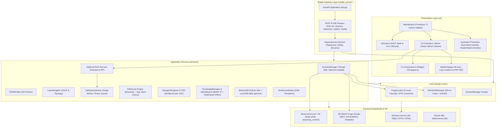
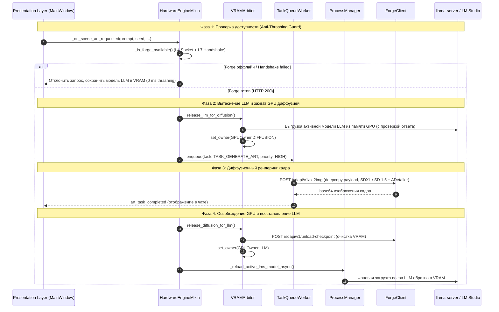
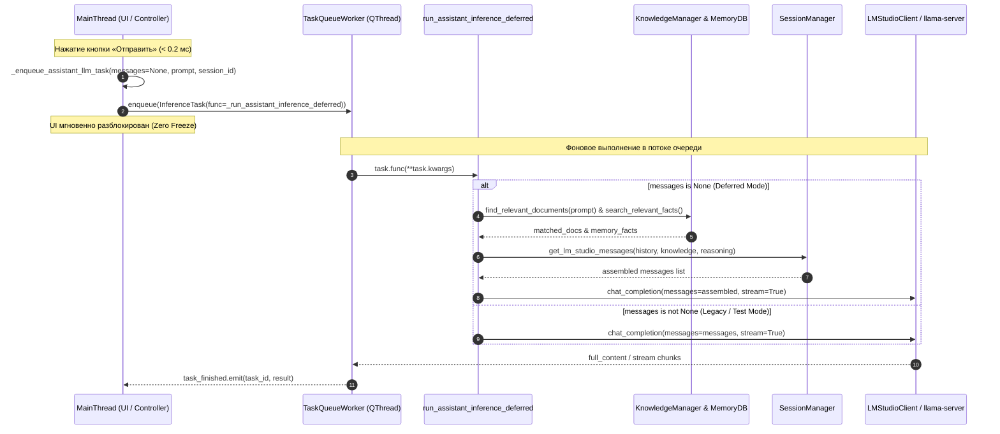
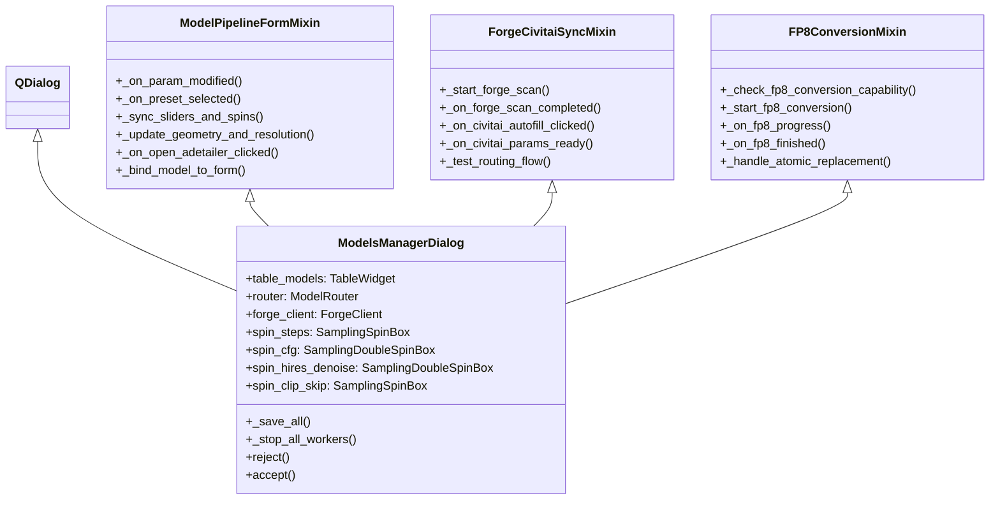
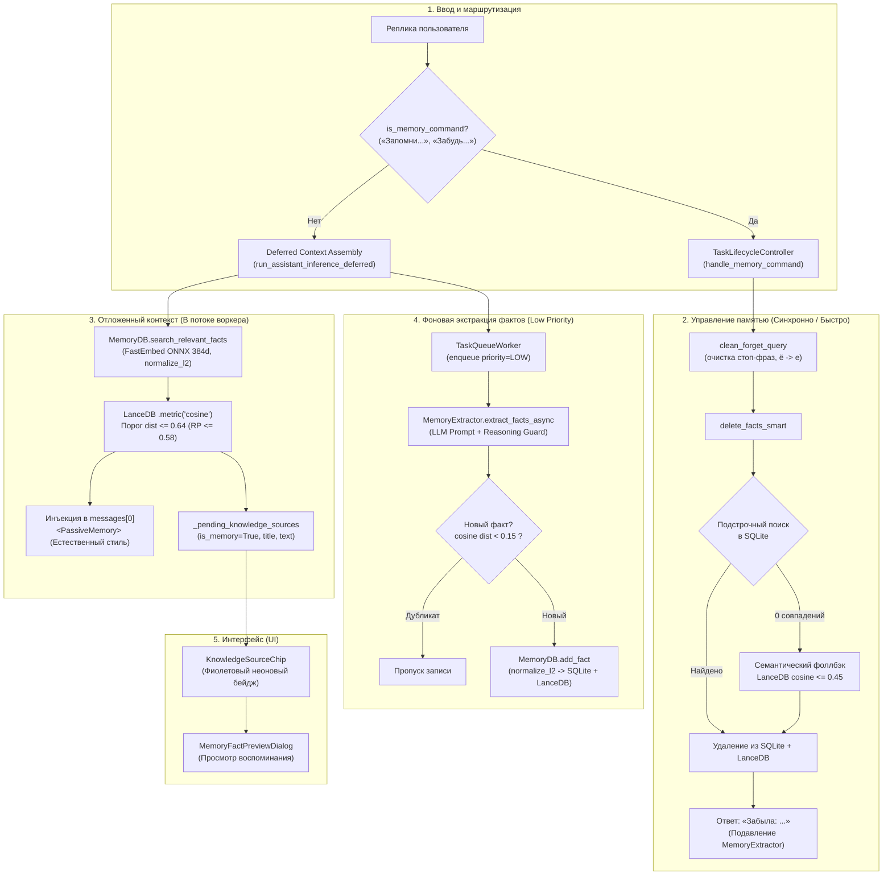
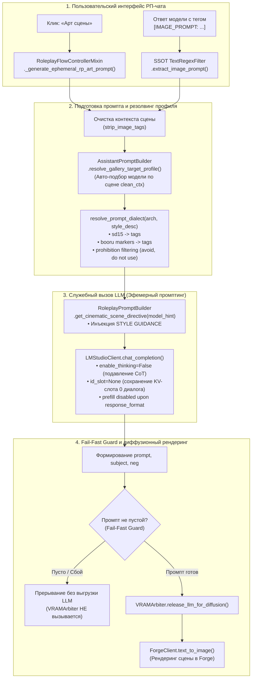

# Техническая спецификация архитектуры NeonRoute

> **Версия системы**: NeonRoute v0.9.8-beta  
> **Целевая платформа**: Windows 10/11 x64, Python 3.10+, PyQt6, QFramelessWindow, QFluentWidgets, FastAPI (Mobile Gateway)  
> **Аппаратный профиль**: 8 ГБ VRAM (NVIDIA GeForce RTX 4060 / RTX 5050 Laptop GPU / 16 ГБ RAM)  
> **Метрики кодовой базы**: 324 файла Python, ~112 500 строк кода  
> **Статус верификации**: 839 тестов собрано и пройдено (100% Pass Rate на полном прогоне `pytest -q`)

---

## Реестр архитектурных решений (Architectural Decision Log / Recent Refactoring Snapshot)

Ниже представлена хронологическая таблица ключевых архитектурных решений и рефакторингов, внедренных в последних коммитах:

| Идентификатор | Коммит(ы) | Затронутые модули | Контекст и проблема | Архитектурное решение и последствия |
| :--- | :--- | :--- | :--- | :--- |
| **ADR-01** | `709075a` | `services/forge_client.py`, `services/lm_studio.py`, `tests/unit/` | 1) Ложное выставление флага `_is_model_unloaded = True` в LM Studio при сбое выгрузки приводило к риску CUDA OOM на 8 ГБ VRAM.<br>2) Мутация словаря параметров запроса по ссылке при каскадных ретраях ADetailer/Hires.<br>3) Блокировка UI-потока до 0.8 с поллером прогресса Forge.<br>4) Недостижимый блок `reload_checkpoint` в `text_to_image`. | 1) Внедрен строгий аудит ответа выгрузки LLM перед переключением арбитра.<br>2) Передача изолированной копии `copy.deepcopy(p)` в `_send_request`.<br>3) Сокращение `join` поллера до 0.05 с с проверкой `is_alive()`.<br>4) Сброс `_checkpoint_unloaded` после проверки `elif`.<br>5) Создание изолированных тестовых сьютов (130 тестов: 50+ Forge, 30+ LM Studio). |
| **ADR-02** | `17d3c15` | `services/lm_studio.py`, `services/thought_stream_parser.py` | Появление моделей рассуждения (DeepSeek-R1), транслирующих рассуждения через стриминговые чанки `delta.reasoning_content` и генерирующих глубокие цепочки мыслей, превышающие буфер 4K/8K токенов. | 1) Нативная поддержка формата SSE-стриминга `reasoning_content` наряду с тегами `<think>`.<br>2) Расширение лимита буфера `ThoughtStreamParser` до 16 384 токенов (16K failsafe buffer) с автоматическим переключением в неоновый спойлер интерфейса. |
| **ADR-03** | `8c1952d`, `a051a6a`, `02a3578` | `ui/components/bubbles/avatar_renderer.py`, `ui/components/chat_header_widget.py`, `ui/components/sidebar_widget.py` | 1) Избыточный брендовый заголовок в боковой панели отнимал вертикальное пространство сессий.<br>2) Грубое кадрирование аватаров без сглаживания краев.<br>3) Плоская визуальная иерархия шапки диалога. | 1) Полная ликвидация брендового хедера в `SidebarWidget` в пользу минималистичного макета.<br>2) Реализация сглаживания краев аватаров (seamless avatar edge feathering) на базе антиалиасинга `QPainterPath`.<br>3) Внедрение кинематографической глубины (elevation depth) в `ChatHeaderWidget`.<br>4) Перевод дефолтных аватаров на векторные символы Fluent Icon. |
| **ADR-04** | `f5a4ffd` | `services/memory_db.py` | Устаревание служебных методов LanceDB `compact_files()` и `cleanup_old_versions()` в новых версиях библиотеки с риском сбоев сжатия таблиц фактов. | Переход на нативный API `table.optimize()` LanceDB с автоматической очисткой фрагментов и вакуумизацией дискового пространства. |
| **ADR-05** | `3fc12f5`, `a5230f4`, `ba4979e` | `services/hybrid_search.py`, `services/knowledge_manager.py`, `tests/unit/test_hybrid_fastembed_rag.py` | 1) Потеря частотности терминов в BM25 из-за бинарного подсчета.<br>2) Отсутствие фильтрации стоп-слов RU/EN.<br>3) Разрыв контекста при фрагментировании смежных чанков.<br>4) Непрозрачность отбора RAG-документов. | 1) Полноценная формула BM25 с учетом term frequency и насыщения.<br>2) Интеграция FastEmbed ONNX с L2-нормализацией векторов.<br>3) Автоматический подбор соседнего чанка (`next_chunk_id`) по порядку следования в документе.<br>4) Внедрение компактного диагностического логирования `[RAG-Trace]` для отслеживания оценок сходства и решений Gatekeeper. |
| **ADR-06** | `841693f` | `services/process_manager.py`, `tests/` | Утечка фоновых daemon-потоков в smoke-тестах и сбои при генерации Qt-сигналов на удаленные C++ объекты `QObject` (`RuntimeError: wrapped C/C++ object has been deleted`). | 1) Изоляция фоновых потоков `ProcessManager` при обнаружении `PYTEST_CURRENT_TEST`.<br>2) Проверка валидности QObject через `sip.isdeleted()` и weakref-гарды перед эмитом сигналов `lms_status_changed` и `forge_status_changed`. |
| **ADR-07** | `f31cc11`, `d62b4bf`, `38e19fb`, `29b5b20`, `7adaf9b` | `services/art_director/director.py`, `services/assistant_prompt_builder.py`, `services/roleplay_prompt_builder.py` | 1) Потеря команд отрицания («без очков», «без оружия») при переходе к мирным/интимным сценам в РП и галерее.<br>2) Анатомическая нестабильность кистей рук в SDXL при средних планах. | 1) Сквозная поддержка флага `--neg <items>` (regex `r'-{1,2}(?:negative|neg)'`) в директивах SD 1.5, SDXL и ролевом футере `_build_footer`.<br>2) Внедрение HAND ANCHOR RULE (обязательная привязка кистей рук к опоре/предметам) и матрицы флагов кадрирования (`--ar square/portrait/wide`).<br>3) Введение Canon Shield для защиты ДНК внешности персонажей. |
| **ADR-08** | `36c2c50`, `2359063` | `ui/main_window.py`, `ui/controllers/chat_flow_controller.py`, `ui/controllers/reminder_controller.py`, `tests/` | Монолитный `MainWindow` (2096 строк) содержал мертвые прокси-методы, смешивал кинематику скролла с логикой бизнес-слоя, а контроллер напоминаний не имел явного жизненного цикла. | 1) Инкапсуляция `ReminderController` с явным методом `cleanup()`.<br>2) Перенос кинетики скролла и логики залипания внизу (`_is_at_bottom`) в `ChatFlowControllerMixin`.<br>3) Удаление избыточных прокси-переопределений (`_on_llm_response_received`, `_on_send_clicked`).<br>4) Формирование базового набора характеризационных тестов `tests/test_main_window_baseline.py` (14 тестов). |
| **ADR-09** | `0142b29` | `ui/controllers/assistant_flow_controller.py`, `services/roleplay_flow_controller.py`, `services/task_queue.py` | Синхронный поиск в RAG и базе памяти в UI-потоке перед отправкой задачи вызывал латентность 15–150 мс (до 2 с на холодном старте). | Переход на отложенную сборку контекста (Deferred Context Assembly Runner): отправка сообщения за $< 0.2$ мс в UI, сборка RAG и памяти внутри фонового потока `TaskQueueWorker`. |
| **ADR-10** | `c6b83a2`, `a9bd983` | `core/forge_locator.py`, `core/win32_job.py`, `services/process_manager.py` | Хардкод путей Forge, конфликты DLL виртуального окружения, зависание процессов-зомби при аварийном выходе. | 1) 5-уровневый каскад локатора с раскрытием NTFS Junctions.<br>2) Изоляция окружения `get_clean_forge_env`.<br>3) Двухфакторная проверка L4 сокет + L7 HTTP handshake.<br>4) Windows Job Object (`JOB_OBJECT_LIMIT_KILL_ON_JOB_CLOSE = 0x2000`).<br>5) Динамический флаг `--always-offload-from-vram` на GPU $\le 8$ ГБ. |
| **ADR-11** | `c86e755` | `ui/main_window.py`, `ui/controllers/session_controller.py`, `ui/controllers/search_controller.py`, `ui/controllers/dialog_controller.py`, `ui/components/chat_list_item.py` | Фасад `MainWindow` содержал 939 строк монолитной логики сессий, разрозненные методы поиска и рудиментарный monkeypatching (`AvatarCropDialog`, `resizeEvent` элементов списка сессий), нарушая SRP. | 1) Полная консолидация сессий (`_load_saved_sessions`, `create_chat`, `_create_new_session`, `_switch_to_session`, прогрессивный рендеринг) в `SessionControllerMixin` (+855 строк).<br>2) Перенос навигации по поиску (`_search_next`, `_search_prev`, `_navigate_search_match`) в `ChatSearchMixin`.<br>3) Перенос модальных вызовов в `DialogControllerMixin`.<br>4) Нативная инкапсуляция усечения заголовка (`ElideRight`) в `ChatSessionItemWidget`.<br>5) Удаление устаревших monkeypatching-заглушек `AvatarCropDialog`.<br>6) Сокращение `MainWindow` с 2007 до 1068 строк (-47%) без создания новых сущностей. |
| **ADR-12** | `HEAD` | `ui/models_manager_dialog.py`, `ui/models_manager/mixins.py`, `ui/models_manager/widgets.py`, `ui/models_manager/workers.py`, `ui/models_manager/__init__.py`, `tests/unit/test_models_manager_dialog.py` | 1) `models_manager_dialog.py` (2569 строк) содержал жестко связанную логику UI-форм рендеринга, сканеров Forge/Civitai, фонового FP8 квантования и потокобезопасности (нарушение SRP).<br>2) Скрытый баг `NameError` в `register_orphaned_worker` при изоляции активных QThread потоков.<br>3) Исчезновение числовых значений параметров напротив слайдеров (шаги, CFG, денойз hires, clip skip) из-за бокового оффсета 80px стандартного `SpinBox` при фиксированной ширине 70px.<br>4) Отсутствие сквозных характеризационных тестов менеджера моделей. | 1) Модульная декомпозиция фасада через 3 контроллер-миксина (`ModelPipelineFormMixin`, `ForgeCivitaiSyncMixin`, `FP8ConversionMixin`) в `ui/models_manager/mixins.py` с сокращением фасада с 2569 до 959 строк (-63%).<br>2) Вынос чистых функций (`MODEL_PRESETS`, нормализаторы, негативы, фабрики ячеек) в `ui/models_manager/widgets.py` и системных утилит проверки Python/Torch в `ui/models_manager/workers.py`.<br>3) Устранение `NameError` через регистратор `register_orphaned_worker()`.<br>4) Перевод счетчиков на `CompactSpinBox` и `CompactDoubleSpinBox` с шириной 82px, чистым белым текстом (`#FFFFFF`), вертикальными стрелками и гардом `wheelEvent: ignore`.<br>5) Внедрение `_DynamicModuleProxy` для 100% совместимости моков `InfoBar` в тестах.<br>6) Разработка сьюта из 10 сквозных тестов (`tests/unit/test_models_manager_dialog.py`). 100% Pass Rate на 393 тестах. |
| **ADR-13** | `HEAD` | `services/hybrid_search.py`, `services/knowledge_manager.py`, `services/document_parser.py`, `services/assistant_prompt_builder.py`, `ui/controllers/assistant_flow_controller.py`, `tests/unit/test_sticky_knowledge_anaphora_e2e.py` | 1) Смешение `Linear Fusion` и `RRF` раздувало слабые одиночные BM25-совпадения через `max_bm25`.<br>2) Несогласованный бюджет сниппета (`8500` vs `2400` в `AssistantPromptBuilder`) обрезал релевантные поздние чанки и оставлял дубли `overlap`.<br>3) Парсеры DOCX/XLSX/CSV не формировали валидные Markdown-таблицы с крайними `\|` и разделителем.<br>4) «Липкие» `active_knowledge_docs` в `run_assistant_inference_deferred` тянули старые документы в несвязанные реплики и small talk, а пустая БД/small talk вызывали холодный старт FastEmbed. | 1) Переход на Weighted Normalized RRF (`k=60`, `w_dense=0.6`, `w_bm25=0.4`, `version=3`) с сохранением Dense-Gate по сырому `s_dense`.<br>2) Context Stitching в `KnowledgeManager` (`MAX_SNIPPET_BUDGET=3600`, согласовано с `max_chars_per_doc=3600`), заполнение 1-шаговых дыр и дедупликация текстового `overlap` и шапок таблиц.<br>3) Унификация таблиц в `DocumentParser.format_markdown_table()`.<br>4) Ранний выход при пустом реестре и холодном small talk до `get_search_engine()`.<br>5) Анафорический гейт `KnowledgeManager.has_document_anaphora()` и сброс `active_knowledge_docs` при смене темы, покрыто сквозным сьютом `test_sticky_knowledge_anaphora_e2e.py` (2 теста). |
| **ADR-14** | `HEAD` | `services/art_director/prompting.py`, `services/art_director/director.py`, `services/assistant_prompt_builder.py`, `services/context_window_builder.py`, `services/roleplay_flow_controller.py`, `ui/controllers/assistant_flow_controller.py`, `mobile_server/routes/chat.py`, `scripts/assistant_prompt_stand.py`, `tests/unit/test_self_portrait_routing.py`, `tests/unit/test_gallery_model_routing_sync.py` | 1) Подстрочный перехват `"себя"` в `_dispatch_art_to_forge` ложно срабатывал на фразах третьего лица («девушка держит себя в руках»), принудительно инжектируя `TargetSubject.ELARIA` и `ELARIA_VISUAL_DNA`.<br>2) Ручной выбор модели Forge в шапке (`selected_forge_checkpoint`) не пробрасывался через `run_assistant_inference_deferred` → `ContextWindowBuilder` → `AssistantPromptBuilder`, из-за чего LLM получала инструкции от другой модели/архитектуры.<br>3) В режиме «Арт-директор (Авто)» заполненное поле `llm_guidance` (Textual Inversion) затирало описание стиля (`routing_description`) для LLM.<br>4) Дублированный разбор флагов `[IMAGE_PROMPT: ...]` и отсутствие CLI-стенда инспекции промптов Ассистента. | 1) Протокольный флаг `--self` в директивах `SD15`/`SDXL`, единый SSOT-парсер `parse_image_prompt_flags()` и строгий синтаксический фоллбэк `detect_elaria_self_portrait_intent()` без ложных срабатываний на `"себя"` (включая `ArtDirector`, RP и `mobile_server`).<br>2) Единый SSOT-резолвер `AssistantPromptBuilder.resolve_gallery_target_profile()`, сквозной проброс `selected_forge_checkpoint` от UI до LLM и гарантированная передача `routing_description` независимо от `llm_guidance`.<br>3) Интерактивный CLI-стенд `scripts/assistant_prompt_stand.py` для проверки системного промпта, скиллов и арт-пайплайна Ассистента.<br>4) Добавлены 10 unit-тестов (`test_self_portrait_routing.py`, `test_gallery_model_routing_sync.py`) и обновлён смоук-ассерт в `test_smoke_assistant_6phases_pipeline.py` (496/496 passed). |
| **ADR-15** | `HEAD` | `services/art_director/vram_policy.py`, `services/art_director/director.py`, `services/forge_client.py`, `services/process_manager.py`, `services/vram_arbiter.py`, `ui/controllers/hardware_engine.py`, `services/model_router.py`, `tests/smoke/test_forge_vram_profiles_smoke.py` | 1) Безусловный `--always-offload-from-vram` при старте Forge на $\le 8$ ГБ VRAM вызывал избыточный PCIe-своп на SD 1.5 и SDXL FP8 с ADetailer.<br>2) `ForgeClient` отслеживал только булев `always_offload` без `inference_memory_mb`, не передавал `unload_models=True` при понижении режима, не включал VAE Tiling перед пиком VAE в SDXL `>= 960x960` + AD, дублировал запросы `override_settings` и ждал фиксированные 3800 МБ свободной VRAM на 2–4 ГБ GPU.<br>3) Небезопасное включение `--pin-shared-memory` и отсутствие защиты при дефиците системной RAM (`<= 6` ГБ RAM или малой свободной ОЗУ).<br>4) Дублирование расчёта ADetailer в `ArtDirector`, повторные выгрузки в `VRAMArbiter` / `ProcessManager` и утечка фоновых таймеров `ModelRouter` из-за сброса `_initialized = False` в `cancel_deferred_warmup()`. | 1) 3-уровневая динамическая политика `resolve_forge_offload_policy()` (`FAST_KEEP_VRAM`, `SMART_SWAP`, `STAGE_OFFLOAD`), оценка весов на диске (`resolve_checkpoint_file_size_mb`, `estimate_active_model_weights_mb`), кэш топологии GPU (TTL 5.0 с) и лог `[VRAM-Planner]`.<br>2) `resolve_forge_startup_flags()` с RAM-гардом `should_enable_pin_shared_memory()` (`--always-offload-from-vram` на старте только при `VRAM < 6.0` ГБ).<br>3) В `ForgeClient`: синхронизация пары `(always_offload, inference_memory_mb)` через `/sdapi/v1/free-vram`, принудительный `unload_models=True` в `STAGE_OFFLOAD`, авто-VAE Tiling (`forge_vae_tiling`, `sd_vae_tile`, `"Never OOM Integrated"` через `/sdapi/v1/scripts`), `Host RAM Starvation Guard` (`fp8e4`, отключение Hires и второго слота ADetailer), адаптивный порог `_wait_for_vram_clear()` и дедупликация `set_model`/`txt2img`.<br>4) Единый `_resolve_adetailer_pipeline()` + `_log_vram_planner_passport()` в `ArtDirector`; идемпотентные выгрузки в `VRAMArbiter`, `ProcessManager` и `HardwareEngineMixin`.<br>5) В `ModelRouter`: `_cancel_deferred_timer()`, `reset_instance()` и подавление фонового прогрева при `PYTEST_CURRENT_TEST`; добавлен сьют `test_forge_vram_profiles_smoke.py` (15 тестов) — 545/545 passed. |
| **ADR-16** | `HEAD` | `services/art_director/plan.py`, `services/art_director/director.py`, `services/assistant_prompt_builder.py`, `ui/models_manager/adetailer_dialog.py`, `tests/smoke/test_adetailer_prompt_passthrough_smoke.py`, `tests/unit/test_adetailer_dialog.py`, `tests/test_gallery_directives_pipeline.py` | 1) В `GenerationPlan.to_forge_kwargs()` отсутствовали флаги `ad_use_inpaint_width_height` / `ad_use_cfg_scale`, из-за чего Forge игнорировал окна `768x768`/`512x512` и растягивал кроп до полного холста.<br>2) Скрытые/захардкоженные промпты слотов ADetailer (`canon.ad_prompt`, `canon.ad_negative`, `detailed hand, realistic fingers...`, `woman, girl, body...`) перекрывали основной промпт сцены и «Базовый негативный промпт» модели.<br>3) Тег `cowboy shot` в SDXL-директиве провоцировал артефактные ковбойские шляпы, а отсутствие правила `HAND ANCHOR` оставляло руки висящими вдоль тела. | 1) В `GenerationPlan.to_forge_kwargs()` и `ArtDirector` удалены скрытые подмены промптов слотов: оба слота ADetailer (`face_slot` и `hand_slot`) получают строго `ad_prompt = self.prompt` и `ad_negative_prompt = self.negative_prompt` для SD 1.5 и SDXL; выставлены `ad_use_inpaint_width_height=True`, `ad_use_steps=False` (нативное число шагов `p.steps` модели) и `ad_use_cfg_scale=False`; в `ArtDirector` добавлен `_format_adetailer_log_blocks()`.<br>2) Из `ADetailerSettingsDialog` удалены поля ввода промптов рук (оставлены только технические параметры детектора/инпейнта) и добавлен `get_settings()` с обратной совместимостью со старыми JSON.<br>3) В `GALLERY_SKILL_DIRECTIVE_SDXL_TEMPLATE` тег `cowboy shot` заменён на `thigh-up portrait, medium shot` после субъекта и позы; в SDXL и SD 1.5 директивы закреплено правило `HAND ANCHOR`.<br>4) Добавлен смоук-сьют `test_adetailer_prompt_passthrough_smoke.py` (2 теста) и обновлены `test_adetailer_dialog.py`, `test_gallery_directives_pipeline.py` — `548/548 passed`. |
| **ADR-17** | `HEAD` | `services/art_director/geometry.py`, `services/art_director/director.py`, `tests/unit/test_art_director_geometry_resolution.py` | 1) Эвристика `has_human` в `director.py` при явном флаге `--ar wide` переключала кадр в `scenery` (1216x832, `force_ad=False`), если персонаж описывался нестандартными токенами (`samurai`, `cyborg`, `knight`, `Mr. Freeze`, `monster`).<br>2) В `geometry.py` в бакетах `scenery` и `cinematic` флаг `force_ad: False` отключал ADetailer под капотом, смешивая геометрию кадра с управлением плагином детекции лиц.<br>3) В `detect_scene_archetype` бытовые слова (`standing`, `boots`, `dress`) ложно переключали портретные сцены в узкий `fullbody`.<br>4) При отсутствии флага `--ar` ветка `else:` в `director.py` затирала результат детекции (`closeup`, `scenery`, `fullbody`, `cinematic`) безусловным `"solo"`.<br>5) При несовпадении архитектуры профиля роутера и целевого чекпоинта SDXL происходило занижение геометрии до SD 1.5. | 1) Прямой детерминированный маппинг явного флага `--ar`: `portrait` -> `"solo"` (896x1152 / 512x768), `wide` -> строго `"pair"` (1152x896 / 768x512), `square` -> `"closeup"` (1024x1024 / 512x512), `fullbody` -> `"fullbody"` (832x1216 / 448x768), `cinematic` -> `"cinematic"` (1344x768 / 768x448), `scenery` -> `"scenery"` (1216x832 / 768x512), без эвристики `has_human`.<br>2) Полное отвязывание ADetailer от геометрии: `force_ad: True` во всех бакетах SD 1.5 и SDXL; активность ADetailer регулируется исключительно настройками профиля модели и тумблерами пользователя в UI.<br>3) Очистка `fullbody_markers` в `geometry.py` до явных маркеров (`"full body"`, `"full-body"`, `"full length"`, `"head to toe"`).<br>4) Сохранение распознанного архетипа в ветке `else:` при отсутствии явного `--ar`.<br>5) Автоматическая синхронизация архитектуры `model_target` при выборе SDXL-чекпоинта.<br>6) Создан юнит-сьют `tests/unit/test_art_director_geometry_resolution.py` (5 тестов) — 553/553 passed. |
| **ADR-18** | `HEAD` | `config.py`, `ui/components/bubbles/avatar_renderer.py`, `ui/components/bubbles/workspace_cards.py`, `ui/controllers/avatar_controller.py`, `mobile_server/routes/media.py`, `tests/unit/test_default_avatars.py` | 1) По умолчанию во всех 3 режимах отображались векторные пиктограммы FluentIcon (`ROBOT`, `DEVELOPER_TOOLS`, `GAME`) на плоских цветных градиентах без индивидуального визуального стиля.<br>2) Отсутствовали централизованные пути к дефолтным аватарам в `config.py`.<br>3) Риск падения FPS при парсинге тяжелых JPG при скролле баблов и сессий.<br>4) Циклический импорт `workspace_cards.py` $\leftrightarrow$ `chat_bubble.py`. | 1) Регистрация SSOT путей в `config.py` (`DEFAULT_ASSISTANT_AVATAR = avatars/assistant.jpg`, `DEFAULT_ENGINEER_AVATAR = avatars/engenier.jpg`, `DEFAULT_ROLEPLAY_AVATAR = avatars/RP_chat.jpg`).<br>2) В `avatar_renderer.py`: бесшовный маппинг режимов/имен на арт-файлы с органичным вписыванием в круг, центрированным кропом и альфа-маской `Seamless Edge Feathering`.<br>3) Потокобезопасный `QImage`-кэш `_DEFAULT_AVATAR_IMAGE_CACHE` для мгновенного рендера (60 FPS) с защитой от GDI-конфликтов.<br>4) Сохранение 100% сопутствующей механики (смена аватара в сессии, кроп-диалог, карточки, сброс к дефолту, фоллбэк на векторные иконки).<br>5) Устранение циклического импорта в `workspace_cards.py` через ленивое разрешение `_get_selectable_text_browser()`.<br>6) Добавлен тестовый сьют `tests/unit/test_default_avatars.py` (4 теста). |
| **ADR-19** | `HEAD` | `config.py`, `utils/config_manager.py`, `ui/dialogs/llm_engine_settings_dialog.py`, `services/assistant_flow.py`, `ui/controllers/assistant_flow_controller.py`, `ui/controllers/chat_flow_controller.py`, `services/roleplay_flow_controller.py`, `services/lm_studio.py`, `services/thought_stream_parser.py`, `tests/` | 1) Гибридные модели рассуждений (Qwen 3.5, Gemma 4, DeepSeek-R1, QwQ) по умолчанию тратят лишние токены и время на генерацию цепочек `<think>` в диалогах, RP и при переводе промптов SDXL.<br>2) Отсутствовал единый переключатель режима рассуждений в UI «Настроек движка LLM» и возможность менять режим без рестарта `llama-server`.<br>3) Скилл генерации арт-промптов (`gallery`) страдал от галлюцинаций и потери синтаксиса директив при высокой температуре (0.7-0.8) и включённом `thinking`.<br>4) При программном подавлении мыслей через assistant prefill (`<think>\n\n</think>\n\n`) модель продолжала ответ одиночным закрывающим тегом `</think>`, который мог загрязнять UI-стрим и историю диалога. | 1) Добавлен ключ `"thinking_mode": "auto"` (`"auto"`, `"on"`, `"off"`) в `DEFAULT_SETTINGS` и константы `DEFAULT_THINKING_MODE`, `THINKING_MODEL_KEYWORDS` в `config.py`.<br>2) В `LLMEngineSettingsDialog` внедрена карточка «Режим размышлений (Thinking)» с `SegmentedWidget` и реактивной подсказкой; сохранение `thinking_mode` не инициирует рестарт `llama-server` (рестарт только при смене KV-квантования или Flash Attention).<br>3) Реализован SSOT-резолвер `resolve_effective_thinking(mode, model_name, active_skill, explicit_override)`: в `"auto"` рассуждения активны только в режиме Инженера, отключены в Ассистенте, RP и принудительно выключены для скилла `gallery`; сквозной проброс `enable_thinking` в `llm_kwargs` всех контроллеров.<br>4) Внедрён строгий per-request override в памяти для SDXL-генератора (`gallery`): `temperature=0.4` и `enable_thinking=False` без мутации глобального `config.json` и `MODE_PROFILES`.<br>5) В `LMStudioClient`: передача `chat_template_kwargs={"enable_thinking": enable_thinking}` и инъекция assistant prefill `<think>\n\n</think>\n\n` на иммутабельной копии `req_messages` при подавлении рассуждений у думающих моделей.<br>6) В `ThoughtStreamParser` внедрён фильтр одиночного стартового тега `</think>` в `NORMAL_TEXT`, а в `HistorySanitizer` — очистка пустых блоков `<think>\s*</think>` и висячих закрывающих тегов.<br>7) Покрыто юнит-сьютами (68 тестов в целевых модулях, 562 теста суммарно). |
| **ADR-20** | `HEAD` | `mobile_server/services/chat_service.py`, `services/assistant_flow.py`, `mobile_server/routes/media.py`, `tests/` | 1) Мобильный сервер (`chat_service.py`) игнорировал глобальный `thinking_mode` из `config.json` и не передавал `enable_thinking` в `lm_client.stream_chat_completion`, из-за чего думающие модели (Qwen 3.5, Gemma 4, DeepSeek-R1) при запросах с телефона тратили токены на рассуждения во всех режимах.<br>2) При срабатывании скилла `gallery` в мобильном чате температура оставалась завышенной (0.8), а в Фазе 2 (`build_gallery_art_plan`) `enable_thinking=False` не передавался в `chat_completion`.<br>3) Эндпоинт аватаров сессий `/media/avatar/{id}` возвращал `HTTP 200` вместо `304 Not Modified` при проверке ETag на дефолтных файловых аватарах. | 1) Подключение единого резолвера `resolve_effective_thinking` и `THINKING_MODEL_KEYWORDS` в `build_chat_context_and_params` с трансляцией `enable_thinking` в `sampling_params` мобильного SSE-потока.<br>2) Внедрение в мобильном чате per-request override для скилла `gallery` (`temperature=0.4`, `enable_thinking=False`) без мутации `config.json` и `MODE_PROFILES`.<br>3) Гарантированная передача `enable_thinking=False` в `lm_client.chat_completion` внутри `build_gallery_art_plan` (Фаза 2 генерации тегов SDXL).<br>4) Реализация хелпера `_file_response(request, path)` с поддержкой `If-None-Match` и статуса `304 Not Modified` в `mobile_server/routes/media.py`.<br>5) Добавлены 4 теста в `tests/test_chat.py`, `tests/unit/test_assistant_flow.py`, `tests/test_mobile_server_gateway.py` (566 тестов суммарно, 100% Pass Rate). |
| **ADR-21** | `HEAD` | `services/art_director/geometry.py`, `services/art_director/director.py`, `services/assistant_prompt_builder.py`, `services/roleplay_prompt_builder.py`, `services/skill_router.py`, `tests/test_gallery_directives_pipeline.py` | 1) Отсутствие поддержки ультраширокого формата 21:9 (`ultrawide`) в `ArtDirector` ограничивало кинематографические панорамы.<br>2) Скилл `gallery` был жестко привязан к моделям SD 1.5 / SDXL без универсальной адаптации под выбранный чекпоинт, а директивам не хватало структурирования по камере, ракурсам и направленному свету.<br>3) Тег плана кадрирования `cowboy shot` в промптах реалистичных моделей провоцировал появление нежелательных артефактов в виде ковбойских шляп. | 1) Добавлен бакет `ultrawide` (21:9): `1536x640` для SDXL и `768x320` для SD 1.5 в `geometry.py` и `ArtDirector`.<br>2) Внедрён универсальный скилл `cinematic` с динамической интерполяцией `{target_model_id}` и `{model_hint}`, дефолтным `--ar cinematic` (16:9) и поддержкой `--ar ultrawide` (21:9).<br>3) Структурированы шаблоны директив `GALLERY_SKILL_DIRECTIVE_*` и `CINEMATIC_SKILL_DIRECTIVE_*` с секциями `###`, приоритетом камеры, направленного света и сбалансированными примерами.<br>4) Токен `cowboy shot` повсеместно заменён на нейтральный аналог `thigh-up shot`, исключающий ложные шляпы. |
| **ADR-22** | `HEAD` | `services/session_manager.py`, `ui/controllers/assistant_flow_controller.py`, `mobile_server/services/chat_service.py`, `services/context_window_builder.py` | При попытке пользователя отредактировать сгенерированное изображение («то же самое, но ночью», «сделай в полный рост», «убери очки») ассистент терял контекст предыдущей генерации, так как сырой `[IMAGE_PROMPT: ...]` отсекался из истории диалога или не передавался на следующий ход. | 1) Сохранение полного ответа ассистента с `[IMAGE_PROMPT: ...]` в истории сообщений сессии (`chat_history`, `session.json`) в десктопном и мобильном сервере.<br>2) При сборке контекста следующего хода (`ContextWindowBuilder`) предыдущий арт-промпт передается модели как часть истории, обеспечивая связное редактирование и семантическую непрерывность визуальных инструкций без загрязнения временных инъекций скиллов. |
| **ADR-23** | `HEAD` | `services/art_director/vram_policy.py`, `services/art_director/director.py`, `services/art_director/__init__.py`, `tests/unit/test_forge_vram_policy.py`, `tests/smoke/test_art_pipeline_smoke.py` | 1) На SD 1.5 принудительный VAE Tiling в `float16` вызывал `RuntimeWarning: invalid value encountered in cast` (NaN) и приводил к сохранению черных PNG (~4.8 КБ).<br>2) Эвристические константы `K_ARCH_SD15` / `K_ARCH_SDXL` создавали бинарный гейт Hires.fix, конфликтовавший с реальным планировщиком памяти `resolve_forge_offload_policy`, необоснованно блокируя Hires.fix для SD 1.5 или широких форматов (16:9, 21:9).<br>3) Шаги второго прохода Hires.fix (`hr_second_pass_steps`) были захардкожены на `14` / `15`, раздувая время генерации на быстрых 6–8 шаговых моделях (Lightning/Turbo/DMD). | 1) Добавлен CLI-флаг `"--no-half-vae"` в базовый список флагов запуска Forge; порог VAE Tiling для SD 1.5 поднят до $> 1.3\text{M}$ px (отключен для типовых портретов $\le 1.3\text{M}$ px, напр. 704x1088).<br>2) Разработана точная обратная формула пикового бюджета VRAM в `calculate_max_hires_canvas_area`: $\text{free\_for\_hr\_mb} = \text{target\_budget\_mb} - (\text{total\_weights} + \text{base\_canvas} + \text{upscaler} + \text{ad\_stage})$, $\text{max\_area} = \mathrm{int}((\text{free\_for\_hr\_mb} / \text{cost\_per\_mpix}) \times 10^6)$, устранив хардкод `K_ARCH` и вынеся константы стоимости пикселей холста/Hires и VAE tiling factor (0.65).<br>3) Функция `resolve_safe_hires_scale` адаптивно подбирает безопасный масштаб Hires.fix: для SD 1.5 запросы 1.5x и 2.0x больше не срезаются, для SDXL FP8 на 8 ГБ масштаб 1.50x безопасно поджимается до 1.25x в режиме `SMART_SWAP`; fallback апскейлера для SDXL — `"Latent"`.<br>4) Внедрена адаптивная функция `resolve_hires_second_pass_steps(base_steps, denoising_strength, configured_steps)`: для моделей $\le 10$ шагов масштаб шагов Hires равен $\max(4, \min(10, \text{base\_steps}))$, для стандартных моделей вычисляется от $0.60 \times \text{base\_steps}$ со страховкой по силе денойза.<br>5) Единый диагностический паспорт `[RESOLUTION]` и `[Forge VRAM Policy Diagnostic Passport]` в логах `ArtDirector`. |
| **ADR-24** | `HEAD` | `services/layer_budgeter.py`, `services/process_manager.py`, `services/forge_client.py`, `services/vram_arbiter.py`, `ui/controllers/hardware_engine.py`, `services/lm_studio.py`, `ui/controllers/assistant_flow_controller.py`, `mobile_server/services/chat_service.py`, `services/context_window_builder.py`, `services/session_manager.py`, `tests/smoke/test_layer_budgeter_profiles_smoke.py`, `tests/unit/test_thinking_tokens_and_anti_loop.py` | 1) Падение производительности инференса с 28 tok/s до 4.2 tok/s при плотной аллокации VRAM (>95%, Gemma 4 12B Q4_K_M при CTX=14336 на 8 ГБ GPU) из-за сброса CUDA-буферов в Shared System RAM драйвером WDDM при свободном остатке $< 250$ МБ.<br>2) Неучёт динамического фона ОС/других процессов и буферов вычислений Compute/Logits для моделей с гигантским словарем (`vocab_size >= 200 000`).<br>3) Переполнение 64 КБ буфера GGUF-парсера массивом `tokenizer.ggml.tokens` (262K токенов) с обнулением `vocab_size`.<br>4) Залипание гистерезиса (`can_apply_hysteresis`) при дефиците памяти и «зомби-NGL» в `ProcessManager` после падения/выгрузки сервера.<br>5) Удержание Forge residual CUDA-памяти (~443–684 МБ) и наложение старта LLM с падением в Host RAM.<br>6) Искусственный потолок в 2048 токенов для думающих моделей в Desktop и Mobile BFF. | 1) В `LayerBudgeter`: калибровка запаса WDDM `safety_res = 280 МБ` (вместо 150 МБ) при `is_arbiter_managed=True`, учёт динамического фона `effective_os_reserve = max(os_reserve_mb, ceil(used_vram))` через опрос NVML (`get_current_used_vram_mb`) и буферов вычислений `compute_mb = (150/220) + (60 if vocab_size >= 200000 else 0)`.<br>2) Для Gemma 4 12B CTX=14336 на 8 ГБ GPU: автоматический расчёт `NGL = 47` (остаток 388 МБ, защита от WDDM paging), а при CTX=8192 — полный оффлоад `NGL = 99`.<br>3) Физический предохранитель гистерезиса: блокировка сохранения `current_running_ngl`, если блок-бюджет меньше запроса или при нехватке памяти под полный оффлоад.<br>4) Ликвидация «зомби-NGL»: гарантированный сброс `_current_running_ngl = None` и `_current_total_layers = None` при выгрузке/убийстве инстанса, проверка `was_running` при перезапуске.<br>5) VRAM-барьер перехода Forge $\rightarrow$ LLM: `release_diffusion_for_llm(force=True)` с обходом флага `_checkpoint_unloaded` и ожиданием стабилизации памяти `_wait_for_vram_stabilization()` (порог 750 МБ или $\Delta < 15$ МБ).<br>6) Восстановление бинарного парсера GGUF: фиксация длины массива токенов до чтения строковых элементов (`metadata[f"{key}.count"] = int(arr_len)`) и авто-инвалидация `models_cache.json` при отсутствии `vocab_size`.<br>7) Прозрачный лог `LMStudioClient`: отображение фактического `effective_ngl` в формате `GPU layers: 45/48` или `99 (all layers)` в строгом соответствии с паспортом `LayerBudgeter`.<br>8) Снятие лимита 2048 токенов: расширение дефолтного потолка ответа для думающих моделей (`THINKING_MODEL_KEYWORDS`) до `MASTER_MAX_RESPONSE_TOKENS` (4096 токенов) в Desktop и Mobile Gateway, сохранение ручных настроек пользователя, защита Sliding CoT от пустых мыслей и потоковый Anti-Loop детектор повторов.<br>9) Разработан смоук-сьют `test_layer_budgeter_profiles_smoke.py` (18 тестов) на 4 профилях GPU (2/4/8/16 ГБ) — 615/615 passed. |
| **ADR-25** | `eb8b2e2`, `1b7cc79`, `619c3e4` | `services/memory_db.py`, `services/memory_extractor.py`, `services/assistant_flow.py`, `services/assistant_prompt_builder.py`, `services/context_window_builder.py`, `ui/controllers/task_lifecycle_controller.py`, `ui/components/bubbles/chat_message_widget.py`, `ui/components/bubbles/knowledge_hud_widget.py`, `ui/controllers/chat_flow_controller.py`, `ui/main_window.py`, `config.json`, `tests/unit/` | 1) Поиск в `MemoryDB` молча не возвращал факты в десктопном цикле (`Deferred RAG`), так как прогрев эмбеддера в `KnowledgeManager` кэшировал `_EMBED_MODEL`, минуя инициализацию таблиц LanceDB (`_LANCE_TABLE is None`).<br>2) Несоответствие метрик в LanceDB: дефолтная евклидова $L_2$ дистанция сравнивалась с косинусным порогом ($0.64$), пропуская ненормализованные векторы.<br>3) Удаление фактов `delete_fact` падало на строках с апострофами и кавычками (`Syntax error in predicate`).<br>4) Команда «Забудь...» требовала строгого подстрочного совпадения и спотыкалась о речевые префиксы («о том, что», «про», букву «ё»).<br>5) Фоновый `MemoryExtractor` пытался извлекать факты из реплик управления памятью («Запомни...», «Забудь...») и отменялся при вводе следующего сообщения из-за `abort_tasks_by_type("all")`.<br>6) В UI отсутствовал визуальный индикатор срабатывания памяти в бабле ответа.<br>7) Жесткая директива `<PassiveMemory>` блокировала использование фактов вне прямых вопросов о них. | 1) Раздельная, независимая ленивая инициализация `_init_lance_tables()` и `_get_embedding_engine()` с гарантией создания таблиц в любом порядке обращений.<br>2) Сквозная $L_2$-нормализация векторов (`normalize_l2`) при записи и поиске, переход на нативный `.metric("cosine")` в LanceDB (порог 0.64 для Ассистента, 0.58 для RP, дедупликация при distance < 0.15).<br>3) Безопасная параметризация SQL/LanceDB предикатов через экранирование кавычек и транзакционный контекст-менеджер `_get_connection()`.<br>4) Умное удаление `delete_facts_smart`: очистка префиксов (`clean_forget_query`, `ё -> е`), точный поиск + семантический фоллбэк (`max_distance=0.45`), возвращающий точные формулировки удаленных фактов.<br>5) Подавление `MemoryExtractor` на управляющих репликах (`is_memory_command`) и очистка системных подтверждений («Запомнила...», «Забыла...») из контекста диалога.<br>6) Защита фоновых задач памяти в `TaskQueueWorker`: `abort_tasks_by_type(exclude_types={"memory_extraction", "memory_sync"})` при новом вводе пользователя.<br>7) Фиолетовый HUD-чип источника памяти в бабле чата (`is_memory: True`, `rgba(168, 85, 247, 0.35)`, `#C084FC`) со всплывающим окном полного текста воспоминаний.<br>8) Естественная директива `<PassiveMemory>`: факты используются гармонично и ненавязчиво в релевантном контексте.<br>9) Разработаны 4 unit-сьюта (19 тестов), суммарный объем тестов увеличен до 638 (100% Pass Rate). |
| **ADR-26** | `HEAD` | `services/layer_budgeter.py`, `services/process_manager.py`, `scripts/audit_layer_budgeter.py`, `tests/smoke/test_layer_budgeter_profiles_smoke.py` | 1) При возврате LLM в VRAM после генерации в SD Forge и сброса чекпоинта `LayerBudgeter` срезал оффлоад с 48 до 45 слоёв (`NGL=45`) для `gemma-4-12b-it-uncensored-Q4_K_S.gguf` на 8 ГБ GPU, снижая скорость генерации с 28.5–29 tok/s до 18.2 tok/s, хотя при инференсе фактически оставалось 781 МБ свободной VRAM.<br>2) Двойной налог на VRAM: штраф `frag_margin = 180 МБ` начислялся поверх выросшего до 590.5 МБ фона ОС/CUDA-контекста процесса Forge (`effective_os_reserve = 591 МБ` вместо базовых 246 МБ), суммарно изымая 525 МБ.<br>3) Завышенный базовый буфер `safety_res = 280 МБ` в монопольном режиме `is_arbiter_managed=True`, где буферы KV и Compute (676 МБ) уже превышали фактический оверхед NVML (618 МБ).<br>4) Обнуление `_current_running_ngl` при диффузионной выгрузке, из-за чего гистерезис отключался, а при значении 99 дельта `\|45 - 99\| = 54` превышала лимит `HYSTERESIS_LAYER_DELTA = 3`.<br>5) Риск утечки NGL старой модели при переключении чекпоинта пользователем после диффузии. | 1) Динамический `frag_margin` в `ProcessManager`: штраф 180 МБ начисляется только если `current_used_vram <= 400.0 МБ` (когда NVML ещё не зафиксировал остаточный след Forge); при `used_vram > 400.0 МБ` след уже учтён в `effective_os_reserve`, поэтому `frag_margin = 0 МБ`.<br>2) Калибровка `safety_res = 170 + frag_margin` в `LayerBudgeter` при `is_arbiter_managed=True`: устранила искусственный дефицит в 274.5 МБ и обеспечила честный оффлоад `NGL = 99 (48/48 слоев)` с положительным запасом блоков $+15.35$ МБ и фактическим остатком ~446 МБ Free VRAM.<br>3) Сохранение правила `base_overhead_mb = 0.20`: эвристика 20% сохранена для гарантии безопасности моделей без weight-tying (Qwen, Llama).<br>4) Нормализация NGL в гистерезисе через `min(ngl, total_layers)` с сохранением строгого физического правила `available_for_blocks_mb >= blocks_weight_mb` (без ослабления допуска дефицита).<br>5) В `ProcessManager`: сохранение `_evicted_for_forge_ngl` и `_evicted_for_forge_model` при `for_forge_eviction=True` с нормализацией до `total_layers` и валидацией совпадения модели при перезапуске (сброс в `None` при смене модели).<br>6) Создан CLI-стенд `scripts/audit_layer_budgeter.py` для аудита формулы и сценариев до/после патча; тестовая база расширена до 653 тестов (100% Pass Rate). |
| **ADR-27** | `HEAD` | `build_release.bat`, `install.bat`, `README.md`, `requirements.txt`, `config.py`, `core/forge_locator.py`, `scripts/build_release.py`, `tests/smoke/test_clean_pc_startup_smoke.py` | 1) Vendored-папка `PyQt-Fluent-Widgets/` в корне (200.47 МБ, 396 файлов) не использовалась кодом (импорты шли из pip-пакета `qfluentwidgets`), раздувая репозиторий.<br>2) Неполнота `requirements.txt`: отсутствовали 9 транзитивных/ранее не зафиксированных библиотек (`python-multipart`, `scipy`, `docx2txt`, `openpyxl`, `python-pptx`, `jinja2`, `huggingface-hub`, `fastapi`, `starlette`), что приводило к сбоям на чистой системе.<br>3) Хардкод путей `C:\neyroGPD` в `core/forge_locator.py` и навязчивый модальный диалог `prompt_locate_forge()` при старте блокировал пользователя на ПК без установленного Forge.<br>4) Отсутствие единого релизного конвейера, автоматического аудита зависимостей и скрипта безопасного развертывания. | 1) Полное удаление vendored-каталога `PyQt-Fluent-Widgets/` (-200.47 МБ, 0 сломанных импортов) и очистка артефактов/кэшей (`contacts.db`, `dummy.json`, `htmlcov/`, `.coverage`).<br>2) Актуализация `requirements.txt` (+9 пакетов) и разработка надежного `install.bat` с плоским каскадным поиском Python 3.10+ (`py -3.12`..`py -3.10`, `python`) и поддержкой оффлайн-установки из каталога `wheels\`.<br>3) Устранение хардкода Forge: очистка `C:\neyroGPD` из дефолтных путей `core/forge_locator.py`, отключение авто-попапа `prompt_locate_forge()` при старте с мягким фоллбэком на чисто текстовый режим (LLM-only).<br>4) Централизация версии `APP_VERSION = "0.9.8-beta"`, создание `build_release.bat` и конвейера `scripts/build_release.py`: Stage A (AST-аудит импортов на соответствие `requirements.txt`), Stage B (Quality Gate `pytest -q`), Stage C (сборка стерильного дистрибутива в `dist/NeonRoute_v0.9.8-beta.zip`).<br>5) Написание пользовательской документации `README.md` и создание смоук-теста `tests/smoke/test_clean_pc_startup_smoke.py`. |
| **ADR-28** | `HEAD` | `ui/common/toast_helper.py`, `ui/dialogs/forge_settings_dialog.py`, `ui/builders/menu_builder.py`, `ui/dialogs/settings_dialog.py`, `ui/dialogs/__init__.py`, `services/forge_patcher.py`, `scripts/patch_forge.py`, `scripts/forge_neonroute.patch`, `services/forge_client.py`, `services/process_manager.py`, `ui/controllers/hardware_engine.py`, `tests/unit/test_toast_helper.py`, `tests/unit/test_forge_patcher.py`, `tests/smoke/test_forge_settings_dialog_smoke.py`, `tests/unit/test_forge_client.py` | 1) Фрагментация всплывающих уведомлений `InfoBar`: несогласованное позиционирование (BOTTOM, TOP, TOP_RIGHT), произвольные таймауты и риск падения при `parent=None`.<br>2) Отсутствие в GUI специализированного окна настройки параметров Forge (расположение, лаунчер, FP8, режим генерации артов) по эталону `LLMEngineSettingsDialog`.<br>3) Несовместимость стокового SD WebUI Forge 2.0 на чужих ПК: отсутствие роута `/sdapi/v1/free-vram`, блокировки весов в VRAM при смене моделей на лету, падение Pydantic-схемы `SDModelItem.config` и затирание CLI-аргументов `ProcessManager` в стоковом `webui-user.bat`.<br>4) Модальный спам при старте с предложением патчинга и отсутствие механизма безопасного бэкапа оригиналов с откатом. | 1) Разработка централизованного хелпера `ui/common/toast_helper.py` (`show_toast`, `toast_info`, `toast_success`, `toast_warning`, `toast_error`): дефолтная позиция `TOP_RIGHT`, стандартная матрица таймаутов (2500–5500 мс), фоллбэк на `activeWindow()`, перевод контроллеров и диалогов.<br>2) Создание `ForgeSettingsDialog` (`ui/dialogs/forge_settings_dialog.py`) с ленивой загрузкой в `ui/dialogs/__init__.py`, интеграция пункта «SD Forge...» в меню «Параметры и настройки → Система» и вкладку «Движки».<br>3) Разработка эталонного сервиса патчинга `services/forge_patcher.py` + CLI `scripts/patch_forge.py` + `scripts/forge_neonroute.patch`: автоматический бэкап оригиналов в `.neonroute_backup/original/` без перезаписи, применение 4 правок совместимости Forge 2.0, адаптация `webui-user.bat` под CLI-флаги `%*` и `--api` с сохранением пользовательских настроек, безопасный откат `restore_backup`.<br>4) Интеграция в `HardwareEngineMixin`: умный диалог предложения патча строго при явном запуске Forge (с чекбоксом «Больше не предлагать» и плашкой `toast_info` при отказе); двойная передача `COMMANDLINE_ARGS` и CLI-флагов в `ProcessManager`; мягкая деградация `HTTP 404` в `ForgeClient.free_vram()` с отключением повторного спама.<br>5) Созданы тестовые сьюты `test_toast_helper.py`, `test_forge_patcher.py`, `test_forge_settings_dialog_smoke.py` и тест 404-фоллбэка. База расширена до 668 тестов (100% Pass Rate). |
| **ADR-29** | `HEAD` | `scripts/build_release.py`, `install.bat`, `run.bat`, `run_debug.bat`, `run_llama_server.bat`, `core/forge_locator.py`, `utils/file_utils.py`, `config.py`, `services/sandbox_manager.py`, `services/environment_doctor.py`, `services/workspace_launcher.py`, `ui/models_manager/workers.py`, `README.md`, `tests/unit/test_forge_locator.py`, `tests/smoke/test_release_pipeline_smoke.py` | 1) Зависимость релизной сборки от предустановленного пользователем системного Python в PATH создавала высокий порог входа и приводила к сбоям при конфликтах версий (3.12+, x86 вместо x64).<br>2) При запуске через встроенный Python каталог `runtime\python\` мог протекать в PATH дочернего процесса Forge, вызывая смешение DLL и пакетов со встроенным `system\python\` Forge.<br>3) Запуск через `pythonw.exe` приводил к молчаливому падению консольных CLI-подпроцессов (`pip`, `pytest`, интерактивный запуск скриптов Инженера в `cmd.exe /k`).<br>4) Несогласованность batch-файлов: UTF-8 BOM в `run_llama_server.bat`, зависание `pause` при автоматическом тестировании и отсутствие приоритета автономного рантайма. | 1) Интеграция автономного портативного CPython 3.10.16 x64 (Astral `python-build-standalone`) в релизный конвейер `scripts/build_release.py` с кэшированием в `.cache/portable_python/` (исключён из git и zip) и CLI-флагом `--no-embedded-python`; размер архива релиза со встроенным рантаймом составляет всего 44.80 МБ.<br>2) Изоляция окружения Forge: расширение `get_clean_forge_env` в `core/forge_locator.py` с гарантированным вырезанием из `PATH` каталогов `sys.executable`, `sys.prefix` и любых вхождений `runtime\python\`, предотвращая коллизии с Forge.<br>3) Разработка хелпера `get_python_cli_executable()` в `utils/file_utils.py` (экспортирован в `config.py`): автоматическое разрешение `pythonw.exe -> python.exe` для дочерних процессов `SandboxManager`, `EnvironmentDoctor`, `WorkspaceLauncher` и `workers.py`.<br>4) Полировка батников: строго Windows CRLF, UTF-8 без BOM, очистка unquoted спецсимволов echo, внедрение поддержки `--unattended`/`CI`; двухуровневый каскад `install.bat` (Приоритет 1: автономный `runtime\python\python.exe` без создания `venv\`; Приоритет 2: системный Python 3.10+ с `venv\`); автоматический запуск `run.bat` / `run_debug.bat` через встроенный рантайм.<br>5) Добавлены тесты `tests/smoke/test_release_pipeline_smoke.py` и `tests/unit/test_forge_locator.py`. Пройдена 100% живая верификация в изолированной чистой Temp-среде с air-gap PATH. База расширена до 674 тестов (100% Pass Rate). |
| **ADR-30** | `HEAD` | `utils/system_monitor.py`, `services/layer_budgeter.py`, `scripts/build_release.py`, `services/llama_downloader.py`, `scripts/download_llama_server.py`, `install.bat`, `services/server_config.py`, `ui/main_window.py`, `ui/controllers/hardware_engine.py`, `ui/dialogs/forge_onboarding_dialog.py`, `ui/dialogs/llm_engine_settings_dialog.py`, `utils/config_manager.py`, `README.md`, `tests/` | 1) На видеокартах AMD Radeon / Intel Arc / iGPU модуль `SystemMonitor` при отсутствии NVML возвращал заглушку 8192 МБ, провоцируя завышенный NGL в `LayerBudgeter` и сброс тензоров в Host RAM / CUDA OOM.<br>2) Скрипт сборки релиза копировал каталоги `bin/` и `models/` вместе с локальными бинарниками llama-server и тяжелыми GGUF-моделями (нарушение гигиены дистрибутива).<br>3) Пользователю требовалось вручную искать бинарники llama-server на GitHub (путаница тэгов v1.0.0 и сборок CUDA/Vulkan) и настраивать папку `bin/`.<br>4) При первом запуске или отсутствии `active_model` система не подхватывала первую попавшуюся `.gguf` модель из `models/`, а в диалоге настроек LLM отсутствовала возможность загрузки движка и изменения пути к моделям.<br>5) Диалог онбординга Forge вызывал недоумение у пользователей на картах AMD/Intel или в чисто текстовом режиме. | 1) Честный детектор GPU через Windows Registry (`_detect_windows_gpu_via_registry`): опрос ветки `Class\{4d36e968-e325-11ce-bfc1-08002be10318}`, считывание `DriverDesc` и 64-битного `HardwareInformation.qwMemorySize` с отсевом Basic Display Adapter; корректный VRAM для AMD/Intel; безопасный режим `NGL=0` при `total_vram <= 512` или без GPU; экспорт `vendor` в `detect_hardware_kv_profile`.<br>2) Стерилизация релиза: исключение `bin` и `models` из копируемых `source_dirs` и их динамическое создание в виде чистых директорий с `.gitkeep`.<br>3) Авто-загрузчик llama-server (`services/llama_downloader.py` + `scripts/download_llama_server.py`): распознавание вендора GPU, выбор архитектуры (CUDA 12.4 / Vulkan / CPU), обход ночных тэгов GitHub API, распаковка в `bin/`, верификация `--version` через `CREATE_NO_WINDOW`, флаг `--if-missing` и интеграция в `install.bat` с поддержкой `--skip-llama`.<br>4) Авто-выбор модели: автоматическая фиксация первого `.gguf` файла при старте; в `LLMEngineSettingsDialog` добавлена карточка «Движок llama-server и папка моделей» с фоновой загрузкой через `QThread` и кнопкой обзора `models_dir`.<br>5) Умный однократный онбординг Forge (`ForgeOnboardingDialog`): строгий показ один раз (`forge_onboarding_shown=False`) только на дискретных NVIDIA GPU с VRAM $\ge 3800$ МБ (с предупреждениями для 4 ГБ и архитектур Blackwell CC $\ge 10.0$); полное сокрытие на AMD/Intel и при `PYTEST_CURRENT_TEST`.<br>6) Созданы 3 юнит-сьюта (`test_gpu_detection_fallback.py`, `test_llama_downloader.py`, `test_seamless_onboarding_and_models.py`) и смоук-тест `install.bat`. База расширена до 692 тестов (100% Pass Rate). |
| **ADR-31** | `HEAD` | `services/engineer_context.py`, `services/engineer_planner.py`, `services/engineer_skill_router.py`, `services/engineer_prompts.py`, `services/subagent_engineer.py`, `services/code_validator.py`, `services/tool_engine.py`, `services/sandbox_manager.py`, `scripts/repro_engineer_baseline.py` | 1) `normalize_artifact_format` сбрасывал формат `interactive_loop` в `cli`, а `EngineerPlanner` затирал принудительно выбранный пользователем скилл на `cli_automation` и не пробрасывал `worker_rules` в системный промпт Работяги.<br>2) Правила Архитектора требовали дробления на `<name>_core.py` и `game.py`, порождая неработоспособные обрубки без визуализации.<br>3) AST-валидатор пропускал блокирующие вызовы `pygame.time.delay` / `time.sleep` и не проверял наличие вызовов рендера/flip, а `ToolEngine.check_artifact_substance` пропускал пустые методы-заглушки (`pass`, `...`, docstring).<br>4) `SandboxManager` проваливался в повторный бесконечный прогон через `sandbox_runner` при успешном `rc == 0`, а при `TimeoutExpired` ложно возвращал `success=True`. | 1) В `EngineerContext.normalize_artifact_format`: поддержка параметра `skill_id`, детерминированное распознавание всех форматов Архитектора (`interactive_loop`, `batch_artifact`, `pure_logic_tdd`, `cli_automation`), расширение словаря ключевых слов для игр и GUI, безопасный fallback по `skill_id`.<br>2) В `EngineerPlanner`: фиксация флага `is_manual_skill` с запретом деградации на `cli_automation`/`pure_logic_tdd`, обязательный проброс `injected_worker_rules` в системный промпт, увеличение лимита `max_tokens` до 1800 (вместе с `SubagentEngineer`).<br>3) В `ENGINEER_SKILLS["interactive_loop"]`: проектирование единого самодостаточного `game.py`/`app.py`, строгий чеклист сущностей 2D-игры (`Player`, `Level`, объекты, счёт, коллизии без delay), обязательный запуск точки входа с 1-го хода.<br>4) В `CodeValidator`: AST-гейт против блокирующего фриза (`delay`/`sleep`) и проверка минимальной полноты рендера (минимум 2 вызова отрисовки + `flip`/`update`); в `ToolEngine.check_artifact_substance` — блокировка методов-заглушек.<br>5) В `SandboxManager`: 16×16 детерминированный сэмплер пикселей Pygame на кадрах 3 и 30 с детекцией однотонного (<=1 цвета) и статичного экрана (`sys.exit(2)`), протокол маркера `[GUI_CHECKLIST_PASSED]`, немедленный возврат при `rc == 0` и строгий `success=False` при таймауте.<br>6) Базовый стенд `scripts/repro_engineer_baseline.py` расширен позитивным тестом `GOOD_PYGAME_MARIO`. База расширена до 721 теста (100% Pass Rate). |
| **ADR-32** | `HEAD` | `services/engineer_parser.py`, `services/subagent_engineer.py`, `services/sandbox_manager.py`, `services/engineer_diagnostics.py`, `scripts/repro_loop_and_color_bug.py`, `scripts/repro_wave1_errors_and_gui.py` | 1) Парсер принимал обычную текстовую болтовню модели за Python-код и затирал исходный файл проекта.<br>2) Пустые и чисто текстовые ответы модели сбрасывали счетчик зацикливания `consecutive_same_error_count`, приводя к бесконечному циклу.<br>3) Экран со сливающимися цветами (зеленый игрок на зеленом фоне) не распознавался как ошибка, и модель не получала подсказок по палитре.<br>4) Пустые окна Tkinter без вызова `.pack()/.grid()/.place()` и Pygame без `flip()/update()` не детектировались до запуска. | 1) В `EngineerResponseParser`: строгий фильтр `EngineerContext.has_python_code` на ветке фоллбэка чистого кода (болтовня отсекается до `write_blocks`).<br>2) В `SubagentEngineer`: защита счетчика зацикливания от пустых ответов (`consecutive_same_error_count` сохраняется и инкрементируется при повторе), принудительный останов при исчерпании лимита с выводом понятного сообщения пользователю.<br>3) В `SandboxManager`: 16×16 детерминированный сэмплер пикселей с анализом среза палитры видимых цветов экрана (напр. `[(0, 255, 0): 98%, (255, 255, 255): 2%]`), детекция статичности экрана и выдача подсказки о контрасте игрока/объектов и фона.<br>4) В `diagnose_runtime_error`: специализированная детекция `module bad modification`, подсказки по `pygame.error` (отсутствие внешних файлов ресурсов) и `TypeError` при сложении координат с кортежами. |
| **ADR-33** | `HEAD` | `services/engineer_tdd.py`, `services/subagent_engineer.py`, `scripts/repro_wave2_tdd.py` | 1) В цикле двустороннего исцеления TDD модель-кодер при ошибках в реализации переписывала сам файл тестов `test_<mod>.py`, удаляя проверки и делая тесты тривиально пустыми.<br>2) Детектор зацикливания TDD игнорировал падения `pytest`, из-за чего модель крутила все 15 попыток с одной и той же ошибкой.<br>3) Промпт исправления кода не содержал диагностических рекомендаций `diagnose_runtime_error`. | 1) В `CodeFirstTDDPipeline`: строгий промпт-гард тестера и запрет модификации файла тестов на нечетных итерациях; принудительный откат файла тестов к эталону.<br>2) Внедрение детектора зацикливания в TDD-пайплайн на базе `extract_error_fingerprint`: фиксация отпечатка `TEST_FAIL::<file>::<test>::<error>` с лимитом 3 повторения и досрочным остановом.<br>3) Интеграция базы диагностических рецептов `diagnose_runtime_error` непосредственно в промпт починки реализации в TDD-пайплайне. |
| **ADR-34** | `HEAD` | `services/code_validator.py`, `services/subagent_engineer.py`, `services/engineer_skill_router.py`, `scripts/repro_validator_deadlock.py` | 1) Тупиковая вилка валидаторов: `check_cross_module_contracts` требовал добавить отсутствующий метод (`MissingMethod`), модель добавляла метод с `pass`, а `AST Stub Guard` блокировал его как пустую заглушку, загоняя 7B-модель в дедлок.<br>2) AST Stub Guard выдавал только короткое имя функции без имени класса, запутывая модель при наличии методов с одинаковыми именами.<br>3) Блок эскалации `escalation_warning` безусловно требовал «исправить инициализацию коллекций и переменных», сбивая модель с толку при ошибках контрактов и синтаксиса.<br>4) Архитектор для `interactive_loop` не требовал точку входа `main` в `interface_spec.functions`. | 1) В `CodeValidator.check_cross_module_contracts`: расширение альтернативы ошибки — «Либо добавь рабочую реализацию `def <method>(self):` в класс, либо удали лишний вызов, если метод не нужен».<br>2) В `CodeValidator.validate_python_syntax`: привязка методов к родительским классам через `func_parent_map` с выводом квалифицированного имени `f"{parent_cls}.{node.name}"` (напр. `'Level.update'`), и предложение удалить пустой метод вместе с его вызовами.<br>3) В `SubagentEngineer`: дифференцированная классификация ошибок (`[ПУСТОЙ МЕТОД-ЗАГЛУШКА]`, `[ОШИБКА ЦЕЛОСТНОСТИ ФАЙЛА]`, `[СЕМАНТИЧЕСКАЯ ОШИБКА]`, `[СИНТАКСИЧЕСКАЯ ОШИБКА]`, `[ОШИБКА ВАЛИДАЦИИ]`); совет про инициализацию коллекций строго изолирован под `NameError/UnboundLocalError`, для остальных ошибок — универсальное требование изменить структуру кода.<br>4) В `ENGINEER_SKILLS["interactive_loop"]["architect_rules"]`: обязательное включение точки входа `'main'` в `interface_spec.functions`. |
| **ADR-35** | `HEAD` | `services/engineer_context.py`, `services/engineer_diagnostics.py`, `scripts/repro_format_matrix.py` | 1) Метод `normalize_artifact_format` содержал дубли логики на 4 уровнях с подстрочной проверкой `in t`: слово «платформами» ложно матчило «форма» и превращало игры в `tkinter`, а «кнопка старта» в аркаде сбивала игру в десктопное приложение.<br>2) Запросы вида «калькулятор с классом истории» сваливались в `module` из-за опережающей проверки слова «класс».<br>3) Отсутствие в диагностике рецептов для типовых ловушек Tkinter (константы клавиш `tk.SPACE/tk.LEFT` и коллизия имени со встроенным методом `tk.Tk.keys()`). | 1) Централизованный метод `EngineerContext._resolve_interactive_loop_format` с регулярными выражениями строго по границам слов `(?<![а-яёa-z0-9_])`: Приоритет 1 (явный фреймворк `tkinter/customtkinter/ttk/pyqt` vs `pygame`) $\rightarrow$ Приоритет 2 (игры `марио/платформер/аркада/шутер` vs десктопные формы `калькулятор/таймер/форм(?:а|ы|у|е|ой|ами)?/кнопка`) $\rightarrow$ дефолт `pygame`.<br>2) В безымянной ветке: проверка интерактивных маркеров вынесена до проверки на «класс»/«модуль», а ключевые слова документов (`.xlsx`, `.docx`) переведены на границы слов.<br>3) В `diagnose_runtime_error`: рецепт при `module 'tkinter' has no attribute` (привязка клавиш строками `'<space>'`, `'<Left>'`) и при `'method' object is not subscriptable` (конфликт со встроенным методом `tk.Tk.keys()`, рекомендация `self.pressed_keys`). |
| **ADR-36** | `HEAD` | `services/subagent_engineer.py`, `services/engineer_tdd.py`, `services/code_validator.py`, `scripts/repro_engineer_temps.py`, `scripts/repro_sprite_draw_false_reject.py` | 1) Работяга-кодер наследовал высокую пользовательскую температуру диалога (0.70–0.85), генерируя стохастический и нестабильный код вместо строго детерминированного.<br>2) При повторе одной и той же ошибки валидатора модель на низкой температуре застревала в локальном минимуме, посимвольно повторяя отклонённый код до исчерпания 3 попыток.<br>3) Статический валидатор `InsufficientRenderCalls` (`draw_calls_count < 2`) ложно блокировал полноценные игры на базе `pygame.sprite.Group.draw(screen)` и игры с одиночной отрисовкой в цикле. | 1) В `SubagentEngineer`: введена константа `CODER_TEMPERATURE = 0.20`; разделены `architect_temp = max(0.05, min(1.50, raw_temp))` (планирование Архитектора и синтез ответов) и `worker_temp = min(architect_temp, SubagentEngineer.CODER_TEMPERATURE)` (детерминированная кодогенерация и TDD-пайплайн); дефолт `worker_temp = 0.20` в `CodeFirstTDDPipeline`.<br>2) В цикле генерации кода внедрен динамический анти-ступор температуры: `current_temp = min(0.50, round(worker_temp + 0.15 * consecutive_same_error_count, 2))` (ход 1: 0.20, повтор 1: 0.35, повтор 2: 0.50), позволяющий модели выйти из застрявшей конструкции без превышения безопасного порога 0.50.<br>3) Из `CodeValidator.validate_python_syntax` полностью удален искусственный статический счетчик `InsufficientRenderCalls` (`draw_calls_count < 2`); контроль фактического рендера и движения возложен на динамический 16×16 сэмплер пикселей в `SandboxManager`. |
| **ADR-37** | `HEAD` | `services/engineer_parser.py`, `services/engineer_skill_router.py`, `services/engineer_prompts.py`, `services/engineer_diagnostics.py`, `scripts/repro_multifile_markdown_loss.py` | 1) Многофайловый парсер `EngineerResponseParser` терял вспомогательные модули (напр. `player.py`), если модель оформляла их стандартными Markdown-блоками с двоеточием ````python:player.py``` или заголовками `**player.py**`, из-за узкого флага `has_named_blocks`.<br>2) Незакрытые теги `<<TOOL:write_file>>` приводили к поглощению последующих файлов в теле первого файла.<br>3) Детектор зацикливания сбрасывался при смещении строки импорта на $\pm 1$ строчку в стектрейсе `ModuleNotFoundError`.<br>4) Модель в однофайловых задачах генерировала оборванные импорты несуществующих локальных файлов (`from player import Player`), не создавая их. | 1) В `EngineerResponseParser.parse_turn_actions`: поддержка синтаксиса ````python:fn```, атрибутов `filename=/file=` и контекстных заголовков Markdown (`**file.py**`, `### file.py`, `# file.py`); активация многофайловой записи при наличии именованных блоков либо $\ge 2$ блоков с уникальными подсказками, с сохранением `extract_pure_py` для одиночных ревизий в режиме maintenance.<br>2) В `write_pattern` добавлен позитивный lookahead `(?=<<TOOL:write_file\b)`, предотвращающий поглощение следующего файла при отсутствии закрывающего тега.<br>3) В `extract_error_fingerprint`: для `ModuleNotFoundError` и `ImportError` формируется стабильный отпечаток без номера строки (`f"{file_name}::{last_line}"`), исключающий сброс детектора зацикливания при смещении строк.<br>4) В `get_engineer_system_prompt` (ОБЩИЕ ПРАВИЛА КОДОГЕНЕРАЦИИ, п. 4) и в `ENGINEER_SKILLS["interactive_loop"]["worker_rules"]` закреплен строгий запрет локальных импортов несуществующих файлов без их одновременного создания отдельными блоками инструментов. |
| **ADR-38** | `HEAD` | `services/tool_engine.py`, `services/subagent_engineer.py`, `services/engineer_planner.py`, `services/code_validator.py`, `services/engineer_prompts.py` | 1) При SubstanceGuard REJECT и рантайм-сбоях десинхронизация `last_error` подставляла ошибку 1-го хода, из-за чего модель на четных ходах генерировала побайтово одинаковый код.<br>2) Короткие подтверждения согласия (~39–80 символов) без вызова инструментов попадали в `assistant` как few-shot демонстрация допустимости текстовых ответов, вызывая бесконечный холостой цикл.<br>3) Конфликт контрактов: запрет `pass` в методах блокировал добавление методов, требуемых спецификацией, принуждая модель к галлюцинациям.<br>4) Ложные браковки SubstanceGuard на монолитных ООП-архитектурах, когда игра инкапсулирована в `Game.main()`, а Архитектор выдумал внешние процедурные функции `init_game`, `main_loop` или `player_move_left(player)`.<br>5) Хрупкие частные эвристики (`ENTRYPOINT_ALIASES`, `OPTIONAL_CLASS_METHODS`, `player_`, `class_logic_weight`).<br>6) Recency bias: модель копировала старый ошибочный код из-за расположения ошибки в начале сообщения. | 1) **Чистая двухрежимная архитектура контрактов `interface_spec` в `ToolEngine.check_artifact_substance`**: параметр `strict_contract = bool(self.verification_script)`. В строгом режиме (`strict_contract=True`, TDD/модули с тестом) действует Hard Contract — точное совпадение всех классов, методов и функций. В режиме самодостаточного монолита (`strict_contract=False`, GUI, CLI, сервисы, игры) действует Structural Blueprint — проверяются только заявленные классы и их наполненность методами (`if not cls_methods`), при этом инженеру гарантировано право инкапсулировать логику внутрь классов; для чисто процедурного кода достаточно наличия вызываемых функций.<br>2) **Полная ликвидация частных эвристик**: удалены списки синонимов, эвристики префиксов и подсчет веса AST; в `EngineerPlanner` очищены доменные фильтры (`level`, `game`, `app`, `player`, `enemy`), оставлена универсальная дедупликация и удаление ошибочного первого аргумента `"self"` у глобальных функций.<br>3) **Синхронизация стейта ошибок**: `last_error = substance_err` при отбраковке, сохранение упавшего кода в `last_rejected_code_context` во всех ветках сбоев, ликвидация преждевременного сброса контекста.<br>4) **Ликвидация холостых циклов**: инъекция фиктивного якоря `<<TOOL:write_file filename="...">>` в `assistant` и строгая директива `STRICT_NO_TEXT_DIRECTIVE`, запрещающая текст без инструментов.<br>5) **Нижний якорь ошибки (Bottom Error Anchor)**: во всех точках самокоррекции сразу после блока отклонённого кода размещается блок `🚨 КОНКРЕТНОЕ ТРЕБОВАНИЕ К ИСПРАВЛЕНИЮ ЭТОГО КОДА: {конкретный_текст_ошибки}` перед вызовом `write_file`, устраняющий recency bias.<br>6) В `get_architect_prompt` закреплено проектирование строго через методы классов при ООП без процедурных дублей. |
| **ADR-39** | `HEAD` | `services/server_config.py`, `services/process_manager.py`, `services/llama_downloader.py`, `hotfix_v098/apply_hotfix.bat`, `hotfix_v098/hotfix_llama_v098.py`, `tests/unit/test_server_mmap_args.py`, `tests/unit/test_llama_downloader.py` | 1) В современных сборках llama.cpp (b12470+, PR #28334) флаг `--no-mmap` окончательно удален в пользу `--load-mode <none|mmap|direct_io>` (`-lm`), из-за чего на чистых ПК `llama-server.exe` падал при старте с ошибкой `error: invalid argument: --no-mmap (код выхода 1)`.<br>2) В `llama.cpp` бинарники CUDA разделены на основной архив (`llama-*-bin-win-cuda-12.4-x64.zip`, ~30 МБ) и runtime-библиотеки NVIDIA CUDA (`cudart-llama-bin-win-cuda-12.4-x64.zip`, ~391 МБ). При обрыве сети тяжелый архив не докачивался или пропускался проверкой `--if-missing` (проверялось только наличие `llama-server.exe`), из-за чего `ggml-cuda.dll` молча не мог инициализировать CUDA бэкенд (`Available devices: (none)`) и модель падала в системную RAM.<br>3) Пользователи вышедшей версии `v0.9.8-beta` не имели простого способа применить исправление без ручной переустановки. | 1) **Динамический резолвер флагов mmap**: в `ServerConfigResolver.resolve_mmap_disable_args(server_exe, cuda_dir)` внедрен безопасный зондирующий вызов `llama-server.exe --help` (с изоляцией PATH, `CREATE_NO_WINDOW`, `timeout=5.0s`). Если бинарник поддерживает современный синтаксис `--load-mode`, возвращается `["--load-mode", "none"]`; если старый — `["--no-mmap"]`. Результат кэшируется в `_MMAP_ARGS_CACHE` по нормализованному пути только при успешном непустом выводе (при ошибке/таймауте отдается безопасный дефолт `["--load-mode", "none"]`).<br>2) В `ProcessManager`: замена жесткого `cmd.append("--no-mmap")` на `resolve_mmap_disable_args` со строгим контролем отсутствия флагов `--no-mmap`, `--load-mode`, `-lm` и префиксов `--load-mode=`, `-lm=`.<br>3) **Отказоустойчивая загрузка и валидация CUDA DLL**: в `download_file` таймаут увеличен до 60 с, внедрен механизм до 3 повторных попыток с экспоненциальной паузой и поддержкой HTTP Range (код 206) для докачки `.part`-файлов; в `is_llama_server_installed` и `verify_llama_server_binary` добавлена строгая проверка наличия `cudart64_*.dll` и `cublas64_*.dll` при наличии `ggml-cuda.dll` (предотвращает ложные пропуски в `--if-missing`), а на NVIDIA GPU выполняется проверочный запуск `--list-devices` с браковкой при наличии `(none)`.<br>4) **Автономный пакет хотфикса `hotfix_v098/`**: создание `apply_hotfix.bat` (`chcp 65001`, автопоиск Python) и `hotfix_llama_v098.py` (бэкап `.bak`, идемпотентный патч `services/`, скачивание CUDA 12.4 runtime с прогресс-баром, распаковка в `bin/` и валидация GPU).<br>5) Создан сьют `test_server_mmap_args.py` (11 тестов) и расширен `test_llama_downloader.py`. Суммарная база тестов доведена до 743 (100% Pass Rate). |
| **ADR-40** | `HEAD` | `ui/dialogs/gguf_catalog_dialog.py`, `ui/dialogs/engineer_settings_dialog.py`, `ui/workers/shutdown_worker.py`, `tests/unit/test_gguf_catalog_dialog.py` | 1) В диалоге «Каталог и загрузка моделей (GGUF)» правая часть карточек со всеми кнопками «Скачать» и бейджами совместимости GPU срезалась за пределы экрана из-за раздувания `minimumSizeHint()` до 914 px монолитной строкой `lbl_meta`.<br>2) В панели фильтров громоздкий текст «Только идеальные под мой ПК (100% VRAM):» накладывался поверх вкладки «Инженер».<br>3) Фоновый поток поиска HuggingFace `_HFSearchWorker` создавался с `parent=self`, создавая риск краша `QThread: Destroyed while thread is still running` при закрытии диалога пользователем во время блокирующего сетевого сокета.<br>4) Утечка ссылок в `_GLOBAL_REFRESH_CALLBACKS` и тройной холостой пересчет моделей в комбобоксах при завершении скачивания. | 1) В `_ModelCatalogCard`: `setWordWrap(True)` и `QSizePolicy(Expanding, Preferred)` для `lbl_meta`, предсказуемый `minimumSizeHint() = QSize(460, 96)`, выравнивание кнопки «Скачать» вправо (`AlignRight | AlignVCenter`) с гарантированной минимальной шириной 115 px.<br>2) Лаконичное переименование переключателя в «Оптимизированные:» с расширением базового окна с $740 \times 680$ до $780 \times 680$ (свободный зазор 139 px между вкладками и тумблером).<br>3) Изоляция `_HFSearchWorker` (`parent=None`) с гарантированным отключением сигналов (`disconnect`) и прерыванием (`abort`) при закрытии окна.<br>4) Автоматическая очистка `_GLOBAL_REFRESH_CALLBACKS` в `_cleanup_on_close` и удаление дублирующего сигнала в `engineer_settings_dialog.py`.<br>5) Корректная отмена активного воркера загрузки при выходе из приложения в `ShutdownWorker`.<br>6) Тест `test_catalog_card_layout_and_optimized_filter_label` в `tests/unit/test_gguf_catalog_dialog.py` (5/5 passed). |
| **ADR-41** | `HEAD` | `ui/widgets/splash_screen.py`, `main.py`, `tests/unit/test_splash_screen.py` | 1) Анимированная GIF-заставка (`splash.gif`) при запуске приложения подтупливала и замирала на несколько секунд (фриз до 2.46 с во время фоновой синхронизации знаний и 542 мс во время сборки `MainWindow`).<br>2) Причина: `SmoothSplashScreen` и `QMovie` работали в том же GUI-потоке, который блокировался тяжелым импортом модулей и сборкой виджетов, а при запуске фоновых потоков (`KnowledgeSyncWorker`, `warmup_memory_engine`) CPython GIL удерживался тяжелыми вычислениями FastEmbed/ONNX Runtime, задерживая вызовы слота `_on_frame_changed`.<br>3) Необходимость обеспечить стабильные 35 FPS без микролагов на всем участке прогрева приложения без костылей и без нарушения тестов. | 1) **Архитектура изолированного Splash-процесса (Process-Isolated Splash)**: реализация `IsolatedSplashScreen` и запуск легковесного дочернего процесса (`ui.widgets.splash_screen`) с независимым GUI-потоком, полностью свободным от GIL, дисковых операций и блокировок основного процесса.<br>2) **Отказоустойчивый атомарный IPC**: рукопожатие готовности первого кадра через `ready_flag`, передача команды на плавное растворение (`fade_out_and_close`) через файловый флаг и двухуровневая защита от процессов-зомби (контроль родительского PID через `psutil.pid_exists` + 25-секундный сторожевой таймер безопасности).<br>3) **Умная фабрика `launch_isolated_splash`**: прозрачный возврат in-process `SmoothSplashScreen` в тестах (`PYTEST_CURRENT_TEST`, `offscreen`) и запуск изолированного процесса в production.<br>4) Создан тестовый сьют `tests/unit/test_splash_screen.py` (3 теста), суммарная база тестов расширена до 772 тестов (100% Pass Rate). |
| **ADR-42** | `HEAD` | `config.py`, `services/layer_budgeter.py`, `services/process_manager.py`, `services/lm_studio.py`, `services/forge_client.py`, `services/vram_arbiter.py`, `tests/unit/test_audit_fixes.py` | 1) Инцидент 2026-11-18 (03:57:41 – 04:01:11): при краше `llama-server` (WinError 10054/10061) SSE-стрим обрывался с 0 токенов без исключения, задача в `TaskQueue` ошибочно закрывалась с успехом, а `LMStudioClient` слал следующий запрос на мёртвый порт.<br>2) Задержка детекции смерти `llama-server` достигала 39 с из-за ожидания планового тика мониторинга вместо немедленного реагирования на EOF stdout и сокетные ошибки.<br>3) Статические эвристики буфера вычислений (`+250` при `vocab >= 200000`) и KV-кэша в `LayerBudgeter` не учитывали реальный микробатч `ubatch` (дефолт 512 в `llama.cpp`) и гибридную анатомию KV-голов Gemma 3/4, вызывая дефицит VRAM и OOM при пике логитов (Gemma 4: 262K токенов -> 512 МБ логитов в fp32).<br>4) Отсутствовал явный флаг `-ub` в CLI `llama-server`, создавая рассинхронизацию между расчётом памяти и рантаймом.<br>5) Метод `ForgeClient.unload_checkpoint` при HTTP 500 ошибочно возвращал `True`, а стабилизация в `VRAMArbiter` не распознавала плато памяти (~778 МБ при $\Delta < 15$ МБ). | 1) В `LMStudioClient.chat_completion`: при `stream=True`, пустом `content` и отсутствии прерывания `_is_aborted` выбрасывается `RuntimeError("LLM stream closed with 0 tokens...")`; в `is_model_loaded` и при `ConnectionError` проверяется `process_manager.is_lm_studio_running()`, сбрасывается кэш `_last_loaded_model_id = None` и выставляется `_is_model_unloaded = True`.<br>2) В `ProcessManager._stream_llama_stdout`: при EOF потока проверяется `proc.poll()`, очищается ссылка на процесс и выставляется `ServerState.STOPPED` с причиной аварии (за исключением `EVICTED_FOR_FORGE`/`STOPPING`). В командную строку запуска добавлен явный флаг `-ub <ubatch_size>` (по умолчанию `DEFAULT_LLAMA_UBATCH_SIZE = 512` из `config.py`).<br>3) В `LayerBudgeter`: точный аналитический расчёт пикового буфера логитов $\text{logits\_mb} = \lceil (\text{ubatch\_size} \times \text{vocab\_size} \times 4) / 1024^2 \rceil$ и базового графа $\text{base\_graph\_mb} = 100 \text{ (при } < 5000\text{ МБ)} \mid 140 \text{ (при } \ge 5000\text{ МБ)}$; итоговый $\text{compute\_mb} = \text{base\_graph\_mb} + \text{logits\_mb}$ (Llama 32K -> 203 МБ, Qwen 152K -> 437 МБ, Gemma 262K -> 652 МБ); в `parse_gguf_metadata` списки `head_count_kv`, `key_length`, `value_length` усредняются по слоям; в `estimate_kv_cache_mb` рассчитывается физический размер KV-кэша $\text{bytes\_per\_token\_per\_layer} = \text{head\_count\_kv} \times (k\_len + v\_len) \times \text{type\_bytes}$ с учётом SWA и 15% накладных расходов CUDA; `SAFETY_MARGIN_VRAM_MB` поднят со 170 до 250 МБ; в аудит-паспорт добавлены `ubatch_size` и `logits_buffer_mb`.<br>4) В `ForgeClient`: возврат `False` при HTTP 500 на выгрузке чекпоинта с принудительной очисткой VRAM; в `VRAMArbiter`: выход из ожидания стабилизации по плато при $\text{Used} < 1500\text{ МБ}$ и $\Delta < 15\text{ МБ}$.<br>5) Создан тестовый сьют `tests/unit/test_audit_fixes.py` (12 тестов), суммарная база unit-тестов расширена до 498 тестов (100% Pass Rate). |
| **ADR-43** | `HEAD` | `services/art_director/vram_policy.py`, `services/forge_client.py`, `tests/smoke/test_forge_vram_profiles_smoke.py` | 1) На современных GPU NVIDIA (Ampere, Ada, Blackwell: RTX 30xx/40xx/50xx, `compute_cap >= (8, 0)`) легаси-флаги `--no-half-vae` и `--vae-in-fp32` приводили к избыточному расходу ~300+ МБ VRAM на декодировании VAE в FP32 вместо нативного bfloat16.<br>2) На системах с $\le 16.5$ ГБ RAM кэш чекпоинтов Forge в системной памяти (`sd_checkpoint_cache > 0`) забивал ОЗУ, вызывая Host RAM Thrashing при переключении между моделями. | 1) В `services/art_director/vram_policy.py`: внедрен динамический запрос аппаратного профиля через `LayerBudgeter.detect_hardware_kv_profile()`; для NVIDIA GPU с `compute_cap >= (8, 0)` передается флаг `"--vae-in-bf16"` (с очисткой `--no-half-vae` и `--vae-in-fp32`), а для старых GPU сохраняется безопасный фоллбэк `["--no-half-vae", "--vae-in-fp32"]`.<br>2) Защита от `--pin-shared-memory` на системах с $\le 16.5$ ГБ RAM.<br>3) В `ForgeClient`: методы `ensure_system_options()` и `set_model()` гарантируют `sd_checkpoint_cache = 0` и `sd_checkpoints_limit = 1` для предотвращения удержания старых моделей в ОЗУ.<br>4) Обновлен смоук-сьют `test_forge_vram_profiles_smoke.py`. |
| **ADR-44** | `HEAD` | `config.py`, `services/server_config.py`, `services/layer_budgeter.py`, `services/process_manager.py`, `ui/dialogs/llm_engine_settings_dialog.py`, `tests/unit/test_llm_engine_settings_dialog.py` | 1) Симметричный KV-кэш `q8_0/q8_0` требовал 2.125 байт на токен на измерение, ограничивая контекст на 8 ГБ GPU до 8K-14K при плотном оффлоаде слоев.<br>2) Симметричный `q4_0/q4_0` снижал качество рассуждений в длинных диалогах из-за квантования ключей (Keys).<br>3) Отсутствовал единый SSOT-резолвер асимметричных пар в CLI и послойный расчет раздельных типов Key/Value в бюджетере. | 1) В `services/server_config.py`: реализован чистый SSOT-резолвер `resolve_kv_cache_types(raw_type)` с поддержкой пресета `q8_0_q4_0` (`-ctk q8_0 -ctv q4_0`), обеспечивающего 6-битный эффективный размер токена при качестве внимания FP16/Q8_0.<br>2) В `LayerBudgeter.estimate_kv_cache_mb`: внедрена раздельная формула физического размера: $\text{bytes} = \text{head\_count\_kv} \times (k\_len \times \text{type\_bytes\_k} + v\_len \times \text{type\_bytes\_v}) \times 1.15$, экономящая 25–30% VRAM под KV-кэш.<br>3) В `ProcessManager` и `LLMEngineSettingsDialog`: передача флагов `-ctk` и `-ctv`, синхронизация Flash Attention (`-fa on`) и выбор асимметричного пресета в GUI.<br>4) Обновлены тесты `test_llm_engine_settings_dialog.py`. |
| **ADR-45** | `HEAD` | `config.py`, `services/process_manager.py`, `services/vram_arbiter.py`, `tests/unit/test_kv_slot_save_restore.py` | 1) При временной выгрузке `llama-server` под запуск SD Forge (арбитраж VRAM на 8 ГБ GPU) весь накопленный контекст диалога терялся.<br>2) После возврата LLM первый же запрос пользователя вызывал полный пересчет промпта (Prompt Processing / TTFT до 4–8 с). | 1) В `config.py` зарегистрирована директория слотов `KV_SLOTS_DIR = DATA_DIR / "kv_slots"`.<br>2) В `ProcessManager.start_llama_server_sync`: аргумент CLI `["--slot-save-path", str(KV_SLOTS_DIR)]`.<br>3) При вытеснении LLM (`_save_kv_slot_for_eviction`): отправка `POST /slots/0?action=save` с сохранением состояния слота в `evicted_slot_0.bin` (лог размера файла и времени сохранения).<br>4) При возврате LLM (`_restore_kv_slot_after_start`): вызов `POST /slots/0?action=restore` с валидацией файла и восстановлением контекста за ~1.0 с (~1.2 ГБ слота).<br>5) Потокобезопасная очистка кэша слотов `clear_kv_slot_cache()` при смене модели.<br>6) Создан юнит-сьют `test_kv_slot_save_restore.py` (9 тестов). |
| **ADR-46** | `HEAD` | `services/assistant_prompt_builder.py`, `services/context_window_builder.py`, `services/assistant_flow.py`, `services/lm_studio.py`, `tests/unit/test_static_prefix_anchoring.py` | 1) Наличие динамического штампа текущей даты и времени (`{current_dt_str}`) в системном промпте меняло первый токен `system`-сообщения каждую минуту, приводя к инвалидации префикса KV-кэша и полному пересчету промпта (Prompt Re-eval).<br>2) Мутация `assembled_messages[0]` блоками RAG и скиллами разрушала кэшированный префикс.<br>3) Отсутствовала детальная телеметрия использования KV-кэша (`cache_n`, `prompt_n`). | 1) **Static Prefix Anchoring**: системный промпт Ассистента (`AssistantPromptBuilder.build()`) заморожен в побитово идентичное статическое ядро (персона, стиль, скиллы, `<UserInfo>`), гарантируя 100% KV-кэш хит системного префикса.<br>2) **Инкапсуляция контекста хода (`<TurnContext>`)**: динамические метаданные (время хода, факты `<PassiveMemory>`, фрагменты `<KnowledgeBase>`, документы `<AttachedDocument>`, скилл-директивы) упаковываются методом `build_turn_context()` и инжектируются исключительно в эфемерную копию последнего пользовательского сообщения (`messages[-1]["content"]`) без сохранения в сессию `SessionManager`.<br>3) **Ролевая защита (Role Guard)**: в системный промпт добавлено правило, запрещающее модели цитировать теги `<TurnContext>` или путать их с репликами пользователя.<br>4) В `LMStudioClient`: передача `"id_slot": 0`, активация `"stream_options": {"include_usage": True}` и разбор блоков `"usage"` и `"timings"` (`cache_n`, `prompt_n`) в SSE-потоке с информативным логом попаданий в KV-кэш.<br>5) Создан тестовый сьют `test_static_prefix_anchoring.py` (4 теста). |
| **ADR-47** | `HEAD` | `services/forge_client.py`, `ui/controllers/hardware_engine.py`, `services/vram_arbiter.py`, `tests/unit/test_forge_client.py` | 1) Инцидент: падение ядра Forge с `IndexError: list index out of range` в `backend/memory_management.py:466` и зависание ~908 МБ VRAM вместо ~490 МБ при выгрузке чекпоинта после ADetailer.<br>2) Причина: агрессивный клиентский таймаут 5.0 с на `POST /sdapi/v1/unload-checkpoint` (перемещение 6.7 ГБ SDXL весов по PCIe в RAM на 16 ГБ ПК физически занимает 5–8 с); при таймауте клиент немедленно слал `POST /sdapi/v1/free-vram`, вызывая гонку двух параллельных потоков Uvicorn на незащищенном глобальном списке `current_loaded_models`.<br>3) Дублирующий вызов выгрузки из `_finalize_forge_generation` (`force=True`). | 1) **Сериализация выгрузки**: на экземпляр `ForgeClient` добавлен мьютекс `self._unload_lock = threading.Lock()`, исключающий параллельные вызовы выгрузки.<br>2) **Адаптивный таймаут и защита от конкуренции**: таймаут `/unload-checkpoint` увеличен до 18.0 с; при `ReadTimeout` конкурирующий `free-vram` не отправляется немедленно — выдерживается пауза 1.0 с перед аварийной очисткой; таймаут `free-vram` поднят до 10.0 с.<br>3) **Остановка поллера**: ожидание фонового потока прогресса увеличено с 0.05 до 1.5 с (`poller_thread.join(timeout=1.5)`), гарантируя закрытие сокета `/progress` до старта выгрузки.<br>4) **Устранение дублирующей выгрузки**: в `_finalize_forge_generation` передается `force=not getattr(self.forge_client, "_checkpoint_unloaded", False)`; при уже выгруженном чекпоинте повторные HTTP-запросы пропускаются.<br>5) Созданы 4 unit-теста в `tests/unit/test_forge_client.py` (96 тестов в сьюте, 843 теста суммарно). |
| **ADR-48** | `HEAD` | `services/lm_studio.py`, `services/rp_cast_extractor.py`, `services/roleplay_flow_controller.py`, `services/roleplay_prompt_builder.py`, `services/assistant_prompt_builder.py`, `services/regex_filter.py`, `ui/controllers/hardware_engine.py`, `ui/controllers/chat_flow_controller.py`, `ui/builders/chat_bubble_builder.py`, `services/assistant_flow.py`, `services/context_window_builder.py`, `services/roleplay_state_manager.py`, `tests/smoke/test_roleplay_e2e_smoke.py` | 1) В ролевом режиме (РП-чат) при нажатии кнопки «Арт сцены» позитивный промпт не доходил до Forge при использовании думающих моделей (Qwen 2.5/3, DeepSeek-R1): служебные запросы экстракции сцены и персонажей активировали reasoning-токены, prefill роли `assistant` ломал JSON-грамматику, а фоновый запрос затирал KV-кэш слота 0 диалога.<br>2) При пустом промпте происходила преждевременная выгрузка LLM из VRAM перед падением рендера.<br>3) Разрозненные регулярные выражения перехвата арт-тегов не учитывали опечатки модели (`IMAGE_PROP`, `IMAGE_PROMT`, `IMG_PROMPT`) и регистронезависимость.<br>4) Выбор формата промпта («Danbooru tags» vs «SDXL descriptive phrases») зависел от хрупких проверок имен моделей; дефолтный аргумент `target_model_id="realistic"` ломал авто-подбор профиля в режиме Арт-директора.<br>5) Тестовое покрытие РП-чата было фрагментировано по 5 разрозненным файлам с дублированием моков. | 1) **Подавление Thinking в служебных вызовах**: в `services/lm_studio.py` добавлена поддержка `enable_thinking=False`, отключение role prefill при наличии `response_format` (защита JSON-грамматики) и изоляция слота через `id_slot=None` (предотвращение вытеснения KV-кэша слота 0); в `RPCastExtractor` и `_generate_ephemeral_rp_art_prompt` служебные вызовы изолированы (`enable_thinking=False`, `id_slot=None`, `cache_prompt=False`).<br>2) **Fail-Fast Guard VRAM**: в `ui/controllers/hardware_engine.py` добавлена предварительная проверка непустого промпта до вызова `VRAMArbiter.release_llm_for_diffusion()`.<br>3) **Единый SSOT-перехватчик арт-тегов**: в `services/regex_filter.py` внедрены константа `IMAGE_TAG_LABEL_PATTERN`, обновленный `_RE_IMAGE_TAG` (re.IGNORECASE, поддержка опечаток) и метод `strip_image_tags(cls, text)`; стриминговые и UI-фильтры синхронизированы.<br>4) **Data-Driven резолвинг диалектов промпта**: в `services/assistant_prompt_builder.py` реализована функция `resolve_prompt_dialect(architecture, routing_description)` без хардкода моделей, с нарезкой по знакам препинания и фильтрацией запретов (`avoid`, `never use`, `do not use`, `не используй`); в `services/roleplay_prompt_builder.py` внедрена динамическая секция `STYLE GUIDANCE`; в `RoleplayFlowControllerMixin` устранена ловушка `"realistic"` (`ckpt_for_resolver = None`, `effective_query=clean_ctx`) и добавлен фоллбэк `- Subject:` на имя персонажа.<br>5) **Консолидация E2E-тестов РП-чата**: 5 разрозненных смоук-файлов объединены в единый сьют `tests/smoke/test_roleplay_e2e_smoke.py` (7 исчерпывающих сценариев) с унифицированной диагностикой `assert_diag`. |

---

## 1. Обзор системы (System Overview & Tech Stack)

Система **NeonRoute** — это мультимодальный десктопный ИИ-клиент и headless-шлюз (Mobile BFF Gateway) для локального инференса нейросетевых моделей в условиях жесткого аппаратного бюджета видеопамяти (8 ГБ VRAM). Система бесшовно объединяет:

1. **Большие языковые модели (LLM)**: многомодальный контекст, три режима работы (Ассистент «Элария», Ролевой чат с поддержкой карточек Tavern/Chub, автономный агент разработки ПО «Инженер»), нативный парсинг стриминга DeepSeek-R1 `reasoning_content` и буфер цепочек мыслей до 16K токенов.
2. **Диффузионный рендеринг (Stable Diffusion WebUI Forge)**: фотореалистичный синтез сцен, портретов персонажей и окружения на базе архитектур SD 1.5, SDXL, Pony, с поддержкой LoRA, ADetailer, нативной квантизации FP8 E4M3FN, сквозного отрицания `--neg`, протокола фиксации рук Hand Anchor, ультраширокого формата 21:9 (`ultrawide`), универсального скилла `cinematic`, обратной формулы Hires.fix под VRAM без хардкодных лимитов и защиты от NaN в VAE (`--no-half-vae`).
3. **Голосовой интерфейс**: синтез речи F5-TTS на CPU и голосовой ввод через Faster-Whisper.
4. **Гибридный RAG и ассоциативная память**: трехконтурный гибридный поиск (Контур 1: BM25 с сохранением term frequency; Контур 2: плотные эмбеддинги FastEmbed ONNX `paraphrase-multilingual-MiniLM-L12-v2` с L2-нормализацией и fallback на `BuiltinDenseVectorizer`; Контур 3: Weighted Normalized RRF) и долговременная память на базе SQLite WAL и оптимизированного LanceDB.
5. **Headless Mobile Gateway (`mobile_server`)**: асинхронный REST/SSE шлюз на базе FastAPI для взаимодействия с мобильными клиентами через локальную сеть или VPN (Tailscale) с единой очередью инференса.
6. **Отложенная сборка контекста (Deferred Context Assembly Runner)**: перенос ресурсоемкого поиска по базе знаний и памяти из UI-потока в рабочий поток очереди задач, снижающий латентность отправки сообщений до $< 0.2$ мс.

### Аппаратный манифест 8 ГБ VRAM

При аппаратном лимите в 8192 МБ одновременная аллокация квантованной LLM (Qwen 7B / L3-Stheno-8B: ~4.2–5.5 ГБ VRAM) и диффузионного чекпоинта SDXL (~3.2–4.8 ГБ VRAM) неизбежно приводит к падению в Shared System RAM (падение скорости инференса в 10–20 раз) или критическому сбою `CUDA out of memory` (OOM).

В основу NeonRoute заложен **принцип взаимного исключения видеопамяти (Mutual Exclusion Principle)**:
- В каждый момент времени доступ к тяжелым вычислительным тензорам GPU имеет строго одно вычислительное ядро (LLM или Diffusion).
- Переключение контекста управляется централизованным арбитром `services.vram_arbiter.VRAMArbiter`.
- На старте Forge принудительный `--always-offload-from-vram` добавляется только при `VRAM < 6.0` ГБ, а на $\ge 6$ ГБ переключение между `FAST_KEEP_VRAM`, `SMART_SWAP` и `STAGE_OFFLOAD` выполняется динамически перед каждым кадром через `/sdapi/v1/free-vram` с контролем системной RAM (`--pin-shared-memory`, Host RAM Starvation Guard).
- Предотвращение паразитного VRAM Thrashing: выгрузка LLM категорически блокируется, если сервер Forge недоступен или не прошел двухфакторный хэндшейк.

### Технологический стек

| Слой | Технологии и компоненты |
| :--- | :--- |
| **Рантайм и Ядро** | Python 3.10+, Standard Library (`ctypes`, `subprocess`, `urllib.request`, `socket`, `configparser`, `shutil`) |
| **Графический интерфейс** | PyQt6, QFramelessWindow (Cyberpunk Glassmorphism / Acrylic), QFluentWidgets |
| **Мобильный шлюз (BFF)** | FastAPI, Uvicorn, Server-Sent Events (SSE), Pydantic v2, CORS Middleware |
| **Хранение данных** | SQLite 3 (`PRAGMA journal_mode=WAL; PRAGMA synchronous=NORMAL;`), LanceDB (`table.optimize()`), Zero-Fsync JSON-зеркала |
| **Сетевые контракты** | FastAPI / Uvicorn (Mobile BFF Gateway REST + Server-Sent Events), Gradio/Automatic1111 REST API, HTTP Keep-Alive |
| **Управление ОС и процессами** | Win32 API (`kernel32.dll`: Windows Job Objects `JOB_OBJECT_LIMIT_KILL_ON_JOB_CLOSE = 0x2000`, дескрипторы скрытых процессов `CREATE_NO_WINDOW`) |
| **Контроль качества** | Pytest, pytest-mock, pytest-cov, Headless GUI Smoke Harness, AST CodeValidator, SubstanceGuard (692 теста) |

---

## 2. Компонентная топология (Component Architecture)

### 2.1. Разграничение ответственности (Layer Boundaries)

Архитектура системы четко разделена на независимые слои с направлением зависимостей снаружи внутрь:



1. **Core Domain (`core/`)**:
   - `core/forge_locator.py`: 5-уровневый каскад обнаружения директории Forge, парсинг аргументов лаунчера (`--models-dir`, `--ckpt-dir`, `--lora-dir`), разрешение NTFS-симлинков и Junctions, изоляция окружения `get_clean_forge_env`, запись в `server_config.ini`.
   - `core/win32_job.py`: `Win32JobManager` (Singleton) на чистом `ctypes` — привязка дочерних процессов к Windows Job Object с флагом `JOB_OBJECT_LIMIT_KILL_ON_JOB_CLOSE (0x2000)`.
   - `core/session_manager.py`: фасад совместимости для SessionManager.
2. **Application Services (`services/`)**:
   - `services/process_manager.py`: оркестратор жизненного цикла внешних процессов (`llama-server.exe`, LM Studio CLI, SD WebUI Forge) с двухфакторной проверкой сокетов (L4 TCP + L7 HTTP Handshake), изоляцией daemon-потоков в тестах и гардами от удаленных QObject.
   - `services/vram_arbiter.py`: арбитраж монопольного владения GPU (`GPUOwner.NONE`, `GPUOwner.LLM`, `GPUOwner.DIFFUSION`).
   - `services/layer_budgeter.py`: топологический аудитор GPU, парсер бинарных заголовков GGUF и калькулятор слоев `-ngl` с Pre-flight RAM Guard.
   - `services/forge_client.py`: асинхронный REST-клиент SD Forge API с Watchdog, автоочисткой VRAM, глубоким копированием payload (`deepcopy`), неблокирующим выходом поллера (0.05 с) и корректной перезагрузкой чекпоинта.
   - `services/lm_studio.py`: клиент LLM инференса с поддержкой SSE-стриминга, Keep-Alive, парсинга DeepSeek-R1 `reasoning_content`, фильтрацией технического плейсхолдера `default` и перехватом HTTP 400 (Jinja/ролевые конфликты).
   - `services/art_director/`: подсистема режиссуры кадра (резолвинг стилей, LoRA, нативный флаг `--neg`, Hand Anchor Protocol, матрица флагов `--ar`, геометрия кадра, политика оффлоада).
   - `services/task_queue.py`: приоритетная однопоточная очередь инференса (`max_workers=1`, уровни `HIGH=0`, `NORMAL=10`, `LOW=20`) с поддержкой Deferred Context Assembly.
   - `services/subagent_engineer.py`, `services/engineer_tdd.py`, `services/tool_engine.py`, `services/sandbox_manager.py`: изолированная песочница и двухфазный TDD-пайплайн.
   - `services/knowledge_manager.py`, `services/hybrid_search.py`, `services/memory_db.py`: гибридный поиск RAG (BM25 TF + FastEmbed ONNX + RRF + непрерывность соседних чанков) и двухконтурная память с `LanceDB.table.optimize()`.
   - `services/mode_coordinator.py`: конечный автомат переключения режимов (Ассистент, Ролевой чат, Инженер).
3. **Headless Mobile Gateway (`mobile_server/`)**:
   - `mobile_server/api.py`: FastAPI приложение, CORS-настройки для локальной сети и VPN (Tailscale), монтирование статики и роутеров.
   - `mobile_server/dependencies.py`: внедрение зависимостей синглтонов `TaskQueueWorker`, `SessionManager`, `VRAMArbiter`, `LMStudioClient`, `ForgeClient`.
   - `mobile_server/routes/`: асинхронные эндпоинты генерации (`art.py`), чата и SSE-стриминга (`chat.py`), управления сессиями (`sessions.py`), персонажей (`characters.py`), телеметрии VRAM (`system.py`) и статических медиа (`media.py`).
4. **Presentation Layer (`ui/`)**:
   - `ui/main_window.py`: главное окно с 3-колоночным сплиттером (`SidebarWidget` | `MainContent` | `WorkspaceInspectorWidget`), интегрированное с `UIContext`.
   - `ui/controllers/`: 13 специализированных миксинов контроллеров без прямого наследования от `QObject`, включая отложенные раннеры контекста и кинематику скролла в `ChatFlowControllerMixin`.
   - Выделенные контроллеры/презентеры: `ReminderController` с явным жизненным циклом `cleanup()` и `HeaderStateController` для шапки и прогресса Forge.
   - `ui/components/`: 23 графических виджета ввода, баблов сообщений, статуса, шапки с кинематографической глубиной, сглаженных аватаров, инспектора песочницы, 16K спойлеров рассуждений `<think>`.
   - `ui/dialogs/`: 25 модальных диалогов с ленивой загрузкой через PEP 562.
5. **Configuration & Utilities (`config.py`, `utils/`)**:
   - `config.py`: единый источник правды (SSOT) путей, лимитов памяти, профилей режимов, динамический метод `get_forge_models_dir()`, независимость от рабочего каталога (CWD-independence).
   - `utils/`: `system_monitor.py` (NVML/psutil), `health_checker.py` (сокетный опрос без блокировок), `file_utils.py` (атомарная запись `atomic_write_json`), `config_manager.py`.

---

### 2.2. Топология файлов репозитория

```text
NeonRoute/
├── build_release.bat                    # [45 строк] Однокликовый батник сборщика стерильного релизного архива
├── install.bat                          # [65 строк] Автоматический установщик окружения (поиск Python 3.10+, оффлайн wheels\)
├── README.md                            # [103 строки] Документация пользователя, быстрый старт, режимы LLM/Forge и CLI
├── config.py                            # [214 строк] Единый источник правды (SSOT): пути, лимиты VRAM, get_forge_models_dir()
├── main.py                              # [126 строк] Точка входа: QApplication, setup_environment_and_logging, exception handler
├── run_mobile_server.py                 # [45 строк] Точка входа Headless Mobile Gateway Server (FastAPI на порту 8000)
├── server_config.ini                    # Пользовательская конфигурация путей [PATHS] (forge_root_dir, forge_path)
│
├── core/                                # Ядро и системные привязки Windows
│   ├── __init__.py                      # Инициализация пакета core
│   ├── forge_locator.py                 # [353 строки] 5-уровневый каскад поиска Forge, парсер аргументов, изоляция env
│   ├── session_manager.py               # [8 строк] Фасад совместимости SessionManager
│   └── win32_job.py                     # [113 строк] Win32JobManager: привязка к Job Object (KILL_ON_JOB_CLOSE = 0x2000)
│
├── mobile_server/                       # Headless Mobile Gateway Server (FastAPI / BFF)
│   ├── __init__.py                      # [6 строк] Инициализация пакета mobile_server
│   ├── api.py                           # [49 строк] FastAPI приложение, CORS, эндпоинты, монтирование static
│   ├── config.py                        # [17 строк] Pydantic-настройки мобильного шлюза (HOST=0.0.0.0, PORT=8000)
│   ├── dependencies.py                  # [180 строк] DI-провайдеры: get_task_queue, get_vram_arbiter, get_session_manager
│   ├── schemas.py                       # [222 строки] Pydantic-схемы валидации запросов и ответов
│   └── routes/                          # Асинхронные REST и SSE эндпоинты
│       ├── __init__.py                  # [7 строк] Экспорт роутеров
│       ├── art.py                       # [705 строк] REST API генерации изображений через TaskQueue и ForgeClient
│       ├── characters.py                # [80 строк] REST API карточек персонажей и аватаров
│       ├── chat.py                      # [631 строка] REST/SSE эндпоинты чата, стриминг токенов, SSOT-флаги арта (--self)
│       ├── media.py                     # [164 строки] Эндпоинты отдачи сгенерированных артов и медиа
│       ├── sessions.py                  # [354 строки] Управление сессиями (листинг, создание, удаление, экспорт)
│       └── system.py                    # [148 строк] Телеметрия VRAM, статус процессов, системный healthcheck
│
├── services/                            # Сервисный слой и бизнес-логика (Business Logic Layer)
│   ├── __init__.py                      # Инициализация пакета services
│   ├── art_director_config.py           # [256 строк] Загрузка/сохранение data/art_director_models.json
│   ├── asset_validator.py               # [103 строки] Pre-flight аудит наличия чекпоинтов SD и весов ADetailer
│   ├── assistant_flow.py                # [207 строк] Пошаговый пайплайн Ассистента
│   ├── assistant_prompt_builder.py      # [798 строк] Сборщик промпта Эларии, resolve_gallery_target_profile, директивы SD 1.5/SDXL (thigh-up, HAND ANCHOR, --self, --neg)
│   ├── card_translator.py               # [444 строки] Пошаговый переводчик карточек с CJK Quality Gate
│   ├── chub_client.py                   # [416 строк] REST API клиент каталога Chub.ai (поиск, очистка промо-мусора)
│   ├── civitai_service.py               # [181 строка] Запрос параметров модели по AutoV2 SHA-256 с Civitai API
│   ├── code_engine.py                   # [327 строк] ASTSkeletonizer, ExecutionSandbox, AutoImporter (Zero-Token Healing)
│   ├── code_validator.py                # [666 строк] AST-валидатор синтаксиса, Scope Guard, квалифицированный Stub Guard (Class.method), BlockingFreeze, MissingDisplayFlip
│   ├── context_window_builder.py        # [840 строк] Сборщик контекста LLM, «Три якоря», Sliding CoT, проброс selected_forge_checkpoint
│   ├── direct_command_parser.py         # [108 строк] Парсер CLI-параметров прямого рендера (!арт / !art)
│   ├── document_parser.py               # [630 строк] Универсальный CPU-парсер документов (.pdf, .docx, .xlsx, .pptx, etc.) и format_markdown_table
│   ├── engineer_context.py              # [413 строк] Сбор файлового контекста, детерминированная нормализация форматов по границам слов (_resolve_interactive_loop_format)
│   ├── engineer_diagnostics.py          # [420 строк] Очистка стектрейсов, стабильный отпечаток ошибок extract_error_fingerprint, экспертные рецепты Tkinter/Pygame
│   ├── engineer_parser.py               # [380 строк] Отказоустойчивый парсер инструментов и Markdown (python:file, **file.py**, lookahead write_file)
│   ├── engineer_planner.py              # [519 строк] Фаза «Архитектор»: 3-уровневая AST-локализация узлов >250 строк, фиксация ручного скилла
│   ├── engineer_prompts.py              # [132 строки] Мета-промпты Архитектора, Инженера и RCA (запрет оборванных локальных импортов)
│   ├── engineer_review.py               # [169 строк] Ветка статического аудита, Git Diff и чекпоинтов
│   ├── engineer_skill_router.py         # [614 строк] Векторный роутер 5 архетипов на CPU (FastEmbed), контракт точки входа 'main' и правила монолитности
│   ├── engineer_stream.py               # [79 строк] Потоковый парсинг токенов LLM (CodeStreamExtractor)
│   ├── engineer_tdd.py                  # [866 строк] Code-First TDD пайплайн (защита эталонных тестов, детектор зацикливания TEST_FAIL, worker_temp=0.20)
│   ├── entity_mapper.py                 # [160 строк] Детерминированный конвертер кириллических сущностей в теги SD 1.5
│   ├── environment_doctor.py            # [124 строки] Аудит окружения и фоновая установка пакетов через PipInstallWorker
│   ├── file_generator.py                # [318 строк] Генератор стилизованных документов Excel (.xlsx) и Word (.docx)
│   ├── forge_client.py                  # [1313 строк] REST-клиент SD Forge API (динамический VRAM-план, VAE Tiling/Never OOM, адаптивный wait, дедупликация set_model)
│   ├── forge_models.py                  # [392 строки] Реестр паспортов моделей SD (MODEL_REGISTRY, Capabilities)
│   ├── forge_patcher.py                 # [530 строк] Инспекция, бэкап в .neonroute_backup/original/, патчинг Forge 2.0 и webui-user.bat
│   ├── git_sandbox.py                   # [333 строки] GitSandboxManager: локальный Git репозиторий песочницы
│   ├── hybrid_search.py                 # [678 строк] Гибридный поиск: BM25 (TF + stopwords) + FastEmbed ONNX + Weighted Normalized RRF (v3)
│   ├── knowledge_manager.py             # [1176 строк] Менеджер базы знаний: [RAG-Trace], Context Stitching, has_document_anaphora, registry.json
│   ├── knowledge_watcher.py             # [201 строка] QFileSystemWatcher сателлит с дебаунсом 2.0 с
│   ├── layer_budgeter.py                # [628 строк] Топологический аудитор GPU, парсер GGUF и калькулятор слоев NGL
│   ├── lm_studio.py                     # [795 строк] Клиент LLM (Keep-Alive, SSE, reasoning_content, default filter, HTTP 400 guard)
│   ├── macro_engine.py                  # [64 строки] Парсер макросов {{user}}, {{char}}, {{random: ...}}, {{roll: XdY+Z}}
│   ├── markdown_chunker.py              # [400 строк] Структурный нарезчик Markdown с защитой целостности кодовых блоков
│   ├── memory_db.py                     # [815 строк] Хранилище памяти: SQLite WAL + LanceDB native table.optimize()
│   ├── memory_extractor.py              # [308 строк] Асинхронный экстрактор фактов о пользователе (PRIORITY_LOW)
│   ├── minor_safety.py                  # [117 строк] Детектор несовершеннолетних персонажей и фильтр безопасности
│   ├── mode_coordinator.py              # [480 строк] Конечный автомат режимов (Teardown -> Switch -> Boot -> Mount)
│   ├── model_router.py                  # [580 строк] Гибридный роутер моделей Арт-директора (триггеры + FastEmbed, reset_instance, изоляция таймера)
│   ├── patch_engine.py                  # [499 строк] Хирургический PatchApplier и SelfHealingEngine
│   ├── process_manager.py               # [1467 строк] Оркестратор процессов: llama-server, Forge (resolve_forge_startup_flags), L4+L7, thread isolation
│   ├── regex_filter.py                  # [71 строка] Очистка тегов <think>, спецтокенов, нормализация тире
│   ├── roleplay_flow_controller.py      # [695 строк] Контроллер диалогового цикла RP: run_roleplay_inference_deferred, SSOT-парсинг флагов арта
│   ├── roleplay_prompt_builder.py       # [607 строк] Сборщик промптов RP: Depth-0 якоря, 11 архетипов, --neg в футере
│   ├── roleplay_state_manager.py        # [137 строк] Парсер блоков <stats>/[STATUS] (локация, инвентарь, квесты)
│   ├── rp_cast_extractor.py             # [553 строки] Асинхронный летописец сцены: NPC, локации, мутации, scene_type
│   ├── rp_cast_manager.py               # [978 строк] Менеджер состояния кампании (history/cast_<id>.json): сопартийцы
│   ├── rp_constants.py                  # [26 строк] Словарь ключевых слов триггеров анализа сцены (SCAN_KEYWORDS)
│   ├── rp_scene_updater.py              # [475 строк] Транзакционное применение изменений сцены к cast_data
│   ├── sandbox_guard.py                 # [236 строк] Периметр безопасности рантайма: sys.addaudithook, блокировка сети
│   ├── sandbox_manager.py               # [934 строки] Менеджер песочницы: изоляция проектов, Headless GUI Smoke Harness
│   ├── sandbox_runner.py                # [63 строки] Изолированный раннер пользовательских скриптов
│   ├── search_tokenizer.py              # [173 строки] Токенизатор для BM25 со стеммингом Портера RU/EN
│   ├── server_config.py                 # [496 строк] 3-уровневый каскад ServerConfigResolver (llama-server, CUDA, GGUF)
│   ├── session_manager.py               # [993 строки] Управление сессиями диалогов (SQLite WAL + Zero-fsync JSON mirror)
│   ├── skill_router.py                  # [391 строка] Роутер микро-скиллов Ассистента (7 базовых + custom)
│   ├── stt_service.py                   # [68 строк] Сервис голосового ввода (Faster-Whisper stub)
│   ├── subagent_engineer.py             # [1853 строки] Автономный субагент «Инженер»: двухфазный цикл, разделение температур (architect/worker=0.20), анти-ступор (0.20->0.50), SubstanceGuard
│   ├── task_queue.py                    # [243 строки] Однопоточная приоритетная очередь задач (TaskQueueWorker)
│   ├── tavern_models.py                 # [692 строки] Модели CharacterCard и LoreEntry: 11 архетипов, пол, POV
│   ├── tavern_parser.py                 # [864 строки] Парсер карточек Tavern V1/V2/CCv3 и Chub (JSON/PNG/WebP)
│   ├── thought_stream_parser.py         # [218 строк] Потоковый FSM тегов <think> с 16K буфером и reasoning_content
│   ├── token_budget_manager.py          # [345 строк] Оценка токенов BPE, светофор карточек и 2-контурный бюджет
│   ├── tool_engine.py                   # [849 строк] Диспетчер инструментов песочницы (write_file, patch_file, run_pytest)
│   ├── tool_parser.py                   # [308 строк] Парсер тегов <TOOL:...> с поддержкой SEARCH/REPLACE
│   ├── tts_service.py                   # [146 строк] Клиент синтеза речи F5-TTS на CPU с резервным WAV-генератором
│   ├── user_profile_manager.py          # [179 строк] Менеджер профилей пользователя и кэша приветствий карточек
│   ├── vision_utils.py                  # [102 строки] LANCZOS-сжатие изображений в base64 для Vision-моделей
│   ├── vram_arbiter.py                  # [140 строк] Централизованный арбитр видеопамяти (GPUOwner, идемпотентные выгрузки)
│   ├── workspace_launcher.py            # [75 строк] Интерактивный запуск скриптов в отдельном окне cmd.exe /k
│   │
│   └── art_director/                    # Подсистема режиссуры изображений «Арт-директор»
│       ├── __init__.py                  # [74 строки] Фасад подсистемы art_director
│       ├── contracts.py                 # [113 строк] Контракты данных: TargetSubject, VisualIntent, SceneAnalysisContract
│       ├── director.py                  # [2195 строк] ArtDirector: _resolve_adetailer_pipeline, _resolve_hires_policy_for_plan, [RESOLUTION] log
│       ├── geometry.py                  # [115 строк] Разрешения SD 1.5 и SDXL по 7 архетипам кадра (включая ultrawide 21:9)
│       ├── legacy_helpers.py            # [117 строк] Вспомогательные функции обратной совместимости
│       ├── lora_manager.py              # [284 строки] Чтение заголовков .safetensors на CPU (0 MB VRAM)
│       ├── plan.py                      # [211 строк] Модель GenerationPlan и сериализатор to_forge_kwargs() с прозрачным пробросом ADetailer
│       ├── prompting.py                 # [261 строка] ELARIA_VISUAL_DNA, parse_image_prompt_flags, detect_elaria_self_portrait_intent, негатив
│       └── vram_policy.py               # [850 строк] Калиброванная политика VRAM/RAM (FAST_KEEP_VRAM/SMART_SWAP/STAGE_OFFLOAD, обратная формула Hires.fix, resolve_safe_hires_scale, resolve_hires_second_pass_steps)
│
├── ui/                                  # Слой графического интерфейса (Presentation Layer)
│   ├── __init__.py                      # Инициализация пакета ui
│   ├── main_window.py                   # [1068 строк] Главное окно MainWindow (3-колоночный сплиттер, UIContext)
│   ├── models_manager_dialog.py         # [959 строк] Модульный пульт управления моделями Forge, Civitai AutoFill, FP8
│   ├── engineer_skills_dialog.py        # [998 строк] Центр управления знаниями инженера (Skills Hub)
│   ├── log_console.py                   # [187 строк] Live-консоль логов (QtLogHandler, кольцевой буфер на 2000 записей)
│   ├── styles.py                        # [319 строк] Глобальная таблица стилей NEON_THEME_QSS
│   │
│   ├── common/                          # Общие утилиты и контекст UI
│   │   ├── __init__.py                  # Инициализация пакета common
│   │   ├── icon_utils.py                # [85 строк] Утилиты векторных иконок Fluent
│   │   ├── toast_helper.py              # [120 строк] Централизованный хелпер показа плашек InfoBar (show_toast, TOP_RIGHT)
│   │   └── ui_context.py                # [142 строки] UIContext: Single Source of Truth состояния интерфейса
│   │
│   ├── builders/                        # Строители интерфейсных элементов
│   │   ├── __init__.py                  # Инициализация пакета builders
│   │   ├── chat_bubble_builder.py       # [284 строки] Построитель баблов чата
│   │   └── menu_builder.py              # [341 строка] MenuBuilder, ClickOnlyMenuBar
│   │
│   ├── controllers/                     # 13 чистых Python-миксинов и контроллеров MainWindow
│   │   ├── __init__.py                  # Инициализация пакета controllers
│   │   ├── assistant_flow_controller.py # [1393 строки] run_assistant_inference_deferred, проброс selected_forge_checkpoint, арт-проход (--self)
│   │   ├── avatar_controller.py         # [787 строк] Синхронизация аватаров, меню скиллов, вызов диалогов
│   │   ├── chat_flow_controller.py      # [1745 строк] Диспетчеризация ввода, кинематика скролла, стрим 28 FPS
│   │   ├── dialog_controller.py         # [438 строк] Управление модальными окнами настроек, базы знаний, экспорта
│   │   ├── engineer_controller.py       # [772 строки] Маршрутизация задач в SubagentEngineer, инспектор песочницы
│   │   ├── hardware_engine.py           # [1035 строк] Управление процессами LLM/Forge, автотюн KV, guard VRAM thrashing
│   │   ├── header_controller.py         # [129 строк] HeaderStateController: реактивный контроллер шапки чата и Forge
│   │   ├── reminder_controller.py       # [116 строк] ReminderController: пуллинг напоминаний, cleanup() жизненного цикла
│   │   ├── roleplay_controller.py       # [492 строки] Фон сцены, сводка кампании, локализация карточек
│   │   ├── search_controller.py         # [104 строки] Поиск, подсветка и навигация по тексту диалога
│   │   ├── session_controller.py        # [989 строк] Полный жизненный цикл сессий, сэмплинга, приветствий и истории
│   │   ├── task_lifecycle_controller.py # [494 строки] Маршрутизация задач в очередь, перехват команд памяти
│   │   └── window_state_controller.py   # [158 строк] Кэширование фона главного окна и полный экран (F11)
│   │
│   ├── dialogs/                         # 26 модальных диалоговых окон приложения (Lazy Loaded)
│   │   ├── __init__.py                  # [73 строки] Реэкспорт диалогов через PEP 562
│   │   ├── about_dialog.py              # [146 строк] Окно «О программе», лицензии, системная информация
│   │   ├── anchor_viewer_dialog.py      # [145 строк] Инспектор активных системных якорей и промптов
│   │   ├── avatar_crop_dialog.py        # [287 строк] Интерактивный кроппер аватаров персонажей и профиля
│   │   ├── avatar_lightbox_dialog.py    # [61 строка] Полноэкранный просмотрщик аватаров высокого разрешения
│   │   ├── background_dialog.py         # [178 строк] Настройка статических и динамических фонов сцены
│   │   ├── campaign_info_dialog.py      # [1034 строки] Дашборд кампании (Память, Инвентарь, Сценарий, Каст, Локация)
│   │   ├── campaign_subdialogs.py       # [397 строк] Вспомогательные окна редактора квестов и отношений
│   │   ├── card_visual_setup_dialog.py  # [158 строк] Визуальный конфигуратор ДНК внешности персонажа
│   │   ├── characters_gallery_dialog.py # [1725 строк] Двухпанельная галерея персонажей, светофор токенов
│   │   ├── chub_catalog_dialog.py       # [575 строк] Каталог персонажей Chub.ai: поиск, импорт карточек
│   │   ├── civitai_catalog_dialog.py    # [1069 строк] Каталог Civitai: безопасное скачивание .safetensors, SHA-256
│   │   ├── civitai_lora_dialog.py       # [595 строк] Браузер и загрузчик LoRA-адаптеров с Civitai API
│   │   ├── clean_cache_dialog.py        # [612 строк] Очиститель кэша Forge, логов, превью и LanceDB
│   │   ├── dependency_dialog.py         # [181 строка] Менеджер внешних пакетов и утилит окружения
│   │   ├── engineer_settings_dialog.py  # [352 строки] Настройки субагента «Инженер»: лимиты итераций, тайм-ауты
│   │   ├── forge_settings_dialog.py     # [597 строк] Настройки SD Forge: пути, лаунчер, FP8, авто-арт и патчер
│   │   ├── gallery/                     # Модули расширенной галереи
│   │   │   ├── __init__.py              # [1 строка] Инициализация пакета
│   │   │   ├── character_card_widget.py # [320 строк] Виджет карточки персонажа в галерее
│   │   │   ├── dna_party_mixin.py       # [210 строк] Миксин настройки партии соратников
│   │   │   └── translation_mixin.py     # [145 строк] Миксин слотного перевода карточки
│   │   ├── help_dialog.py               # [208 строк] Интерактивная справочная система и шорткаты
│   │   ├── knowledge_manager_dialog.py  # [997 строк] Центр «Знания Эларии»: документы, скиллы, системный промпт
│   │   ├── llm_engine_settings_dialog.py# [411 строк] Выбор LLM бэкенда, KV/FA, и управление Thinking Mode
│   │   ├── local_lora_dialog.py         # [274 строки] Менеджер локальных LoRA моделей с превью весов
│   │   ├── media_gallery_dialog.py      # [207 строк] Галерея сгенерированных изображений сессии
│   │   ├── model_sampling_dialog.py     # [803 строки] Тюнинг параметров сэмплирования (temp, min_p, DRY, XTC)
│   │   ├── new_chat_dialog.py           # [202 строки] Мастер создания нового диалога с выбором режима
│   │   ├── prompt_viewer_dialog.py      # [181 строка] Инспектор сырых токенов и скомпилированного системного промпта
│   │   ├── shutdown_dialog.py           # [83 строки] Диалог безопасного завершения фоновых процессов
│   │   └── user_settings_dialog.py      # [1005 строк] Профили пользователя и игровые персоны
│   │
│   ├── components/                      # 23 специализированных графических компонента
│   │   ├── __init__.py                  # Инициализация пакета components
│   │   ├── assistant_chat_bubble.py     # [456 строк] Бабл ассистента с видоискателем арт-генерации (28 FPS)
│   │   ├── audio_player.py              # [126 строк] Встроенный аудиоплеер озвучки F5-TTS
│   │   ├── bubbles/                     # Баблы и вспомогательные рендереры
│   │   │   ├── __init__.py              # Инициализация пакета
│   │   │   ├── avatar_renderer.py       # [148 строк] Сглаживание краев аватаров (edge feathering), антиалиасинг
│   │   │   ├── image_preview_dialog.py  # [95 строк] Просмотрщик полноразмерных превью изображений
│   │   │   └── workspace_cards.py       # [180 строк] Карточки артефактов и файлов песочницы
│   │   ├── chat_background.py           # [123 строки] Виджет отрисовки киберпанк-фонов и неоновых эффектов
│   │   ├── chat_bubble.py               # [1399 строк] Базовый бабл сообщения: Markdown, подсветка кода, экспорт
│   │   ├── chat_header_widget.py        # [314 строк] Шапка диалога: статус модели, кинематографическая глубина
│   │   ├── chat_input_panel.py          # [244 строки] Нижняя парящая капсула ввода с чипами вложений
│   │   ├── chat_list_item.py            # [254 строки] Элемент списка сессий в минималистичном сайдбаре
│   │   ├── chat_message_widget.py       # [181 строка] Обертка виджета реплики для списка истории
│   │   ├── chat_stream_widget.py        # [201 строка] Виджет потокового вывода токенов с мягким скроллом
│   │   ├── emoji_picker.py              # [97 строк] Всплывающая панель эмодзи
│   │   ├── file_card.py                 # [153 строки] Карточка прикрепленного документа / файла
│   │   ├── input_box.py                 # [349 строк] Многострочное поле ввода с автовысотой и Drag&Drop
│   │   ├── reminder_toast.py            # [63 строки] Всплывающее уведомление напоминаний в стиле Fluent
│   │   ├── rp/                          # Компоненты ролевого режима
│   │   │   ├── __init__.py              # Инициализация пакета
│   │   │   └── rp_chat_bubble.py        # [312 строк] Специализированный бабл ролевых реплик
│   │   ├── rpg_elements.py              # [513 строк] RPG-виджеты (<stats>, <meters>, <choices>, <check>)
│   │   ├── scroll_button.py             # [136 строк] Кнопка быстрого скролла вниз с индикатором новых реплик
│   │   ├── search_bar.py                # [165 строк] Всплывающая строка поиска по тексту чата
│   │   ├── sidebar_widget.py            # [323 строки] Минималистичная левая панель навигации (без бренд-хедера)
│   │   ├── status_bar_widget.py         # [313 строк] MainStatusBar: телеметрия VRAM/RAM, LED-индикаторы
│   │   ├── status_pill.py               # [51 строка] Компактный светодиодный индикатор статуса
│   │   ├── step_progress_button.py      # [94 строки] Кнопка с круговым индикатором прогресса генерации
│   │   ├── thought_spoiler_widget.py    # [257 строк] Неоновый спойлер для цепочек рассуждений <think> (16K tokens)
│   │   ├── typing_loader.py             # [106 строк] Анимированный индикатор набора текста
│   │   └── workspace_inspector.py       # [748 строк] Правая панель песочницы (дерево файлов, редактор, Git, Smoke F5)
│   │
│   ├── models_manager/                  # Модули диалога управления моделями
│   │   ├── __init__.py                  # Инициализация пакета и реэкспорт сущностей
│   │   ├── adetailer_dialog.py          # [292 строки] Диалог точной настройки технических параметров ADetailer (без полей промптов)
│   │   ├── mixins.py                    # [710 строк] Контроллер-миксины: ModelPipelineFormMixin, ForgeCivitaiSyncMixin, FP8ConversionMixin
│   │   ├── widgets.py                   # [470 строк] Карточки, SamplingSpinBox/DoubleSpinBox (белый текст, Compact), пресеты, ячейки
│   │   └── workers.py                   # [470 строк] Фоновые воркеры QThread, сканирование Forge/Civitai, FP8 квантование, изоляция потоков
│   │
│   └── workers/                         # Фоновые воркеры интерфейса
│       ├── __init__.py                  # Инициализация пакета workers
│       ├── model_discovery_worker.py    # [120 строк] Фоновое сканирование установленных моделей
│       ├── shutdown_worker.py           # [85 строк] Грациозная остановка внешних рантаймов
│       └── tool_execution_worker.py     # [140 строк] Выполнение инструментов песочницы в рабочем потоке
│
├── utils/                               # Системные вспомогательные утилиты
│   ├── __init__.py                      # Инициализация пакета utils
│   ├── config_manager.py                # [129 строк] Управление конфигурацией config.json со слиянием дефолтов
│   ├── file_utils.py                    # [40 строк] Атомарная запись JSON (atomic_write_json) с fsync и защитой от WinError 32
│   ├── health_checker.py                # [100 строк] Асинхронный сокет-монитор портов (1234, 7860, 5010) без блокировок
│   └── system_monitor.py                # [204 строки] Мониторинг VRAM/RAM через pynvml / nvidia-smi / psutil
│
├── scripts/                             # Диагностические и сервисные CLI-инструменты
│   ├── assistant_prompt_stand.py        # [210 строк] Интерактивный CLI-стенд инспекции системного промпта, скиллов и арт-пайплайна Ассистента
│   ├── build_release.py                 # [320 строк] Автоматический конвейер релизной сборки (AST-аудит, Quality Gate, упаковка ZIP)
│   ├── download_llama_server.py         # [100 строк] CLI-утилита загрузки и распаковки бинарников llama-server с верификацией версии
│   ├── forge_neonroute.patch            # [78 строк] Эталонный git diff патча ядра Forge 2.0 (free-vram, VRAM offload, config=None)
│   └── patch_forge.py                   # [130 строк] CLI-утилита инспекции, авто-бэкапа, применения и отката патчей Forge
│
├── hotfix_v098/                         # Автономный пакет хотфикса для пользователей релиза v0.9.8-beta
│   ├── apply_hotfix.bat                 # Пакетный лаунчер в 1 клик с поиском рантайма Python и chcp 65001
│   └── hotfix_llama_v098.py             # Скрипт бэкапа, патчинга кода, докачки CUDA DLL и проверки устройств
│
└── tests/                               # Пирамида тестирования (743 теста, 100% Pass Rate)
    ├── conftest.py                      # [149 строк] Airgap-фикстуры (_apply_airgap_paths, check_sandbox_state_leak)
    ├── test_chat.py                     # [88 строк] Тестирование чат-эндпоинтов мобильного шлюза
    ├── test_engineer_task_card.py       # [43 строки] Карточка задач инженера и отображение логов
    ├── test_fp8_conversion_safety.py    # [164 строки] Безопасность FP8 квантования и парсинга тензоров
    ├── test_gallery_directives_pipeline.py # [208 строк] Директивы галерейного арта SD 1.5 vs SDXL, thigh-up, HAND ANCHOR, --neg
    ├── test_layer_budgeter.py           # [485 строк] Тесты калькулятора слоев GGUF, топологии VRAM и RAM Guard
    ├── test_main_window_baseline.py     # [413 строк] 14 характеризационных тестов MainWindow: жизненный цикл, FSM, шина событий
    ├── test_mobile_server_gateway.py    # [458 строк] Комплексный аудит эндпоинтов мобильного шлюза (REST, SSE, media)
    ├── test_prompt_and_anchor_dialogs.py# [82 строки] Тестирование диалогов просмотра промптов и системных якорей
    ├── test_tavern_parser.py            # [349 строк] Парсинг Tavern V1/V2/CCv3, Chub PNG chunk и лорбуков
    ├── test_thought_stream_parser.py    # [232 строки] Потоковый FSM разбор мыслей <think>, reasoning_content, 16K buffer
    ├── test_three_anchors_context_eviction.py # [191 строка] Вытеснение середины контекста при сохранении трех якорей
    ├── test_token_budget_manager.py     # [337 строк] Токенизация BPE, двухконтурная модель и светофор
    │
    ├── integration/                     # 2 сьюта интеграционных тестов безопасности и арбитража (9 тестов)
    │   ├── test_sandbox_security.py     # [140 строк] Безопасность песочницы: запрет импортов, path traversal, тайм-ауты
    │   └── test_vram_arbitrage_flow.py  # [133 строки] Сквозное переключение VRAMArbiter между LLM и Diffusion, идемпотентность выгрузок
    │
    ├── smoke/                           # 20 сьютов сквозного смоук-тестирования компонентов (106 тестов)
    │   ├── __init__.py                  # Инициализация пакета smoke
    │   ├── test_adetailer_prompt_passthrough_smoke.py # [177 строк] Проброс основного позитива/негатива в слоты ADetailer и UI без полей промптов
    │   ├── test_art_pipeline_smoke.py   # [457 строк] Сквозной смоук-тест конвейера Арт-директора и Forge
    │   ├── test_clean_pc_startup_smoke.py # [52 строки] Холодный старт на чистом ПК без Forge (отсутствие модальных блокировок)
    │   ├── test_dialog_sync_smoke.py    # [155 строк] Синхронизация при закрытии ModelsManagerDialog через reject()
    │   ├── test_forge_baseline.py       # [180 строк] Базовые пути Forge, аргументы запуска, фильтрация процессов
    │   ├── test_forge_edge_cases.py     # [190 строк] Краевые случаи: пробелы/кавычки, битый INI, directory-trap
    │   ├── test_forge_settings_dialog_smoke.py # [151 строка] Создание, ленивый импорт, UI-биндинги и жизненный цикл патча в ForgeSettingsDialog
    │   ├── test_forge_vram_profiles_smoke.py # [539 строк] Матрица профилей памяти (2–12 ГБ VRAM x 3 класса моделей), 4 ГБ RAM Guard
    │   ├── test_isolated_core_smoke.py  # [148 строк] Изолированное тестирование SessionManager и ContextBuilder
    │   ├── test_layer_budgeter_profiles_smoke.py # [325 строк] Смоук-тестирование NGL профилей Layer Budgeter (2–16 ГБ VRAM)
    │   ├── test_release_pipeline_smoke.py # [90 строк] Проверка контрактов batch-файлов, изоляции runtime и интеграции загрузчика llama-server
    │   ├── test_rp_art_pipeline_smoke.py# [130 строк] Смоук-тест конвейера арта в ролевом режиме (SD 1.5 / SDXL)
    │   ├── test_rp_card_and_ui_smoke.py # [220 строк] Смоук-тест карточек персонажей, каста и UI-баблов
    │   ├── test_rp_pipeline_smoke.py    # [168 строк] Сквозной пайплайн ролевого хода с контролем гигиены промпта
    │   ├── test_smoke_assistant_6phases_pipeline.py # [314 строк] 6 фаз конвейера Ассистента и галерейный single-pass
    │   ├── test_smoke_mainwindow_lifecycle.py # [158 строк] Zero-Freeze Startup Guard, старт окна < 1000 мс
    │   ├── test_smoke_subagent_engineer.py # [94 строки] Жизненный цикл субагента «Инженер» (Архитектор -> TDD -> Fix)
    │   ├── test_smoke_tool_engine.py    # [115 строк] Выполнение инструментов песочницы и санитизация путей
    │   ├── test_sqlite_sessions_and_leak_guard_smoke.py # [255 строк] SQLite WAL сессии и защита от утечек данных
    │   └── test_three_modes_deep_smoke.py # [192 строки] Глубокие контрактные смоук-тесты трех режимов (AST, RAG, RPG)
    │
    └── unit/                            # 51 сьют изолированных модульных тестов (430+ тестов)
        ├── test_adetailer_dialog.py     # [246 строк] Настройки ADetailer без полей промптов, флаги шагов/окна и сквозной проброс промпта
        ├── test_build_release_versioning.py # [210 строк] Интерактивное управление версией, валидация формата, ведение hotfix.md и откат
        ├── test_gpu_detection_fallback.py # [120 строк] Реестровый детектор GPU Windows для AMD/Intel/iGPU и безопасный оффлоад NGL=0
        ├── test_llama_downloader.py     # [215 строк] Авто-загрузчик llama-server (CUDA/Vulkan/CPU), Range-докачка, валидация cudart/cublas DLL и --list-devices
        ├── test_models_manager_dialog.py# [370 строк] 10 сквозных тестов ModelsManagerDialog: CRUD, пресеты, спинбоксы, воркеры
        ├── test_seamless_onboarding_and_models.py # [115 строк] Бесшовный авто-подбор .gguf моделей и умный однократный онбординг Forge
        ├── test_assistant_flow.py       # [85 строк] Резолвинг температур и диспетчеризация арт-прохода
        ├── test_core_services.py        # [165 строк] Модульные тесты базовых утилит (AST, парсеры, песочница)
        ├── test_deferred_rag_execution.py # [96 строк] Отложенная сборка контекста (Deferred RAG), 0 мс UI-блока
        ├── test_forge_client.py         # [1093 строки] 50+ тестов: Watchdog, deepcopy payload, 0.05s poller, reload fix, 404 free-vram fallback
        ├── test_forge_custom_paths.py   # [132 строки] Парсинг --models-dir, --ckpt-dir, пробелов, кавычек, симлинков
        ├── test_forge_handshake.py      # [92 строки] Двухфакторная проверка: L4 TCP сокет + L7 HTTP handshake
        ├── test_forge_locator.py        # [220 строк] 10 тестов: 5 уровней каскада локатора, INI, get_clean_forge_env
        ├── test_forge_patcher.py        # [250 строк] Инспекция статусов, бэкап в .neonroute_backup, автопатч, откат, webui-user.bat
        ├── test_forge_vram_policy.py    # [171 строка] 3-уровневая политика VRAM, RAM-гард --pin-shared-memory, TTL-кэш бюджета
        ├── test_gallery_model_routing_sync.py # [134 строки] Синхронизация шапки Forge (Авто/Ручной) и сохранение routing_description
        ├── test_hybrid_fastembed_rag.py # [147 строк] FastEmbed ONNX, BM25 TF, стоп-слова, непрерывность чанков
        ├── test_lm_studio.py            # [582 строки] 30+ тестов: SSE reasoning_content, default filter, HTTP 400 guard
        ├── test_path_normalization.py   # [164 строки] Проверка CWD-независимости и исключения хардкода диска C:
        ├── test_self_portrait_routing.py# [181 строка] Протокол --self, parse_image_prompt_flags, защита от ложных срабатываний «себя»
        ├── test_server_mmap_args.py     # [120 строк] Динамический выбор флагов mmap (--load-mode vs --no-mmap), кэш и сборка cmd в ProcessManager
        ├── test_sticky_knowledge_anaphora_e2e.py # [176 строк] Сквозная проверка сброса липких документов и анафорического контекста
        ├── test_thinking_tokens_and_anti_loop.py # [185 строк] Валидация токенов размышлений, защита Sliding CoT, анти-луп
        ├── test_toast_helper.py         # [42 строки] Маршрутизация show_toast, шорткаты, таймауты, fallback parent
        ├── test_vram_guard.py           # [85 строк] Защита от VRAM Thrashing при оффлайн Forge
        └── test_win32_job.py            # [116 строк] Windows Job Objects: Singleton, fallback на Linux, Popen handle
```

---

## 3. Подсистема управления внешними AI-рантаймами (Runtime & Process Lifecycle)

### 3.1. Интеграция LLM рантаймов (LM Studio / llama-server)

NeonRoute поддерживает двойной контур инференса больших языковых моделей:

1. **Headless `llama-server.exe` (Основной контур)**:
   - Обнаружение бинарного файла через 3-уровневый каскад `ServerConfigResolver` (`services/server_config.py`): сконфигурированный путь -> `bin/` -> системный PATH.
   - Запуск через `ProcessManager.start_llama_server_sync`: скрытые флаги Windows (`CREATE_NO_WINDOW`, `CREATE_NEW_PROCESS_GROUP`), неблокирующий стриминг `stdout` в `logs/llama_server.log`.
   - Автоматическая подвязка CUDA 12 рантайма (`ServerConfigResolver.resolve_cuda_dir`).
   - Интеграция с `LayerBudgeter`: расчет безопасного числа трансформерных слоев (`-ngl`), параметров квантования KV-кэша (`-ctk`, `-ctv`: `q8_0`, `q4_0`, `f16`) и активации Flash Attention (`-fa on/off`).
   - **Динамический резолвер флагов mmap (`ServerConfigResolver.resolve_mmap_disable_args`)**:
     - В связи с удалением устаревшего флага `--no-mmap` в апстриме `llama.cpp` (PR #20834, PR #28334, сборки `b12470+`) и переходом на аргумент `--load-mode <none|mmap|direct_io>` (`-lm`), внедрен зондирующий вызов `[str(server_exe), "--help"]` с `cwd=server_exe.parent`, добавлением путей бинарника и CUDA в `PATH`, `CREATE_NO_WINDOW` и `timeout=5.0s`.
     - При обнаружении токена `--load-mode` возвращается современный синтаксис `["--load-mode", "none"]`; при работе со старыми бинарниками возвращается `["--no-mmap"]`.
     - Результаты кэшируются в `_MMAP_ARGS_CACHE` по нормализованному пути только при успешном выводе; при сбое или таймауте возвращается безопасный дефолт `["--load-mode", "none"]`.
     - В `ProcessManager` внедрен строгий барьер, предотвращающий дублирование аргументов при наличии в командной строке `--no-mmap`, `--load-mode`, `-lm` или префиксов `--load-mode=`, `-lm=`.
   - **Двухархивная модель загрузки и целостность CUDA рантайма (`services/llama_downloader.py`)**:
     - Дистрибуция `llama.cpp` разделена на компактный бинарник (`llama-*-bin-win-cuda-12.4-x64.zip`, ~30 МБ с `llama-server.exe` и `ggml-cuda.dll`) и тяжелый runtime-пакет NVIDIA (`cudart-llama-bin-win-cuda-12.4-x64.zip`, ~391 МБ с `cudart64_12.dll`, `cublas64_12.dll`, `cublasLt64_12.dll`).
     - В `download_file` реализован отказоустойчивый транспорт с таймаутом 60 с, 3 повторными попытками и поддержкой HTTP Range (код 206) для докачки `.part`-файлов без потери прогресса.
     - В `is_llama_server_installed` и `verify_llama_server_binary` внедрена жесткая верификация: при наличии `ggml-cuda.dll` проверяется обязательное физическое присутствие `cudart64_*.dll` и `cublas64_*.dll`. Это исключает ложноположительный пропуск докачки флагом `--if-missing` и тихое падение сервера в системную RAM (`Available devices: (none)`). На картах NVIDIA выполняется дополнительный проверочный запуск `--list-devices`.
   - **Автономный пакет хотфикса (`hotfix_v098/`)**:
     - Для пользователей дистрибутива `v0.9.8-beta` реализован автономный пакет восстановления в 1 клик (`apply_hotfix.bat` + `hotfix_llama_v098.py`), выполняющий резервное копирование `.bak`, идемпотентный патч `server_config.py` / `process_manager.py`, автоматическую докачку недостающих CUDA DLL и верификацию инициализации GPU.
   - **Асимметричное квантование KV-кэша (`-ctk q8_0 -ctv q4_0`)**:
     - В `services/server_config.py` внедрен SSOT-резолвер `resolve_kv_cache_types(raw_type)` с поддержкой пресета `q8_0_q4_0`, квантующего ключи (Keys) в `q8_0` для сохранения точности матрицы внимания и значения (Values) в `q4_0` для снижения объема кэша на 50%. Эффективный размер KV-пары составляет 6 бит/токен/слой.
     - Интеграция с Flash Attention (`-fa on`) и синхронизация селектора в `LLMEngineSettingsDialog`.
   - **Сохранение и восстановление контекста слотов llama-server (`--slot-save-path`)**:
     - Запуск `llama-server.exe` с аргументом `["--slot-save-path", str(KV_SLOTS_DIR)]` (`data/kv_slots/`).
     - При вытеснении LLM под диффузию (`ProcessManager._save_kv_slot_for_eviction`) отправляется `POST /slots/0?action=save` с сохранением дампа слота в `evicted_slot_0.bin`.
     - При возврате LLM в VRAM (`ProcessManager._restore_kv_slot_after_start`) вызывается `POST /slots/0?action=restore`, восстанавливая полный контекст сессии за ~1.0 с (~1.2 ГБ слота) без задержки TTFT (Time-to-First-Token) и без повторного вычисления токенов диалога.
     - Потокобезопасная очистка кэша слотов `clear_kv_slot_cache()` при смене активной модели или завершении приложения.
2. **LM Studio CLI (`lms`) и REST API (Резервный контур)**:
   - Взаимодействие через CLI-команды `lms server start` / `lms server stop` и постоянное HTTP Keep-Alive соединение на порту 1234.
   - **Стриминг токенов рассуждений (DeepSeek-R1 `reasoning_content`)**: парсер SSE-потока в `services/lm_studio.py` детектирует поле `delta.reasoning_content` наряду с традиционным полем `delta.content`, направляя цепочку рассуждений в `ThoughtStreamParser` с буфером до 16K токенов.
   - **Сквозное управление режимом размышлений (Thinking / Reasoning Mode)**:
     - Поддержка гибридных моделей рассуждения (Qwen 3.5, Gemma 4, DeepSeek-R1, QwQ) через глобальный параметр `"thinking_mode": "auto"` (`"auto" | "on" | "off"`) в `DEFAULT_SETTINGS` (`utils/config_manager.py`).
     - Пользовательский интерфейс в `LLMEngineSettingsDialog`: селектор на базе `SegmentedWidget` с реактивной подсказкой; сохранение `thinking_mode` не инициирует рестарт `llama-server` (рестарт выполняется только при реальном изменении квантования KV-кэша или Flash Attention).
     - Единый SSOT-резолвер `resolve_effective_thinking(mode, model_name, active_skill, explicit_override)` в `services/assistant_flow.py`: в режиме `"auto"` размышления включаются для `mode == "engineer"`, отключаются для диалогов/RP и жестко выключаются для скилла `'gallery'`.
     - Двухуровневое подавление рассуждений в `LMStudioClient`: передача `chat_template_kwargs={"enable_thinking": enable_thinking}` в тело запроса и инъекция Assistant Prefill `{"role": "assistant", "content": "<think>\n\n</think>\n\n"}` на изолированной копии `req_messages` для моделей рассуждения при `enable_thinking is False`.
     - Защита потока `ThoughtStreamParser`: автоматическая фильтрация висячих одиночных закрывающих тегов `</think>` в начале стрима при продолжении генерации после prefill.
     - Санитация контекста в `HistorySanitizer`: очистка пустых блоков `<think>\s*</think>` и одиночных `</think>` перед формированием истории для LLM.
   - **Фильтрация плейсхолдеров**: замена эвристики `startswith('default')` на строгий метод `_is_default_model_placeholder()`, сохраняющий реальные пользовательские модели вида `default_*.gguf` и отсекающий исключительно конфигурационные заглушки.
   - **Защита от сбоев переключения (HTTP 400 Jinja / Role Guard)**: перехват ошибок шаблонизатора Jinja и чередования ролей сообщений при смене модели «на лету» без аварийного падения сессии.
   - **Изоляция daemon-потоков и guard сигналов**: методы `ProcessManager` не запускают фоновые потоки-демоны в тестовой среде (`PYTEST_CURRENT_TEST`), а эмит сигналов `lms_status_changed` защищен проверкой `sip.isdeleted()` для предотвращения обращений к разрушенным объектам `QObject`.

### 3.2. Архитектура интеграции SD WebUI Forge

Подсистема SD WebUI Forge решает задачи автоматического обнаружения, безопасного старта, изоляции зависимостей и динамического разрешения моделей:

```mermaid
flowchart TD
    subgraph Discovery ["1. Каскадный локатор (core/forge_locator.py)"]
        D1["1. configured_path"] --> D2["2. os.environ['FORGE_ROOT_DIR']"]
        D2 --> D3["3. server_config.ini ([PATHS] -> forge_root_dir)"]
        D3 --> D4["4. Относительные каталоги (../neyroGPD, ../sd-webui-forge)"]
        D4 --> D5["5. Сканирование корней дисков (C:/, D:/ ... Z:/)"]
        D5 --> D6["6. Безопасный фоллбек: Path.cwd() / 'forge'"]
    end

    subgraph Args ["2. Динамический резолвер путей моделей"]
        PARSER["parse_forge_launcher_args(launcher_path)"]
        PARSER --> FLAG_CKPT["--ckpt-dir (Приоритет 1)"]
        PARSER --> FLAG_MODELS["--models-dir / Stable-diffusion (Приоритет 2)"]
        PARSER --> FLAG_DEFAULT["forge_root / models / Stable-diffusion (Приоритет 3)"]
        FLAG_CKPT & FLAG_MODELS & FLAG_DEFAULT --> RESOLVE["Path.resolve() (NTFS Junctions & Symlinks)"]
    end

    subgraph Isolation ["3. Изоляция окружения (get_clean_forge_env)"]
        ENV["os.environ"] --> POP_VENV["Удаление VIRTUAL_ENV, PYTHONPATH, PYTHONHOME"]
        POP_VENV --> CLEAN_PATH["Санитация PATH (удаление .venv/Scripts и .venv/bin)"]
        CLEAN_PATH --> CLEAN_ENV["Изолированный словарь env"]
    end

    subgraph Verification ["4. Двухфакторная проверка доступности"]
        L4["Фаза 1: L4 Сокет (is_port_open, timeout=0.3s)"] -->|Открыт| L7["Фаза 2: L7 HTTP Handshake (verify_forge_http_handshake, timeout=0.8s)"]
        L7 -->|HTTP 200 на /sdapi/v1/options| READY["Сервер готов к инференсу"]
        L7 -->|Таймаут или 404/502| PORT_CONFLICT["Конфликт портов! Gradio -> порт 7861"]
    end

    subgraph ClientHardening ["5. Защита клиента (services/forge_client.py)"]
        MUTATION["Защита от мутации: deepcopy(params)"]
        POLL["Неблокирующий выход поллера: join(0.05s)"]
        RELOAD["Корректный сброс _checkpoint_unloaded"]
    end

    subgraph Hardening ["6. Защита процессов (Win32JobManager)"]
        JOB["CreateJobObjectW(KILL_ON_JOB_CLOSE = 0x2000)"]
        PROC["subprocess.Popen(env=clean_env)"] --> ASSIGN["AssignProcessToJobObject(job, proc._handle)"]
        JOB -.->|Авто-уничтожение при аварии родителя| KILLED["Уничтожение cmd.exe / python.exe"]
    end
```



#### Каскадный локатор (`core/forge_locator.py`)
Разрешение рабочей директории Forge осуществляется через строгий 5-уровневый каскад:
1. **`configured_path`**: Явный параметр вызова API.
2. **`os.environ["FORGE_ROOT_DIR"]`**: Переменная окружения. Имеет абсолютный приоритет над INI-файлом, гарантируя изоляцию в CI/CD и тестах.
3. **`server_config.ini` (`[PATHS] -> forge_root_dir` / `forge_path`)**: Пользовательская настройка в конфигурационном файле. Поддерживает UTF-8 пути с кириллицей и пробелами.
4. **Относительные каталоги портативных сборок**: Поиск относительно корня NeonRoute (`../neyroGPD`, `../sd-webui-forge`, `../Forge`, `./forge`).
5. **Автосканирование смонтированных дисков**: Быстрая проверка без рекурсии стандартных папок верхнего уровня на всех доступных дисках Windows (`C:/`, `D:/` ... `Z:/`): `<диск>:/neyroGPD`, `<диск>:/sd-webui-forge`, `<диск>:/Forge`, `<диск>:/AI/Forge`, `<диск>:/webui_forge`.
6. **Безопасный фоллбек**: Путь `Path(r"C:\neyroGPD")` либо локальная папка `forge`.

Критерий валидности каталога (`is_valid_forge_dir`): директория признается рабочей только при наличии хотя бы одного исполняемого файла лаунчера (`forge_launcher.bat`, `webui-user.bat`, `run.bat`, `launch.py`) с обязательной проверкой `p.is_file()`, что предотвращает directory-trap ошибки при наличии подпапок с именами лаунчеров.

#### Динамическое разрешение путей моделей и симлинков (`core/forge_locator.py`)
- Функция `parse_forge_launcher_args(launcher_path: Optional[Path]) -> Dict[str, Path]` извлекает флаги `--models-dir`, `--ckpt-dir`, `--lora-dir`, `--embeddings-dir` из bat/cmd/sh файлов, корректно обрабатывая пути в кавычках, пробелы и синтаксис вида `--models-dir="E:\Models"`.
- Функция `resolve_forge_models_directory(forge_root, launcher_path)` применяет строгий каскад приоритетов (`--ckpt-dir` > `--models-dir / Stable-diffusion` > `forge_root / models / Stable-diffusion`).
- Все пути нормализуются через `Path.resolve()`, что прозрачно раскрывает NTFS Junctions (`mklink /J`) и символические ссылки Windows.

#### Изоляция окружения дочернего процесса (`get_clean_forge_env`)
- Из словаря переменных окружения дочернего процесса Forge безусловно удаляются `VIRTUAL_ENV`, `PYTHONPATH`, `PYTHONHOME`.
- Из переменной `PATH` удаляются директории активного виртуального окружения NeonRoute (`.venv\Scripts`, `.venv\bin` и любые подкаталоги `VIRTUAL_ENV`).
- Сохраняются критические системные каталоги Windows (`System32`, `SystemRoot`, `ComSpec`, `TEMP`) и пути к NVIDIA CUDA Toolkit (`CUDA 12.1\bin`).

#### Двухфакторная верификация доступности (L4 TCP + L7 HTTP Handshake)
- Функция `verify_forge_http_handshake(host="127.0.0.1", port=7860, timeout=0.8) -> bool` на базе стандартной библиотеки `urllib.request` выполняет легковесный GET-запрос к эндпоинту `/sdapi/v1/options` с заголовком `User-Agent: NeonRoute-Handshake/1.0`.
- Возвращает `True` строго при получении HTTP-статуса `200 OK`. При `404` или `502` возвращается `False`, предотвращая ложное распознавание посторонних локальных сервисов.

#### Устранение ложного завершения процессов
В методах `_run_forge_stop` и `shutdown_all` сервиса `services/process_manager.py` фильтрация процессов `psutil` выполняется строго по полному нормализованному пути рабочей папки (`forge_dir_str in cmd_str`), исключая случайное завершение редакторов кода или терминалов.

### 3.3. Защита от процессов-сирот через Windows Job Objects (`core/win32_job.py`)

- **Синглтон `Win32JobManager`**: реализован на чистом `ctypes` стандартной библиотеки Python (без сторонних зависимостей).
- **Флаг ядра `JOB_OBJECT_LIMIT_KILL_ON_JOB_CLOSE (0x2000)`**: настраивается через вызов Win32 API `SetInformationJobObject` с классом информации `JobObjectExtendedLimitInformation (9)`.
- **Автоматическая привязка**: дескрипторы `proc._handle` внешних рантаймов привязываются к объекту задания через `AssignProcessToJobObject`.
- **Аппаратная гарантия**: при закрытии NeonRoute (включая аварийное завершение процесса или сбой питания) ядро Windows мгновенно уничтожает все дочерние процессы `cmd.exe`, `python.exe` (Forge) и `llama-server.exe`.
- **Кроссплатформенная безопасность**: при `sys.platform != "win32"` модуль плавно деградирует (возвращает `False` без выброса необработанных исключений).

---

## 4. Арбитраж ресурсов и бюджетирование памяти (VRAM & Memory Management)

### 4.1. Модель разделения 8 ГБ VRAM

Видеопамять объемом 8192 МБ делится между компонентами системы по математической модели бюджетирования:

| Сегмент памяти | Объем (МБ) | Назначение |
| :--- | :---: | :--- |
| **Total VRAM Budget** | 8192 | Полный физический объем видеопамяти NVIDIA GeForce RTX 4060 / RTX 5050 Laptop GPU |
| **OS Reserve (dGPU)** | 700 | Резерв Windows DWM / Desktop Rendering для первичного дисплея |
| **OS Reserve (iGPU)** | 150 | Резерв в режиме `PURE COMPUTE` (дисплей подключен к интегрированному видеоядру) |
| **Forge VRAM Reserve** | 450 | Неснижаемый контекст PyTorch CUDA для SD WebUI Forge |
| **Safety Margin VRAM** | 150 | Буфер предотвращения срабатывания Windows TDR (таймаут видеодрайвера) |
| **Emergency VRAM Limit** | 150 | Порог экстренной остановки инференса при опасном исчерпании VRAM |
| **Usable VRAM (Active Model)** | ~6742–7292 | Полезный бюджет для квантов LLM либо диффузионного чекпоинта |

### 4.2. Централизованный арбитр `VRAMArbiter`

Синглтон `services.vram_arbiter.VRAMArbiter` управляет эксклюзивным владением графическим процессором через состояние `GPUOwner` (`NONE`, `LLM`, `DIFFUSION`):



### 4.3. Защита от паразитного VRAM Thrashing

На системах с 8 ГБ VRAM холостой цикл «выгрузить LLM -> упасть на оффлайн Forge -> загрузить LLM обратно» приводил к потере 15–30 секунд и сильной деградации отзывчивости GUI.
В `ui/controllers/hardware_engine.py` внедрен строгий Guard доступности:
- В методах `_scene_art_pipeline`, `_on_scene_art_requested`, `_generate_scene_art_async`, `_enqueue_image_task` и `_enqueue_direct_image_task` перед вызовом `release_llm_for_diffusion()` выполняется неблокирующая проверка:
  `ProcessManager.is_forge_running()` и `ForgeClient.get_instance().is_server_ready(timeout=0.3)`.
- Если сервер Forge оффлайн, не сконфигурирован или не прошел двухфакторный хэндшейк, выгрузка LLM из VRAM **категорически блокируется**. Запрос мягко отклоняется с уведомлением пользователя, видеопамять остается стабильной.

### 4.4. Адаптивная политика оффлоада VRAM и защита Host RAM (`vram_policy` + `ForgeClient`)

Вместо жёсткой блокировки в оффлоад на $\le 8$ ГБ система динамически подбирает политику памяти для каждого кадра через `services/art_director/vram_policy.py`, `services/process_manager.py`, `services/art_director/director.py` и `services/forge_client.py`:
1. **Стартовые флаги Forge (`resolve_forge_startup_flags`)**:
   - Принудительный `--always-offload-from-vram` при старте добавляется **только** при `total_vram_gb < 6.0`. На системах с $\ge 6$ ГБ VRAM стартовый оффлоад снят.
   - **Динамическое управление точностью VAE**: через `LayerBudgeter.detect_hardware_kv_profile()` определяется архитектура GPU. Для NVIDIA GPU с `compute_cap >= (8, 0)` (RTX 30xx/40xx/50xx, архитектуры Ampere, Ada, Blackwell) передаётся флаг `"--vae-in-bf16"` (убирая легаси `--no-half-vae` и `--vae-in-fp32`), что обеспечивает нативный инференс VAE в bfloat16 и экономит до 300+ МБ VRAM без риска NaN-артефактов. Для GPU с `compute_cap < (8, 0)` или не-NVIDIA сохраняется безопасная пара `["--no-half-vae", "--vae-in-fp32"]`.
   - `should_enable_pin_shared_memory()` отключает `--pin-shared-memory` при дефиците свободной ОЗУ (порог $7500$ МБ при активной LLM, $6000$ МБ без неё или $< 9000$ МБ при отключённом `forge_sdxl_fp8_enabled` на $\le 16.5$ ГБ RAM; $< 4096$ МБ на $> 16.5$ ГБ RAM), предотвращая Host RAM OOM от page-locked буферов.
2. **Трёхуровневый планировщик кадра (`resolve_forge_offload_policy`) и адаптивный VAE Tiling**:
   - Оценка веса чекпоинта на диске (`resolve_checkpoint_file_size_mb`, `estimate_active_model_weights_mb`) + буферы базового холста, Hires.fix, ADetailer (`Face` / `Face+Hands`) и адаптеров LoRA (`LORA_ADAPTER_WEIGHT_MB = 120`), с кэшированием аппаратного бюджета GPU в `resolve_hardware_vram_budget()` (`TTL = 5.0` с).
   - **`FAST_KEEP_VRAM`** (`always_offload=False`): SD 1.5 (даже с Hires+ADetailer, пик $< 5$ ГБ) и SDXL FP8 на 8 ГБ без Hires. Для SDXL с ADetailer при холсте $\ge 960 \times 960$ или Hires принудительно выставляются `enable_vae_tiling=True` и `inference_memory_mb=512`, исключая вытеснение UNet/CLIP на пике декодирования VAE перед ADetailer.
   - **`SMART_SWAP`** (`always_offload=False`, `inference_memory_mb` `1152–1536`): пограничный бюджет (например, SDXL FP8 с Hires+ADetailer или чистая SDXL FP16 без Hires/AD).
   - **`STAGE_OFFLOAD`** (`always_offload=True`): тяжёлые связки SDXL FP16 с Hires/ADetailer или малые GPU (`VRAM <= 6144` МБ / жёсткий лимит свободной VRAM).
   - **Адаптивный порог VAE Tiling**: для SDXL включается при $\ge 1024$ px или `STAGE_OFFLOAD`; для SD 1.5 принудительный VAE Tiling отключен для стандартных портретов $\le 1.3\text{M}$ px (напр. 704x1088) во избежание сбоев точности, и активируется только при кадрах $> 1.3\text{M}$ px или VRAM $\le 6$ ГБ.
3. **Обратная формула бюджета Hires.fix (`calculate_max_hires_canvas_area` и `resolve_safe_hires_scale`)**:
   - Ликвидирован хардкод эвристических констант `K_ARCH_SD15` / `K_ARCH_SDXL`. Потолок площади вычисляется строго обратно пиковому потреблению:
     $$\text{free\_for\_hr\_mb} = \text{target\_budget\_mb} - (\text{total\_weights\_mb} + \text{base\_canvas\_mb} + \text{upscaler\_mb} + \text{ad\_stage\_mb})$$
     $$\text{max\_area} = \mathrm{int}\left(\frac{\text{free\_for\_hr\_mb}}{\text{cost\_per\_mpix}} \times 1\,000\,000\right)$$
   - Модульные константы стоимости: SD 1.5 (420 МБ fixed, 350 МБ/Mpix base, 520 МБ/Mpix Hires), SDXL (520 МБ fixed, 380 МБ/Mpix base, 700 МБ/Mpix Hires), `VAE_TILING_FACTOR = 0.65`.
   - Адаптивный спуск масштаба `resolve_safe_hires_scale()` (сетка от запрошенного масштаба вниз до 1.15): для SD 1.5 запросы 1.5x и 2.0x не срезаются, для SDXL FP8 на 8 ГБ запрос 1.50x безопасно адаптируется до 1.25x в режиме `SMART_SWAP`.
   - Безопасные дефолты: fallback апскейлера для SDXL — `"Latent"` (0 МБ оверхеда), на GPU $\le 8.5$ ГБ размер инпейнта ADetailer для SDXL ограничен 512 px.
4. **Динамический расчёт шагов второго прохода (`resolve_hires_second_pass_steps`)**:
   - Вместо жесткого хардкода 14/15 шагов число шагов вычисляется от `base_steps` и `denoising_strength` при сохранении приоритета за явным значением из профиля модели (`configured_steps > 0`).
   - Для быстрых моделей ($\le 10$ базовых шагов): $\max(4, \min(10, \text{base\_steps}))$; для стандартных моделей: $\min(22, \max(0.60 \times \text{base\_steps}, \lceil 3.0 / \text{denoise} \rceil))$.
5. **Синхронизация контракта с Forge (`/sdapi/v1/free-vram`)**:
   - В `ForgeClient.text_to_image` отслеживается пара `(always_offload, inference_memory_mb)`: любое изменение хотя бы одного параметра (включая смену резерва при неизменном `always_offload=False`) отправляет обновление в `/sdapi/v1/free-vram`.
   - При первом входе в `STAGE_OFFLOAD`, понижении из `FAST_KEEP_VRAM`/`SMART_SWAP` или дефиците RAM (`host_ram_starved`) передаётся `unload_models=True` для очистки прежних хвостов VRAM.
   - При активном решении планировщика `enable_vae_tiling=True` (обязательно для `STAGE_OFFLOAD`, GPU $\le 6144$ МБ, SDXL `>= 960x960` + ADetailer и Hires $\ge 1024$ px) выставляются `forge_vae_tiling=True`, `sd_vae_tile=True` и аргумент скрипта `"Never OOM Integrated"` (при его наличии в `/sdapi/v1/scripts` через `has_script()`).
6. **Host RAM Starvation Guard и ликвидация состояния гонки при выгрузке**:
   - При `total_ram_mb <= 6144` или `available_ram_mb <= 2500` на профилях SDXL с `total_vram_mb <= 6144` `ArtDirector._log_vram_planner_passport()` и `ForgeClient.text_to_image()` форсируют `forge_unet_storage_dtype="fp8e4"`, отключают `Hires.fix` (`force_disable_hr`) и обрезают второй слот ADetailer (`disable_secondary_adetailer`).
   - На системах с `total_ram <= 16.5` ГБ методы `ensure_system_options()` и `set_model()` в `ForgeClient` гарантируют установку `sd_checkpoint_cache = 0` и `sd_checkpoints_limit = 1`, предотвращая удержание старых моделей в системной ОЗУ.
   - В `ForgeClient._wait_for_vram_clear()` порог готовности масштабируется под размер GPU: `min(3800, max(512, int(total_vram_mb * 0.65)))`.
   - **Race Condition Unload Guard**:
     - На экземпляр `ForgeClient` добавлен мьютекс `self._unload_lock = threading.Lock()`, исключающий параллельные вызовы выгрузки из разных потоков приложения.
     - Таймаут `POST /sdapi/v1/unload-checkpoint` увеличен с 5.0 до 18.0 с, устраняя ложные таймауты при переносе 6.7 ГБ весов SDXL по PCIe в системную память.
     - При возникновении `ReadTimeout` конкурирующий `POST /sdapi/v1/free-vram` не отправляется немедленно — выдерживается пауза 1.0 с для завершения серверной операции, после чего выполняется `free_vram` с таймаутом 10.0 с.
     - В блоке `finally:` метода `text_to_image()` время ожидания закрытия потока прогресса увеличено до 1.5 с (`poller_thread.join(timeout=1.5)`), гарантируя закрытие сокета `/progress` до старта выгрузки.
     - В `HardwareEngineMixin._finalize_forge_generation()` передаётся `force=not getattr(self.forge_client, "_checkpoint_unloaded", False)`, пропуская дублирующий вызов выгрузки при уже очищенной VRAM.

### 4.5. Математическая модель `LayerBudgeter` (`services/layer_budgeter.py`)

Перед запуском `llama-server.exe` модуль `LayerBudgeter` вычисляет безопасное число слоев оффлоада (`-ngl`), исключающее вытеснение тензоров в Shared System RAM драйвером Windows WDDM:
1. **Детекция топологии и динамический опрос VRAM**:
   - Топология дисплея: проверка `nvmlDeviceGetDisplayActive` и процессов `dwm.exe` возвращает `(is_pure_compute, os_reserve_mb)` (150 МБ для `PURE COMPUTE`, 700 МБ для `PRIMARY DISPLAY`).
   - Фактический опрос занятой видеопамяти через NVML (`get_current_used_vram_mb()`): в режиме арбитража (`is_arbiter_managed=True`) эффективный резерв ОС расширяется с учётом фоновых аллокаций:
     $$\text{Effective\_OS\_Reserve} = \max(\text{OS\_Reserve},\, \lceil\text{Used\_VRAM}\rceil)$$
2. **Калиброванная формула полезной видеопамяти под WDDM**:
   $$\text{Usable\_VRAM} = \text{Total\_VRAM} - \text{Effective\_OS\_Reserve} - \text{Forge\_Reserve} - \text{Safety\_Margin} - \text{KV\_Cache} - \text{Compute\_Buffer}$$
   - **Forge Reserve**: вычитается `450 МБ` в автономном режиме (`is_arbiter_managed=False`) и строго `0 МБ` при активном арбитре (`is_arbiter_managed=True`), гарантирующем взаимное исключение.
   - **Safety Margin (WDDM Headroom)**: `SAFETY_MARGIN_VRAM_MB = 250 МБ` (+ `frag_margin` при `is_arbiter_managed=True`). Базовый буфер 250 МБ предотвращает скачки аллокаций драйвера WDDM и вытеснение тензоров в PCIe Shared Memory.
   - **Динамический Fragmentation Margin**: при недавней работе Forge ($t < 8.0$ с) запас `frag_margin = 180 МБ` начисляется только если `used_vram <= 400.0 МБ` (когда след Forge ещё не проявился в NVML); при `used_vram > 400.0 МБ` резидентный контекст процесса Forge (~345 МБ) уже вычтен в `Effective_OS_Reserve`, поэтому `frag_margin = 0 МБ` во избежание двойного штрафа.
   - **Аналитический KV-кэш (`estimate_kv_cache_mb`)**: при наличии размерностей голов в GGUF рассчитывается точный физический размер с 15% CUDA-буфером на выравнивание памяти с поддержкой раздельных типов квантования Key и Value:
     $$\text{Bytes\_Per\_Token\_Per\_Layer} = \text{Head\_Count\_KV} \times (\text{Key\_Length} \times \text{Type\_Bytes\_K} + \text{Value\_Length} \times \text{Type\_Bytes\_V}) \times 1.15$$
     (где `Type_Bytes`: `0.5625` для `q4_0`, `1.0625` для `q8_0`, `2.0` для `f16`). Для асимметричной пары `q8_0_q4_0` эффективный размер составляет 1.625 байт на измерение (экономия 25–30% VRAM по сравнению с симметричным `q8_0` при сохранении точности матрицы внимания). Для гибридных SWA-архитектур (Gemma 3/4) списочные поля усредняются по слоям и учитывается эффективное число токенов локальных слоёв с окном $\min(\text{ctx}, \text{sliding\_window} + 512)$ и глобальных слоёв с полным контекстом. При отсутствии размерностей голов действует надёжный fallback: ~64 КБ/токен для `q8_0`, ~36 КБ/токен для `q4`, ~128 КБ/токен для `f16`.
   - **Аналитический Compute & Logits Buffer**: буфер тензоров вычислений графа и выходного тензора логитов, вычисляемый от реального физического микробатча `ubatch` (`DEFAULT_LLAMA_UBATCH_SIZE = 512`) и размера словаря модели `vocab_size`:
     $$\text{Logits\_MB} = \left\lceil \frac{\text{ubatch\_size} \times \text{vocab\_size} \times 4}{1024^2} \right\rceil$$
     $$\text{Base\_Graph\_MB} = 100 \text{ (при model\_size} < 5000\text{ МБ) } \mid 140 \text{ (при } \ge 5000\text{ МБ)}$$
     $$\text{Compute\_Buffer} = \text{Base\_Graph\_MB} + \text{Logits\_MB}$$
     Примеры: Llama 2/3 (Vocab 32K) -> $140 + 63 = 203\text{ МБ}$; Qwen 2.5 (Vocab 152K) -> $140 + 297 = 437\text{ МБ}$; Gemma 4 (Vocab 262K) -> $140 + 512 = 652\text{ МБ}$. Флаг `-ub <ubatch_size>` явно передается в CLI запуска `llama-server`.
3. **Бинарный парсинг GGUF-заголовков и анатомия весов**:
   - Чтение метаданных `_parse_gguf_header` с сохранением длины массива (`metadata[f"{key}.count"] = int(arr_len)`) непосредственно при чтении дескриптора типа `9` (`ARRAY`), что обеспечивает корректное определение размера словаря (`262 144` токена у Gemma 4) даже при переполнении 64 КБ буфера заголовка токенами `tokenizer.ggml.tokens`.
   - Автоматическая инвалидация устаревших записей в `models_cache.json`, если в кэше отсутствует валидное значение `vocab_size`.
   - Фиксация консервативной эвристики `Base_Overhead = Model_Size * 0.20`: гарантирует запас для моделей без weight-tying (Qwen, Llama, где отдельный `output.weight` весит 15–18% модели).
4. **Физический предохранитель гистерезиса и нормализация NGL**:
   - Нормализация NGL: дельта $\Delta \text{ngl} = |\min(\text{calc\_ngl}, \text{layers}) - \min(\text{prev\_ngl}, \text{layers})|$ устраняет ложный пробой зоны нечувствительности при NGL=99 ($|45 - 99| = 54 > 3$).
   - Переиспользование предыдущего `current_running_ngl` при $\Delta \text{ngl} \le 3$ допускается только при условии физической проходимости (`can_apply_hysteresis`): гистерезис строго блокируется, если доступный бюджет слоёв меньше запрошенного числа или если запрашивается полный оффлоад (`NGL >= total_layers`), на который не хватает видеопамяти (без допуска дефицита).
5. **Барьер синхронизации VRAM (Forge $\rightarrow$ LLM)**:
   - При переключении с диффузии на язык `VRAMArbiter.release_diffusion_for_llm(force=True)` выполняет принудительный сброс контекста Forge через `ForgeClient.free_vram(force=True)` в обход кэша `_checkpoint_unloaded`.
   - Ожидание стабилизации видеопамяти `_wait_for_vram_stabilization()` (опрос NVML с шагом 0.1 с до 1.5 с, критерий: $\text{Used\_VRAM} < 750\text{ МБ}$ или $\Delta < 15\text{ МБ}$).
6. **Pre-flight RAM Guard & Жизненный цикл процессов**:
   - При частичном оффлоаде на CPU проверяется свободная системная ОЗУ с запасом 1024–1500 МБ для ОС.
   - Исключение «зомби-NGL» и привязка к модели: при диффузионной выгрузке `ProcessManager` сохраняет `_evicted_for_forge_ngl = min(ngl, total_layers)` и `_evicted_for_forge_model`. При возврате LLM проверяется совпадение модели (сброс в `None` при смене модели пользователем), что исключает ошибочный перенос NGL на другую архитектуру. Реальный NGL передаётся в `LMStudioClient` для прозрачного логирования (`GPU layers: 48/48` или `GPU layers: 99 (all layers)`).

---

## 5. Презентационный слой и взаимодействие (UI, EventBus & Dialogs)

### 5.1. Архитектура MainWindow и шина событий (EventBus)

Главное окно `ui/main_window.py` спроектировано на базе `qframelesswindow.FramelessMainWindow` с композицией из 13 специализированных миксинов контроллеров, выделенных презентеров и единого контекста интерфейса `UIContext`:


- **Предотвращение коллизий sip.wrappertype**: все 13 миксинов контроллеров являются чистыми классами Python без прямого наследования от `QObject` или `QWidget`. Точкой входа в метакласс Qt выступает сам `MainWindow`.
- **Выделенные Presenter-классы**:
  - `ReminderController`: полностью инкапсулирует опрос SQLite-базы напоминаний, показ всплывающих карточек `ReminderToast` и имеет явный метод жизненного цикла `cleanup()` для предотвращения утечек таймеров при закрытии окна.
  - `HeaderStateController`: управляет динамическим состоянием шапки окна, светодиодными индикаторами, прогресс-баром генерации Forge и синхронизацией визуальной темы режимов.
- **Инкапсуляция кинематики скролла**: логика мягкой автопрокрутки, флаг залипания внизу (`_is_at_bottom`) и обработка плавающей кнопки `FloatingScrollDownButton` инкапсулированы в `ChatFlowControllerMixin`, исключив захламление основного класса окна.
- **Шина событий (EventBus)**: слабосвязанное взаимодействие между слоями через типизированные сигналы PyQt6 (`lms_status_changed`, `forge_status_changed`, `action_completed`, `model_installed`, `hardware_stats`).
- **Единый источник правды (UIContext SSOT)**: состояние интерфейса, активная сессия, текущий ход генерации и привязка артефактов изолированы в объекте `ui.common.ui_context.UIContext`.

### 5.2. Асинхронные очереди инференса (`services/task_queue.py`)

Все ресурсоемкие фоновые задачи (инференс LLM, диффузия Forge, синтез речи F5-TTS, компиляция песочницы, RAG-индексация) ставятся в приоритетную очередь `TaskQueueWorker`:
- **Лимит параллелизма**: `max_workers = 1` (строгий последовательный инференс на GPU).
- **Уровни приоритетов**: `PRIORITY_HIGH = 0` (пользовательский ввод и прямой рендер), `PRIORITY_NORMAL = 10` (арт сцены, озвучка), `PRIORITY_LOW = 20` (экстракция фактов, RAG-индексация).
- **Вытесняющая отмена (`abort_tasks_by_type`)**: при остановке генерации или смене сессии неприоритетные задачи мгновенно сбрасываются из очереди.
- **Универсальный воркер**: `TaskQueueWorker.run()` выполняет задачи по общему контракту `task.func(*task.args, **task.kwargs)`, подготавливая VRAM через `VRAMArbiter.prepare_for_task()` и гарантируя отсутствие взаимных блокировок.

#### Архитектура отложенной сборки контекста (Deferred Context Assembly Runner)

Ранее синхронный поиск в базе знаний (`KnowledgeManager.find_relevant_documents`), извлечение сниппетов и опрос долгосрочной памяти (`MemoryDB.search_relevant_facts`) выполнялись в UI-потоке непосредственно внутри `_on_send_clicked()` перед вызовом `enqueue()`. При размере базы знаний в сотни документов и баз памяти LanceDB это вызывало микрофризы интерфейса (20–150 мс).

В рамках архитектуры **Deferred Context Assembly Runner** реализован двухрежимный контракт задач (`Dual-Mode Task Contract`):
1. **Zero-Block MainThread**: контроллеры `_enqueue_assistant_llm_task()` и `_enqueue_roleplay_llm_task()` не обращаются к диску, базе знаний или LanceDB. Они вычисляют только легковесный бюджет токенов и сэмплирование в памяти ($< 0.2$ мс), после чего создают `InferenceTask` с `messages=None` и функцией-раннером `_run_assistant_inference_deferred` (или `_run_roleplay_inference_deferred`).
2. **Исполнение в потоке воркера (`TaskQueueWorker`)**:
   - При извлечении задачи из очереди воркер запускает раннер.
   - **Deferred RAG Mode (`messages is None`)**: раннер в фоновом потоке выполняет поиск документов в `KnowledgeManager`, извлечение сниппетов, опрос `MemoryDB`, сборку сообщений через `SessionManager.get_lm_studio_messages()` и инъекцию Depth-1 якоря / протокола `<think>`. После сборки контекста управление передается в `lm_client.chat_completion()`.
   - **Legacy / Pre-assembled Mode (`messages is not None`)**: если в задачу уже передан готовый список сообщений (в смоук-тестах или прямых вызовах), раннер напрямую делегирует его в `chat_completion()`, гарантируя 100% обратную совместимость и отсутствие повторного RAG-поиска.
3. **Сохранение метаданных и защита от «липких» документов**: источники знаний `_pending_knowledge_sources` и `active_knowledge_docs` привязываются к объекту задачи и баблу ответа; повторное использование `active_knowledge_docs` при пустом ответе RAG допускается **только** при явной документной анафоре (`KnowledgeManager.has_document_anaphora`), а самостоятельный несвязанный запрос очищает `active_knowledge_docs` и `_pending_knowledge_sources`. В `find_relevant_documents` также передаётся `previous_query` из истории диалога.
4. **Точечный per-request override сэмплирования и размышлений для SDXL (`gallery`)**: при активации скилла генерации изображений формирование арт-промпта (`enqueue_gallery_art_pass`) выполняется с принудительно заниженной температурой (`temperature=0.4`) и отключенным режимом рассуждений (`enable_thinking=False`). Эти параметры передаются точечно в `llm_kwargs` конкретного запроса в памяти, не мутируя глобальный `config.json` и профили режимов (`MODE_PROFILES`).



#### Маршрутизация арт-промптов Ассистента, выбор модели и детектор автопортрета (`--self`)

1. **Пересборка системного промпта на каждый ход (Stateless Skill Injection)**:
   - В режиме Ассистента `messages[0]` (включая секцию скилла от `SkillRouter`) пересобирается заново при каждом запросе через `run_assistant_inference_deferred` → `ContextWindowBuilder` → `AssistantPromptBuilder.build()` и **не сохраняется** в `chat_history` или файл сессии.
   - При настройке скилла `"auto"` (по умолчанию) одноразовая активация скилла (`gallery`, `code_architect` и др.) действует только на текущий ход и не переносится на последующие реплики. Фиксация скилла на всю сессию происходит только при явном выборе в контекстном меню аватара (`session.metadata["active_assistant_skill"]`). В `chat_history` после арт-ответа сохраняется только контекстный след `\n\n[IMAGE_PROMPT: ...]`.
2. **Единый SSOT-выбор модели и стиля (`AssistantPromptBuilder.resolve_gallery_target_profile`)**:
   - Состояние селектора шапки `selected_forge_checkpoint` (`ChatHeaderWidget.forge_combo`) фиксируется при постановке задачи в `_enqueue_assistant_llm_task()` и пробрасывается через `run_assistant_inference_deferred()` → `ContextWindowBuilder` → `AssistantPromptBuilder.build()`.
   - При ручном выборе модели в шапке используется строго её профиль из `ModelRouter.get_profile()`; в режиме `✨ Арт-директор (Авто)` — профиль победителя `ModelRouter.match_prompt()` (с фоллбэком на `get_default_profile()`).
   - Архитектура выбранного профиля (`sd15` / `sdxl`) определяет шаблон директивы (`GALLERY_SKILL_DIRECTIVE_SD15_TEMPLATE` или `SDXL_TEMPLATE`), а в `{model_hint}` для LLM всегда передаётся описание стиля `routing_description` (без затирания тегами `llm_guidance`, которые подмешиваются отдельно на этапе `ArtDirector._mix_guidance_tags()`).
3. **Протокол автопортрета Эларии (`--self` и SSOT-парсер флагов)**:
   - В директивах генерации LLM добавляет флаг `--self` (или `--subject elaria`) **только** при явном запросе изобразить саму Эларию; сторонние персонажи с возвратными конструкциями («девушка держит себя в руках») не маркируются как `--self`.
   - Единый парсер `parse_image_prompt_flags()` (`services/art_director/prompting.py`) извлекает `--model`/`--style`, `--neg`, `--ar` и `--self`/`--subject` для десктопа (`_dispatch_art_to_forge`), РП (`RoleplayFlowControllerMixin`), `ArtDirector` и мобильного шлюза (`mobile_server/routes/chat.py`).
   - Функция `detect_elaria_self_portrait_intent()` объединяет приоритетный сигнал `--self`, прямое упоминание `Elaria`/`Элария` в промпте и строгий синтаксический фоллбэк без подстрочных ложных срабатываний на `"себя"`, выставляя `TargetSubject.ELARIA` (инъекция `ELARIA_VISUAL_DNA`) либо `TargetSubject.SCENE_OBJECT`.
4. **CLI-стенд диагностики (`scripts/assistant_prompt_stand.py`)**:
   - Позволяет в интерактивном режиме или по флагам `-q` / `-c` / `-t` прогнать запрос через реальный пайплайн Ассистента (без запуска LM Studio и Forge) и увидеть отработавший скилл, выбранный профиль/стиль, пост-обработку `ArtDirector` и полный системный промпт `messages[0]`.
5. **Матрица геометрических архетипов и детерминированный маппинг `--ar` (`services/art_director/geometry.py`, `director.py`)**:
   - **Таблица разрешений и соотношений сторон**:
     | Архетип | SD 1.5 (`w × h`) | SDXL (`w × h`) | Соотношение | Семантическое назначение |
     | :--- | :---: | :---: | :---: | :--- |
     | `solo` | 512 × 768 | 896 × 1152 | ~2:3 / 3:4 | Вертикальный портрет одиночного персонажа (`--ar portrait`, `--ar vertical`, `--ar tall`, `--ar 2:3`) |
     | `pair` | 768 × 512 | 1152 × 896 | ~3:2 / 4:3 | Горизонтальный кадр для пар, групп, батальных сцен, монстров и техники (`--ar wide`, `--ar landscape`, `--ar horizontal`, `--ar 3:2`) |
     | `closeup` | 512 × 512 | 1024 × 1024 | 1:1 | Крупный план лица, аватар (`--ar square`, `--ar sq`, `--ar 1:1`, `--ar closeup`) |
     | `fullbody` | 448 × 768 | 832 × 1216 | ~9:16 | Узкий вертикальный кадр строго в полный рост (`--ar fullbody`, `--ar 9:16`) |
     | `cinematic` | 768 × 448 | 1344 × 768 | ~16:9 | Кинематографическая панорама горизонта (`--ar cinematic`, `--ar pano`, `--ar 16:9`) |
     | `scenery` | 768 × 512 | 1216 × 832 | ~3:2 | Чистый пейзаж / интерьер без персонажей (`--ar scenery`) |
   - **Прямое подчинение флагу `--ar` (детерминизм)**: выбор геометрии при наличии явного флага `--ar` в `plan_from_visual_intent` и `plan_generation` происходит напрямую без эвристики `has_human`. Промпты с неканоническими описаниями персонажей (`samurai`, `cyborg`, `knight`, `Mr. Freeze`, `monster`) при `--ar wide` гарантированно получают холст `pair` (`1152x896` в SDXL, `768x512` в SD 1.5), не сваливаясь в `scenery`.
   - **Декупплинг ADetailer от геометрии**: флаг `force_ad: True` закреплен за всеми бакетами (включая `scenery` и `cinematic`). Включение ADetailer зависит исключительно от настроек профиля модели в `art_director_models.json` и пользовательских тумблеров UI, а не от выбранного разрешения холста (YOLO-детектор пропускает кадр за 10 мс при отсутствии лиц).
   - **Очистка маркеров полного роста**: из `detect_scene_archetype` удалены бытовые токены (`standing`, `boots`, `dress`, `long shot`, `entire body`), оставлены только явные маркеры (`full body`, `full-body`, `full length`, `head to toe`).
   - **Защита от затирания архетипа**: при отсутствии явного флага `--ar` ветка `else:` сохраняет архетип, ранее обнаруженный `detect_scene_archetype()`, предотвращая безусловный сброс в `"solo"`.

### 5.3. Жизненный цикл диалогов и UI Re-entrancy Guards

1. **Re-entrancy Guard локатора (`_is_locating_forge`)**: флаг-блокиратор в `core/forge_locator.py` предотвращает лавинное открытие диалоговых окон выбора директории при серии быстрых кликов пользователя.
2. **Правило мягкого отказа**: если пользователь закрывает окно поиска Forge кнопкой «Отмена», статус Forge переходит в `STOPPED`, а система продолжает полноценную работу в текстовых и инженерных режимах без блокировки GUI.
3. **Ленивая загрузка тяжелых диалогов (PEP 562 Lazy Loading)**: модули `ui/dialogs/` импортируются динамически при первом вызове через механизм `__getattr__` в `ui/dialogs/__init__.py`, что снижает потребление RAM при старте и исключает фризы инициализации.
4. **Безопасность каталога Civitai (`ui/dialogs/civitai_catalog_dialog.py`)**:
   - Потоковое скачивание чекпоинтов с расчетом AutoV2 SHA-256 на лету.
   - Разрешение целевой папки через `config.get_forge_models_dir()` с автоматическим раскрытием NTFS Junctions и символических ссылок.
   - Строгая фильтрация расширений: загрузка разрешена исключительно для безопасного формата `.safetensors` (файлы `.ckpt` и `.pt` блокируются).

### 5.4. Модульная архитектура менеджера моделей (`ui/models_manager/`)

Диалог управления моделями генерации и семантического роутинга `ui/models_manager_dialog.py` реорганизован из монолитного файла (2569 строк) в модульную компонентную архитектуру с разделением обязанностей на контроллер-миксины (сокращение объема фасада до 959 строк, -63%):



1. **Контроллер-миксины (`ui/models_manager/mixins.py`)**:
   - `ModelPipelineFormMixin`: двусторонняя привязка полей формы пайплайна (сэмплеры, планировщики, шаги, CFG, денойз hires, clip skip, негативный промпт), пресеты параметров (`MODEL_PRESETS`), расчет геометрии и разрешения, синхронизация с дашбордом ADetailer.
   - `ForgeCivitaiSyncMixin`: фоновые интеграции сканирования локальных чекпоинтов SD Forge (`ForgeScanWorker`), парсинг параметров Civitai API (`CivitaiParamsWorker`), авторегистрация новых моделей в реестре и семантическое тестирование роутинга (`RoutingTestWorker`).
   - `FP8ConversionMixin`: управление конвейером квантования весов в FP8 E4M3FN (`FP8ConvertWorker`), обнаружение локального torch/python окружения, Name Affinity Guard и безопасная атомарная замена файлов.
   - `_DynamicModuleProxy`: динамический прокси для `InfoBar`, `InfoBarPosition` и `MessageBox`, прозрачно перенаправляющий вызовы на моки `patch("ui.models_manager_dialog.*")` в существующих тестовых сьютах.

2. **Эргономика и дизайн числовых счетчиков (`SamplingSpinBox` / `SamplingDoubleSpinBox`)**:
   - Перевод на специализированные классы `CompactSpinBox` и `CompactDoubleSpinBox` из библиотеки QFluentWidgets.
   - Вертикальное компактное расположение стрелок управления шагом в единый столбец справа (`padding: 0px 24px 0 6px`).
   - Четкий чистый белый цвет цифр (`color: #FFFFFF; font-size: 13px; font-weight: 500;`) в нормальном состоянии, при наведении и при фокусе, полностью соответствующий темной киберпанк-эстетике приложения.
   - Унифицированная ширина `setFixedWidth(82)` для всех четырех регуляторов, полностью устраняющая обрезание текста любых числовых параметров.
   - Жесткая блокировка нежелательной прокрутки колесиком мыши (`wheelEvent: e.ignore()`).

3. **Потокобезопасность и жизненный цикл фоновых потоков**:
   - Метод `_stop_all_workers()` выполняет надежную грациозную остановку: отключение Qt-сигналов, вызов `abort()` / `requestInterruption()`, `quit()`, мягкое ожидание `wait(200)`.
   - Активные воркеры, не успевшие завершиться за таймаут, отвязываются от родительского `QDialog` и изолируются через глобальный реестр `register_orphaned_worker()`, гарантируя отсутствие вылетов `QThread: Destroyed while thread is still running` и полностью ликвидируя скрытый баг `NameError`.

### 5.5. Архитектура Headless Mobile Gateway (`mobile_server/`)

Пакет `mobile_server/` реализует архитектурный паттерн Backend-for-Frontend (BFF) на базе FastAPI для подключения мобильных веб-клиентов и нативных мобильных оболочек через локальную сеть (Wi-Fi) или зашифрованный туннель Tailscale VPN:

1. **Единая очередь инференса**: мобильный сервер не создает собственных фоновых воркеров для тяжелых вычислений, а импортирует глобальные синглтоны `get_task_queue()` и `get_vram_arbiter()`. Это исключает состояние гонки за VRAM между десктопным интерфейсом и мобильным клиентом.
2. **Server-Sent Events (SSE)**: эндпоинт `/api/chat/stream` транслирует чанки сгенерированного текста и мысли `<think>` в реальном времени с поддержкой переподключения без потери позиции в диалоге через общий `ThoughtStreamParser` с гардиантом от одиночного стартового тега `</think>`.
3. **Сквозная интеграция `thinking_mode` и runtime-override для SDXL**:
   - Функция `build_chat_context_and_params` обращается к SSOT-резолверу `resolve_effective_thinking(mode, model_id, active_skill, explicit_override)` и словарю `THINKING_MODEL_KEYWORDS`, транслируя `enable_thinking` в `sampling_params`.
   - Временный per-request override для скилла `'gallery'` в мобильном чате: принудительное выставление `temperature=0.4` и `enable_thinking=False` в памяти без мутации дискового `config.json`.
   - Фаза 2 генерации тегов SDXL (`build_gallery_art_plan`) безусловно передаёт `enable_thinking=False` в `lm_client.chat_completion(...)`.
4. **Маршрутизация по доменам**:
   - `/api/system`: статус здоровья, доступность Forge и LLM, текущая загрузка видеопамяти NVML.
   - `/api/sessions`: листинг и управление диалогами, зеркалирование изменений в SQLite WAL.
   - `/api/chat`: отправка текстовых запросов, отмена генерации.
   - `/api/art`: заказ генерации артов через `ArtDirector` и Forge API с контролем очередей.
   - `/api/characters`: каталог карточек персонажей, переключение спутников.
   - `/media`: раздача сохраненных артов, аватаров и фонов сцены с динамическим кэшированием HTTP ETag 304 через `_file_response` и `_svg_response`.

---

## 6. Хранилище данных и RAG (Data Persistence & Context)

### 6.1. Двухконтурный движок сессий (`SQLite WAL + Zero-Fsync JSON Mirror`)

Для устранения накладных расходов диска и блокировок `os.fsync` при частых обновлениях диалогов в `services/session_manager.py` реализована двухконтурная архитектура:

1. **Транзакционное ядро SQLite WAL (`data/memory.db`)**:
   - Режим `PRAGMA journal_mode = WAL; PRAGMA synchronous = NORMAL;`.
   - Таблицы `chat_sessions` и `chat_messages` с индексом `idx_chat_messages_sess`.
   - Скорость записи хода диалога `~0.1 мс`. Поля режимов (`knowledge_sources`, `thought`, `visual_intent`, `character_data`, `generation_params`) сохраняются в JSON-колонках без потерь.
   - Считывание списка сессий в боковой панели выполняется за один SQL-запрос со сверкой `st_mtime`.
2. **Быстрое файловое зеркало (`Zero-Fsync JSON Mirror`)**:
   - Файлы `history/chat_<id>.json` и `outputs/sessions/<id>/session.json` обновляются через атомарный `os.replace` без вызова `os.fsync`, сохраняя совместимость с мобильным шлюзом `mobile_server` и внешним экспортом.
   - При внешнем редактировании файла JSON `load_session()` детектирует изменение `st_mtime` и автоматически обновляет данные в SQLite WAL.
3. **Оптимизация долговременной векторной памяти LanceDB**:
   - Векторные таблицы фактов (`facts`) и ролевых воспоминаний (`rp_memories`) периодически оптимизируются через вызов `table.optimize()`, устраняющий фрагментацию файлов и устаревшие версии строк без деградации скорости семантического поиска.

### 6.2. Персоны и парсинг карточек персонажей (`services/tavern_parser.py`)

- Поддержка стандартов карточек Tavern V1, Tavern V2, Character Card V3 (CCv3) и формата Chub.ai (PNG chunk tEXt/zTXt, JSON, WebP).
- Автоматическая классификация архетипа карточки `detect_card_archetype` (11 архетипов: Fantasy, Cyberpunk, Sci-Fi, LitRPG, Modern/Slice-of-life, etc.), определение пола и POV (первое/третье лицо).
- Извлечение и динамическое подключение встроенных лорбуков (Lorebooks).
- Слотный переводчик `CardTranslator`: пошаговый перевод полей с CJK Quality Gate и защитой плейсхолдеров (`{{char}}`, `{{user}}`).

### 6.3. Контекстное окно, архитектура «Трех якорей» и Static Prefix Anchoring

Для предотвращения деградации ролевой идентичности, контекстной амнезии и потерь KV-кэша в `services/context_window_builder.py` и `services/assistant_prompt_builder.py` реализована модель несменяемых якорей:
1. **System Prompt Anchor (Anchor 1)**: базовые правила личности, ограничения безопасности, доступные микро-скиллы.
2. **Depth-0 Scene Anchor (Anchor 2)**: неизменяемый снимок канонического описания персонажа, стартового окружения и отношений.
3. **User Identity Anchor (Anchor 3)**: профиль пользователя и факты активной персоны.
4. **Динамическое контекстное окно (Sliding CoT Preservation)**:
   - При приближении к лимиту токена контекста старые ходы диалога сжимаются и вытесняются, но цепочки мыслей `<think>` последних $N$ ходов сохраняются для когерентности рассуждений.
5. **Заморозка статического префикса (Static Prefix Anchoring & `<TurnContext>`)**:
   - **Ликвидация инвалидации префикса**: из `SYSTEM_PERSONA_TEMPLATE` удален динамический штамп даты и времени, что делает `system`-сообщение побитово идентичным на каждом ходе диалога и обеспечивает 100% попадание в KV-кэш статического префикса.
   - **Инкапсуляция контекста хода (`<TurnContext>`)**: динамические метаданные текущего хода (штамп времени `[Ход диалога]`, факты долговременной памяти `<PassiveMemory>`, фрагменты базы знаний `<KnowledgeBase>`, прикрепленные документы `<AttachedDocument>` и скилл-директивы `[SYSTEM DIRECTIVE]`) упаковываются методом `build_turn_context()` и прикрепляются исключительно к эфемерной копии последнего пользовательского сообщения (`messages[-1]["content"]`). Блок `<TurnContext>` никогда не сохраняется в историю сессии `SessionManager`.
   - **Ролевая защита (Role Guard)**: в системный промпт внедрена инструкция:
     `- Служебный блок <TurnContext>...</TurnContext> в сообщении пользователя содержит системные метаданные текущего хода (время, память, активный режим). Учитывай их при ответе, но никогда не цитируй эти теги и не воспринимай их как слова самого пользователя.`
   - **Телеметрия KV-кэша и привязка слота**: в `LMStudioClient` передается `"id_slot": 0` и `"stream_options": {"include_usage": True}`, а в цикле чтения SSE извлекаются поля `"usage"` и `"timings"` (`cache_n`, `prompt_n`) из финального чанка, формируя диагностический лог:
     `prompt_tokens=X (KV hit: Y tok, eval: Z tok), completion_tokens=...`

### 6.4. Гибридный поиск RAG (`services/hybrid_search.py`, `services/knowledge_manager.py`)

Поиск по базе знаний Эларии выполняется строго на CPU (0 МБ VRAM, латентность $< 50$ мс) и асинхронно в фоновом потоке воркера (Deferred RAG). Архитектурно пайплайн состоит из двух поисковых веток (BM25 + один Dense-векторизатор) и третьего контура слияния/фильтрации:

```text
[Пользовательский файл]
        │
        ▼
DocumentParser (.pdf, .docx, .doc, .xlsx, .csv, .pptx, .fb2, .txt, .md, .py, .json;
                таблицы DOCX/XLSX/CSV унифицируются через format_markdown_table)
        │
        ▼
MarkdownChunker (500–1400 симв., overlap 150, сохранение кодовых блоков ``` и шапки таблиц)
        │
        ▼
[Запрос пользователя] ──▶ Pre-retrieval Gatekeeper (ранний выход при пустом registry.json;
                          is_conversational_query: small talk <= 3 слов отсекается ДО загрузки
                          FastEmbed на холодном старте и ДО поиска BM25/Dense)
        │
        ├───────────────────────────────────────────┐
        ▼                                           ▼
  Контур 1: BM25Index                         Контур 2: Dense-векторизатор
(Точная частота TF, стемминг                  • Основной: FastEmbed ONNX
 RU/EN, стоп-слова, артикулы,                   (paraphrase-multilingual-MiniLM-L12-v2, 384d, L2)
 hex-коды 0x...)                              • Graceful Fallback (при сбое ONNX): BuiltinDenseVectorizer (256d)
        │                                           │
        └─────────────────────┬─────────────────────┘
                              ▼
                 Контур 3: HybridSearchEngine
                              │
        Weighted Normalized RRF (k=60, w_dense=0.6, w_bm25=0.4)
                              │
        Post-retrieval Gatekeeper (при BM25 == 0: dense >= 0.55 для FastEmbed / >= 0.75 для fallback)
                              │
        KnowledgeManager (триггеры registry.json, Next-Chunk Continuity + Context Stitching,
                          бюджет до 6 чанков / 3600 симв. (синхронизировано с AssistantPromptBuilder),
                          дедупликация overlap и шапок таблиц, Cross-Reference Linker, has_document_anaphora)
                              │
        [RAG-Trace] Диагностическое логирование (ID чанков, скоры, гейткипер)
                              │
                              ▼
            KnowledgeHUDWidget (Неоновые микро-чипы источников в чате)
```

### 6.5. Архитектура междиалоговой долговременной памяти (Memory Subsystem & ADR-25)

Междиалоговая долговременная память обеспечивает накопление, семантический поиск и актуализацию персональных фактов о пользователе («Элария помнит детали между перезапусками и разными чатами») без расхода видеопамяти (0 МБ VRAM). Подсистема охватывает дуальное хранилище данных, асинхронную экстракцию на базе локальной LLM, прецизионный векторный поиск, транзакционное управление и визуальный фидбек в интерфейсе.



#### 6.5.1. Топология хранения и транзакционная целостность
Хранилище памяти организовано по дуальной гибридной схеме в каталоге `data/`:
1. **Реляционное ядро (`data/memory.db`, SQLite WAL)**:
   - Таблица `user_memory`: первичный ключ `id`, текстовый факт `fact`, категория `category`, временная метка `created_at`.
   - Таблица `rp_memories`: эпизодические воспоминания ролевого режима с привязкой к имени персонажа `character_name` и контексту сцены.
   - Таблица `memory_sync_meta`: состояние синхронизации индексов.
   - **Управление дескрипторами соединений**: доступ к SQLite строго инкапсулирован через генератор-контекст `@contextlib.contextmanager def _get_connection(self)`. В блоке `finally` гарантирован вызов `conn.close()`, что исключает утечки дескрипторов файлов и ошибки `[WinError 32]` при очистке временных баз данных в тестах и на платформе Windows.
2. **Векторный индекс (`data/lancedb/`, LanceDB)**:
   - Таблицы `facts` и `rp_memories` со схемой Apache Arrow (PyArrow): `id` (int64), `vector` (FixedSizeList 384 float32), `fact` (string), `category` (string), `created_at` (float64).
   - Векторы хранятся в колоночном формате Lance с оптимизацией фрагментов через `table.optimize()`.

#### 6.5.2. Векторизация, метрика расстояний и калиброванные пороги
1. **Эмбеддер на CPU**: модель `paraphrase-multilingual-MiniLM-L12-v2` (384 измерения) через рантайм `fastembed.TextEmbedding` (ONNX Runtime, строго execution provider CPU). Потребление VRAM равно 0 МБ.
2. **Сквозная $L_2$-нормализация векторов**:
   $$\mathbf{v}_{\text{norm}} = \frac{\mathbf{v}}{\|\mathbf{v}\|_2 + \epsilon}, \quad \epsilon = 10^{-12}$$
   Нормализация применяется единообразно в функции `normalize_l2()`:
   - При добавлении факта (`add_fact`).
   - При семантической дедупликации перед записью.
   - При вычислении поискового вектора запроса пользователя в `search_relevant_facts`.
3. **Косинусная метрика в LanceDB**:
   Поиск выполняется строго с вызовом `.metric("cosine")`. Для нормализованных векторов косинусное расстояние $D_{\text{cosine}} = 1 - \cos(\mathbf{u}, \mathbf{v}) \in [0, 2]$.
4. **Пороговая калибровка**:
   - **Порог дедупликации при записи**: $D_{\text{cosine}} < 0.15$. Если семантически эквивалентный факт уже есть в базе, запись пропускается, предотвращая засорение векторного индекса тавтологиями.
   - **Порог релевантности для Ассистента (Элария)**: $D_{\text{cosine}} \le 0.64$ (соответствует косинусному сходству $\ge 0.36$). Гарантирует извлечение фактов даже при непрямой формулировке вопроса (например, «Ты знаешь что-нибудь про Т-34?» находит факт «пользователь интересуется танком Т-34-85»).
   - **Порог релевантности для ролевого режима (RP)**: $D_{\text{cosine}} \le 0.58$ (более строгая фильтрация для защиты канона сцены).

#### 6.5.3. Независимая ленивая инициализация (Decoupled Deferred Initialization)
Ранее в системе существовала скрытая зависимость инициализации: при обращении `KnowledgeManager` к общему движку эмбеддингов кэшировался синглтон модели `_EMBED_MODEL`, в результате чего вызов `MemoryDB._get_embedding_engine()` считал подсистему готовой и пропускал создание таблиц LanceDB (`_LANCE_TABLE is None`). Это приводило к молчаливому возврату пустого списка фактов `[]` в десктопном диалоге без каких-либо ошибок в логах.

В рамках ADR-25 инициализация полностью разделена:
- Метод `_init_lance_tables()` проверяет и подключает таблицы `_LANCE_TABLE` и `_RP_TABLE` независимо от наличия модели векторизации.
- Метод `_get_embedding_engine()` гарантирует вызов `_init_lance_tables()` при каждом обращении.
- Внедрено прозрачное диагностическое логирование:
  ```text
  [MemoryDB] Поиск: найдено 2 факт(ов), best_dist=0.281
  [AssistantFlow.Deferred] Память: передано 2 факт(ов) в контекст
  ```

#### 6.5.4. Умное удаление фактов и семантический фоллбэк (`delete_facts_smart`)
Удаление фактов через прямое обращение пользователя («Забудь, где я живу», «Удали из памяти про Т-34») детерминировано двухэтапным алгоритмом:
1. **Нормализация и очистка запроса (`clean_forget_query`)**:
   - Удаление речевых префиксов и командных конструкций через регулярные выражения: `^(?:удали|забудь|сотри|стереть)\s+из\s+памяти(?:[,\s]+|$)`, `^(?:забудь|удали|сотри|стереть)\s+`, а также связок `^(?:о\s+том[,\s]+что|про|что\s+я|что|о|об)\s+`.
   - Нормализация букв `ё` $\rightarrow$ `е`.
   - Очистка обрамляющих кавычек и лишних пробелов.
2. **Двухэтапный поиск удаляемых записей**:
   - **Этап 1: Подстрочный поиск в SQLite**: поиск записей по `lower(fact) LIKE %cleaned%`.
   - **Этап 2: Семантический фоллбэк в LanceDB**: если подстрочный поиск дал 0 результатов, выполняется векторный поиск `search_relevant_facts(cleaned_query, max_distance=0.45)`.
3. **Атомарная синхронизация и экранирование**:
   - Удаление записей из SQLite по найденным `id`.
   - Удаление из таблицы LanceDB через `table.delete(f"id IN ({id_list})")` с экранированием одинарных кавычек `escape_sql_literal()`, что полностью предотвращает синтаксические ошибки LanceDB при наличии апострофов в фактах.
   - Формирование точного текстового подтверждения: пользователю возвращается перечень реально удаленных формулировок (`«Забыла: ...»`).

#### 6.5.5. Жизненный цикл экстрактора и защита очередей
1. **Подавление экстракции на управляющих репликах (`is_memory_command`)**:
   - Реплики, начинающиеся со слов «запомни», «забудь», «удали из памяти», «сотри из памяти», «очисти память», «покажи память», перехватываются контроллером `TaskLifecycleController.handle_memory_command()` и исполняются локально без отправки запроса в LLM.
   - Для таких реплик фоновая задача `MemoryExtractor` не запускается.
   - Системные подтверждения Ассистента («Запомнила: ...», «Забыла: ...», «Память полностью очищена») распознаются функцией `is_memory_confirmation()` и фильтруются из истории сообщений, предотвращая засорение базы фактами о самом факте сохранения.
2. **Защита от вытеснения в очереди задач**:
   - При отправке пользователем очередного сообщения метод `MainWindow._on_send_clicked()` прерывает незавершенные генерации, но защищает фоновые задачи памяти:
     ```python
     self.task_queue.abort_tasks_by_type("all", exclude_types={"memory_extraction", "memory_sync"})
     ```
   - Это гарантирует, что асинхронный анализ предыдущего хода успешно завершится и факт будет зафиксирован в долговременной памяти, даже если пользователь быстро набирает следующий вопрос.

#### 6.5.6. Визуализация в интерфейсе (Фиолетовый неоновый HUD-чип)
При извлечении фактов из памяти в бабле ответа отображается интерактивный микро-чип:
- **Метаданные чипа**: словарь с ключами `{"title": "Память: N факт(ов)", "text": "...", "is_memory": True}` передается в `_pending_knowledge_sources` и сохраняется в SQLite/JSON истории диалога.
- **Стилизация**: специализированный стиль в `KnowledgeSourceChip` на базе фиолетового акцента киберпанк-палитры:
  - Фон: `rgba(168, 85, 247, 0.14)`.
  - Граница: `1px solid rgba(168, 85, 247, 0.35)`.
  - Текст и иконка: `#C084FC`.
- **Интерактивность**: клик по чипу распознает флаг `is_memory` и открывает модальное диалоговое окно `MemoryFactPreviewDialog` со списком извлеченных воспоминаний, не пытаясь открывать несуществующий файл документа на диске.

#### 6.5.7. Промпт-инженерия `<PassiveMemory>`
Блок воспоминаний инжектируется в `messages[0]` перед системными правилами:
```text
<PassiveMemory>
- Пользователь интересуется историей бронетехники и танком Т-34-85
- Пользователя зовут Алексей
</PassiveMemory>
```
Директива в `SYSTEM_PERSONA_TEMPLATE` смягчена:
> «Факты из блока <PassiveMemory> содержат долговременные знания о пользователе. Используй их естественно и ненавязчиво, если контекст диалога делает это уместным, или когда пользователь задаёт прямые вопросы о себе или связанных темах.»

Это исключает искусственное игнорирование фактов моделью при живом общении.

### 6.6. Архитектура генерации арта сцены в РП-чате и дата-дривен диалекты (Data-Driven Prompt Dialect Resolution & ADR-48)

В ролевом режиме (РП-чат) генерация фонового арта текущей сцены по кнопке «Арт сцены» или тегу `[IMAGE_PROMPT: ...]` представляет собой многоэтапный конвейер взаимодействия языковой модели (LLM), Арт-директора и диффузионного движка (Forge).



#### 6.6.1. Служебные вызовы LLM и защита диалогового слота
- **Подавление режима рассуждений (`enable_thinking=False`)**: для вторичных задач (извлечение каста персонажей `RPCastExtractor`, генерация эфемерного арт-промпта `_generate_ephemeral_rp_art_prompt`, суммаризация) рассуждения модели принудительно отключаются. Это исключает замусоривание служебного JSON-ответа CoT-токенами и экономит время пользователя.
- **Отключение Assistant Prefill при валидации схемы**: передача искусственного prefill `{"role": "assistant", "content": "..."}` при активной JSON-грамматике (`response_format={"type": "json_object"}`) ломает синтаксический анализатор современных моделей; prefill передается строго при отсутствии `response_format`.
- **Изоляция диалогового KV-слота (`id_slot=None`)**: диалог пользователя привязан к слоту 0 (`id_slot=0`) для быстрого кэширования префикса. Служебные подзапросы передают `id_slot=None`, направляясь в свободные эфемерные слоты инференс-сервера и не вытесняя кэшированный контекст активной беседы.

#### 6.6.2. Fail-Fast Guard арбитража видеопамяти
Перед дорогостоящей процедурой выгрузки LLM из видеопамяти (`VRAMArbiter.release_llm_for_diffusion()`) контроллер `HardwareEngineMixin._on_scene_art_requested()` проверяет наличие валидного непустого арт-промпта. Если генерация промпта вернула пустую строку или завершилась сбоем, процесс рендеринга прерывается немедленно: LLM остаётся в VRAM, не вызывая бесполезных и долгих циклов выгрузки и повторной загрузки модели.

#### 6.6.3. Единый SSOT-перехватчик арт-тегов и устойчивость к опечаткам
В `services/regex_filter.py` стандартизирована константа `IMAGE_TAG_LABEL_PATTERN`:
- Перехватывает любые формы тегов: `[IMAGE_PROMPT: ...]`, `[IMAGE_PROP: ...]`, `[IMAGE_PROMT: ...]`, `[IMG_PROMPT: ...]`, `[img_prop: ...]`.
- Регулярное выражение скомпилировано с флагом `re.IGNORECASE`.
- Предоставлен централизованный метод `TextRegexFilter.strip_image_tags(text)`, гарантирующий полное удаление тегов арта из диалогового пузыря, истории сессии и контекста последующих ходов.

#### 6.6.4. Data-Driven определение диалекта промпта (`resolve_prompt_dialect`)
Вместо захардкоженных списков моделей в коде архитектурное решение опирается на данные конфигурации модели (`architecture` и `routing_description`):
1. Если `architecture == "sd15"`, всегда возвращается диалект `"tags"`.
2. Для других архитектур (SDXL, Pony и др.) строка `routing_description` очищается от хвостовых предложений с отрицаниями с помощью регулярного выражения:
   `re.split(r'\b(?:strictly\s+)?(?:avoid|never\s+use|do\s+not\s+use|не\s+используй)\b', desc, maxsplit=1, flags=re.IGNORECASE)[0]`
   Это предотвращает ложные срабатывания, когда описание модели содержит запрет вида «Avoid Danbooru tags».
3. Оставшийся фрагмент проверяется на наличие маркеров тегов (`danbooru`, `e621`, `booru`, `1girl`, `1boy`). При их обнаружении выбирается диалект `"tags"`, в остальных случаях — `"phrases"`.
4. В генераторе промптов устранена ловушка технического плейсхолдера `"realistic"`: при значении `"realistic"` параметр чекпоинта сбрасывается в `None`, обеспечивая честный выбор модели через `ModelRouter` по контексту текущей сцены.

---

## 7. Контроль качества и тестовая инфраструктура (Testing & Quality Gates)

### 7.1. Структура тестового сьюта (839 тестов, 100% Pass Rate на полном прогоне `pytest -q`)

Пирамида тестирования NeonRoute состоит из 839 автоматических тестов в 84 тестовых модулях, разделенных на четыре изолированных контура:

| Контур | Модулей | Тестов | Область покрытия |
| :--- | :---: | :---: | :--- |
| **`tests/smoke/`** | 18 | 121 | Быстрые сквозные смоук-тесты: единый консолидированный сьют РП-чата (`test_roleplay_e2e_smoke.py`, 7 сценариев: диалог, кэш слота 0, подавление thinking в касте, генерация арт-сцены, data-driven диалекты, Fail-Fast Guard VRAM, карточки и сессии), гигиена и контракты batch-файлов (`test_release_pipeline_smoke.py`, включая интеграцию автозагрузчика llama-server в `install.bat` и исключение `hotfix_v098/`), арт-пайплайн, проброс промптов ADetailer, матрица краевых профилей VRAM/RAM Forge (17 тестов), Layer Budgeter (28 тестов), жизненный цикл MainWindow, смена 3 режимов, SQLite WAL, изоляция песочницы, baseline и краевые случаи Forge, холодный старт на чистом ПК без Forge (`test_clean_pc_startup_smoke.py`), реактивный жизненный цикл `ForgeSettingsDialog` (`test_forge_settings_dialog_smoke.py`) |
| **`tests/unit/`** | 53 | 532 | Изолированное модульное тестирование: сохранение и восстановление KV-слотов (`test_kv_slot_save_restore.py`), заморозка статического префикса и телеметрия KV-кэша (`test_static_prefix_anchoring.py`), сериализация и Race Condition Guard выгрузки Forge (`test_forge_client.py`), асимметричный KV-кэш и Flash Attention (`test_llm_engine_settings_dialog.py`), интерактивное версионирование (`test_build_release_versioning.py`), динамический резолвинг mmap аргументов `--load-mode none` vs `--no-mmap` (`test_server_mmap_args.py`), авто-загрузчик llama-server с 2-фазным скачиванием/распаковкой и проверкой CUDA DLL (`test_llama_downloader.py`), реестровый детектор GPU Windows для AMD/Intel/iGPU (`test_gpu_detection_fallback.py`), бесшовный онбординг моделей и фильтр VRAM Forge (`test_seamless_onboarding_and_models.py`), клиенты Forge и LM Studio (включая fallback HTTP 404 free-vram), очистка runtime\python в `get_clean_forge_env`, сервис и CLI патчинга/бэкапа/отката Forge (`test_forge_patcher.py`), геометрия и резолвинг --ar, 3-уровневая политика VRAM и RAM-гард, ModelsManagerDialog, ADetailer, долговременная память MemoryDB (L2, косинус, кавычки, умное удаление), MemoryExtractor, HUD-чипы памяти, RAG FastEmbed ONNX, Deferred RAG, пути и симлинки, Windows Job Objects, L4+L7 хэндшейк, VRAM Guard, локатор |
| **`tests/integration/`** | 2 | 9 | Сквозные тесты периметра безопасности песочницы (`test_sandbox_security.py`) и сквозного арбитража видеопамяти (`test_vram_arbitrage_flow.py`, включая идемпотентность выгрузок) |
| **`tests/` (root)** | 11 | 177 | Интеграционные, регрессионные и характеризационные тесты: базовые контракты MainWindow (14 тестов), Token Budget Manager, Tavern Parser, Thought Stream Parser, Layer Budgeter, Three Anchors, FP8 Safety, Gallery Directives, Mobile Server Gateway, Prompt & Anchor Viewer |
| **ИТОГО** | **84** | **839** | **100% Pass Rate на полном прогоне `pytest -q`** |

### 7.2. Карта unit-тестов подсистем Forge, рантайма и отложенного контекста

Каталог `tests/unit/` обеспечивает строгое модульное покрытие критических механизмов:

1. **`test_forge_client.py` (50+ тестов, 894 строки)**:
   - `TestHelperFunctions`: детекция SDXL чекпоинтов по маркерам и реестру, валидация интимных и динамических триггеров, правила включения ADetailer.
   - `TestForgeClientInitAndState`: синглтон, проверка доступности (`check_health`), сокетный и API хэндшейк `is_server_ready`, получение текущей модели.
   - `TestModelsAndCheckpoints`: получение списка моделей из API и с диска, переключение модели с авто-выбором архитектуры (SDXL -> FP8, SD 1.5 -> Auto), обработка HTTP-ошибок.
   - `TestVRAMManagement`: очистка VRAM (`wait_for_vram_clear`), выгрузка чекпоинта (`unload_checkpoint`), повторная загрузка (`reload_checkpoint`), прерывание инференса (`interrupt`), безопасный запуск процесса.
2. **`test_lm_studio.py` (30+ тестов, 582 строки)**:
   - `TestHealthAndModelDiscovery`: опрос статуса LM Studio, автовыбор активной модели, фильтрация технического плейсхолдера `default`.
   - `TestModelLoadedState`: сопоставление имени модели и суффиксов GGUF.
   - `TestModelUnloadAndAbort`: выгрузка модели через REST и CLI, перехват прерывания генерации.
   - `TestEnsureModelLoaded`: предстартовая проверка загрузки и длины контекста.
   - `TestChatCompletion`: форматирование payload, стриминг SSE-токенов, нативный парсинг `delta.reasoning_content`, устойчивость к поврежденным чанкам, перехват ошибок HTTP 400 (шаблоны Jinja / конфликт ролей).
3. **`test_hybrid_fastembed_rag.py` (6 тестов, 147 строк)**:
   - Интеграция векторизатора FastEmbed ONNX с L2-нормализацией.
   - Проверка сохранения term frequency в формуле BM25 и фильтрация стоп-слов RU/EN.
   - Верификация калибровки Gatekeeper (отсев нерелевантного шума при BM25=0 и dense < 0.55).
   - Проверка непрерывности порядка документов (`next_chunk_id`).
4. **`test_path_normalization.py` (6 тестов, 164 строки)**:
   - Абсолютное разрешение системных путей относительно корня проекта.
   - Проверка CWD-независимости критических сервисов.
   - Исключение захардкоженных путей диска `C:\` в диалогах, воркерах и строке статуса.
5. **`test_deferred_rag_execution.py` (1 тест, 96 строк)**:
   - Проверка отложенной сборки контекста (Deferred RAG Execution): отсутствие вызовов RAG в UI-потоке при создании задачи, обогащение контекста в фоновом потоке очереди задач, поддержка legacy-режима с готовыми сообщениями.
6. **`test_sticky_knowledge_anaphora_e2e.py` (2 теста, 176 строк)**:
   - Изолированный сквозной тест от контроллера `AssistantFlowControllerMixin` до payload в `lm_client.chat_completion`: проверка сброса «липких» `active_knowledge_docs` на small talk и самостоятельных запросах, сохранения контекста при явной документной анафоре (`«Продолжи по нему»`, `«а что в этом файле»`) и отсутствия ложных срабатываний (`«В этом году...»`).
7. **`test_forge_custom_paths.py` (4 теста, 132 строки)**:
   - Парсинг путей с пробелами и кавычками в аргументах лаунчера Forge (`--models-dir`, `--ckpt-dir`).
   - Приоритет внешних каталогов и раскрытие NTFS Junctions и символических ссылок.
8. **`test_win32_job.py` (4 теста, 116 строк)**:
   - Синглтон `Win32JobManager`, мягкая деградация на Linux, привязка дескрипторов `Popen` к Windows Job Object, устойчивость к сбоям Win32 API.
9. **`test_forge_handshake.py` (4 теста, 92 строки)**:
   - Двухфакторная проверка: L4 сокет + L7 HTTP handshake на `/sdapi/v1/options`, отсев конфликтующих портов.
10. **`test_forge_vram_policy.py` (13 тестов, 483 строки)**:
    - Калиброванные режимы `FAST_KEEP_VRAM`, `SMART_SWAP`, `STAGE_OFFLOAD` на 8 ГБ, RAM-гард `should_enable_pin_shared_memory()`, отсутствие хардкода `--always-offload-from-vram` при старте на 8 ГБ и 5-секундный TTL-кэш `resolve_hardware_vram_budget()`.
    - Флаг `--no-half-vae` против NaN-артефактов, адаптивный порог VAE Tiling (без навязывания на SD 1.5 при кадрах $\le 1.3\text{M}$ px).
    - Обратная формула Hires.fix без хардкода `K_ARCH`, адаптивный спуск `resolve_safe_hires_scale()` (полный масштаб 1.5x/2.0x для SD 1.5, поджатие до 1.25x для SDXL на 8 ГБ, корректная обработка 16:9 и 21:9 ultrawide, блокировка SDXL FP16 на 8 ГБ).
    - Динамический расчёт шагов второго прохода `resolve_hires_second_pass_steps()` (быстрые модели 6-10 шагов, стандартные модели, ручной оверрайд) и сквозная интеграция с планом `ArtDirector`.
11. **`test_vram_guard.py` (2 теста, 85 строк)**:
    - Блокировка выгрузки LLM из VRAM при недоступном сервере Forge (Anti-Thrashing Guard).
12. **`test_forge_locator.py` (10 тестов, 220 строк)**:
    - 5 уровней каскада локатора, чтение/запись `server_config.ini`, санитизация окружения `get_clean_forge_env`.
13. **`test_self_portrait_routing.py` (7 тестов, 181 строка)**:
    - SSOT-разбор флагов `[IMAGE_PROMPT: ...]` (`parse_image_prompt_flags`, включая `--self`, `--subject elaria`, `--neg`, `--ar`, `--hands` в произвольном порядке), защита `detect_elaria_self_portrait_intent()` от ложных срабатываний на возвратные конструкции с `"себя"` и сквозная проверка инъекции `ELARIA_VISUAL_DNA` в `ArtDirector` только при явном автопортрете.
14. **`test_gallery_model_routing_sync.py` (3 теста, 134 строки)**:
    - Сквозной проброс `selected_forge_checkpoint` из шапки через `run_assistant_inference_deferred` к системному промпту LLM, переключение SD 1.5 / SDXL директив и сохранение `routing_description` («Описание стиля») при заполненном `llm_guidance` в режимах Авто и Ручной (включая `_enqueue_gallery_art_pass`).
15. **`test_art_director_geometry_resolution.py` (5 тестов, 168 строк)**:
    - Верификация `force_ad: True` для всех бакетов SD 1.5 и SDXL (декупплинг ADetailer от геометрии).
    - Проверка очищенных маркеров `fullbody` (бытовые слова `standing`, `boots`, `dress` не вытягивают холст).
    - Детерминированный маппинг явного флага `--ar` в SDXL и SD 1.5 без эвристики `has_human` (включая нестандартные токены персонажей `samurai`, `cyborg` на `--ar wide`).
    - Сохранение детекции архетипа в VisualIntent при отсутствии явного флага `--ar` (защита от затирания дефолтным `solo`).
16. **`test_memory_db_normalization_and_syntax.py` (6 тестов, 168 строк)**:
    - Верификация функции `normalize_l2` и математических свойств нормализованных векторов.
    - Проверка сквозной нормализации при записи факта (`add_fact`) и семантической дедупликации ($D_{\text{cosine}} < 0.15$).
    - Валидация калибровки порога поиска ($D_{\text{cosine}} \le 0.64$) с косинусной метрикой LanceDB `.metric("cosine")`.
    - Безопасность синтаксиса предикатов `delete_fact` на строках с апострофами, кавычками и спецсимволами (`escape_sql_literal`).
    - Очистка таблиц LanceDB от сиротских векторов при переиндексации `sync_and_reindex_facts`.
17. **`test_memory_extractor_reasoning.py` (4 теста, 137 строк)**:
    - Запуск экстрактора только при достаточной глубине истории (`len(history) >= 2`).
    - Корректная фильтрация и извлечение валидных JSON-массивов фактов из ответов LLM, содержащих цепочки рассуждений `<think>...</think>`.
    - Игнорирование тривиальных реплик («Привет», «Как дела?») и системных подтверждений.
    - Асинхронное сохранение новых фактов в базу без блокировки очереди задач.
18. **`test_memory_hud_chip.py` (3 теста, 126 строк)**:
    - Верификация формирования метаданных чипа памяти `_pending_knowledge_sources` (`is_memory=True`).
    - Рендеринг фиолетового визуального стиля чипа в `KnowledgeHUDWidget` (`rgba(168, 85, 247, ...)`, `#C084FC`).
    - Перехват клика по чипу памяти: открытие модального окна просмотра текста воспоминаний без обращения к файловой системе.
19. **`test_memory_smart_forget_and_passive_prompt.py` (6 тестов, 178 строк)**:
    - Проверка функции `clean_forget_query`: удаление стоп-фраз («о том, что», «стереть из памяти»), очистка пунктуации и нормализация буквы «ё».
    - Двухэтапный алгоритм `delete_facts_smart`: точное совпадение подстроки + семантический фоллбэк с порогом $0.45$.
    - Проверка возврата точных формулировок удаленных фактов пользователю.
    - Подавление запуска `MemoryExtractor` для реплик команд памяти (`is_memory_command`).
    - Естественное правило промпта `<PassiveMemory>` в `AssistantPromptBuilder` и шаблонах персоны.
20. **`test_forge_patcher.py` (7 тестов, 250 строк)**:
    - Инспекция статусов (`NOT_FOUND`, `NEEDS_PATCH`, `PATCHED`, `INCOMPATIBLE`).
    - Автоматическое создание бэкапа оригиналов ядра в `.neonroute_backup/original/` без перезаписи существующего архива.
    - Идемпотентное применение 4 правок Forge 2.0 (`/sdapi/v1/free-vram`, `refresh_model_loading_parameters`, `config=None`, `unload_model_weights`).
    - Адаптация лаунчера `webui-user.bat`: сквозная передача `%*` из `ProcessManager`, сохранение пользовательских флагов и гарантия инъекции `--api`.
    - Безопасный откат `restore_backup` с полным возвратом файлов к исходному стоковому состоянию.
21. **`test_toast_helper.py` (3 теста, 42 строки)**:
    - Проверка диспетчеризации централизованного хелпера `show_toast` и шорткатов (`toast_info`, `toast_success`, `toast_warning`, `toast_error`).
    - Настройка стандартных длительностей показа (2500–5500 мс) и дефолтной позиции `TOP_RIGHT`.
    - Корректная обработка и фоллбэк при передаче `parent=None` на активное окно `QApplication.activeWindow()`.
22. **`test_gpu_detection_fallback.py` (6 тестов, 120 строк)**:
    - Реестровый опрос GPU в `_detect_windows_gpu_via_registry`: чтение 64-битного `HardwareInformation.qwMemorySize` и `DriverDesc`.
    - Игнорирование виртуальных адаптеров ("Microsoft Basic Display Adapter", "RDP Adapter").
    - Корректная детекция дискретных видеокарт AMD Radeon (2048 МБ, 10240 МБ) и Intel Arc при сбое NVML.
    - Безопасное выставление `NGL = 0` в `LayerBudgeter.calculate_layer_offload()` при VRAM $\le 512$ МБ (CPU-only safe mode).
23. **`test_llama_downloader.py` (13 тестов, 215 строк)**:
    - Разрешение целевой сборки: NVIDIA -> CUDA 12.4, AMD/Intel -> Vulkan x64, fallback -> AVX2/CPU.
    - Корректный разбор ассетов GitHub API с обходом ночных плейсхолдер-тегов `v1.0.0` без win-x64 архивов.
    - Отказоустойчивая загрузка `download_file` с таймаутом 60 с, 3 повторными попытками и поддержкой HTTP Range (код 206) для докачки `.part`-файлов без потери прогресса.
    - Строгая проверка целостности CUDA в `is_llama_server_installed`: если в `bin/` присутствует `ggml-cuda.dll`, обязательное наличие `cudart64_*.dll` И `cublas64_*.dll` (предотвращает ложноположительный пропуск докачки в `--if-missing`).
    - Верификация `verify_llama_server_binary` с запуском `llama-server.exe --list-devices` на NVIDIA GPU и отсевом конфигураций без доступных устройств `(none)`.
24. **`test_seamless_onboarding_and_models.py` (4 теста, 115 строк)**:
    - Защита от всплывающих модальных окон в тестах (`PYTEST_CURRENT_TEST`).
    - Однократный показ онбординга Forge строго на NVIDIA GPU с VRAM $\ge 3800$ МБ с записью `forge_onboarding_shown = True`.
    - Блокировка онбординга Forge на AMD/Intel и на GPU с VRAM $< 3800$ МБ.
    - Автоматический выбор и сохранение первого обнаруженного `.gguf` файла из `models/` при старте.
25. **`test_server_mmap_args.py` (11 тестов, 120 строк)**:
    - Проверка динамического переключения флагов `ServerConfigResolver.resolve_mmap_disable_args`: возврат `["--load-mode", "none"]` при наличии `--load-mode` в `--help` и fallback на `["--no-mmap"]` для старых сборок.
    - Кэширование успешных ответов в `_MMAP_ARGS_CACHE` по нормализованному пути и безопасный дефолт `["--load-mode", "none"]` при исключениях, таймаутах или пустом выводе (без загрязнения кэша).
    - Валидация сборки командной строки `cmd` в `ProcessManager`: строгая защита от дублирования аргументов при наличии `--no-mmap`, `--load-mode`, `-lm` или префиксов `--load-mode=`, `-lm=`.
26. **`test_build_release_versioning.py` (11 тестов, 280 строк)**:
    - Валидация произвольного формата версии (`validate_version_string`): поддержка SemVer и расширенных строк (`0.9.8.123.2321ABSJDLKAD`, `1.0_rc2`), блокировка пустых значений, символов Windows (`<>:"/\\|?*`) и управляющих символов.
    - Автогенерация `hotfix.md` с нуля и инъекция новых записей `## v<version> (YYYY-MM-DD)` поверх старых с сохранением всей хронологической истории.
    - Идемпотентность при неизменной версии и автоматический откат `config.py` и `hotfix.md` при сбое проверок на Stage A или Stage B (`rollback_versioning`).
    - Остановка сбора коммитов ровно на маркере `[release-head]`, фильтрация служебного шума (wip, test:, ci:, fixup!, дубликаты) и подсчёт скрытых.
    - Формирование авто-коммита `git commit --only -- config.py hotfix.md`, инъекция `[release-head]` в commit body и проверка его отсутствия в `hotfix.md`.
27. **`test_kv_slot_save_restore.py` (9 тестов, 210 строк)**:
    - Сохранение состояния KV-слота `llama-server` при вытеснении LLM под диффузию через `POST /slots/0?action=save`.
    - Восстановление кэша слота при возврате LLM через `POST /slots/0?action=restore` с валидацией целостности файла.
    - Проверка передачи CLI-аргумента `["--slot-save-path", ...]` в `ProcessManager.start_llama_server_sync`.
    - Потокобезопасная очистка дискового кэша слотов `clear_kv_slot_cache()` при смене модели.
28. **`test_static_prefix_anchoring.py` (4 теста, 160 строк)**:
    - Побитовая стабильность статического системного промпта Ассистента при смене даты, времени, RAG и скиллов.
    - Изоляция метаданных текущего хода в блоке `<TurnContext>` исключительно в эфемерной копии сообщения пользователя без утечки в сессионную память.
    - Передача параметров `"id_slot": 0` и `"stream_options": {"include_usage": True}` в `LMStudioClient`.
    - Извлечение и валидация телеметрии `timings` (`cache_n`, `prompt_n`) и `usage` из финального SSE-чанка `llama-server`.

### 7.3. Характеризационный базовый сьют MainWindow (`tests/test_main_window_baseline.py`)

Набор из 14 тестов (413 строк) фиксирует стабильные контракты графического интерфейса:
1. `test_mainwindow_initialization_smoke`: холодная инициализация всех подсистем, контроллеров и `UIContext` в headless-режиме.
2. `test_mode_switching_contract_engineer_vs_assistant`: корректность переключения режимов конечным автоматом FSM.
3. `test_message_sending_event_chain`: цепочка отправки сообщения от нажатия кнопки до постановки в `TaskQueueWorker`.
4. `test_llm_response_routing_and_busy_state`: маршрутизация ответа LLM и управление состоянием `is_busy`.
5. `test_llm_error_routing_and_recovery`: восстановление интерфейса и разблокировка ввода при сбое генерации.
6. `test_reminder_controller_isolation_and_trigger`: изоляция и срабатывание напоминаний в `ReminderController`.
7. `test_close_event_graceful_shutdown`: грациозное завершение фоновых потоков и вызов `cleanup()` при закрытии окна.
8. `test_edge_case_rapid_empty_send_is_throttled`: подавление быстрых повторных кликов и пустых сообщений.
9. `test_edge_case_stream_abort_and_stop_button`: мгновенная остановка стриминга по кнопке Stop.
10. `test_edge_case_session_switch_during_streaming_isolation`: изоляция контекста при смене сессии во время активного стриминга.
11. `test_edge_case_active_session_deletion_fallback`: корректный фоллбек на чистую сессию при удалении активного диалога.
12. `test_edge_case_malformed_session_json_resilience`: устойчивость к поврежденным JSON-файлам истории диалогов.
13. `test_edge_case_greeting_cycler_lifecycle_and_first_turn_removal`: жизненный цикл стартовых приветствий карточки персонажа.
14. `test_edge_case_workspace_inspector_toggle_and_mode_lock`: блокировка и управление инспектором песочницы в инженерном режиме.

### 7.4. Карта сквозных смоук-тестов (`tests/smoke/`)

18 сквозных смоук-сьютов (121 тест) гарантируют надежность пользовательских сценариев:
1. **`test_smoke_assistant_6phases_pipeline.py`**: сквозная верификация 6 фаз конвейера Ассистента (захват ввода, семантический роутинг, системное окно, стриминг токенов, мысли `<think>`, сессии) и галерейный single-pass.
2. **`test_roleplay_e2e_smoke.py` (7 сценариев)**: единый сквозной смоук-сьют ролевого режима с подробной диагностикой `assert_diag` («Сценарий -> Вход -> Ожидали -> Получили»), консолидировавший 5 разрозненных тестовых файлов без потери покрытия:
   - Сценарий 1: Базовый ролевой ход, макросы `{{char}}`/`{{user}}`, очистка тегов и валидация thinking-режима.
   - Сценарий 2: Подавление thinking (`enable_thinking=False`) и изоляция слота (`id_slot=None`) при фоновой экстракции каста `RPCastExtractor`.
   - Сценарий 3: Генерация арта сцены с data-driven выбором диалекта (Danbooru tags vs SDXL descriptive phrases) и инъекцией `STYLE GUIDANCE`.
   - Сценарий 4: Fail-Fast Guard арбитража видеопамяти (блокировка выгрузки LLM из VRAM при пустом арт-промпте).
   - Сценарий 5: VRAM-арбитраж и сохранение состояния KV-слота (`evicted_slot_0.bin`).
   - Сценарий 6: Парсинг карточек персонажей, архетипы, сохранение RPG-разметки и устойчивость к опечаткам арт-тегов (`IMAGE_PROP`, `IMAGE_PROMT`, `IMG_PROMPT`).
   - Сценарий 7: Изоляция сессий диалогов и сохранение ролевых воспоминаний в SQLite WAL.
3. **`test_three_modes_deep_smoke.py`**: контрактный тест утилит трех режимов (`PatchApplier`, `AutoImporter`, AST-скелетирование, парсинг инструментов, Markdown-нарезчик, RPG-виджеты, апдейтер каста).
4. **`test_smoke_mainwindow_lifecycle.py`**: Zero-Freeze Startup Pipeline (старт главного окна $< 1000$ мс, отсутствие блокировок на UI-потоке).
5. **`test_sqlite_sessions_and_leak_guard_smoke.py`**: движок SQLite WAL, атомарные JSON-зеркала, изоляция боевой БД `data/memory.db`.
6. **`test_smoke_subagent_engineer.py`**: полный автономный цикл субагента «Инженер» (планирование Архитектора, TDD-генерация кода, перехват SyntaxError, выполнение в песочнице).
7. **`test_smoke_tool_engine.py`**: диспетчеризация инструментов песочницы (`write_file`, `patch_file`, `run_script`, `run_pytest`), защита от path traversal за пределы `workspace/`.
8. **`test_art_pipeline_smoke.py`**: полный цикл Арт-директора (директивы `!art`, резолвинг моделей, LoRA, BREAK-симметризация, генерационный план).
9. **`test_adetailer_prompt_passthrough_smoke.py` (2 теста)**: сквозной проброс основного позитива и базового негатива модели в оба слота ADetailer через `ArtDirector -> GenerationPlan.to_forge_kwargs() -> ForgeClient.text_to_image()` и проверка отсутствия полей ввода промптов в `ADetailerSettingsDialog`.
10. **`test_dialog_sync_smoke.py`**: синхронизация конфигурации при закрытии диалогов через кнопку закрытия `X` или Escape (`reject()`).
11. **`test_forge_baseline.py` & `test_forge_edge_cases.py`**: интеграция SD WebUI Forge, устойчивость к поврежденным INI-файлам, кириллице и пробелам в путях, защита от лавинных запросов при мертвом бэкенде.
12. **`test_forge_vram_profiles_smoke.py` (15 тестов)**: сквозной смоук-сьют цепочки `ProcessManager` → `ArtDirector` → `vram_policy` → `VRAMArbiter` → `ForgeClient.text_to_image` на краевых профилях VRAM (2/4/6/8/12 ГБ) для SD 1.5, SDXL FP8 и SDXL FP16 Heavy, включая `Host RAM Starvation Guard` на 4 ГБ RAM, авто-включение VAE Tiling и проверку идемпотентности выгрузок при смене моделей в одной сессии.
13. **`test_layer_budgeter_profiles_smoke.py` (26 тестов)**: комплексный смоук-сьют калиброванного расчёта слоёв `LayerBudgeter` на 4 профилях видеокарт (2 ГБ, 4 ГБ, 8 ГБ, 16 ГБ), подтвердивший предотвращение WDDM paging, полнослойный возврат NGL=99 (48/48 слоёв) после выгрузки SD Forge при used VRAM = 590.5 МБ, устранение двойного налога `frag_margin`, нормализацию NGL в гистерезисе, привязку `_evicted_for_forge_ngl` к модели и сброс при смене модели.
14. **`test_isolated_core_smoke.py`**: изолированная валидация атомарной записи JSON, арбитра VRAM, калькулятора слоев GGUF, AST-валидатора и конечного автомата `ModeCoordinator`.
15. **`test_clean_pc_startup_smoke.py`**: холодный старт NeonRoute на чистом ПК без предварительно установленного Forge (отсутствие модальных блокировок и навязчивых окон при старте, мягкий фоллбэк на текстовый режим LLM-only).
16. **`test_forge_settings_dialog_smoke.py` (3 теста)**: инициализация диалога настроек Forge, PEP 562 ленивый импорт в `ui.dialogs`, валидация путей и лаунчера, сохранение конфигурации и динамический жизненный цикл применения/отката патча.

### 7.5. Характеризационный базовый сьют ModelsManagerDialog (`tests/unit/test_models_manager_dialog.py`)

Набор из 10 сквозных тестов (370 строк) фиксирует стабильные поведенческие контракты диалога управления моделями:
1. `test_models_manager_init_and_table_population`: холодная инициализация диалога, корректный парсинг моделей из конфигурации, наполнение строк таблицы и выставление флагов активности.
2. `test_models_manager_preset_selection`: применение архитектурных пресетов (SDXL Turbo, SDXL Classic, SD 1.5 Photoreal) с обновлением полей сэмплера, планировщика, шагов, CFG и тумблеров ADetailer/Hires.
3. `test_models_manager_slider_spinbox_sync`: строгая двусторонняя синхронизация ползунков и числовых счетчиков (шаги 5–60, CFG 1.0–15.0, Денойз 0.10–0.90, Clip skip 1–4).
4. `test_models_manager_form_data_binding`: надежная привязка формы к модели: изменение чекпоинтов, шагов, сэмплеров и негативного промпта синхронно обновляет словарь модели.
5. `test_models_manager_table_crud`: полный жизненный цикл CRUD: добавление новой модели, переключение чекбокса активности и удаление строк с подтверждением.
6. `test_models_manager_civitai_params_ready_flow`: сквозной поток Civitai API: получение сэмплера, шагов, CFG и негативного промпта из фонового воркера с автоподстановкой в форму.
7. `test_models_manager_forge_scan_auto_registration`: фоновое сканирование чекпоинтов Forge: регистрация новых `.safetensors`, фильтрация квантованных дубликатов и обновление таблицы.
8. `test_models_manager_test_routing_flow`: верификация роутинга: ввод промпта, асинхронное сопоставление через FastEmbed ONNX и отображение бейджа `RoutingResultBadge`.
9. `test_models_manager_save_all_flow`: атомарное сохранение всей таблицы в `data/art_director_models.json`, обновление векторов роутера и синхронизация реестра Forge.
10. `test_models_manager_safe_shutdown_and_worker_cleanup`: надежный жизненный цикл: отключение сигналов, вызов abort, безопасная изоляция через `register_orphaned_worker` без NameError.

### 7.6. Регрессионный сьют и воспроизводящие стенды подсистемы «Инженер» (`scripts/repro_*.py`)

Для гарантированной защиты от регрессий и верификации автономного субагента «Инженер» развернута матрица из 9 специализированных воспроизводящих стендов:

1. **`scripts/repro_engineer_baseline.py` (ТЗ №1)**: верификация сквозного пайплайна «Инженер» для 2D-игр и GUI: нормализация `interactive_loop -> pygame`, инжекция правил Pygame в системный промпт, выявление `MissingEntryPoint`, блокировка `pygame.time.delay` валидатором `CodeValidator`, отбраковка заглушек `ToolEngine.check_artifact_substance`, динамический Smoke-тест `SandboxManager` (негативные и позитивные сценарии `GOOD_PYGAME_MARIO`).
2. **`scripts/repro_loop_and_color_bug.py` (ТЗ №2)**: защита парсера от болтовни (обычный русский текст без кода не попадает в `write_blocks`), защита счётчика зацикливания `consecutive_same_error_count` от пустых ответов модели, детекция слияния цветов игрока и фона в `SandboxManager` со срезом палитры.
3. **`scripts/repro_wave1_errors_and_gui.py` (Волна 1)**: диагностика ошибок `pygame.error` / `TypeError`, отбраковка пустых/неразмещенных окон Tkinter (без `.pack()/.grid()/.place()`), детекция Pygame без `flip()/update()`, анализ статичного экрана со срезом палитры, AST Stub Guard на методах классов.
4. **`scripts/repro_wave2_tdd.py` (Волна 2)**: защита эталонного файла тестов `test_<module>.py` от деградации и порчи моделью-кодером при сбоях в реализации, детектор зацикливания TDD на отпечатке `TEST_FAIL::<file>::<test>::<error>` с остановом за 3 повторения, инъекция диагностических подсказок `diagnose_runtime_error` в промпт починки кода.
5. **`scripts/repro_validator_deadlock.py` (ТЗ №5)**: устранение тупиковой вилки валидаторов (`MissingMethod` $\leftrightarrow$ `AST Stub Guard`), выдача альтернативы удаления лишнего вызова, вывод квалифицированных имен `Class.method` (напр. `'Level.update'`), контекстная эскалация ошибок (совет про инициализацию переменных выдается строго при `NameError/UnboundLocalError`).
6. **`scripts/repro_format_matrix.py` (ТЗ №6)**: детерминированная матрица 9 сценариев нормализации форматов по границам слов `(?<![а-яёa-z0-9_])`: приоритет явного фреймворка над жанром, устранение подстрочных коллизий («платформами» не триггерит форму Tkinter, «кнопка» в аркаде не сбивает игру), рецепты диагностики Tkinter (`tk.SPACE/tk.LEFT` и коллизия с `tk.Tk.keys()`).
7. **`scripts/repro_engineer_temps.py` (ТЗ №7)**: разделение температур Архитектора и Работяги: при пользовательской температуре `0.85` Архитектор получает `0.85`, а кодер-работяга строго детерминированные `0.20` (`CODER_TEMPERATURE`); при ручной низкой температуре `0.15` значение не завышается.
8. **`scripts/repro_sprite_draw_false_reject.py` (ТЗ №8)**: устранение ложного гейта `InsufficientRenderCalls` (`draw_calls_count < 2`): игры на `pygame.sprite.Group.draw(screen)` и игры с одиночной отрисовкой в цикле успешно проходят `CodeValidator` (`valid=True`) и подтверждаются живым Smoke-тестом `SandboxManager` (`rc=0`).
9. **`scripts/repro_multifile_markdown_loss.py` (ТЗ №9 и 9.1)**: многофайловый парсер Markdown (извлечение всех файлов при синтаксисе ````python:player.py``` и заголовках `**player.py**`), защита от поглощения файлов lookahead `(?=<<TOOL:write_file\b)`, сценарий `MAINTENANCE_BEFORE_AFTER` (извлечение ровно 1 файла `app.py` с новым кодом без дублирования `app_2.py`), стабильный отпечаток `ModuleNotFoundError` при смещении строки импорта.

---

## 8. Архитектура автономного субагента «Инженер» (Autonomous Software Engineer Subagent Architecture)

Подсистема автономного субагента «Инженер» (`services/subagent_engineer.py`) представляет собой изолированный программный конвейер полного цикла разработки, инспекции, тестирования и самокоррекции программного кода в песочнице. Архитектура оптимизирована под локальные квантованные 7B/8B LLM (Qwen2.5-Coder-7B, Llama-3-8B) в условиях жесткого аппаратного бюджета (8 ГБ VRAM).

```mermaid
flowchart TD
    subgraph UI ["Пользовательский интерфейс"]
        USER["Запрос пользователя\n(CLI, GUI, Игра, Модуль, Документ)"]
        SKILL_SELECT["Выбор скилла / Векторный роутер\n(interactive_loop, pure_logic_tdd, batch_artifact, cli_automation)"]
    end

    subgraph PHASE1 ["Фаза 1: Архитектор (Планирование и контракт)"]
        ARCH_PLAN["EngineerPlanner.plan_architecture\n(Температура = architect_temp / user_temp)"]
        AST_LOCALIZE["3-уровневая AST-локализация контекста\n(Скелетирование модулей > 250 строк)"]
        CONTRACT_SPEC["interface_spec (JSON)\n(Классы, методы, функции, точка входа 'main')"]
        SKILL_INJECT["Инъекция стандартов реализации скилла\n(worker_rules в системный промпт)"]
    end

    subgraph PHASE2 ["Фаза 2: Работяга-кодер (Детерминированная кодогенерация)"]
        WORKER_TEMP["worker_temp = min(architect_temp, 0.20)\n(Детерминированная генерация)"]
        ANTI_STALL["Динамический анти-ступор температуры\n(При повторе ошибки: 0.20 -> 0.35 -> 0.50)"]
        IDLE_GUARD["Инструментальный якорь и STRICT_NO_TEXT\n(Защита от холостых ходов и текстовых согласий)"]
        PARSER["EngineerResponseParser\n(<<TOOL:write_file>>, python:file, **file.py**)"]
        LOOKAHEAD["Lookahead защита от поглощения\n(?=<<TOOL:write_file)"]
    end

    subgraph VALIDATION ["Контур статической AST-валидации (CodeValidator)"]
        V_PARSE["1. Синтаксический разбор ast.parse"]
        V_SAFETY["2. AST Safety Guard (Блокировка сокетов/низкоуровневых модулей)"]
        V_ENTRY["3. MissingEntryPoint Guard (if __name__ == '__main__':)"]
        V_SCOPE["4. Scope Guard (Проверка объявленности имен)"]
        V_STUB["5. Квалифицированный Stub Guard (Class.method, запрет pass/...)"]
        V_CONTRACT["6. Cross-Module Contract Validator (MissingMethod)"]
        V_FREEZE["7. Anti-Freeze Guard (Запрет pygame.time.delay / sleep)"]
        V_FLIP["8. MissingDisplayFlip (Наличие display.flip / update)"]
    end

    subgraph TDD_FLOW ["TDD-конвейер (CodeFirstTDDPipeline)"]
        TDD_RUN["Двустороннее исцеление (до 15 попыток)"]
        TDD_TEST_GUARD["Иммутабельность тестов на шагах кода\n(Запрет деградации test_<mod>.py)"]
        TDD_LOOP_DETECTOR["Детектор зацикливания TEST_FAIL\n(Лимит 3 повторения отпечатка)"]
    end

    subgraph RUNTIME_SANDBOX ["Песочница и сенсоры рантайма (SandboxManager & ToolEngine)"]
        SMOKE_GUI["16x16 детерминированный сэмплер пикселей Pygame\n(Кадры 3 и 30, синтез ввода)"]
        PALETTE_CHECK["Анализ палитры и детекция статичности\n(Контраст объектов и фона)"]
        TK_EMPTY_CHECK["Детектор пустых окон Tkinter\n(Проверка наличия .pack/.grid/.place)"]
        SUBSTANCE["SubstanceGuard (Dual-Mode: strict_contract TDD vs Monolith Blueprint)"]
        GIT_SANDBOX["GitSandboxManager (Локальные чекпоинты и rollback)"]
    end

    subgraph DIAGNOSTICS ["Диагностика и адаптивная эскалация"]
        FINGERPRINT["Стабильный цифровой отпечаток ошибки\n(ModuleNotFoundError без смещения строк)"]
        EXPERT_DIAG["diagnose_runtime_error (Рецепты Tkinter, Pygame, docx, SQLite)"]
        BOTTOM_ANCHOR["Нижний якорь ошибки (Bottom Error Anchor)\n(Нейтрализация recency bias, синхронизация last_error)"]
        ESCALATION["Контекстная эскалация при повторах\n(Дифференциация NameError vs архитектура)"]
    end

    USER --> SKILL_SELECT
    SKILL_SELECT --> ARCH_PLAN
    ARCH_PLAN --> AST_LOCALIZE
    AST_LOCALIZE --> CONTRACT_SPEC
    CONTRACT_SPEC --> SKILL_INJECT
    SKILL_INJECT --> WORKER_TEMP
    WORKER_TEMP --> ANTI_STALL
    ANTI_STALL --> PARSER
    PARSER --> LOOKAHEAD
    LOOKAHEAD --> VALIDATION
    VALIDATION -- "TDD модуль" --> TDD_FLOW
    VALIDATION -- "Скрипт / GUI / Игра" --> RUNTIME_SANDBOX
    TDD_FLOW -- "Сбой тестов" --> DIAGNOSTICS
    RUNTIME_SANDBOX -- "Ошибка рантайма" --> DIAGNOSTICS
    DIAGNOSTICS --> ANTI_STALL
    RUNTIME_SANDBOX -- "Успех (rc=0)" --> GIT_SANDBOX
```



### 8.1. Двухфазный архитектурный цикл и разделение температур

1. **Фаза «Архитектор» (`EngineerPlanner.plan_architecture`)**:
   - Работает на пользовательской температуре $T_{\text{architect}} = T_{\text{user}}$ (по умолчанию 0.70; при ручной настройке до 0.85). Это обеспечивает гибкость архитектурного проектирования, разнообразие игровых механик и генерацию сценариев.
   - Формирует строгую JSON-спецификацию контрактов `interface_spec`: классы, сигнатуры методов, типы аргументов и обязательную функцию точки входа `'main'`.
   - Производит 3-уровневую локализацию контекста: при объеме существующих файлов $> 250$ строк передаются не сырые файлы, а их AST-скелеты (`ASTSkeletonizer`), экономя контекстное окно LLM.

2. **Фаза «Работяга-кодер» (`SubagentEngineer.execute_worker`)**:
   - Введена константа `SubagentEngineer.CODER_TEMPERATURE = 0.20`.
   - Температура рабочего кодера рассчитывается как:
     $$T_{\text{worker}} = \min(T_{\text{architect}}, \text{CODER\_TEMPERATURE})$$
   - Это гарантирует строгую детерминированность кодогенерации, точное следование сигнатурам `interface_spec` и отсутствие стохастических галлюцинаций в синтаксисе. Если пользователь вручную выставил низкую температуру (напр. 0.10–0.15), она сохраняется и не завышается до 0.20.
   - Финальный синтез текста ответа пользователю выполняется на температуре Архитектора $T_{\text{architect}}$.

### 8.2. Динамический анти-ступор температуры при самокоррекции

При работе на низкой температуре ($0.20$) в случае отклонения кода валидатором 7B-модели склонны застревать в локальном минимуме, посимвольно воспроизводя отклонённый фрагмент. Для преодоления этой проблемы внедрен адаптивный алгоритм анти-ступора:

$$T_{\text{current}} = \begin{cases} T_{\text{worker}}, & \text{если } \text{consecutive\_same\_error} = 0 \\ \min\left(0.50, \text{round}(T_{\text{worker}} + 0.15 \times \text{consecutive\_same\_error}, 2)\right), & \text{если } \text{consecutive\_same\_error} > 0 \end{cases}$$

- **Ход 1 (чистый ход)**: $T = 0.20$ — максимальная точность генерации.
- **Повтор ошибки 1/3**: $T = 0.35$ — легкое расширение вариативности для поиска альтернативного решения.
- **Повтор ошибки 2/3**: $T = 0.50$ — достаточная энтропия для изменения структуры кода и выхода из застрявшего паттерна.
- **Потолок**: жестко ограничен $0.50$, исключая деградацию кода в галлюцинации.

### 8.3. Многоуровневый контур статической AST-валидации (`CodeValidator`)

Перед сохранением любого файла на диск и передачей в песочницу скрипт проходит 8-ступенчатый синхронный статический аудит:

1. **AST Parse**: проверка синтаксиса Python без запуска интерпретатора.
2. **AST Safety Guard**: блокировка импортов из черного списка низкоуровневых/сетевых библиотек песочницы.
3. **MissingEntryPoint Guard**: для исполняемых скриптов обязательно наличие корневого вызова и блока `if __name__ == '__main__':`.
4. **Scope Guard (`check_undefined_names`)**: выявление необъявленных переменных, пропущенных импортов и `UnboundLocalError`.
5. **Квалифицированный AST Stub Guard**: запрет пустых функций и методов, содержащих только `pass`, `...` или docstring. Ошибка выводится с квалифицированным именем родительского класса (`qual_name = f"{parent_cls}.{node.name}"`, напр. `'Level.update'`), предлагая два выхода: реализовать полную логику либо удалить пустой метод вместе с его вызовами.
6. **Cross-Module Contract Validator (`check_cross_module_contracts`)**: устранена тупиковая вилка валидаторов `MissingMethod`. При вызове отсутствующего метода диагностика сообщает: *«Либо добавь рабочую реализацию `def <method>(self):` в класс, либо удали лишний вызов `<obj>.<method>()`, если метод не нужен»*.
7. **Anti-Freeze Guard (`BlockingFreeze`)**: запрет вызовов `pygame.time.delay` и `time.sleep` внутри функций, методов и игрового цикла. Вся анимация и тайминги должны управляться через скорости, гравитацию и `clock.tick(60)`.
8. **MissingDisplayFlip Guard**: проверка обязательного наличия `pygame.display.flip()` или `pygame.display.update()`. Ложный статический счетчик `InsufficientRenderCalls` (`draw_calls_count < 2`) полностью ликвидирован, что открыло нативную поддержку `pygame.sprite.Group.draw(screen)` и модульных архитектур.

### 8.4. Сенсорная песочница и Smoke-тесты GUI (`SandboxManager`)

Для проверки фактической работоспособности оконных приложений песочница запускает автономный Smoke-тест с синтетическими сенсорами:

1. **16×16 детерминированный сэмплер пикселей Pygame**:
   - Сэмплирует состояние экрана на кадрах 3 и 30.
   - **Детектор однотонного экрана**: если количество уникальных цветов палитры $\le 1$, фиксируется пустой холст (`sys.exit(2)`).
   - **Детектор статичного экрана и слияния цветов**: если нажатия клавиш управления (синтезированные события стрелок и пробела) и течение времени не меняют картинку между кадрами 3 и 30, приложение бракуется. Диагностический отчет выводит реальный процентный срез палитры экрана (напр. `[(0, 255, 0): 98%, (255, 255, 255): 2%]`) и выдает рекомендацию сделать цвет персонажа/объектов контрастным фону.
2. **Детектор пустых окон Tkinter**:
   - Инспектирует дерево виджетов корневого окна `root.winfo_children()`.
   - Если виджеты не добавлены или не размещены через менеджеры геометрии (`.pack()`, `.grid()`, `.place()`), окно закрывается с кодом 2 и выдачей диагностической подсказки.
3. **SubstanceGuard (Dual-Mode AST & Size Validator)**:
   - Автоматическая отбраковка файлов размером менее 350 байт как подозрительно неполных, предотвращающая сохранение скелетов-пустышек.
   - Запрет пустых функций и методов-заглушек (`pass`, `...`, чистый docstring) для рабочего кода, исключая разрешенные хуки жизненного цикла (`on_*`, `noop*`, `__init__`).
   - Проверка соответствия архитектурному контракту `interface_spec` с автоматическим переключением между режимами Hard Contract (для TDD с внешним `verification_script`) и Structural Blueprint (для монолитных GUI/CLI/игр).

### 8.5. Двусторонний Code-First TDD-конвейер (`CodeFirstTDDPipeline`)

Для задач чистой бизнес-логики и алгоритмов (`pure_logic_tdd`) развернут 15-шаговый итерационный конвейер:
- **Нечетные шаги**: модель выступает как инженер и исправляет код реализации. Файл тестов `test_<module>.py` защищен от перезаписи: любые попытки модели переписать или упростить тесты пресекаются принудительным откатом тестов к эталонной версии.
- **Четные шаги**: модель выступает как тестировщик и уточняет тесты только при контрактных изменениях спецификации.
- **Детектор зацикливания TDD**: отслеживает цифровой отпечаток `TEST_FAIL::<file>::<test>::<error>`. При повторе одной и той же ошибки 3 раза подряд цикл немедленно прерывается с сохранением безопасного отката.
- **Инъекция базы рецептов**: при падении тестов стектрейс `pytest` обогащается целевыми рекомендациями из `diagnose_runtime_error`.

### 8.6. Отказоустойчивый многофайловый парсер (`EngineerResponseParser`)

1. **Универсальный захват блоков**:
   - Распознает стандартные теги `<<TOOL:write_file filename="...">>`, Markdown с двоеточием ````python:filename.py```, атрибуты `filename=`/`file=` и контекстные заголовки Markdown (`**player.py**`, `### level.py`, `# player.py`).
   - Автоматически активирует многофайловую запись, если найдено $\ge 2$ блоков с уникальными именами, предотвращая потерю вспомогательных модулей при разбиении на файлы.
2. **Защита от поглощения файлов (Lookahead Guard)**:
   - В регулярное выражение `write_pattern` добавлен позитивный lookahead `(?=<<TOOL:write_file\b)`, предотвращающий проглатывание последующих файлов, если модель опустила закрывающий тег `<</TOOL:write_file>>`.
3. **Стабильный цифровой отпечаток ошибок (`extract_error_fingerprint`)**:
   - Для `ModuleNotFoundError` и `ImportError` отпечаток формируется без номера строки (`f"{file_name}::{last_line}"`). Смещение строки `import player` на $\pm 1$ строчку не сбрасывает счетчик детектора зацикливания.
4. **Запрет оборванных локальных импортов**:
   - В системный промпт инженера (`get_engineer_system_prompt`) и правила скилла `interactive_loop` внедрено строгое требование: запрещено импортировать локальные модули (`from player import Player`), если файлы не создаются в этом же ответе. Для однофайловых проектов все классы реализуются внутри целевого файла.

### 8.7. Детерминированная нормализация форматов (`EngineerContext`)

Метод `EngineerContext.normalize_artifact_format` очищен от подстрочных дублей и переведен на централизованный резолвер `_resolve_interactive_loop_format` с регулярными выражениями строго по границам начала и конца слов `(?<![а-яёa-z0-9_])`:
- **Приоритет 1 (Явный фреймворк)**: `tkinter`, `customtkinter`, `ttk`, `pyqt`, `pyside` $\rightarrow$ `"tkinter"`; `pygame` $\rightarrow$ `"pygame"`.
- **Приоритет 2 (Жанр игры vs Десктопная форма)**:
  - Игровые маркеры (`марио`, `платформер`, `аркада`, `шутер`, `змейка`, `тетрис`, `монета`, `враг`) проверяются первыми $\rightarrow$ `"pygame"`.
  - Десктопные маркеры (`калькулятор`, `конвертер`, `таймер`, `заметки`, `форм(?:а|ы|у|е|ой|ами)?`, `виджет`, `кнопка`) $\rightarrow$ `"tkinter"`. Слово «платформами» больше не вызывает ложного срабатывания на корень «форм».
- **Защита от деградации в модуль**: проверка интерактивных маркеров вынесена до общих слов «класс» и «структура», благодаря чему запросы вроде *«калькулятор с классом истории»* корректно маршрутизируются в `"tkinter"`, а не в `"module"`.

### 8.8. Чистая двухрежимная архитектура контрактов interface_spec (Hard Contract vs Structural Blueprint)

Спецификация `interface_spec` играет две принципиально разные роли в зависимости от наличия внешнего тестирующего скрипта (`verification_script`):

1. **Режим внешней верификации (`strict_contract = True`, TDD / изолированные модули)**:
   - Внешний тестовый скрипт импортирует классы, методы и свободные функции по точным строковым именам из `interface_spec`.
   - Валидатор `ToolEngine.check_artifact_substance` работает в режиме **Hard Contract**: все заявленные классы, методы каждого класса (кроме `__init__`/`init`) и функции из секции `functions` обязаны физически присутствовать в AST анализируемого файла. Отсутствие любого элемента немедленно бракует файл с регистрацией в `missing_items`.

2. **Режим самодостаточного монолитного артефакта (`strict_contract = False`, GUI, CLI, сервисы, игры)**:
   - Никакой внешний модуль не импортирует внутренности скрипта по именам; работоспособность подтверждается запуском точки входа интерпретатором в песочнице. Спецификация служит **структурным чертежом (Structural Blueprint)**:
     - **ООП-архитектура (`defined_classes` не пуст)**: обязательными структурными единицами являются только заявленные классы (`interface_spec["classes"]`) и наличие у каждого класса хотя бы одного рабочего метода (`if not cls_methods`). Инженер обладает полным архитектурным правом инкапсулировать логику из `functions` или вспомогательные методы внутрь основных методов классов (`update`, `run`, `process` и др.) без создания искусственных процедурных функций-обёрток.
     - **Процедурная архитектура (`defined_classes` пуст)**: проверяется наличие вызываемых функций в теле файла (`if not defined_callables`).
   - Из валидатора и планировщика полностью устранены частные эвристики (списки синонимов `ENTRYPOINT_ALIASES`, `OPTIONAL_CLASS_METHODS`, префиксы `player_`, эвристический подсчет AST-веса `class_logic_weight` и привязка к игровым словам).

### 8.9. Защита от холостых циклов, синхронизация стейта ошибок и нижний якорь (Bottom Error Anchor)

Для предотвращения деградации диалогового конвейера при самокоррекции на 7B-моделях внедрена трехуровневая система синхронизации стейта:

1. **Синхронизация `last_error` и сохранение упавшего кода**:
   - При срабатывании `SubstanceGuard REJECT` переменная `last_error` детерминированно обновляется текстом `substance_err`. На последующих ходах при отсутствии действий модели `retry_msg` транслирует актуальную причину браковки файла, а не устаревшую ошибку с Хода 1.
   - Код упавшей ревизии (`clean_code` или его AST-скелет + срез места сбоя) сохраняется в `last_rejected_code_context` при синтаксических ошибках, рантайм-сбоях интерпретатора и отказах SubstanceGuard. Устранен преждевременный сброс контекста на шаге парсинга до валидации.

2. **Ликвидация few-shot ловушки холостых ответов**:
   - При получении текстового подтверждения согласия (~39–80 символов) без вызова инструментов, такое сообщение блокируется от сохранения в историю как plain text.
   - В историю диалога в реплику `assistant` подставляется фиктивный инструментальный якорь:
     ```python
     <<TOOL:write_file filename="...">>
     # (предыдущая ревизия отклонена проверкой)
     <</TOOL:write_file>>
     ```
   - В диагностическое сообщение `user` добавляется жесткая директива: *«ВАЖНО: Не пиши текстовых подтверждений согласия без кода! Сразу выведи полный исправленный код внутри блока <<TOOL:write_file filename="..." >> и вызови <<TOOL:run_script filename="..." >>»*.

3. **Нижний якорь ошибки (Bottom Error Anchor)**:
   - Вследствие эффекта *Recency Bias* в декодерах LLM, когда блок отклонённого кода (>100 строк) размещался в самом конце сообщения, модель игнорировала описание ошибки в начале промпта и посимвольно копировала старый ошибочный код.
   - Во всех точках самокоррекции (синтаксис, рантайм, SubstanceGuard) непосредственно после блока отклонённого кода перед вызовом инструментов размещается нижний якорь:
     ```text
     🚨 КОНКРЕТНОЕ ТРЕБОВАНИЕ К ИСПРАВЛЕНИЮ ЭТОГО КОДА:
     <конкретный текст ошибки или нарушения контракта>
     Запрещено возвращать приведённый выше код без изменений! Обязательно внеси указанные правки в код перед записью в <<TOOL:write_file>>.
     ```
   - Это гарантирует, что модель видит конкретное предписание исправления в непосредственной близости к точке генерации ответа.

