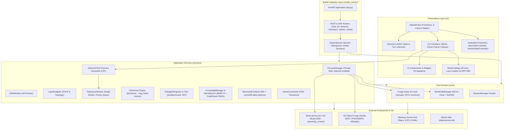
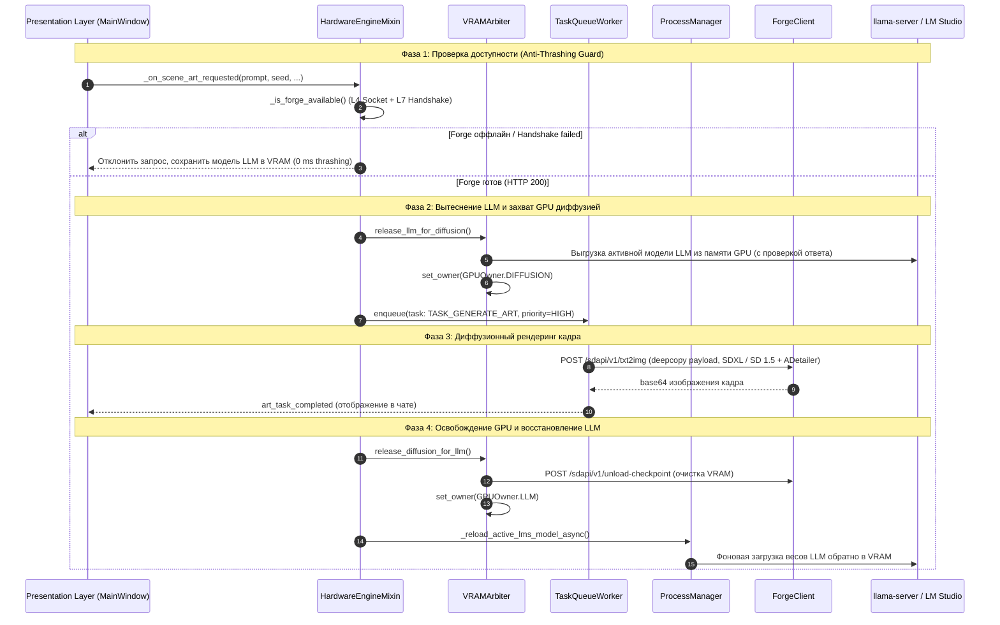
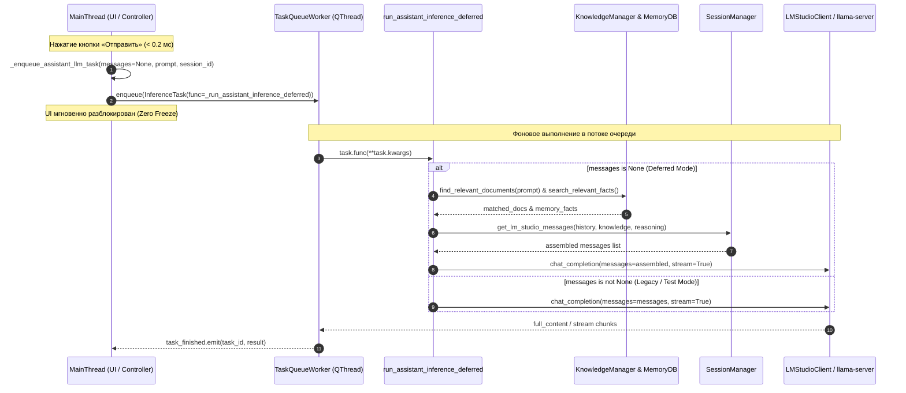
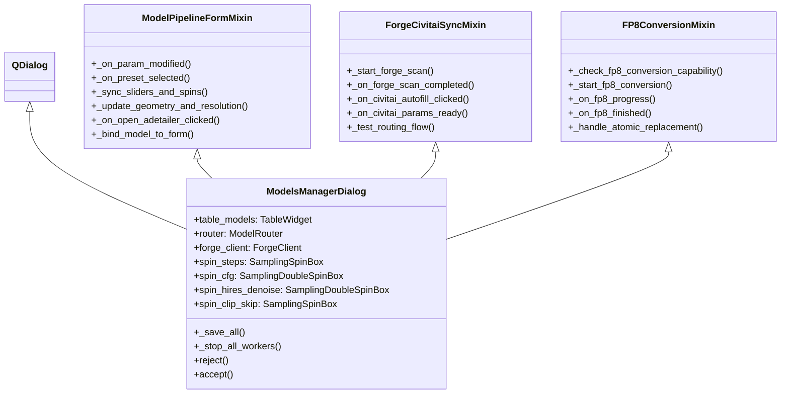

# Техническая спецификация архитектуры NeonRoute

> **Версия системы**: NeonRoute v0.9.1-beta  
> **Целевая платформа**: Windows 10/11 x64, Python 3.10+, PyQt6, QFramelessWindow, QFluentWidgets, FastAPI (Mobile Gateway)  
> **Аппаратный профиль**: 8 ГБ VRAM (NVIDIA GeForce RTX 4060 / RTX 5050 Laptop GPU / 16 ГБ RAM)  
> **Метрики кодовой базы**: 248 файлов Python, ~86 350 строк кода (без учета vendored PyQt-Fluent-Widgets)  
> **Статус верификации**: 393 теста собрано и пройдено (100% Pass Rate: 54 smoke, 202 unit, 8 integration, 129 regression)

---

## Реестр архитектурных решений (Architectural Decision Log / Recent Refactoring Snapshot)

Ниже представлена хронологическая таблица ключевых архитектурных решений и рефакторингов, внедренных в последних коммитах:

| Идентификатор | Коммит(ы) | Затронутые модули | Контекст и проблема | Архитектурное решение и последствия |
| :--- | :--- | :--- | :--- | :--- |
| **ADR-01** | `709075a` | `services/forge_client.py`, `services/lm_studio.py`, `tests/unit/` | 1) Ложное выставление флага `_is_model_unloaded = True` в LM Studio при сбое выгрузки приводило к риску CUDA OOM на 8 ГБ VRAM.<br>2) Мутация словаря параметров запроса по ссылке при каскадных ретраях ADetailer/Hires.<br>3) Блокировка UI-потока до 0.8 с поллером прогресса Forge.<br>4) Недостижимый блок `reload_checkpoint` в `text_to_image`. | 1) Внедрен строгий аудит ответа выгрузки LLM перед переключением арбитра.<br>2) Передача изолированной копии `copy.deepcopy(p)` в `_send_request`.<br>3) Сокращение `join` поллера до 0.05 с с проверкой `is_alive()`.<br>4) Сброс `_checkpoint_unloaded` после проверки `elif`.<br>5) Создание изолированных тестовых сьютов (130 тестов: 50+ Forge, 30+ LM Studio). |
| **ADR-02** | `17d3c15` | `services/lm_studio.py`, `services/thought_stream_parser.py` | Появление моделей рассуждения (DeepSeek-R1), транслирующих рассуждения через стриминговые чанки `delta.reasoning_content` и генерирующих глубокие цепочки мыслей, превышающие буфер 4K/8K токенов. | 1) Нативная поддержка формата SSE-стриминга `reasoning_content` наряду с тегами `<think>`.<br>2) Расширение лимита буфера `ThoughtStreamParser` до 16 384 токенов (16K failsafe buffer) с автоматическим переключением в неоновый спойлер интерфейса. |
| **ADR-03** | `8c1952d`, `a051a6a`, `02a3578` | `ui/components/bubbles/avatar_renderer.py`, `ui/components/chat_header_widget.py`, `ui/components/sidebar_widget.py` | 1) Избыточный брендовый заголовок в боковой панели отнимал вертикальное пространство сессий.<br>2) Грубое кадрирование аватаров без сглаживания краев.<br>3) Плоская визуальная иерархия шапки диалога. | 1) Полная ликвидация брендового хедера в `SidebarWidget` в пользу минималистичного макета.<br>2) Реализация сглаживания краев аватаров (seamless avatar edge feathering) на базе антиалиасинга `QPainterPath`.<br>3) Внедрение кинематографической глубины (elevation depth) в `ChatHeaderWidget`.<br>4) Перевод дефолтных аватаров на векторные символы Fluent Icon. |
| **ADR-04** | `f5a4ffd` | `services/memory_db.py` | Устаревание служебных методов LanceDB `compact_files()` и `cleanup_old_versions()` в новых версиях библиотеки с риском сбоев сжатия таблиц фактов. | Переход на нативный API `table.optimize()` LanceDB с автоматической очисткой фрагментов и вакуумизацией дискового пространства. |
| **ADR-05** | `3fc12f5`, `a5230f4`, `ba4979e` | `services/hybrid_search.py`, `services/knowledge_manager.py`, `tests/unit/test_hybrid_fastembed_rag.py` | 1) Потеря частотности терминов в BM25 из-за бинарного подсчета.<br>2) Отсутствие фильтрации стоп-слов RU/EN.<br>3) Разрыв контекста при фрагментировании смежных чанков.<br>4) Непрозрачность отбора RAG-документов. | 1) Полноценная формула BM25 с учетом term frequency и насыщения.<br>2) Интеграция FastEmbed ONNX с L2-нормализацией векторов.<br>3) Автоматический подбор соседнего чанка (`next_chunk_id`) по порядку следования в документе.<br>4) Внедрение компактного диагностического логирования `[RAG-Trace]` для отслеживания оценок сходства и решений Gatekeeper. |
| **ADR-06** | `841693f` | `services/process_manager.py`, `tests/` | Утечка фоновых daemon-потоков в smoke-тестах и сбои при генерации Qt-сигналов на удаленные C++ объекты `QObject` (`RuntimeError: wrapped C/C++ object has been deleted`). | 1) Изоляция фоновых потоков `ProcessManager` при обнаружении `PYTEST_CURRENT_TEST`.<br>2) Проверка валидности QObject через `sip.isdeleted()` и weakref-гарды перед эмитом сигналов `lms_status_changed` и `forge_status_changed`. |
| **ADR-07** | `f31cc11`, `d62b4bf`, `38e19fb`, `29b5b20`, `7adaf9b` | `services/art_director/director.py`, `services/assistant_prompt_builder.py`, `services/roleplay_prompt_builder.py` | 1) Потеря команд отрицания («без очков», «без оружия») при переходе к мирным/интимным сценам в РП и галерее.<br>2) Анатомическая нестабильность кистей рук в SDXL при средних планах. | 1) Сквозная поддержка флага `--neg <items>` (regex `r'-{1,2}(?:negative|neg)'`) в директивах SD 1.5, SDXL и ролевом футере `_build_footer`.<br>2) Внедрение HAND ANCHOR RULE (обязательная привязка кистей рук к опоре/предметам) и матрицы флагов кадрирования (`--ar square/portrait/wide`).<br>3) Введение Canon Shield для защиты ДНК внешности персонажей. |
| **ADR-08** | `36c2c50`, `2359063` | `ui/main_window.py`, `ui/controllers/chat_flow_controller.py`, `ui/controllers/reminder_controller.py`, `tests/` | Монолитный `MainWindow` (2096 строк) содержал мертвые прокси-методы, смешивал кинематику скролла с логикой бизнес-слоя, а контроллер напоминаний не имел явного жизненного цикла. | 1) Инкапсуляция `ReminderController` с явным методом `cleanup()`.<br>2) Перенос кинетики скролла и логики залипания внизу (`_is_at_bottom`) в `ChatFlowControllerMixin`.<br>3) Удаление избыточных прокси-переопределений (`_on_llm_response_received`, `_on_send_clicked`).<br>4) Формирование базового набора характеризационных тестов `tests/test_main_window_baseline.py` (14 тестов). |
| **ADR-09** | `0142b29` | `ui/controllers/assistant_flow_controller.py`, `services/roleplay_flow_controller.py`, `services/task_queue.py` | Синхронный поиск в RAG и базе памяти в UI-потоке перед отправкой задачи вызывал латентность 15–150 мс (до 2 с на холодном старте). | Переход на отложенную сборку контекста (Deferred Context Assembly Runner): отправка сообщения за $< 0.2$ мс в UI, сборка RAG и памяти внутри фонового потока `TaskQueueWorker`. |
| **ADR-10** | `c6b83a2`, `a9bd983` | `core/forge_locator.py`, `core/win32_job.py`, `services/process_manager.py` | Хардкод путей Forge, конфликты DLL виртуального окружения, зависание процессов-зомби при аварийном выходе. | 1) 5-уровневый каскад локатора с раскрытием NTFS Junctions.<br>2) Изоляция окружения `get_clean_forge_env`.<br>3) Двухфакторная проверка L4 сокет + L7 HTTP handshake.<br>4) Windows Job Object (`JOB_OBJECT_LIMIT_KILL_ON_JOB_CLOSE = 0x2000`).<br>5) Динамический флаг `--always-offload-from-vram` на GPU $\le 8$ ГБ. |
| **ADR-11** | `c86e755` | `ui/main_window.py`, `ui/controllers/session_controller.py`, `ui/controllers/search_controller.py`, `ui/controllers/dialog_controller.py`, `ui/components/chat_list_item.py` | Фасад `MainWindow` содержал 939 строк монолитной логики сессий, разрозненные методы поиска и рудиментарный monkeypatching (`AvatarCropDialog`, `resizeEvent` элементов списка сессий), нарушая SRP. | 1) Полная консолидация сессий (`_load_saved_sessions`, `create_chat`, `_create_new_session`, `_switch_to_session`, прогрессивный рендеринг) в `SessionControllerMixin` (+855 строк).<br>2) Перенос навигации по поиску (`_search_next`, `_search_prev`, `_navigate_search_match`) в `ChatSearchMixin`.<br>3) Перенос модальных вызовов в `DialogControllerMixin`.<br>4) Нативная инкапсуляция усечения заголовка (`ElideRight`) в `ChatSessionItemWidget`.<br>5) Удаление устаревших monkeypatching-заглушек `AvatarCropDialog`.<br>6) Сокращение `MainWindow` с 2007 до 1068 строк (-47%) без создания новых сущностей. |
| **ADR-12** | `HEAD` | `ui/models_manager_dialog.py`, `ui/models_manager/mixins.py`, `ui/models_manager/widgets.py`, `ui/models_manager/workers.py`, `ui/models_manager/__init__.py`, `tests/unit/test_models_manager_dialog.py` | 1) `models_manager_dialog.py` (2569 строк) содержал жестко связанную логику UI-форм рендеринга, сканеров Forge/Civitai, фонового FP8 квантования и потокобезопасности (нарушение SRP).<br>2) Скрытый баг `NameError` в `register_orphaned_worker` при изоляции активных QThread потоков.<br>3) Исчезновение числовых значений параметров напротив слайдеров (шаги, CFG, денойз hires, clip skip) из-за бокового оффсета 80px стандартного `SpinBox` при фиксированной ширине 70px.<br>4) Отсутствие сквозных характеризационных тестов менеджера моделей. | 1) Модульная декомпозиция фасада через 3 контроллер-миксина (`ModelPipelineFormMixin`, `ForgeCivitaiSyncMixin`, `FP8ConversionMixin`) в `ui/models_manager/mixins.py` с сокращением фасада с 2569 до 959 строк (-63%).<br>2) Вынос чистых функций (`MODEL_PRESETS`, нормализаторы, негативы, фабрики ячеек) в `ui/models_manager/widgets.py` и системных утилит проверки Python/Torch в `ui/models_manager/workers.py`.<br>3) Устранение `NameError` через регистратор `register_orphaned_worker()`.<br>4) Перевод счетчиков на `CompactSpinBox` и `CompactDoubleSpinBox` с шириной 82px, чистым белым текстом (`#FFFFFF`), вертикальными стрелками и гардом `wheelEvent: ignore`.<br>5) Внедрение `_DynamicModuleProxy` для 100% совместимости моков `InfoBar` в тестах.<br>6) Разработка сьюта из 10 сквозных тестов (`tests/unit/test_models_manager_dialog.py`). 100% Pass Rate на 393 тестах. |

---

## 1. Обзор системы (System Overview & Tech Stack)

Система **NeonRoute** — это мультимодальный десктопный ИИ-клиент и headless-шлюз (Mobile BFF Gateway) для локального инференса нейросетевых моделей в условиях жесткого аппаратного бюджета видеопамяти (8 ГБ VRAM). Система бесшовно объединяет:

1. **Большие языковые модели (LLM)**: многомодальный контекст, три режима работы (Ассистент «Элария», Ролевой чат с поддержкой карточек Tavern/Chub, автономный агент разработки ПО «Инженер»), нативный парсинг стриминга DeepSeek-R1 `reasoning_content` и буфер цепочек мыслей до 16K токенов.
2. **Диффузионный рендеринг (Stable Diffusion WebUI Forge)**: фотореалистичный синтез сцен, портретов персонажей и окружения на базе архитектур SD 1.5, SDXL, Pony, с поддержкой LoRA, ADetailer, нативной квантизации FP8 E4M3FN, сквозного отрицания `--neg` и протокола фиксации рук Hand Anchor.
3. **Голосовой интерфейс**: синтез речи F5-TTS на CPU и голосовой ввод через Faster-Whisper.
4. **Гибридный RAG и ассоциативная память**: трехконтурный семантический поиск (BM25 с сохранением term frequency + плотные эмбеддинги FastEmbed ONNX с L2-нормализацией + Reciprocal Rank Fusion) и долговременная память на базе SQLite WAL и оптимизированного LanceDB.
5. **Headless Mobile Gateway (`mobile_server`)**: асинхронный REST/SSE шлюз на базе FastAPI для взаимодействия с мобильными клиентами через локальную сеть или VPN (Tailscale) с единой очередью инференса.
6. **Отложенная сборка контекста (Deferred Context Assembly Runner)**: перенос ресурсоемкого поиска по базе знаний и памяти из UI-потока в рабочий поток очереди задач, снижающий латентность отправки сообщений до $< 0.2$ мс.

### Аппаратный манифест 8 ГБ VRAM

При аппаратном лимите в 8192 МБ одновременная аллокация квантованной LLM (Qwen 7B / L3-Stheno-8B: ~4.2–5.5 ГБ VRAM) и диффузионного чекпоинта SDXL (~3.2–4.8 ГБ VRAM) неизбежно приводит к падению в Shared System RAM (падение скорости инференса в 10–20 раз) или критическому сбою `CUDA out of memory` (OOM).

В основу NeonRoute заложен **принцип взаимного исключения видеопамяти (Mutual Exclusion Principle)**:
- В каждый момент времени доступ к тяжелым вычислительным тензорам GPU имеет строго одно вычислительное ядро (LLM или Diffusion).
- Переключение контекста управляется централизованным арбитром `services.vram_arbiter.VRAMArbiter`.
- На системах с объемом памяти $\le 8$ ГБ инжектируется принудительная политика оффлоада `--always-offload-from-vram`.
- Предотвращение паразитного VRAM Thrashing: выгрузка LLM категорически блокируется, если сервер Forge недоступен или не прошел двухфакторный хэндшейк.

### Технологический стек

| Слой | Технологии и компоненты |
| :--- | :--- |
| **Рантайм и Ядро** | Python 3.10+, Standard Library (`ctypes`, `subprocess`, `urllib.request`, `socket`, `configparser`, `shutil`) |
| **Графический интерфейс** | PyQt6, QFramelessWindow (Cyberpunk Glassmorphism / Acrylic), QFluentWidgets |
| **Мобильный шлюз (BFF)** | FastAPI, Uvicorn, Server-Sent Events (SSE), Pydantic v2, CORS Middleware |
| **Хранение данных** | SQLite 3 (`PRAGMA journal_mode=WAL; PRAGMA synchronous=NORMAL;`), LanceDB (`table.optimize()`), Zero-Fsync JSON-зеркала |
| **Сетевые контракты** | FastAPI / Uvicorn (Mobile BFF Gateway REST + Server-Sent Events), Gradio/Automatic1111 REST API, HTTP Keep-Alive |
| **Управление ОС и процессами** | Win32 API (`kernel32.dll`: Windows Job Objects `JOB_OBJECT_LIMIT_KILL_ON_JOB_CLOSE = 0x2000`, дескрипторы скрытых процессов `CREATE_NO_WINDOW`) |
| **Контроль качества** | Pytest, pytest-mock, pytest-cov, Headless GUI Smoke Harness, AST CodeValidator, SubstanceGuard (381 тест) |

---

## 2. Компонентная топология (Component Architecture)

### 2.1. Разграничение ответственности (Layer Boundaries)

Архитектура системы четко разделена на независимые слои с направлением зависимостей снаружи внутрь:



1. **Core Domain (`core/`)**:
   - `core/forge_locator.py`: 5-уровневый каскад обнаружения директории Forge, парсинг аргументов лаунчера (`--models-dir`, `--ckpt-dir`, `--lora-dir`), разрешение NTFS-симлинков и Junctions, изоляция окружения `get_clean_forge_env`, запись в `server_config.ini`.
   - `core/win32_job.py`: `Win32JobManager` (Singleton) на чистом `ctypes` — привязка дочерних процессов к Windows Job Object с флагом `JOB_OBJECT_LIMIT_KILL_ON_JOB_CLOSE (0x2000)`.
   - `core/session_manager.py`: фасад совместимости для SessionManager.
2. **Application Services (`services/`)**:
   - `services/process_manager.py`: оркестратор жизненного цикла внешних процессов (`llama-server.exe`, LM Studio CLI, SD WebUI Forge) с двухфакторной проверкой сокетов (L4 TCP + L7 HTTP Handshake), изоляцией daemon-потоков в тестах и гардами от удаленных QObject.
   - `services/vram_arbiter.py`: арбитраж монопольного владения GPU (`GPUOwner.NONE`, `GPUOwner.LLM`, `GPUOwner.DIFFUSION`).
   - `services/layer_budgeter.py`: топологический аудитор GPU, парсер бинарных заголовков GGUF и калькулятор слоев `-ngl` с Pre-flight RAM Guard.
   - `services/forge_client.py`: асинхронный REST-клиент SD Forge API с Watchdog, автоочисткой VRAM, глубоким копированием payload (`deepcopy`), неблокирующим выходом поллера (0.05 с) и корректной перезагрузкой чекпоинта.
   - `services/lm_studio.py`: клиент LLM инференса с поддержкой SSE-стриминга, Keep-Alive, парсинга DeepSeek-R1 `reasoning_content`, фильтрацией технического плейсхолдера `default` и перехватом HTTP 400 (Jinja/ролевые конфликты).
   - `services/art_director/`: подсистема режиссуры кадра (резолвинг стилей, LoRA, нативный флаг `--neg`, Hand Anchor Protocol, матрица флагов `--ar`, геометрия кадра, политика оффлоада).
   - `services/task_queue.py`: приоритетная однопоточная очередь инференса (`max_workers=1`, уровни `HIGH=0`, `NORMAL=10`, `LOW=20`) с поддержкой Deferred Context Assembly.
   - `services/subagent_engineer.py`, `services/engineer_tdd.py`, `services/tool_engine.py`, `services/sandbox_manager.py`: изолированная песочница и двухфазный TDD-пайплайн.
   - `services/knowledge_manager.py`, `services/hybrid_search.py`, `services/memory_db.py`: гибридный поиск RAG (BM25 TF + FastEmbed ONNX + RRF + непрерывность соседних чанков) и двухконтурная память с `LanceDB.table.optimize()`.
   - `services/mode_coordinator.py`: конечный автомат переключения режимов (Ассистент, Ролевой чат, Инженер).
3. **Headless Mobile Gateway (`mobile_server/`)**:
   - `mobile_server/api.py`: FastAPI приложение, CORS-настройки для локальной сети и VPN (Tailscale), монтирование статики и роутеров.
   - `mobile_server/dependencies.py`: внедрение зависимостей синглтонов `TaskQueueWorker`, `SessionManager`, `VRAMArbiter`, `LMStudioClient`, `ForgeClient`.
   - `mobile_server/routes/`: асинхронные эндпоинты генерации (`art.py`), чата и SSE-стриминга (`chat.py`), управления сессиями (`sessions.py`), персонажей (`characters.py`), телеметрии VRAM (`system.py`) и статических медиа (`media.py`).
4. **Presentation Layer (`ui/`)**:
   - `ui/main_window.py`: главное окно с 3-колоночным сплиттером (`SidebarWidget` | `MainContent` | `WorkspaceInspectorWidget`), интегрированное с `UIContext`.
   - `ui/controllers/`: 13 специализированных миксинов контроллеров без прямого наследования от `QObject`, включая отложенные раннеры контекста и кинематику скролла в `ChatFlowControllerMixin`.
   - Выделенные контроллеры/презентеры: `ReminderController` с явным жизненным циклом `cleanup()` и `HeaderStateController` для шапки и прогресса Forge.
   - `ui/components/`: 23 графических виджета ввода, баблов сообщений, статуса, шапки с кинематографической глубиной, сглаженных аватаров, инспектора песочницы, 16K спойлеров рассуждений `<think>`.
   - `ui/dialogs/`: 25 модальных диалогов с ленивой загрузкой через PEP 562.
5. **Configuration & Utilities (`config.py`, `utils/`)**:
   - `config.py`: единый источник правды (SSOT) путей, лимитов памяти, профилей режимов, динамический метод `get_forge_models_dir()`, независимость от рабочего каталога (CWD-independence).
   - `utils/`: `system_monitor.py` (NVML/psutil), `health_checker.py` (сокетный опрос без блокировок), `file_utils.py` (атомарная запись `atomic_write_json`), `config_manager.py`.

---

### 2.2. Топология файлов репозитория

```text
NeonRoute/
├── config.py                            # [214 строк] Единый источник правды (SSOT): пути, лимиты VRAM, get_forge_models_dir()
├── main.py                              # [126 строк] Точка входа: QApplication, setup_environment_and_logging, exception handler
├── run_mobile_server.py                 # [45 строк] Точка входа Headless Mobile Gateway Server (FastAPI на порту 8000)
├── server_config.ini                    # Пользовательская конфигурация путей [PATHS] (forge_root_dir, forge_path)
│
├── core/                                # Ядро и системные привязки Windows
│   ├── __init__.py                      # Инициализация пакета core
│   ├── forge_locator.py                 # [353 строки] 5-уровневый каскад поиска Forge, парсер аргументов, изоляция env
│   ├── session_manager.py               # [8 строк] Фасад совместимости SessionManager
│   └── win32_job.py                     # [113 строк] Win32JobManager: привязка к Job Object (KILL_ON_JOB_CLOSE = 0x2000)
│
├── mobile_server/                       # Headless Mobile Gateway Server (FastAPI / BFF)
│   ├── __init__.py                      # [6 строк] Инициализация пакета mobile_server
│   ├── api.py                           # [49 строк] FastAPI приложение, CORS, эндпоинты, монтирование static
│   ├── config.py                        # [17 строк] Pydantic-настройки мобильного шлюза (HOST=0.0.0.0, PORT=8000)
│   ├── dependencies.py                  # [180 строк] DI-провайдеры: get_task_queue, get_vram_arbiter, get_session_manager
│   ├── schemas.py                       # [222 строки] Pydantic-схемы валидации запросов и ответов
│   └── routes/                          # Асинхронные REST и SSE эндпоинты
│       ├── __init__.py                  # [7 строк] Экспорт роутеров
│       ├── art.py                       # [705 строк] REST API генерации изображений через TaskQueue и ForgeClient
│       ├── characters.py                # [80 строк] REST API карточек персонажей и аватаров
│       ├── chat.py                      # [602 строки] REST/SSE эндпоинты чата, стриминг токенов, синхронизация реплик
│       ├── media.py                     # [164 строки] Эндпоинты отдачи сгенерированных артов и медиа
│       ├── sessions.py                  # [354 строки] Управление сессиями (листинг, создание, удаление, экспорт)
│       └── system.py                    # [148 строк] Телеметрия VRAM, статус процессов, системный healthcheck
│
├── services/                            # Сервисный слой и бизнес-логика (Business Logic Layer)
│   ├── __init__.py                      # Инициализация пакета services
│   ├── art_director_config.py           # [256 строк] Загрузка/сохранение data/art_director_models.json
│   ├── asset_validator.py               # [103 строки] Pre-flight аудит наличия чекпоинтов SD и весов ADetailer
│   ├── assistant_flow.py                # [207 строк] Пошаговый пайплайн Ассистента
│   ├── assistant_prompt_builder.py      # [729 строк] Сборщик промпта Эларии, директивы SD 1.5/SDXL, --neg, Hand Anchor
│   ├── card_translator.py               # [444 строки] Пошаговый переводчик карточек с CJK Quality Gate
│   ├── chub_client.py                   # [416 строк] REST API клиент каталога Chub.ai (поиск, очистка промо-мусора)
│   ├── civitai_service.py               # [181 строка] Запрос параметров модели по AutoV2 SHA-256 с Civitai API
│   ├── code_engine.py                   # [327 строк] ASTSkeletonizer, ExecutionSandbox, AutoImporter (Zero-Token Healing)
│   ├── code_validator.py                # [614 строк] AST-валидатор синтаксиса, Scope Guard, Stub/Reachability Guard
│   ├── context_window_builder.py        # [838 строк] Сборщик контекста LLM, архитектура «Трех якорей», Sliding CoT
│   ├── direct_command_parser.py         # [108 строк] Парсер CLI-параметров прямого рендера (!арт / !art)
│   ├── document_parser.py               # [598 строк] Универсальный CPU-парсер документов (.pdf, .docx, .xlsx, .pptx, etc.)
│   ├── engineer_context.py              # [354 строки] Сбор файлового контекста и AST-скелетирование песочницы
│   ├── engineer_diagnostics.py          # [351 строка] Очистка стектрейсов clean_traceback, экспертная диагностика
│   ├── engineer_parser.py               # [371 строка] Парсер ответов LLM, извлечение инструментов
│   ├── engineer_planner.py              # [519 строк] Фаза «Архитектор»: 3-уровневая AST-локализация узлов >250 строк
│   ├── engineer_prompts.py              # [128 строк] Мета-промпты Архитектора, Инженера и RCA
│   ├── engineer_review.py               # [169 строк] Ветка статического аудита, Git Diff и чекпоинтов
│   ├── engineer_skill_router.py         # [605 строк] Векторный роутер 5 инженерных архетипов на CPU (FastEmbed)
│   ├── engineer_stream.py               # [79 строк] Потоковый парсинг токенов LLM (CodeStreamExtractor)
│   ├── engineer_tdd.py                  # [678 строк] Двухфазный Code-First TDD пайплайн (NEW_MODULE / INCREMENTAL_FEATURE)
│   ├── entity_mapper.py                 # [160 строк] Детерминированный конвертер кириллических сущностей в теги SD 1.5
│   ├── environment_doctor.py            # [124 строки] Аудит окружения и фоновая установка пакетов через PipInstallWorker
│   ├── file_generator.py                # [318 строк] Генератор стилизованных документов Excel (.xlsx) и Word (.docx)
│   ├── forge_client.py                  # [1090 строк] REST-клиент SD Forge API (deepcopy payload, 0.05s poller, reload fix)
│   ├── forge_models.py                  # [392 строки] Реестр паспортов моделей SD (MODEL_REGISTRY, Capabilities)
│   ├── git_sandbox.py                   # [333 строки] GitSandboxManager: локальный Git репозиторий песочницы
│   ├── hybrid_search.py                 # [678 строк] Гибридный поиск: BM25 (TF + stopwords) + FastEmbed ONNX + RRF + NextChunk
│   ├── knowledge_manager.py             # [1029 строк] Менеджер базы знаний: [RAG-Trace], FastEmbed Gatekeeper, registry.json
│   ├── knowledge_watcher.py             # [201 строка] QFileSystemWatcher сателлит с дебаунсом 2.0 с
│   ├── layer_budgeter.py                # [628 строк] Топологический аудитор GPU, парсер GGUF и калькулятор слоев NGL
│   ├── lm_studio.py                     # [795 строк] Клиент LLM (Keep-Alive, SSE, reasoning_content, default filter, HTTP 400 guard)
│   ├── macro_engine.py                  # [64 строки] Парсер макросов {{user}}, {{char}}, {{random: ...}}, {{roll: XdY+Z}}
│   ├── markdown_chunker.py              # [400 строк] Структурный нарезчик Markdown с защитой целостности кодовых блоков
│   ├── memory_db.py                     # [815 строк] Хранилище памяти: SQLite WAL + LanceDB native table.optimize()
│   ├── memory_extractor.py              # [308 строк] Асинхронный экстрактор фактов о пользователе (PRIORITY_LOW)
│   ├── minor_safety.py                  # [117 строк] Детектор несовершеннолетних персонажей и фильтр безопасности
│   ├── mode_coordinator.py              # [480 строк] Конечный автомат режимов (Teardown -> Switch -> Boot -> Mount)
│   ├── model_router.py                  # [531 строка] Гибридный роутер моделей Арт-директора (триггеры + FastEmbed)
│   ├── patch_engine.py                  # [499 строк] Хирургический PatchApplier и SelfHealingEngine
│   ├── process_manager.py               # [1470 строк] Оркестратор процессов: llama-server, Forge, L4+L7, thread isolation
│   ├── regex_filter.py                  # [71 строка] Очистка тегов <think>, спецтокенов, нормализация тире
│   ├── roleplay_flow_controller.py      # [698 строк] Контроллер диалогового цикла RP: run_roleplay_inference_deferred
│   ├── roleplay_prompt_builder.py       # [607 строк] Сборщик промптов RP: Depth-0 якоря, 11 архетипов, --neg в футере
│   ├── roleplay_state_manager.py        # [137 строк] Парсер блоков <stats>/[STATUS] (локация, инвентарь, квесты)
│   ├── rp_cast_extractor.py             # [553 строки] Асинхронный летописец сцены: NPC, локации, мутации, scene_type
│   ├── rp_cast_manager.py               # [978 строк] Менеджер состояния кампании (history/cast_<id>.json): сопартийцы
│   ├── rp_constants.py                  # [26 строк] Словарь ключевых слов триггеров анализа сцены (SCAN_KEYWORDS)
│   ├── rp_scene_updater.py              # [475 строк] Транзакционное применение изменений сцены к cast_data
│   ├── sandbox_guard.py                 # [236 строк] Периметр безопасности рантайма: sys.addaudithook, блокировка сети
│   ├── sandbox_manager.py               # [934 строки] Менеджер песочницы: изоляция проектов, Headless GUI Smoke Harness
│   ├── sandbox_runner.py                # [63 строки] Изолированный раннер пользовательских скриптов
│   ├── search_tokenizer.py              # [173 строки] Токенизатор для BM25 со стеммингом Портера RU/EN
│   ├── server_config.py                 # [496 строк] 3-уровневый каскад ServerConfigResolver (llama-server, CUDA, GGUF)
│   ├── session_manager.py               # [993 строки] Управление сессиями диалогов (SQLite WAL + Zero-fsync JSON mirror)
│   ├── skill_router.py                  # [391 строка] Роутер микро-скиллов Ассистента (7 базовых + custom)
│   ├── stt_service.py                   # [68 строк] Сервис голосового ввода (Faster-Whisper stub)
│   ├── subagent_engineer.py             # [1787 строк] Автономный субагент «Инженер»: Review/Git, TDD, SubstanceGuard
│   ├── task_queue.py                    # [243 строки] Однопоточная приоритетная очередь задач (TaskQueueWorker)
│   ├── tavern_models.py                 # [692 строки] Модели CharacterCard и LoreEntry: 11 архетипов, пол, POV
│   ├── tavern_parser.py                 # [864 строки] Парсер карточек Tavern V1/V2/CCv3 и Chub (JSON/PNG/WebP)
│   ├── thought_stream_parser.py         # [218 строк] Потоковый FSM тегов <think> с 16K буфером и reasoning_content
│   ├── token_budget_manager.py          # [345 строк] Оценка токенов BPE, светофор карточек и 2-контурный бюджет
│   ├── tool_engine.py                   # [849 строк] Диспетчер инструментов песочницы (write_file, patch_file, run_pytest)
│   ├── tool_parser.py                   # [308 строк] Парсер тегов <TOOL:...> с поддержкой SEARCH/REPLACE
│   ├── tts_service.py                   # [146 строк] Клиент синтеза речи F5-TTS на CPU с резервным WAV-генератором
│   ├── user_profile_manager.py          # [179 строк] Менеджер профилей пользователя и кэша приветствий карточек
│   ├── vision_utils.py                  # [102 строки] LANCZOS-сжатие изображений в base64 для Vision-моделей
│   ├── vram_arbiter.py                  # [91 строка] Централизованный арбитр видеопамяти (GPUOwner)
│   ├── workspace_launcher.py            # [75 строк] Интерактивный запуск скриптов в отдельном окне cmd.exe /k
│   │
│   └── art_director/                    # Подсистема режиссуры изображений «Арт-директор»
│       ├── __init__.py                  # [68 строк] Фасад подсистемы art_director
│       ├── contracts.py                 # [113 строк] Контракты данных: TargetSubject, VisualIntent, SceneAnalysisContract
│       ├── director.py                  # [1811 строк] ArtDirector: RP-контекст, LoRA, regex r'-{1,2}(?:negative|neg)'
│       ├── geometry.py                  # [104 строки] Разрешения SD 1.5 и SDXL по 6 архетипам кадра
│       ├── legacy_helpers.py            # [117 строк] Вспомогательные функции обратной совместимости
│       ├── lora_manager.py              # [284 строки] Чтение заголовков .safetensors на CPU (0 MB VRAM)
│       ├── plan.py                      # [194 строки] Модель GenerationPlan и сериализатор to_forge_kwargs()
│       ├── prompting.py                 # [141 строка] Константа ELARIA_VISUAL_DNA, перехват отрицаний, негатив
│       └── vram_policy.py               # [261 строка] Калькулятор бюджета VRAM, max_hires_canvas_area, offload-политика
│
├── ui/                                  # Слой графического интерфейса (Presentation Layer)
│   ├── __init__.py                      # Инициализация пакета ui
│   ├── main_window.py                   # [1068 строк] Главное окно MainWindow (3-колоночный сплиттер, UIContext)
│   ├── models_manager_dialog.py         # [959 строк] Модульный пульт управления моделями Forge, Civitai AutoFill, FP8
│   ├── engineer_skills_dialog.py        # [998 строк] Центр управления знаниями инженера (Skills Hub)
│   ├── log_console.py                   # [187 строк] Live-консоль логов (QtLogHandler, кольцевой буфер на 2000 записей)
│   ├── styles.py                        # [319 строк] Глобальная таблица стилей NEON_THEME_QSS
│   │
│   ├── common/                          # Общие утилиты и контекст UI
│   │   ├── __init__.py                  # Инициализация пакета common
│   │   ├── icon_utils.py                # [85 строк] Утилиты векторных иконок Fluent
│   │   └── ui_context.py                # [142 строки] UIContext: Single Source of Truth состояния интерфейса
│   │
│   ├── builders/                        # Строители интерфейсных элементов
│   │   ├── __init__.py                  # Инициализация пакета builders
│   │   ├── chat_bubble_builder.py       # [284 строки] Построитель баблов чата
│   │   └── menu_builder.py              # [341 строка] MenuBuilder, ClickOnlyMenuBar
│   │
│   ├── controllers/                     # 13 чистых Python-миксинов и контроллеров MainWindow
│   │   ├── __init__.py                  # Инициализация пакета controllers
│   │   ├── assistant_flow_controller.py # [1286 строк] run_assistant_inference_deferred, 2-контурный бюджет, арт-проход
│   │   ├── avatar_controller.py         # [787 строк] Синхронизация аватаров, меню скиллов, вызов диалогов
│   │   ├── chat_flow_controller.py      # [1745 строк] Диспетчеризация ввода, кинематика скролла, стрим 28 FPS
│   │   ├── dialog_controller.py         # [438 строк] Управление модальными окнами настроек, базы знаний, экспорта
│   │   ├── engineer_controller.py       # [772 строки] Маршрутизация задач в SubagentEngineer, инспектор песочницы
│   │   ├── hardware_engine.py           # [1035 строк] Управление процессами LLM/Forge, автотюн KV, guard VRAM thrashing
│   │   ├── header_controller.py         # [129 строк] HeaderStateController: реактивный контроллер шапки чата и Forge
│   │   ├── reminder_controller.py       # [116 строк] ReminderController: пуллинг напоминаний, cleanup() жизненного цикла
│   │   ├── roleplay_controller.py       # [492 строки] Фон сцены, сводка кампании, локализация карточек
│   │   ├── search_controller.py         # [104 строки] Поиск, подсветка и навигация по тексту диалога
│   │   ├── session_controller.py        # [989 строк] Полный жизненный цикл сессий, сэмплинга, приветствий и истории
│   │   ├── task_lifecycle_controller.py # [494 строки] Маршрутизация задач в очередь, перехват команд памяти
│   │   └── window_state_controller.py   # [158 строк] Кэширование фона главного окна и полный экран (F11)
│   │
│   ├── dialogs/                         # 25 модальных диалоговых окон приложения (Lazy Loaded)
│   │   ├── __init__.py                  # [73 строки] Реэкспорт диалогов через PEP 562
│   │   ├── about_dialog.py              # [146 строк] Окно «О программе», лицензии, системная информация
│   │   ├── anchor_viewer_dialog.py      # [145 строк] Инспектор активных системных якорей и промптов
│   │   ├── avatar_crop_dialog.py        # [287 строк] Интерактивный кроппер аватаров персонажей и профиля
│   │   ├── avatar_lightbox_dialog.py    # [61 строка] Полноэкранный просмотрщик аватаров высокого разрешения
│   │   ├── background_dialog.py         # [178 строк] Настройка статических и динамических фонов сцены
│   │   ├── campaign_info_dialog.py      # [1034 строки] Дашборд кампании (Память, Инвентарь, Сценарий, Каст, Локация)
│   │   ├── campaign_subdialogs.py       # [397 строк] Вспомогательные окна редактора квестов и отношений
│   │   ├── card_visual_setup_dialog.py  # [158 строк] Визуальный конфигуратор ДНК внешности персонажа
│   │   ├── characters_gallery_dialog.py # [1725 строк] Двухпанельная галерея персонажей, светофор токенов
│   │   ├── chub_catalog_dialog.py       # [575 строк] Каталог персонажей Chub.ai: поиск, импорт карточек
│   │   ├── civitai_catalog_dialog.py    # [1069 строк] Каталог Civitai: безопасное скачивание .safetensors, SHA-256
│   │   ├── civitai_lora_dialog.py       # [595 строк] Браузер и загрузчик LoRA-адаптеров с Civitai API
│   │   ├── clean_cache_dialog.py        # [612 строк] Очиститель кэша Forge, логов, превью и LanceDB
│   │   ├── dependency_dialog.py         # [181 строка] Менеджер внешних пакетов и утилит окружения
│   │   ├── engineer_settings_dialog.py  # [352 строки] Настройки субагента «Инженер»: лимиты итераций, тайм-ауты
│   │   ├── gallery/                     # Модули расширенной галереи
│   │   │   ├── __init__.py              # [1 строка] Инициализация пакета
│   │   │   ├── character_card_widget.py # [320 строк] Виджет карточки персонажа в галерее
│   │   │   ├── dna_party_mixin.py       # [210 строк] Миксин настройки партии соратников
│   │   │   └── translation_mixin.py     # [145 строк] Миксин слотного перевода карточки
│   │   ├── help_dialog.py               # [208 строк] Интерактивная справочная система и шорткаты
│   │   ├── knowledge_manager_dialog.py  # [997 строк] Центр «Знания Эларии»: документы, скиллы, системный промпт
│   │   ├── llm_engine_settings_dialog.py# [351 строка] Выбор и тюнинг LLM бэкенда (llama-server vs LM Studio)
│   │   ├── local_lora_dialog.py         # [274 строки] Менеджер локальных LoRA моделей с превью весов
│   │   ├── media_gallery_dialog.py      # [207 строк] Галерея сгенерированных изображений сессии
│   │   ├── model_sampling_dialog.py     # [803 строки] Тюнинг параметров сэмплирования (temp, min_p, DRY, XTC)
│   │   ├── new_chat_dialog.py           # [202 строки] Мастер создания нового диалога с выбором режима
│   │   ├── prompt_viewer_dialog.py      # [181 строка] Инспектор сырых токенов и скомпилированного системного промпта
│   │   ├── shutdown_dialog.py           # [83 строки] Диалог безопасного завершения фоновых процессов
│   │   └── user_settings_dialog.py      # [1005 строк] Профили пользователя и игровые персоны
│   │
│   ├── components/                      # 23 специализированных графических компонента
│   │   ├── __init__.py                  # Инициализация пакета components
│   │   ├── assistant_chat_bubble.py     # [456 строк] Бабл ассистента с видоискателем арт-генерации (28 FPS)
│   │   ├── audio_player.py              # [126 строк] Встроенный аудиоплеер озвучки F5-TTS
│   │   ├── bubbles/                     # Баблы и вспомогательные рендереры
│   │   │   ├── __init__.py              # Инициализация пакета
│   │   │   ├── avatar_renderer.py       # [148 строк] Сглаживание краев аватаров (edge feathering), антиалиасинг
│   │   │   ├── image_preview_dialog.py  # [95 строк] Просмотрщик полноразмерных превью изображений
│   │   │   └── workspace_cards.py       # [180 строк] Карточки артефактов и файлов песочницы
│   │   ├── chat_background.py           # [123 строки] Виджет отрисовки киберпанк-фонов и неоновых эффектов
│   │   ├── chat_bubble.py               # [1399 строк] Базовый бабл сообщения: Markdown, подсветка кода, экспорт
│   │   ├── chat_header_widget.py        # [314 строк] Шапка диалога: статус модели, кинематографическая глубина
│   │   ├── chat_input_panel.py          # [244 строки] Нижняя парящая капсула ввода с чипами вложений
│   │   ├── chat_list_item.py            # [254 строки] Элемент списка сессий в минималистичном сайдбаре
│   │   ├── chat_message_widget.py       # [181 строка] Обертка виджета реплики для списка истории
│   │   ├── chat_stream_widget.py        # [201 строка] Виджет потокового вывода токенов с мягким скроллом
│   │   ├── emoji_picker.py              # [97 строк] Всплывающая панель эмодзи
│   │   ├── file_card.py                 # [153 строки] Карточка прикрепленного документа / файла
│   │   ├── input_box.py                 # [349 строк] Многострочное поле ввода с автовысотой и Drag&Drop
│   │   ├── reminder_toast.py            # [63 строки] Всплывающее уведомление напоминаний в стиле Fluent
│   │   ├── rp/                          # Компоненты ролевого режима
│   │   │   ├── __init__.py              # Инициализация пакета
│   │   │   └── rp_chat_bubble.py        # [312 строк] Специализированный бабл ролевых реплик
│   │   ├── rpg_elements.py              # [513 строк] RPG-виджеты (<stats>, <meters>, <choices>, <check>)
│   │   ├── scroll_button.py             # [136 строк] Кнопка быстрого скролла вниз с индикатором новых реплик
│   │   ├── search_bar.py                # [165 строк] Всплывающая строка поиска по тексту чата
│   │   ├── sidebar_widget.py            # [323 строки] Минималистичная левая панель навигации (без бренд-хедера)
│   │   ├── status_bar_widget.py         # [313 строк] MainStatusBar: телеметрия VRAM/RAM, LED-индикаторы
│   │   ├── status_pill.py               # [51 строка] Компактный светодиодный индикатор статуса
│   │   ├── step_progress_button.py      # [94 строки] Кнопка с круговым индикатором прогресса генерации
│   │   ├── thought_spoiler_widget.py    # [257 строк] Неоновый спойлер для цепочек рассуждений <think> (16K tokens)
│   │   ├── typing_loader.py             # [106 строк] Анимированный индикатор набора текста
│   │   └── workspace_inspector.py       # [748 строк] Правая панель песочницы (дерево файлов, редактор, Git, Smoke F5)
│   │
│   ├── models_manager/                  # Модули диалога управления моделями
│   │   ├── __init__.py                  # Инициализация пакета и реэкспорт сущностей
│   │   ├── adetailer_dialog.py          # [324 строки] Диалог точной настройки параметров ADetailer
│   │   ├── mixins.py                    # [710 строк] Контроллер-миксины: ModelPipelineFormMixin, ForgeCivitaiSyncMixin, FP8ConversionMixin
│   │   ├── widgets.py                   # [470 строк] Карточки, SamplingSpinBox/DoubleSpinBox (белый текст, Compact), пресеты, ячейки
│   │   └── workers.py                   # [470 строк] Фоновые воркеры QThread, сканирование Forge/Civitai, FP8 квантование, изоляция потоков
│   │
│   └── workers/                         # Фоновые воркеры интерфейса
│       ├── __init__.py                  # Инициализация пакета workers
│       ├── model_discovery_worker.py    # [120 строк] Фоновое сканирование установленных моделей
│       ├── shutdown_worker.py           # [85 строк] Грациозная остановка внешних рантаймов
│       └── tool_execution_worker.py     # [140 строк] Выполнение инструментов песочницы в рабочем потоке
│
├── utils/                               # Системные вспомогательные утилиты
│   ├── __init__.py                      # Инициализация пакета utils
│   ├── config_manager.py                # [129 строк] Управление конфигурацией config.json со слиянием дефолтов
│   ├── file_utils.py                    # [40 строк] Атомарная запись JSON (atomic_write_json) с fsync и защитой от WinError 32
│   ├── health_checker.py                # [100 строк] Асинхронный сокет-монитор портов (1234, 7860, 5010) без блокировок
│   └── system_monitor.py                # [204 строки] Мониторинг VRAM/RAM через pynvml / nvidia-smi / psutil
│
└── tests/                               # Пирамида тестирования (393 теста, 100% Pass Rate)
    ├── conftest.py                      # [149 строк] Airgap-фикстуры (_apply_airgap_paths, check_sandbox_state_leak)
    ├── test_chat.py                     # [88 строк] Тестирование чат-эндпоинтов мобильного шлюза
    ├── test_engineer_task_card.py       # [43 строки] Карточка задач инженера и отображение логов
    ├── test_fp8_conversion_safety.py    # [164 строки] Безопасность FP8 квантования и парсинга тензоров
    ├── test_gallery_directives_pipeline.py # [120 строк] Директивы галерейного арта SD 1.5 vs SDXL, --neg
    ├── test_layer_budgeter.py           # [485 строк] Тесты калькулятора слоев GGUF, топологии VRAM и RAM Guard
    ├── test_main_window_baseline.py     # [413 строк] 14 характеризационных тестов MainWindow: жизненный цикл, FSM, шина событий
    ├── test_tavern_parser.py            # [349 строк] Парсинг Tavern V1/V2/CCv3, Chub PNG chunk и лорбуков
    ├── test_thought_stream_parser.py    # [232 строки] Потоковый FSM разбор мыслей <think>, reasoning_content, 16K buffer
    ├── test_three_anchors_context_eviction.py # [191 строка] Вытеснение середины контекста при сохранении трех якорей
    ├── test_token_budget_manager.py     # [337 строк] Токенизация BPE, двухконтурная модель и светофор
    │
    ├── integration/                     # 2 сьюта интеграционных тестов безопасности и арбитража (8 тестов)
    │   ├── test_sandbox_security.py     # [140 строк] Безопасность песочницы: запрет импортов, path traversal, тайм-ауты
    │   └── test_vram_arbitrage_flow.py  # [165 строк] Сквозное переключение VRAMArbiter между LLM и Diffusion
    │
    ├── smoke/                           # 14 сьютов сквозного смоук-тестирования компонентов (54 теста)
    │   ├── __init__.py                  # Инициализация пакета smoke
    │   ├── test_art_pipeline_smoke.py   # [457 строк] Сквозной смоук-тест конвейера Арт-директора и Forge
    │   ├── test_dialog_sync_smoke.py    # [155 строк] Синхронизация при закрытии ModelsManagerDialog через reject()
    │   ├── test_forge_baseline.py       # [180 строк] Базовые пути Forge, аргументы запуска, фильтрация процессов
    │   ├── test_forge_edge_cases.py     # [190 строк] Краевые случаи: пробелы/кавычки, битый INI, directory-trap
    │   ├── test_isolated_core_smoke.py  # [148 строк] Изолированное тестирование SessionManager и ContextBuilder
    │   ├── test_rp_art_pipeline_smoke.py# [130 строк] Смоук-тест конвейера арта в ролевом режиме (SD 1.5 / SDXL)
    │   ├── test_rp_card_and_ui_smoke.py # [220 строк] Смоук-тест карточек персонажей, каста и UI-баблов
    │   ├── test_rp_pipeline_smoke.py    # [168 строк] Сквозной пайплайн ролевого хода с контролем гигиены промпта
    │   ├── test_smoke_assistant_6phases_pipeline.py # [281 строка] 6 фаз конвейера Ассистента и галерейный single-pass
    │   ├── test_smoke_mainwindow_lifecycle.py # [158 строк] Zero-Freeze Startup Guard, старт окна < 1000 мс
    │   ├── test_smoke_subagent_engineer.py # [94 строки] Жизненный цикл субагента «Инженер» (Архитектор -> TDD -> Fix)
    │   ├── test_smoke_tool_engine.py    # [115 строк] Выполнение инструментов песочницы и санитизация путей
    │   ├── test_sqlite_sessions_and_leak_guard_smoke.py # [255 строк] SQLite WAL сессии и защита от утечек данных
    │   └── test_three_modes_deep_smoke.py # [192 строки] Глубокие контрактные смоук-тесты трех режимов (AST, RAG, RPG)
    │
    └── unit/                            # 15 сьютов изолированных модульных тестов (202 теста)
        ├── test_adetailer_dialog.py     # [145 строк] Настройки параметров инпейнта ADetailer лица и кистей рук
        ├── test_models_manager_dialog.py# [370 строк] 10 сквозных тестов ModelsManagerDialog: CRUD, пресеты, спинбоксы, воркеры
        ├── test_assistant_flow.py       # [85 строк] Резолвинг температур и диспетчеризация арт-прохода
        ├── test_core_services.py        # [165 строк] Модульные тесты базовых утилит (AST, парсеры, песочница)
        ├── test_deferred_rag_execution.py # [96 строк] Отложенная сборка контекста (Deferred RAG), 0 мс UI-блока
        ├── test_forge_client.py         # [894 строки] 50+ тестов: Watchdog, deepcopy payload, 0.05s poller, reload fix
        ├── test_forge_custom_paths.py   # [132 строки] Парсинг --models-dir, --ckpt-dir, пробелов, кавычек, симлинков
        ├── test_forge_handshake.py      # [92 строки] Двухфакторная проверка: L4 TCP сокет + L7 HTTP handshake
        ├── test_forge_locator.py        # [220 строк] 10 тестов: 5 уровней каскада локатора, INI, get_clean_forge_env
        ├── test_forge_vram_policy.py    # [66 строк] Гарантированный оффлоад VRAM (--always-offload-from-vram)
        ├── test_hybrid_fastembed_rag.py # [147 строк] FastEmbed ONNX, BM25 TF, стоп-слова, непрерывность чанков
        ├── test_lm_studio.py            # [582 строки] 30+ тестов: SSE reasoning_content, default filter, HTTP 400 guard
        ├── test_path_normalization.py   # [164 строки] Проверка CWD-независимости и исключения хардкода диска C:
        ├── test_vram_guard.py           # [85 строк] Защита от VRAM Thrashing при оффлайн Forge
        └── test_win32_job.py            # [116 строк] Windows Job Objects: Singleton, fallback на Linux, Popen handle
```

---

## 3. Подсистема управления внешними AI-рантаймами (Runtime & Process Lifecycle)

### 3.1. Интеграция LLM рантаймов (LM Studio / llama-server)

NeonRoute поддерживает двойной контур инференса больших языковых моделей:

1. **Headless `llama-server.exe` (Основной контур)**:
   - Обнаружение бинарного файла через 3-уровневый каскад `ServerConfigResolver` (`services/server_config.py`): сконфигурированный путь -> `bin/` -> системный PATH.
   - Запуск через `ProcessManager.start_llama_server_sync`: скрытые флаги Windows (`CREATE_NO_WINDOW`, `CREATE_NEW_PROCESS_GROUP`), неблокирующий стриминг `stdout` в `logs/llama_server.log`.
   - Автоматическая подвязка CUDA 12 рантайма (`ServerConfigResolver.resolve_cuda_dir`).
   - Интеграция с `LayerBudgeter`: расчет безопасного числа трансформерных слоев (`-ngl`), параметров квантования KV-кэша (`-ctk`, `-ctv`: `q8_0`, `q4_0`, `f16`) и активации Flash Attention (`-fa on/off`).
2. **LM Studio CLI (`lms`) и REST API (Резервный контур)**:
   - Взаимодействие через CLI-команды `lms server start` / `lms server stop` и постоянное HTTP Keep-Alive соединение на порту 1234.
   - **Стриминг токенов рассуждений (DeepSeek-R1 `reasoning_content`)**: парсер SSE-потока в `services/lm_studio.py` детектирует поле `delta.reasoning_content` наряду с традиционным полем `delta.content`, направляя цепочку рассуждений в `ThoughtStreamParser` с буфером до 16K токенов.
   - **Фильтрация плейсхолдеров**: замена эвристики `startswith('default')` на строгий метод `_is_default_model_placeholder()`, сохраняющий реальные пользовательские модели вида `default_*.gguf` и отсекающий исключительно конфигурационные заглушки.
   - **Защита от сбоев переключения (HTTP 400 Jinja / Role Guard)**: перехват ошибок шаблонизатора Jinja и чередования ролей сообщений при смене модели «на лету» без аварийного падения сессии.
   - **Изоляция daemon-потоков и guard сигналов**: методы `ProcessManager` не запускают фоновые потоки-демоны в тестовой среде (`PYTEST_CURRENT_TEST`), а эмит сигналов `lms_status_changed` защищен проверкой `sip.isdeleted()` для предотвращения обращений к разрушенным объектам `QObject`.

### 3.2. Архитектура интеграции SD WebUI Forge

Подсистема SD WebUI Forge решает задачи автоматического обнаружения, безопасного старта, изоляции зависимостей и динамического разрешения моделей:

```mermaid
flowchart TD
    subgraph Discovery ["1. Каскадный локатор (core/forge_locator.py)"]
        D1["1. configured_path"] --> D2["2. os.environ['FORGE_ROOT_DIR']"]
        D2 --> D3["3. server_config.ini ([PATHS] -> forge_root_dir)"]
        D3 --> D4["4. Относительные каталоги (../neyroGPD, ../sd-webui-forge)"]
        D4 --> D5["5. Сканирование корней дисков (C:/, D:/ ... Z:/)"]
        D5 --> D6["6. Безопасный фоллбек: Path.cwd() / 'forge'"]
    end

    subgraph Args ["2. Динамический резолвер путей моделей"]
        PARSER["parse_forge_launcher_args(launcher_path)"]
        PARSER --> FLAG_CKPT["--ckpt-dir (Приоритет 1)"]
        PARSER --> FLAG_MODELS["--models-dir / Stable-diffusion (Приоритет 2)"]
        PARSER --> FLAG_DEFAULT["forge_root / models / Stable-diffusion (Приоритет 3)"]
        FLAG_CKPT & FLAG_MODELS & FLAG_DEFAULT --> RESOLVE["Path.resolve() (NTFS Junctions & Symlinks)"]
    end

    subgraph Isolation ["3. Изоляция окружения (get_clean_forge_env)"]
        ENV["os.environ"] --> POP_VENV["Удаление VIRTUAL_ENV, PYTHONPATH, PYTHONHOME"]
        POP_VENV --> CLEAN_PATH["Санитация PATH (удаление .venv/Scripts и .venv/bin)"]
        CLEAN_PATH --> CLEAN_ENV["Изолированный словарь env"]
    end

    subgraph Verification ["4. Двухфакторная проверка доступности"]
        L4["Фаза 1: L4 Сокет (is_port_open, timeout=0.3s)"] -->|Открыт| L7["Фаза 2: L7 HTTP Handshake (verify_forge_http_handshake, timeout=0.8s)"]
        L7 -->|HTTP 200 на /sdapi/v1/options| READY["Сервер готов к инференсу"]
        L7 -->|Таймаут или 404/502| PORT_CONFLICT["Конфликт портов! Gradio -> порт 7861"]
    end

    subgraph ClientHardening ["5. Защита клиента (services/forge_client.py)"]
        MUTATION["Защита от мутации: deepcopy(params)"]
        POLL["Неблокирующий выход поллера: join(0.05s)"]
        RELOAD["Корректный сброс _checkpoint_unloaded"]
    end

    subgraph Hardening ["6. Защита процессов (Win32JobManager)"]
        JOB["CreateJobObjectW(KILL_ON_JOB_CLOSE = 0x2000)"]
        PROC["subprocess.Popen(env=clean_env)"] --> ASSIGN["AssignProcessToJobObject(job, proc._handle)"]
        JOB -.->|Авто-уничтожение при аварии родителя| KILLED["Уничтожение cmd.exe / python.exe"]
    end
```



#### Каскадный локатор (`core/forge_locator.py`)
Разрешение рабочей директории Forge осуществляется через строгий 5-уровневый каскад:
1. **`configured_path`**: Явный параметр вызова API.
2. **`os.environ["FORGE_ROOT_DIR"]`**: Переменная окружения. Имеет абсолютный приоритет над INI-файлом, гарантируя изоляцию в CI/CD и тестах.
3. **`server_config.ini` (`[PATHS] -> forge_root_dir` / `forge_path`)**: Пользовательская настройка в конфигурационном файле. Поддерживает UTF-8 пути с кириллицей и пробелами.
4. **Относительные каталоги портативных сборок**: Поиск относительно корня NeonRoute (`../neyroGPD`, `../sd-webui-forge`, `../Forge`, `./forge`).
5. **Автосканирование смонтированных дисков**: Быстрая проверка без рекурсии стандартных папок верхнего уровня на всех доступных дисках Windows (`C:/`, `D:/` ... `Z:/`): `<диск>:/neyroGPD`, `<диск>:/sd-webui-forge`, `<диск>:/Forge`, `<диск>:/AI/Forge`, `<диск>:/webui_forge`.
6. **Безопасный фоллбек**: Путь `Path(r"C:\neyroGPD")` либо локальная папка `forge`.

Критерий валидности каталога (`is_valid_forge_dir`): директория признается рабочей только при наличии хотя бы одного исполняемого файла лаунчера (`forge_launcher.bat`, `webui-user.bat`, `run.bat`, `launch.py`) с обязательной проверкой `p.is_file()`, что предотвращает directory-trap ошибки при наличии подпапок с именами лаунчеров.

#### Динамическое разрешение путей моделей и симлинков (`core/forge_locator.py`)
- Функция `parse_forge_launcher_args(launcher_path: Optional[Path]) -> Dict[str, Path]` извлекает флаги `--models-dir`, `--ckpt-dir`, `--lora-dir`, `--embeddings-dir` из bat/cmd/sh файлов, корректно обрабатывая пути в кавычках, пробелы и синтаксис вида `--models-dir="E:\Models"`.
- Функция `resolve_forge_models_directory(forge_root, launcher_path)` применяет строгий каскад приоритетов (`--ckpt-dir` > `--models-dir / Stable-diffusion` > `forge_root / models / Stable-diffusion`).
- Все пути нормализуются через `Path.resolve()`, что прозрачно раскрывает NTFS Junctions (`mklink /J`) и символические ссылки Windows.

#### Изоляция окружения дочернего процесса (`get_clean_forge_env`)
- Из словаря переменных окружения дочернего процесса Forge безусловно удаляются `VIRTUAL_ENV`, `PYTHONPATH`, `PYTHONHOME`.
- Из переменной `PATH` удаляются директории активного виртуального окружения NeonRoute (`.venv\Scripts`, `.venv\bin` и любые подкаталоги `VIRTUAL_ENV`).
- Сохраняются критические системные каталоги Windows (`System32`, `SystemRoot`, `ComSpec`, `TEMP`) и пути к NVIDIA CUDA Toolkit (`CUDA 12.1\bin`).

#### Двухфакторная верификация доступности (L4 TCP + L7 HTTP Handshake)
- Функция `verify_forge_http_handshake(host="127.0.0.1", port=7860, timeout=0.8) -> bool` на базе стандартной библиотеки `urllib.request` выполняет легковесный GET-запрос к эндпоинту `/sdapi/v1/options` с заголовком `User-Agent: NeonRoute-Handshake/1.0`.
- Возвращает `True` строго при получении HTTP-статуса `200 OK`. При `404` или `502` возвращается `False`, предотвращая ложное распознавание посторонних локальных сервисов.

#### Устранение ложного завершения процессов
В методах `_run_forge_stop` и `shutdown_all` сервиса `services/process_manager.py` фильтрация процессов `psutil` выполняется строго по полному нормализованному пути рабочей папки (`forge_dir_str in cmd_str`), исключая случайное завершение редакторов кода или терминалов.

### 3.3. Защита от процессов-сирот через Windows Job Objects (`core/win32_job.py`)

- **Синглтон `Win32JobManager`**: реализован на чистом `ctypes` стандартной библиотеки Python (без сторонних зависимостей).
- **Флаг ядра `JOB_OBJECT_LIMIT_KILL_ON_JOB_CLOSE (0x2000)`**: настраивается через вызов Win32 API `SetInformationJobObject` с классом информации `JobObjectExtendedLimitInformation (9)`.
- **Автоматическая привязка**: дескрипторы `proc._handle` внешних рантаймов привязываются к объекту задания через `AssignProcessToJobObject`.
- **Аппаратная гарантия**: при закрытии NeonRoute (включая аварийное завершение процесса или сбой питания) ядро Windows мгновенно уничтожает все дочерние процессы `cmd.exe`, `python.exe` (Forge) и `llama-server.exe`.
- **Кроссплатформенная безопасность**: при `sys.platform != "win32"` модуль плавно деградирует (возвращает `False` без выброса необработанных исключений).

---

## 4. Арбитраж ресурсов и бюджетирование памяти (VRAM & Memory Management)

### 4.1. Модель разделения 8 ГБ VRAM

Видеопамять объемом 8192 МБ делится между компонентами системы по математической модели бюджетирования:

| Сегмент памяти | Объем (МБ) | Назначение |
| :--- | :---: | :--- |
| **Total VRAM Budget** | 8192 | Полный физический объем видеопамяти NVIDIA GeForce RTX 4060 / RTX 5050 Laptop GPU |
| **OS Reserve (dGPU)** | 700 | Резерв Windows DWM / Desktop Rendering для первичного дисплея |
| **OS Reserve (iGPU)** | 150 | Резерв в режиме `PURE COMPUTE` (дисплей подключен к интегрированному видеоядру) |
| **Forge VRAM Reserve** | 450 | Неснижаемый контекст PyTorch CUDA для SD WebUI Forge |
| **Safety Margin VRAM** | 150 | Буфер предотвращения срабатывания Windows TDR (таймаут видеодрайвера) |
| **Emergency VRAM Limit** | 150 | Порог экстренной остановки инференса при опасном исчерпании VRAM |
| **Usable VRAM (Active Model)** | ~6742–7292 | Полезный бюджет для квантов LLM либо диффузионного чекпоинта |

### 4.2. Централизованный арбитр `VRAMArbiter`

Синглтон `services.vram_arbiter.VRAMArbiter` управляет эксклюзивным владением графическим процессором через состояние `GPUOwner` (`NONE`, `LLM`, `DIFFUSION`):



### 4.3. Защита от паразитного VRAM Thrashing

На системах с 8 ГБ VRAM холостой цикл «выгрузить LLM -> упасть на оффлайн Forge -> загрузить LLM обратно» приводил к потере 15–30 секунд и сильной деградации отзывчивости GUI.
В `ui/controllers/hardware_engine.py` внедрен строгий Guard доступности:
- В методах `_scene_art_pipeline`, `_on_scene_art_requested`, `_generate_scene_art_async`, `_enqueue_image_task` и `_enqueue_direct_image_task` перед вызовом `release_llm_for_diffusion()` выполняется неблокирующая проверка:
  `ProcessManager.is_forge_running()` и `ForgeClient.get_instance().is_server_ready(timeout=0.3)`.
- Если сервер Forge оффлайн, не сконфигурирован или не прошел двухфакторный хэндшейк, выгрузка LLM из VRAM **категорически блокируется**. Запрос мягко отклоняется с уведомлением пользователя, видеопамять остается стабильной.

### 4.4. Гарантированный оффлоад VRAM (`--always-offload-from-vram`)

Для архитектур SD 1.5 и SDXL при разрешении $1024 \times 1024$ и двухпроходном ADetailer (лицо + руки) пиковое потребление памяти без оффлоада превышает 8 ГБ, вызывая падение PyTorch в OOM.
1. В `services/process_manager.py` при расчете флагов запуска для систем с $\le 8.0$ ГБ VRAM флаг `--always-offload-from-vram` принудительно добавляется в аргументы командной строки запуска Forge.
2. В `services/art_director/vram_policy.py` функция `resolve_forge_offload_policy(vram_gb)` откалибрована: для любых конфигураций с $\le 8.0$ ГБ VRAM оффлоад признается обязательным независимо от базовой архитектуры модели.

### 4.5. Математическая модель `LayerBudgeter` (`services/layer_budgeter.py`)

Перед запуском `llama-server.exe` модуль `LayerBudgeter` вычисляет безопасное число слоев оффлоада:
1. **Детекция топологии**: проверка `nvmlDeviceGetDisplayActive` и процессов `dwm.exe`. Выбор резерва: 700 МБ (`PRIMARY DISPLAY`) или 150 МБ (`PURE COMPUTE`).
2. **Формула полезной видеопамяти**:
   $$\text{Usable\_VRAM} = \text{Total\_VRAM} - \text{OS\_Reserve} - \text{FORGE\_RESERVE}\,(450) - \text{SAFETY\_MARGIN}\,(150) - \text{KV\_Cache}$$
3. **KV-кэш**: расчет размера с 15% буфером CUDA (~64 КБ/токен для `q8_0`, ~36 КБ/токен для `q4_0`, ~128 КБ/токен для `f16`).
4. **Гистерезис слоев**: если $\Delta \text{ngl} \le 3$, текущее значение сохраняется во избежание лишних перезапусков.
5. **Pre-flight RAM Guard**: при частичном оффлоаде на CPU проверяется наличие свободной системной ОЗУ с запасом 1024–1500 МБ для операционной системы.

---

## 5. Презентационный слой и взаимодействие (UI, EventBus & Dialogs)

### 5.1. Архитектура MainWindow и шина событий (EventBus)

Главное окно `ui/main_window.py` спроектировано на базе `qframelesswindow.FramelessMainWindow` с композицией из 13 специализированных миксинов контроллеров, выделенных презентеров и единого контекста интерфейса `UIContext`:

```mermaid
classDiagram
    class FramelessMainWindow
    class UIContext {
        +main_window: MainWindow
        +active_session_id: str
        +current_mode: str
        +active_character: CharacterCard
        +is_generating: bool
        +set_active_session(session_id)
        +update_turn_state(turn_id, state)
    }
    class WindowStateMixin {
        +_update_background_cache()
        +paintEvent()
        +_toggle_fullscreen()
    }
    class DialogControllerMixin {
        +_open_user_settings_dialog()
        +_open_model_sampling_dialog()
        +_open_clean_cache_dialog()
        +_open_knowledge_manager_dialog()
        +_open_engineer_skills_dialog()
    }
    class TaskLifecycleMixin {
        +_enqueue_translation_task()
        +_route_and_enqueue()
        +_on_task_started()
        +_on_task_finished()
        +_on_task_failed()
    }
    class ChatSearchMixin {
        +_show_search_bar()
        +_on_search_query_changed()
        +_search_next()
        +_search_prev()
        +_navigate_search_match()
    }
    class AvatarControllerMixin {
        +_get_current_avatar_path()
        +_update_expression_avatar()
        +_on_select_engineer_skill()
        +_on_select_assistant_skill()
        +_open_anchor_dialog()
        +_open_prompts_dialog()
    }
    class SessionControllerMixin {
        +_on_new_chat_clicked()
        +_save_current_session()
        +_load_saved_sessions()
        +_create_new_session()
        +_switch_to_session()
        +_render_session_messages()
        +_on_rename_session_requested()
        +_on_delete_session_requested()
    }
    class ChatBubbleBuilderMixin {
        +_render_stored_message()
        +_append_message()
        +_load_previous_messages_chunk()
        +_clear_chat_widgets()
    }
    class ChatFlowControllerMixin {
        +_is_at_bottom: bool
        +_on_send_clicked()
        +_sync_turn()
        +_on_token_streamed()
        +_flush_stream_buffer()
        +_detect_repetition_loop()
        +_update_scroll_kinetics()
        +run_assistant_inference_deferred()
        +run_roleplay_inference_deferred()
    }
    class AssistantFlowControllerMixin {
        +_enqueue_assistant_llm_task()
        +_run_assistant_inference_deferred()
        +run_assistant_inference_deferred()
        +_handle_assistant_llm_response()
        +_enqueue_gallery_art_pass()
        +_handle_assistant_art_completed()
        +process_assistant_attachments()
    }
    class RoleplayControllerMixin {
        +_apply_chat_background()
        +_open_campaign_info_dialog()
        +_translate_character_card_task()
        +_restore_roleplay_character_from_session()
    }
    class RoleplayFlowControllerMixin {
        +_enqueue_roleplay_llm_task()
        +_run_roleplay_inference_deferred()
        +run_roleplay_inference_deferred()
        +_handle_roleplay_llm_response()
        +_generate_ephemeral_rp_art_prompt()
        +_on_scene_visual_intent_ready()
    }
    class HardwareEngineMixin {
        +_on_health_updated()
        +_on_hardware_stats()
        +_perform_hardware_kv_autotune()
        +_on_scene_art_requested()
        +_reload_active_lms_model_async()
    }
    class EngineerControllerMixin {
        +is_engineer_mode_active()
        +_open_mode_model_settings_dialog()
        +_dispatch_ephemeral_doc_worker()
        +_handle_tool_call_flow()
        +_handle_engineer_task_finished()
    }
    class ReminderController {
        +main_window: MainWindow
        +poll_reminders()
        +show_toast()
        +cleanup()
    }
    class HeaderStateController {
        +main_window: MainWindow
        +update_status_indicator()
        +update_forge_progress()
        +sync_mode_visuals()
    }
    class MainWindow {
        +ui_context: UIContext
        +lm_client: LMStudioClient
        +forge_client: ForgeClient
        +task_queue: TaskQueueWorker
        +mode_coordinator: ModeCoordinator
        +workspace_inspector: WorkspaceInspectorWidget
        +header_controller: HeaderStateController
        +reminder_controller: ReminderController
        +toggle_workspace_inspector()
        +closeEvent()
    }

    FramelessMainWindow <|-- MainWindow
    WindowStateMixin <|-- MainWindow
    DialogControllerMixin <|-- MainWindow
    TaskLifecycleMixin <|-- MainWindow
    ChatSearchMixin <|-- MainWindow
    AvatarControllerMixin <|-- MainWindow
    SessionControllerMixin <|-- MainWindow
    ChatBubbleBuilderMixin <|-- MainWindow
    ChatFlowControllerMixin <|-- MainWindow
    AssistantFlowControllerMixin <|-- MainWindow
    RoleplayControllerMixin <|-- MainWindow
    RoleplayFlowControllerMixin <|-- MainWindow
    HardwareEngineMixin <|-- MainWindow
    EngineerControllerMixin <|-- MainWindow

    MainWindow *-- UIContext
    MainWindow *-- ReminderController
    MainWindow *-- HeaderStateController
```



- **Предотвращение коллизий sip.wrappertype**: все 13 миксинов контроллеров являются чистыми классами Python без прямого наследования от `QObject` или `QWidget`. Точкой входа в метакласс Qt выступает сам `MainWindow`.
- **Выделенные Presenter-классы**:
  - `ReminderController`: полностью инкапсулирует опрос SQLite-базы напоминаний, показ всплывающих карточек `ReminderToast` и имеет явный метод жизненного цикла `cleanup()` для предотвращения утечек таймеров при закрытии окна.
  - `HeaderStateController`: управляет динамическим состоянием шапки окна, светодиодными индикаторами, прогресс-баром генерации Forge и синхронизацией визуальной темы режимов.
- **Инкапсуляция кинематики скролла**: логика мягкой автопрокрутки, флаг залипания внизу (`_is_at_bottom`) и обработка плавающей кнопки `FloatingScrollDownButton` инкапсулированы в `ChatFlowControllerMixin`, исключив захламление основного класса окна.
- **Шина событий (EventBus)**: слабосвязанное взаимодействие между слоями через типизированные сигналы PyQt6 (`lms_status_changed`, `forge_status_changed`, `action_completed`, `model_installed`, `hardware_stats`).
- **Единый источник правды (UIContext SSOT)**: состояние интерфейса, активная сессия, текущий ход генерации и привязка артефактов изолированы в объекте `ui.common.ui_context.UIContext`.

### 5.2. Асинхронные очереди инференса (`services/task_queue.py`)

Все ресурсоемкие фоновые задачи (инференс LLM, диффузия Forge, синтез речи F5-TTS, компиляция песочницы, RAG-индексация) ставятся в приоритетную очередь `TaskQueueWorker`:
- **Лимит параллелизма**: `max_workers = 1` (строгий последовательный инференс на GPU).
- **Уровни приоритетов**: `PRIORITY_HIGH = 0` (пользовательский ввод и прямой рендер), `PRIORITY_NORMAL = 10` (арт сцены, озвучка), `PRIORITY_LOW = 20` (экстракция фактов, RAG-индексация).
- **Вытесняющая отмена (`abort_tasks_by_type`)**: при остановке генерации или смене сессии неприоритетные задачи мгновенно сбрасываются из очереди.
- **Универсальный воркер**: `TaskQueueWorker.run()` выполняет задачи по общему контракту `task.func(*task.args, **task.kwargs)`, подготавливая VRAM через `VRAMArbiter.prepare_for_task()` и гарантируя отсутствие взаимных блокировок.

#### Архитектура отложенной сборки контекста (Deferred Context Assembly Runner)

Ранее синхронный поиск в базе знаний (`KnowledgeManager.find_relevant_documents`), извлечение сниппетов и опрос долгосрочной памяти (`MemoryDB.search_relevant_facts`) выполнялись в UI-потоке непосредственно внутри `_on_send_clicked()` перед вызовом `enqueue()`. При размере базы знаний в сотни документов и баз памяти LanceDB это вызывало микрофризы интерфейса (20–150 мс).

В рамках архитектуры **Deferred Context Assembly Runner** реализован двухрежимный контракт задач (`Dual-Mode Task Contract`):
1. **Zero-Block MainThread**: контроллеры `_enqueue_assistant_llm_task()` и `_enqueue_roleplay_llm_task()` не обращаются к диску, базе знаний или LanceDB. Они вычисляют только легковесный бюджет токенов и сэмплирование в памяти ($< 0.2$ мс), после чего создают `InferenceTask` с `messages=None` и функцией-раннером `_run_assistant_inference_deferred` (или `_run_roleplay_inference_deferred`).
2. **Исполнение в потоке воркера (`TaskQueueWorker`)**:
   - При извлечении задачи из очереди воркер запускает раннер.
   - **Deferred RAG Mode (`messages is None`)**: раннер в фоновом потоке выполняет поиск документов в `KnowledgeManager`, извлечение сниппетов, опрос `MemoryDB`, сборку сообщений через `SessionManager.get_lm_studio_messages()` и инъекцию Depth-1 якоря / протокола `<think>`. После сборки контекста управление передается в `lm_client.chat_completion()`.
   - **Legacy / Pre-assembled Mode (`messages is not None`)**: если в задачу уже передан готовый список сообщений (в смоук-тестах или прямых вызовах), раннер напрямую делегирует его в `chat_completion()`, гарантируя 100% обратную совместимость и отсутствие повторного RAG-поиска.
3. **Сохранение метаданных**: источники знаний `_pending_knowledge_sources` и `active_knowledge_docs` привязываются к объекту задачи и баблу ответа по завершении инференса.



### 5.3. Жизненный цикл диалогов и UI Re-entrancy Guards

1. **Re-entrancy Guard локатора (`_is_locating_forge`)**: флаг-блокиратор в `core/forge_locator.py` предотвращает лавинное открытие диалоговых окон выбора директории при серии быстрых кликов пользователя.
2. **Правило мягкого отказа**: если пользователь закрывает окно поиска Forge кнопкой «Отмена», статус Forge переходит в `STOPPED`, а система продолжает полноценную работу в текстовых и инженерных режимах без блокировки GUI.
3. **Ленивая загрузка тяжелых диалогов (PEP 562 Lazy Loading)**: модули `ui/dialogs/` импортируются динамически при первом вызове через механизм `__getattr__` в `ui/dialogs/__init__.py`, что снижает потребление RAM при старте и исключает фризы инициализации.
4. **Безопасность каталога Civitai (`ui/dialogs/civitai_catalog_dialog.py`)**:
   - Потоковое скачивание чекпоинтов с расчетом AutoV2 SHA-256 на лету.
   - Разрешение целевой папки через `config.get_forge_models_dir()` с автоматическим раскрытием NTFS Junctions и символических ссылок.
   - Строгая фильтрация расширений: загрузка разрешена исключительно для безопасного формата `.safetensors` (файлы `.ckpt` и `.pt` блокируются).

### 5.4. Модульная архитектура менеджера моделей (`ui/models_manager/`)

Диалог управления моделями генерации и семантического роутинга `ui/models_manager_dialog.py` реорганизован из монолитного файла (2569 строк) в модульную компонентную архитектуру с разделением обязанностей на контроллер-миксины (сокращение объема фасада до 959 строк, -63%):



1. **Контроллер-миксины (`ui/models_manager/mixins.py`)**:
   - `ModelPipelineFormMixin`: двусторонняя привязка полей формы пайплайна (сэмплеры, планировщики, шаги, CFG, денойз hires, clip skip, негативный промпт), пресеты параметров (`MODEL_PRESETS`), расчет геометрии и разрешения, синхронизация с дашбордом ADetailer.
   - `ForgeCivitaiSyncMixin`: фоновые интеграции сканирования локальных чекпоинтов SD Forge (`ForgeScanWorker`), парсинг параметров Civitai API (`CivitaiParamsWorker`), авторегистрация новых моделей в реестре и семантическое тестирование роутинга (`RoutingTestWorker`).
   - `FP8ConversionMixin`: управление конвейером квантования весов в FP8 E4M3FN (`FP8ConvertWorker`), обнаружение локального torch/python окружения, Name Affinity Guard и безопасная атомарная замена файлов.
   - `_DynamicModuleProxy`: динамический прокси для `InfoBar`, `InfoBarPosition` и `MessageBox`, прозрачно перенаправляющий вызовы на моки `patch("ui.models_manager_dialog.*")` в существующих тестовых сьютах.

2. **Эргономика и дизайн числовых счетчиков (`SamplingSpinBox` / `SamplingDoubleSpinBox`)**:
   - Перевод на специализированные классы `CompactSpinBox` и `CompactDoubleSpinBox` из библиотеки QFluentWidgets.
   - Вертикальное компактное расположение стрелок управления шагом в единый столбец справа (`padding: 0px 24px 0 6px`).
   - Четкий чистый белый цвет цифр (`color: #FFFFFF; font-size: 13px; font-weight: 500;`) в нормальном состоянии, при наведении и при фокусе, полностью соответствующий темной киберпанк-эстетике приложения.
   - Унифицированная ширина `setFixedWidth(82)` для всех четырех регуляторов, полностью устраняющая обрезание текста любых числовых параметров.
   - Жесткая блокировка нежелательной прокрутки колесиком мыши (`wheelEvent: e.ignore()`).

3. **Потокобезопасность и жизненный цикл фоновых потоков**:
   - Метод `_stop_all_workers()` выполняет надежную грациозную остановку: отключение Qt-сигналов, вызов `abort()` / `requestInterruption()`, `quit()`, мягкое ожидание `wait(200)`.
   - Активные воркеры, не успевшие завершиться за таймаут, отвязываются от родительского `QDialog` и изолируются через глобальный реестр `register_orphaned_worker()`, гарантируя отсутствие вылетов `QThread: Destroyed while thread is still running` и полностью ликвидируя скрытый баг `NameError`.

### 5.5. Архитектура Headless Mobile Gateway (`mobile_server/`)

Пакет `mobile_server/` реализует архитектурный паттерн Backend-for-Frontend (BFF) на базе FastAPI для подключения мобильных веб-клиентов и нативных мобильных оболочек через локальную сеть (Wi-Fi) или зашифрованный туннель Tailscale VPN:

1. **Единая очередь инференса**: мобильный сервер не создает собственных фоновых воркеров для тяжелых вычислений, а импортирует глобальные синглтоны `get_task_queue()` и `get_vram_arbiter()`. Это исключает состояние гонки за VRAM между десктопным интерфейсом и мобильным клиентом.
2. **Server-Sent Events (SSE)**: эндпоинт `/api/chat/stream` транслирует чанки сгенерированного текста и мысли `<think>` в реальном времени с поддержкой переподключения без потери позиции в диалоге.
3. **Маршрутизация по доменам**:
   - `/api/system`: статус здоровья, доступность Forge и LLM, текущая загрузка видеопамяти NVML.
   - `/api/sessions`: листинг и управление диалогами, зеркалирование изменений в SQLite WAL.
   - `/api/chat`: отправка текстовых запросов, отмена генерации.
   - `/api/art`: заказ генерации артов через `ArtDirector` и Forge API с контролем очередей.
   - `/api/characters`: каталог карточек персонажей, переключение спутников.
   - `/media`: раздача сохраненных артов, аватаров и фонов сцены с кэшированием HTTP ETag.

---

## 6. Хранилище данных и RAG (Data Persistence & Context)

### 6.1. Двухконтурный движок сессий (`SQLite WAL + Zero-Fsync JSON Mirror`)

Для устранения накладных расходов диска и блокировок `os.fsync` при частых обновлениях диалогов в `services/session_manager.py` реализована двухконтурная архитектура:

1. **Транзакционное ядро SQLite WAL (`data/memory.db`)**:
   - Режим `PRAGMA journal_mode = WAL; PRAGMA synchronous = NORMAL;`.
   - Таблицы `chat_sessions` и `chat_messages` с индексом `idx_chat_messages_sess`.
   - Скорость записи хода диалога `~0.1 мс`. Поля режимов (`knowledge_sources`, `thought`, `visual_intent`, `character_data`, `generation_params`) сохраняются в JSON-колонках без потерь.
   - Считывание списка сессий в боковой панели выполняется за один SQL-запрос со сверкой `st_mtime`.
2. **Быстрое файловое зеркало (`Zero-Fsync JSON Mirror`)**:
   - Файлы `history/chat_<id>.json` и `outputs/sessions/<id>/session.json` обновляются через атомарный `os.replace` без вызова `os.fsync`, сохраняя совместимость с мобильным шлюзом `mobile_server` и внешним экспортом.
   - При внешнем редактировании файла JSON `load_session()` детектирует изменение `st_mtime` и автоматически обновляет данные в SQLite WAL.
3. **Оптимизация долговременной векторной памяти LanceDB**:
   - Векторные таблицы фактов (`facts`) и ролевых воспоминаний (`rp_memories`) периодически оптимизируются через вызов `table.optimize()`, устраняющий фрагментацию файлов и устаревшие версии строк без деградации скорости семантического поиска.

### 6.2. Персоны и парсинг карточек персонажей (`services/tavern_parser.py`)

- Поддержка стандартов карточек Tavern V1, Tavern V2, Character Card V3 (CCv3) и формата Chub.ai (PNG chunk tEXt/zTXt, JSON, WebP).
- Автоматическая классификация архетипа карточки `detect_card_archetype` (11 архетипов: Fantasy, Cyberpunk, Sci-Fi, LitRPG, Modern/Slice-of-life, etc.), определение пола и POV (первое/третье лицо).
- Извлечение и динамическое подключение встроенных лорбуков (Lorebooks).
- Слотный переводчик `CardTranslator`: пошаговый перевод полей с CJK Quality Gate и защитой плейсхолдеров (`{{char}}`, `{{user}}`).

### 6.3. Контекстное окно и архитектура «Трех якорей»

Для предотвращения деградации ролевой идентичности и контекстной амнезии в `services/context_window_builder.py` реализована модель трех несменяемых якорей:
1. **System Prompt Anchor (Anchor 1)**: базовые правила личности, ограничения безопасности, доступные микро-скиллы.
2. **Depth-0 Scene Anchor (Anchor 2)**: неизменяемый снимок канонического описания персонажа, стартового окружения и отношений.
3. **User Identity Anchor (Anchor 3)**: профиль пользователя и факты активной персоны.
4. **Динамическое контекстное окно (Sliding CoT Preservation)**:
   - При приближении к лимиту токена контекста старые ходы диалога сжимаются и вытесняются, но цепочки мыслей `<think>` последних $N$ ходов сохраняются для когерентности рассуждений.

### 6.4. Трехконтурный гибридный поиск RAG (`services/hybrid_search.py`)

Поиск по базе знаний Эларии выполняется строго на CPU (0 МБ VRAM, латентность $< 50$ мс) и асинхронно в фоновом потоке воркера (Deferred RAG):

```text
[Пользовательский файл]
        │
        ▼
DocumentParser (.pdf, .docx, .doc, .xlsx, .csv, .pptx, .fb2, .txt, .md, .py, .json)
        │
        ▼
MarkdownChunker (500–1400 симв., overlap 150, сохранение кодовых блоков ``` и таблиц)
        │
        ├─────────────────────────────────┬─────────────────────────────────┐
        ▼                                 ▼                                 ▼
    BM25Index                      BuiltinDenseVectorizer              FastEmbed ONNX
(Точная частота TF,               (Частотно-морфологические           (MiniLM-L12-v2,
 стоп-слова RU/EN, артикулы)       семантические корни, 256d)         L2-нормализация, 384d)
        │                                 │                                 │
        └─────────────────────────────────┼─────────────────────────────────┘
                                          ▼
                             HybridSearchEngine (Контур 3)
                                          │
                         Reciprocal Rank Fusion (RRF, k=60) + Linear Fusion
                                          │
                         Gatekeeper (Отсев small talk + порог dense >= 0.75 при BM25 == 0)
                                          │
                         Document Order Continuity (Авто-добор следующего чанка next_chunk_id)
                                          │
                         [RAG-Trace] Диагностическое логирование (ID чанков, скоры, гейткипер)
                                          │
                                          ▼
                      KnowledgeHUDWidget (Неоновые микро-чипы источников в чате)
```

---

## 7. Контроль качества и тестовая инфраструктура (Testing & Quality Gates)

### 7.1. Структура тестового сьюта (393 теста, 100% Pass Rate)

Пирамида тестирования NeonRoute состоит из 393 автоматических тестов, разделенных на четыре изолированных контура:

| Контур | Модулей | Тестов | Область покрытия |
| :--- | :---: | :---: | :--- |
| **`tests/smoke/`** | 14 | 54 | Быстрые сквозные смоук-тесты: арт-пайплайн, жизненный цикл MainWindow, смена 3 режимов, SQLite WAL, изоляция песочницы, baseline и краевые случаи Forge |
| **`tests/unit/`** | 15 | 202 | Изолированное модульное тестирование: клиенты Forge и LM Studio (130 тестов), ModelsManagerDialog (10 сквозных тестов), ADetailer (6 тестов), RAG FastEmbed ONNX, Deferred RAG, пути и симлинки, Windows Job Objects, L4+L7 хэндшейк, VRAM Guard, VRAM Policy, локатор |
| **`tests/integration/`** | 2 | 8 | Сквозные тесты периметра безопасности песочницы (`test_sandbox_security.py`) и сквозного арбитража видеопамяти (`test_vram_arbitrage_flow.py`) |
| **`tests/` (root)** | 10 | 129 | Интеграционные, регрессионные и характеризационные тесты: базовые контракты MainWindow (14 тестов), Token Budget Manager, Tavern Parser, Thought Stream Parser, Layer Budgeter, Three Anchors, FP8 Safety, Gallery Directives |
| **ИТОГО** | **41** | **393** | **100% Pass Rate во всех тестовых средах** |

### 7.2. Карта unit-тестов подсистем Forge, рантайма и отложенного контекста

Каталог `tests/unit/` обеспечивает строгое модульное покрытие критических механизмов:

1. **`test_forge_client.py` (50+ тестов, 894 строки)**:
   - `TestHelperFunctions`: детекция SDXL чекпоинтов по маркерам и реестру, валидация интимных и динамических триггеров, правила включения ADetailer.
   - `TestForgeClientInitAndState`: синглтон, проверка доступности (`check_health`), сокетный и API хэндшейк `is_server_ready`, получение текущей модели.
   - `TestModelsAndCheckpoints`: получение списка моделей из API и с диска, переключение модели с авто-выбором архитектуры (SDXL -> FP8, SD 1.5 -> Auto), обработка HTTP-ошибок.
   - `TestVRAMManagement`: очистка VRAM (`wait_for_vram_clear`), выгрузка чекпоинта (`unload_checkpoint`), повторная загрузка (`reload_checkpoint`), прерывание инференса (`interrupt`), безопасный запуск процесса.
2. **`test_lm_studio.py` (30+ тестов, 582 строки)**:
   - `TestHealthAndModelDiscovery`: опрос статуса LM Studio, автовыбор активной модели, фильтрация технического плейсхолдера `default`.
   - `TestModelLoadedState`: сопоставление имени модели и суффиксов GGUF.
   - `TestModelUnloadAndAbort`: выгрузка модели через REST и CLI, перехват прерывания генерации.
   - `TestEnsureModelLoaded`: предстартовая проверка загрузки и длины контекста.
   - `TestChatCompletion`: форматирование payload, стриминг SSE-токенов, нативный парсинг `delta.reasoning_content`, устойчивость к поврежденным чанкам, перехват ошибок HTTP 400 (шаблоны Jinja / конфликт ролей).
3. **`test_hybrid_fastembed_rag.py` (6 тестов, 147 строк)**:
   - Интеграция векторизатора FastEmbed ONNX с L2-нормализацией.
   - Проверка сохранения term frequency в формуле BM25 и фильтрация стоп-слов RU/EN.
   - Верификация калибровки Gatekeeper (отсев нерелевантного small talk при BM25=0).
   - Проверка непрерывности порядка документов (`next_chunk_id`).
4. **`test_path_normalization.py` (6 тестов, 164 строки)**:
   - Абсолютное разрешение системных путей относительно корня проекта.
   - Проверка CWD-независимости критических сервисов.
   - Исключение захардкоженных путей диска `C:\` в диалогах, воркерах и строке статуса.
5. **`test_deferred_rag_execution.py` (1 тест, 96 строк)**:
   - Проверка отложенной сборки контекста (Deferred RAG Execution): отсутствие вызовов RAG в UI-потоке при создании задачи, обогащение контекста в фоновом потоке очереди задач, поддержка legacy-режима с готовыми сообщениями.
6. **`test_forge_custom_paths.py` (4 теста, 132 строки)**:
   - Парсинг путей с пробелами и кавычками в аргументах лаунчера Forge (`--models-dir`, `--ckpt-dir`).
   - Приоритет внешних каталогов и раскрытие NTFS Junctions и символических ссылок.
7. **`test_win32_job.py` (4 теста, 116 строк)**:
   - Синглтон `Win32JobManager`, мягкая деградация на Linux, привязка дескрипторов `Popen` к Windows Job Object, устойчивость к сбоям Win32 API.
8. **`test_forge_handshake.py` (4 теста, 92 строки)**:
   - Двухфакторная проверка: L4 сокет + L7 HTTP handshake на `/sdapi/v1/options`, отсев конфликтующих портов.
9. **`test_forge_vram_policy.py` (2 теста, 66 строк)**:
   - Принудительное включение `--always-offload-from-vram` для GPU $\le 8.0$ ГБ VRAM.
10. **`test_vram_guard.py` (2 теста, 85 строк)**:
    - Блокировка выгрузки LLM из VRAM при недоступном сервере Forge (Anti-Thrashing Guard).
11. **`test_forge_locator.py` (10 тестов, 220 строк)**:
    - 5 уровней каскада локатора, чтение/запись `server_config.ini`, санитизация окружения `get_clean_forge_env`.

### 7.3. Характеризационный базовый сьют MainWindow (`tests/test_main_window_baseline.py`)

Набор из 14 тестов (413 строк) фиксирует стабильные контракты графического интерфейса:
1. `test_mainwindow_initialization_smoke`: холодная инициализация всех подсистем, контроллеров и `UIContext` в headless-режиме.
2. `test_mode_switching_contract_engineer_vs_assistant`: корректность переключения режимов конечным автоматом FSM.
3. `test_message_sending_event_chain`: цепочка отправки сообщения от нажатия кнопки до постановки в `TaskQueueWorker`.
4. `test_llm_response_routing_and_busy_state`: маршрутизация ответа LLM и управление состоянием `is_busy`.
5. `test_llm_error_routing_and_recovery`: восстановление интерфейса и разблокировка ввода при сбое генерации.
6. `test_reminder_controller_isolation_and_trigger`: изоляция и срабатывание напоминаний в `ReminderController`.
7. `test_close_event_graceful_shutdown`: грациозное завершение фоновых потоков и вызов `cleanup()` при закрытии окна.
8. `test_edge_case_rapid_empty_send_is_throttled`: подавление быстрых повторных кликов и пустых сообщений.
9. `test_edge_case_stream_abort_and_stop_button`: мгновенная остановка стриминга по кнопке Stop.
10. `test_edge_case_session_switch_during_streaming_isolation`: изоляция контекста при смене сессии во время активного стриминга.
11. `test_edge_case_active_session_deletion_fallback`: корректный фоллбек на чистую сессию при удалении активного диалога.
12. `test_edge_case_malformed_session_json_resilience`: устойчивость к поврежденным JSON-файлам истории диалогов.
13. `test_edge_case_greeting_cycler_lifecycle_and_first_turn_removal`: жизненный цикл стартовых приветствий карточки персонажа.
14. `test_edge_case_workspace_inspector_toggle_and_mode_lock`: блокировка и управление инспектором песочницы в инженерном режиме.

### 7.4. Карта сквозных смоук-тестов (`tests/smoke/`)

14 сквозных смоук-тестов (54 теста) гарантируют надежность пользовательских сценариев:
1. **`test_smoke_assistant_6phases_pipeline.py`**: сквозная верификация 6 фаз конвейера Ассистента (захват ввода, семантический роутинг, системное окно, стриминг токенов, мысли `<think>`, сессии) и галерейный single-pass.
2. **`test_rp_pipeline_smoke.py`**: ролевой ход в изоляции (память, каст, сборка сообщений, Depth-1 якорь, вызов инференса, анализ сцены).
3. **`test_three_modes_deep_smoke.py`**: контрактный тест утилит трех режимов (`PatchApplier`, `AutoImporter`, AST-скелетирование, парсинг инструментов, Markdown-нарезчик, RPG-виджеты, апдейтер каста).
4. **`test_smoke_mainwindow_lifecycle.py`**: Zero-Freeze Startup Pipeline (старт главного окна $< 1000$ мс, отсутствие блокировок на UI-потоке).
5. **`test_sqlite_sessions_and_leak_guard_smoke.py`**: движок SQLite WAL, атомарные JSON-зеркала, изоляция боевой БД `data/memory.db`.
6. **`test_smoke_subagent_engineer.py`**: полный автономный цикл субагента «Инженер» (планирование Архитектора, TDD-генерация кода, перехват SyntaxError, выполнение в песочнице).
7. **`test_smoke_tool_engine.py`**: диспетчеризация инструментов песочницы (`write_file`, `patch_file`, `run_script`, `run_pytest`), защита от path traversal за пределы `workspace/`.
8. **`test_art_pipeline_smoke.py`**: полный цикл Арт-директора (директивы `!art`, резолвинг моделей, LoRA, BREAK-симметризация, генерационный план).
9. **`test_rp_art_pipeline_smoke.py`**: генерация арта в ролевом режиме с автоматической маршрутизацией по моделям SD 1.5 и SDXL.
10. **`test_rp_card_and_ui_smoke.py`**: импорт карточек персонажей, визуальная ДНК, оффлайн-диспатч арта сцены.
11. **`test_dialog_sync_smoke.py`**: синхронизация конфигурации при закрытии диалогов через кнопку закрытия `X` или Escape (`reject()`).
12. **`test_forge_baseline.py` & `test_forge_edge_cases.py`**: интеграция SD WebUI Forge, устойчивость к поврежденным INI-файлам, кириллице и пробелам в путях, защита от лавинных запросов при мертвом бэкенде.
13. **`test_isolated_core_smoke.py`**: изолированная валидация атомарной записи JSON, арбитра VRAM, калькулятора слоев GGUF, AST-валидатора и конечного автомата `ModeCoordinator`.

### 7.5. Характеризационный базовый сьют ModelsManagerDialog (`tests/unit/test_models_manager_dialog.py`)

Набор из 10 сквозных тестов (370 строк) фиксирует стабильные поведенческие контракты диалога управления моделями:
1. `test_models_manager_init_and_table_population`: холодная инициализация диалога, корректный парсинг моделей из конфигурации, наполнение строк таблицы и выставление флагов активности.
2. `test_models_manager_preset_selection`: применение архитектурных пресетов (SDXL Turbo, SDXL Classic, SD 1.5 Photoreal) с обновлением полей сэмплера, планировщика, шагов, CFG и тумблеров ADetailer/Hires.
3. `test_models_manager_slider_spinbox_sync`: строгая двусторонняя синхронизация ползунков и числовых счетчиков (шаги 5–60, CFG 1.0–15.0, Денойз 0.10–0.90, Clip skip 1–4).
4. `test_models_manager_form_data_binding`: надежная привязка формы к модели: изменение чекпоинтов, шагов, сэмплеров и негативного промпта синхронно обновляет словарь модели.
5. `test_models_manager_table_crud`: полный жизненный цикл CRUD: добавление новой модели, переключение чекбокса активности и удаление строк с подтверждением.
6. `test_models_manager_civitai_params_ready_flow`: сквозной поток Civitai API: получение сэмплера, шагов, CFG и негативного промпта из фонового воркера с автоподстановкой в форму.
7. `test_models_manager_forge_scan_auto_registration`: фоновое сканирование чекпоинтов Forge: регистрация новых `.safetensors`, фильтрация квантованных дубликатов и обновление таблицы.
8. `test_models_manager_test_routing_flow`: верификация роутинга: ввод промпта, асинхронное сопоставление через FastEmbed ONNX и отображение бейджа `RoutingResultBadge`.
9. `test_models_manager_save_all_flow`: атомарное сохранение всей таблицы в `data/art_director_models.json`, обновление векторов роутера и синхронизация реестра Forge.
10. `test_models_manager_safe_shutdown_and_worker_cleanup`: надежный жизненный цикл: отключение сигналов, вызов abort, безопасная изоляция через `register_orphaned_worker` без NameError.
