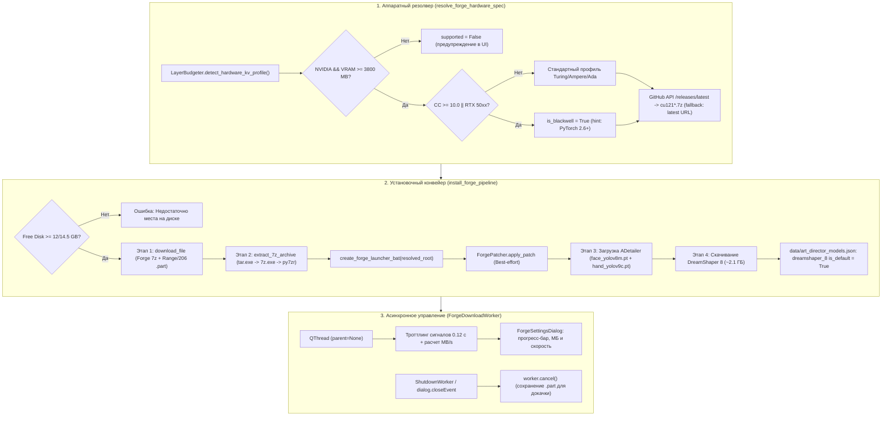
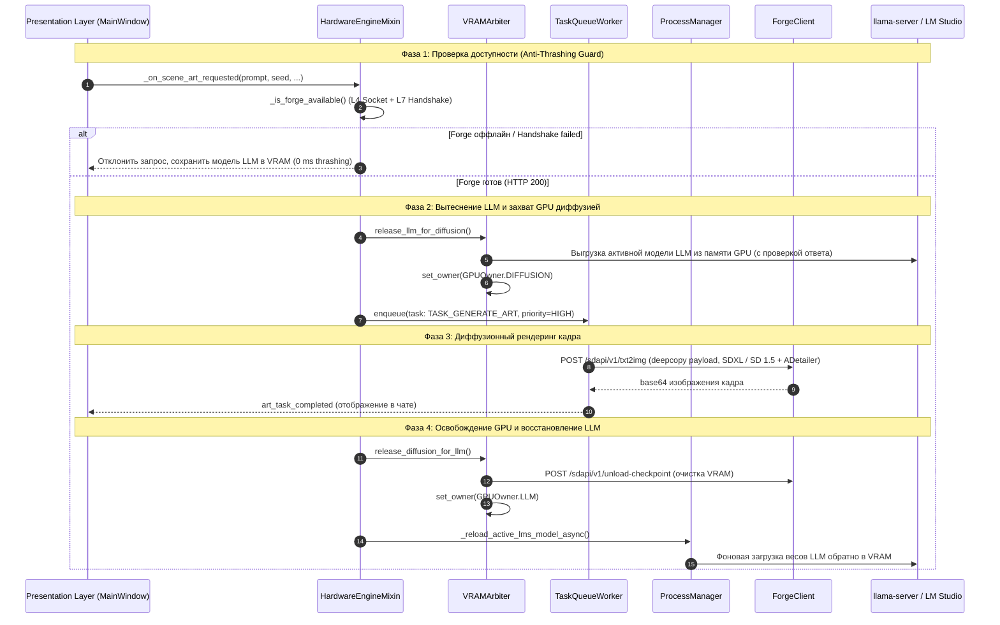
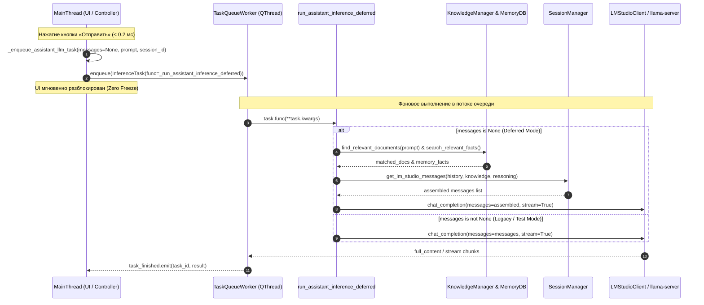
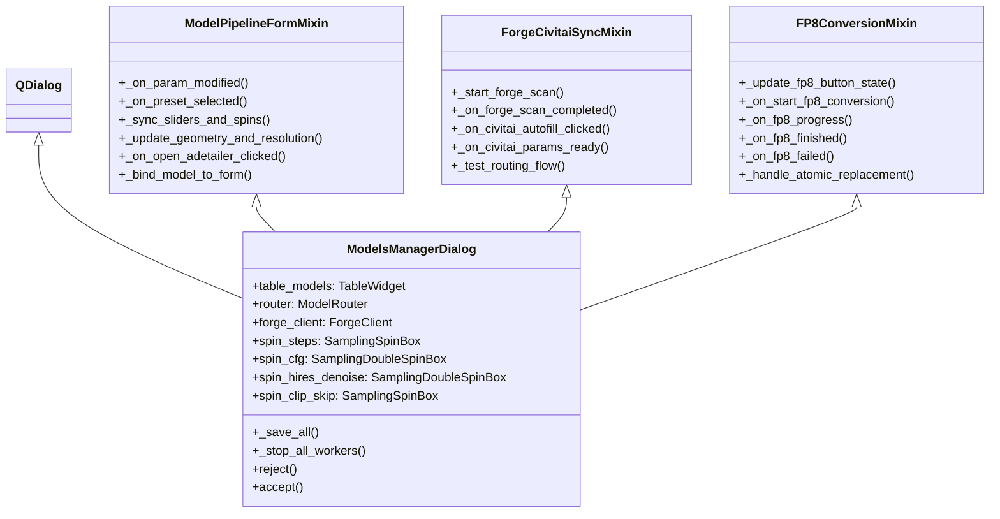
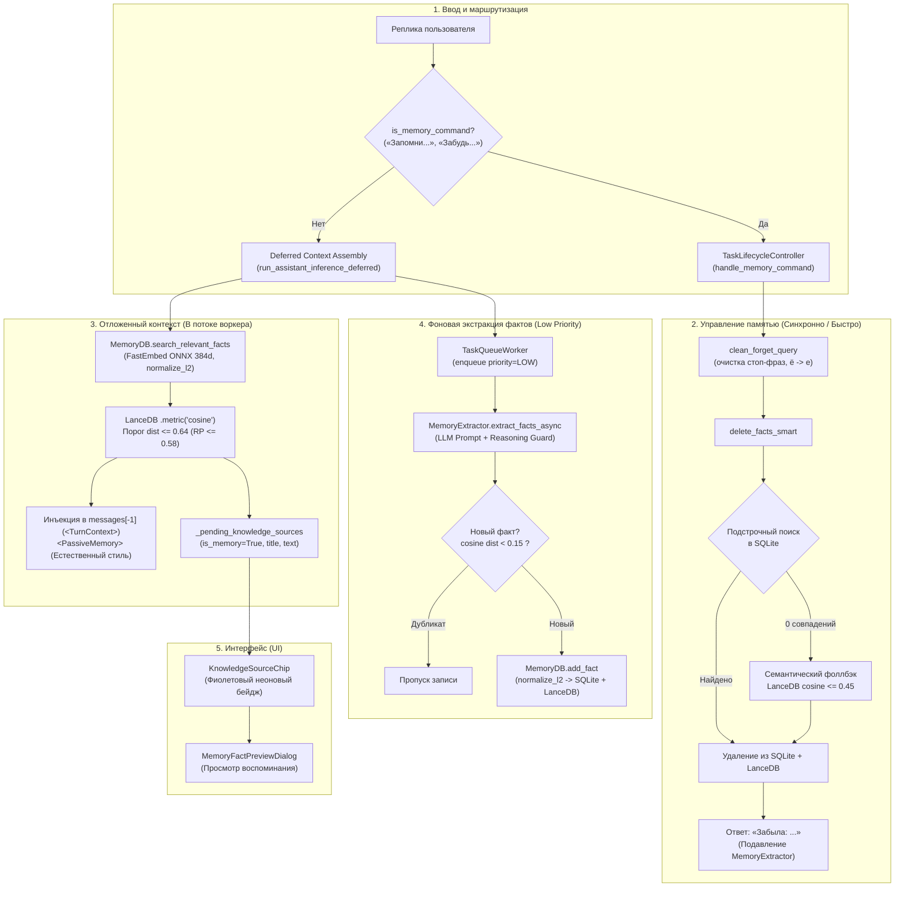
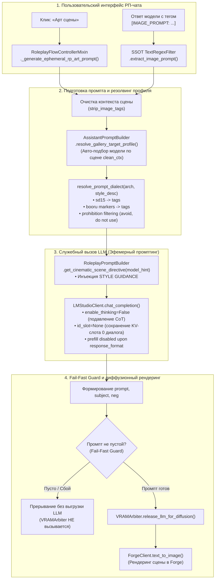
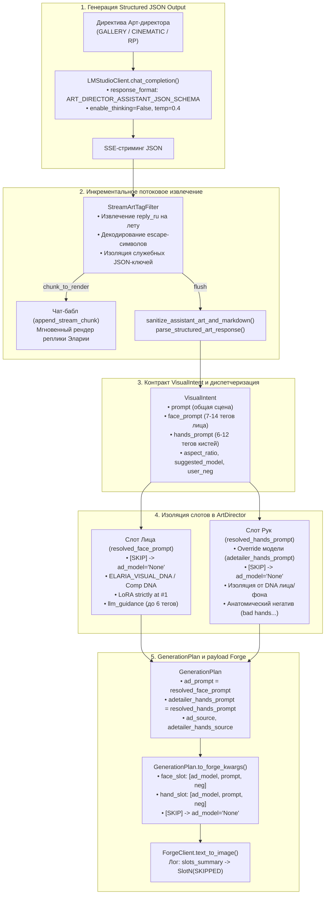

# Техническая спецификация архитектуры NeonRoute

> **Версия системы**: NeonRoute v0.9.8-beta  
> **Целевая платформа**: Windows 10/11 x64, Python 3.10+, PyQt6, QFramelessWindow, QFluentWidgets, FastAPI (Mobile Gateway)  
> **Аппаратный профиль**: 8 ГБ VRAM (NVIDIA GeForce RTX 4060 / RTX 5050 Laptop GPU / 16 ГБ RAM)  
> **Метрики кодовой базы**: 335 файлов Python, ~132 500 строк кода  
> **Статус верификации**: 926 тестов собрано и пройдено (100% Pass Rate на полном прогоне `pytest -q`)

---

## 0. Критические архитектурные инварианты (System Invariants & Guardrails)

Ниже перечислены фундаментальные правила проекта, обязательные для соблюдения при любой модификации и генерации кода:

1. **Mutual Exclusion VRAM (8 ГБ)**: LLM и SD Forge никогда не загружаются в VRAM одновременно. Любое переключение выполняется строго через `VRAMArbiter` с предварительной проверкой доступности Forge (Anti-Thrashing Guard).
2. **Static Prefix Anchoring**: Системный промпт `messages[0]` в режиме Ассистента должен оставаться побитово статичным (без timestamps, RAG и памяти) для 100% KV-cache hit. Весь динамический контекст хода (`<PassiveMemory>`, `<KnowledgeBase>`, скиллы, время) инжектируется только в `<TurnContext>` в эфемерную копию `messages[-1]`.
3. **Запрет хардкода путей Forge и артефактов**: Запрещены жесткие пути к диску `C:\` (включая `C:\neyroGPD`) и статическая привязка к конкретным папкам дистрибутивов (например, `webui_forge_cu121_torch231`). Все пути к Forge, webui, чекпоинтам SD, моделям ADetailer и апскейлерам ESRGAN разрешаются динамически через каскад `core/forge_locator.py` и `config.py` с раскрытием NTFS Junctions.
4. **Изоляция окружения Forge**: Запуск Forge обязан использовать `get_clean_forge_env()` с очисткой `VIRTUAL_ENV`, `PYTHONPATH`, прокси-переменных (`HTTP_PROXY`, `HTTPS_PROXY`, `ALL_PROXY`, `FTP_PROXY`, `AG_LS_PROXY` и их lowercase-вариантов), принудительным заданием `NO_PROXY`/`no_proxy="localhost,127.0.0.1,0.0.0.0"`, `PYTHONUNBUFFERED="1"` и удалением путей Python NeonRoute из `PATH`.
5. **Изоляция служебных вызовов LLM**: Вторичные вызовы (экстракция каста, генерация арт-промптов) обязаны передавать `enable_thinking=False`, `id_slot=None` (не вытеснять слот 0 диалога) и не передавать `assistant` prefill при активном `response_format` (JSON Schema).
6. **Раздельные слоты ADetailer**: Промпты лица (`face_slot`) и рук (`hand_slot`) изолированы в `VisualIntent` и `ArtDirector`. Неиспользуемые слоты получают маркер `[SKIP]` -> `ad_model = "None"`.
7. **Детерминизм геометрии кадра**: Явный флаг `--ar` напрямую задает разрешение холста без эвристики `has_human`. ADetailer отвязан от геометрии (`force_ad: True` во всех бакетах).
8. **Чистые миксины UI и модальная безопасность**: Контроллеры в `ui/controllers/` — чистые Python-классы без наследования от `QObject`/`QWidget`. Фоновые `QThread` создаются с `parent=None` и очищаются при закрытии. Дочерние диалоги создаются на базе `FramelessDialog` с собственным `FluentTitleBar` (запрет вложенных `MaskDialogBase`/`MessageBoxBase` поверх других модальных окон во избежание блокировки главного окна). Открытие модалок из превью баблов выполняется асинхронно через `QTimer.singleShot(0, ...)`, а при закрытии гарантированно сбрасываются все `overrideCursor` и вызывается `unsetCursor()`.
9. **Контракты Инженера (`interface_spec`)**: Режим `strict_contract=True` (Hard Contract) применяется только при наличии `verification_script` (TDD). Для самодостаточных GUI/CLI/игр (`strict_contract=False`) действует Structural Blueprint без принуждения к процедурным оберткам.
10. **CWD-независимость и Zero-Fsync**: Запись JSON выполняется атомарно через `atomic_write_json` (`os.replace`), динамический путь к конфигу разрешается через `get_config_path()`, а сессии пишутся в SQLite WAL (`data/memory.db`) с зеркалированием.

---

## 1. Обзор системы (System Overview & Tech Stack)

Система **NeonRoute** — это мультимодальный десктопный ИИ-клиент и headless-шлюз (Mobile BFF Gateway) для локального инференса нейросетевых моделей в условиях жесткого аппаратного бюджета видеопамяти (8 ГБ VRAM). Система бесшовно объединяет:

1. **Большие языковые модели (LLM)**: многомодальный контекст, три режима работы (Ассистент «Элария», Ролевой чат с поддержкой карточек Tavern/Chub, автономный агент разработки ПО «Инженер»), нативный парсинг стриминга DeepSeek-R1 `reasoning_content` и буфер цепочек мыслей до 16K токенов.
2. **Диффузионный рендеринг (Stable Diffusion WebUI Forge)**: фотореалистичный синтез сцен, портретов персонажей и окружения на базе архитектур SD 1.5, SDXL, Pony, с поддержкой LoRA, ADetailer, нативной квантизации FP8 E4M3FN, сквозного отрицания `--neg`, протокола фиксации рук Hand Anchor, ультраширокого формата 21:9 (`ultrawide`), универсального скилла `cinematic`, обратной формулы Hires.fix под VRAM без хардкодных лимитов и защиты от NaN в VAE (адаптивный выбор точности VAE: --vae-in-bf16 для RTX 30xx+ или --no-half-vae для старых GPU).
3. **Голосовой интерфейс**: синтез речи F5-TTS на CPU и голосовой ввод через Faster-Whisper.
4. **Гибридный RAG и ассоциативная память**: трехконтурный гибридный поиск (Контур 1: BM25 с сохранением term frequency; Контур 2: плотные эмбеддинги FastEmbed ONNX `paraphrase-multilingual-MiniLM-L12-v2` с L2-нормализацией и fallback на `BuiltinDenseVectorizer`; Контур 3: Weighted Normalized RRF) и долговременная память на базе SQLite WAL и оптимизированного LanceDB.
5. **Headless Mobile Gateway (`mobile_server`)**: асинхронный REST/SSE шлюз на базе FastAPI для взаимодействия с мобильными клиентами через локальную сеть или VPN (Tailscale) с единой очередью инференса.
6. **Отложенная сборка контекста (Deferred Context Assembly Runner)**: перенос ресурсоемкого поиска по базе знаний и памяти из UI-потока в рабочий поток очереди задач, снижающий латентность отправки сообщений до $< 0.2$ мс.

### Аппаратный манифест 8 ГБ VRAM

При аппаратном лимите в 8192 МБ одновременная аллокация квантованной LLM (Qwen 7B / L3-Stheno-8B: ~4.2–5.5 ГБ VRAM) и диффузионного чекпоинта SDXL (~3.2–4.8 ГБ VRAM) неизбежно приводит к падению в Shared System RAM (падение скорости инференса в 10–20 раз) или критическому сбою `CUDA out of memory` (OOM).

В основу NeonRoute заложен **принцип взаимного исключения видеопамяти (Mutual Exclusion Principle)**:
- В каждый момент времени доступ к тяжелым вычислительным тензорам GPU имеет строго одно вычислительное ядро (LLM или Diffusion).
- Переключение контекста управляется централизованным арбитром `services.vram_arbiter.VRAMArbiter`.
- На старте Forge принудительный `--always-offload-from-vram` добавляется только при `VRAM < 6.0` ГБ, а на $\ge 6$ ГБ переключение между `FAST_KEEP_VRAM`, `SMART_SWAP` и `STAGE_OFFLOAD` выполняется динамически перед каждым кадром через `/sdapi/v1/free-vram` с контролем системной RAM (`--pin-shared-memory`, Host RAM Starvation Guard).
- Предотвращение паразитного VRAM Thrashing: выгрузка LLM категорически блокируется, если сервер Forge недоступен или не прошел двухфакторный хэндшейк.

### Технологический стек

| Слой | Технологии и компоненты |
| :--- | :--- |
| **Рантайм и Ядро** | Python 3.10+, Standard Library (`ctypes`, `subprocess`, `urllib.request`, `socket`, `configparser`, `shutil`) |
| **Графический интерфейс** | PyQt6, QFramelessWindow (Cyberpunk Glassmorphism / Acrylic), QFluentWidgets |
| **Мобильный шлюз (BFF)** | FastAPI, Uvicorn, Server-Sent Events (SSE), Pydantic v2, CORS Middleware |
| **Хранение данных** | SQLite 3 (`PRAGMA journal_mode=WAL; PRAGMA synchronous=NORMAL;`), LanceDB (`table.optimize()`), Zero-Fsync JSON-зеркала |
| **Сетевые контракты** | FastAPI / Uvicorn (Mobile BFF Gateway REST + Server-Sent Events), Gradio/Automatic1111 REST API, HTTP Keep-Alive |
| **Управление ОС и процессами** | Win32 API (`kernel32.dll`: Windows Job Objects `JOB_OBJECT_LIMIT_KILL_ON_JOB_CLOSE = 0x2000`, дескрипторы скрытых процессов `CREATE_NO_WINDOW`) |
| **Контроль качества** | Pytest, pytest-mock, pytest-cov, Headless GUI Smoke Harness, AST CodeValidator, SubstanceGuard (926 тестов) |

---

## 2. Компонентная топология (Component Architecture)

### 2.1. Разграничение ответственности (Layer Boundaries)

Архитектура системы четко разделена на независимые слои с направлением зависимостей снаружи внутрь:


1. **Core Domain (`core/`)**:
   - `core/forge_locator.py`: 5-уровневый каскад обнаружения директории Forge, парсинг аргументов лаунчера (`--models-dir`, `--ckpt-dir`, `--lora-dir`), разрешение NTFS-симлинков и Junctions, изоляция окружения `get_clean_forge_env`, запись в `server_config.ini`.
   - `core/win32_job.py`: `Win32JobManager` (Singleton) на чистом `ctypes` — привязка дочерних процессов к Windows Job Object с флагом `JOB_OBJECT_LIMIT_KILL_ON_JOB_CLOSE (0x2000)`.
   - `core/session_manager.py`: фасад совместимости для SessionManager.
2. **Application Services (`services/`)**:
   - `services/process_manager.py`: оркестратор жизненного цикла внешних процессов (`llama-server.exe`, LM Studio CLI, SD WebUI Forge) с двухфакторной проверкой сокетов (L4 TCP + L7 HTTP Handshake), изоляцией daemon-потоков в тестах и гардами от удаленных QObject.
   - `services/vram_arbiter.py`: арбитраж монопольного владения GPU (`GPUOwner.NONE`, `GPUOwner.LLM`, `GPUOwner.DIFFUSION`).
   - `services/layer_budgeter.py`: топологический аудитор GPU, парсер бинарных заголовков GGUF и калькулятор слоев `-ngl` с Pre-flight RAM Guard.
   - `services/forge_client.py`: асинхронный REST-клиент SD Forge API с Watchdog, автоочисткой VRAM, глубоким копированием payload (`deepcopy`), неблокирующим выходом поллера (0.05 с) и корректной перезагрузкой чекпоинта.
   - `services/lm_studio.py`: клиент LLM инференса с поддержкой SSE-стриминга, Keep-Alive, парсинга DeepSeek-R1 `reasoning_content`, фильтрацией технического плейсхолдера `default` и перехватом HTTP 400 (Jinja/ролевые конфликты).
   - `services/art_director/`: подсистема режиссуры кадра (резолвинг стилей, LoRA, нативный флаг `--neg`, Hand Anchor Protocol, матрица флагов `--ar`, геометрия кадра, политика оффлоада).
   - `services/task_queue.py`: приоритетная однопоточная очередь инференса (`max_workers=1`, уровни `HIGH=0`, `NORMAL=10`, `LOW=20`) с поддержкой Deferred Context Assembly.
   - `services/subagent_engineer.py`, `services/engineer_tdd.py`, `services/tool_engine.py`, `services/sandbox_manager.py`: изолированная песочница и двухфазный TDD-пайплайн.
   - `services/knowledge_manager.py`, `services/hybrid_search.py`, `services/memory_db.py`: гибридный поиск RAG (BM25 TF + FastEmbed ONNX + RRF + непрерывность соседних чанков) и двухконтурная память с `LanceDB.table.optimize()`.
   - `services/mode_coordinator.py`: конечный автомат переключения режимов (Ассистент, Ролевой чат, Инженер).
3. **Headless Mobile Gateway (`mobile_server/`)**:
   - `mobile_server/api.py`: FastAPI приложение, CORS-настройки для локальной сети и VPN (Tailscale), монтирование статики и роутеров.
   - `mobile_server/dependencies.py`: внедрение зависимостей синглтонов `TaskQueueWorker`, `SessionManager`, `VRAMArbiter`, `LMStudioClient`, `ForgeClient`.
   - `mobile_server/routes/`: асинхронные эндпоинты генерации (`art.py`), чата и SSE-стриминга (`chat.py`), управления сессиями (`sessions.py`), персонажей (`characters.py`), телеметрии VRAM (`system.py`) и статических медиа (`media.py`).
4. **Presentation Layer (`ui/`)**:
   - `ui/main_window.py`: главное окно с 3-колоночным сплиттером (`SidebarWidget` | `MainContent` | `WorkspaceInspectorWidget`), интегрированное с `UIContext`.
   - `ui/controllers/`: 13 специализированных миксинов контроллеров без прямого наследования от `QObject`, включая отложенные раннеры контекста и кинематику скролла в `ChatFlowControllerMixin`.
   - Выделенные контроллеры/презентеры: `ReminderController` с явным жизненным циклом `cleanup()` и `HeaderStateController` для шапки и прогресса Forge.
   - `ui/components/`: 23 графических виджета ввода, баблов сообщений, статуса, шапки с кинематографической глубиной, сглаженных аватаров, инспектора песочницы, 16K спойлеров рассуждений `<think>`.
   - `ui/dialogs/`: 29 модальных диалогов с ленивой загрузкой через PEP 562 (включая `MobileServerDialog`, `DependencyDialog`, `ModelSamplingDialog`, `ForgeSettingsDialog`).
5. **Configuration & Utilities (`config.py`, `utils/`)**:
   - `config.py`: единый источник правды (SSOT) путей, лимитов памяти, профилей режимов, динамический метод `get_forge_models_dir()`, независимость от рабочего каталога (CWD-independence).
   - `utils/`: `system_monitor.py` (NVML/psutil), `health_checker.py` (сокетный опрос без блокировок), `file_utils.py` (атомарная запись `atomic_write_json`), `config_manager.py`.
6. **System Entry Point & Logging Hygiene (`main.py`)**:
   - `pythonw.exe` Guard: автоматическое перенаправление `sys.stdout` в `logs/stdout.log` и `sys.stderr` в `logs/stderr.log` при запуске приложения без консоли (`pythonw.exe`), предотвращающее аварийные падения библиотек инференса (`'NoneType' object has no attribute 'write'`).
   - Изоляция сбоев и аварийный дамп: регистрация обработчиков `sys.excepthook`, `threading.excepthook` и активация `faulthandler.enable(file=crash_file)` для гарантированной фиксации трассировок всех потоков в `logs/crash.log` при непредвиденных исключениях и сбоях уровня C-рантайма.

---

### 2.2. Топология файлов репозитория

```text
NeonRoute/
├── build_release.bat                    # Однокликовый батник сборщика стерильного релизного архива
├── install.bat                          # Автоматический установщик окружения (поиск Python 3.10+, оффлайн wheels\)
├── README.md                            # Документация пользователя, быстрый старт, режимы LLM/Forge и CLI
├── config.py                            # Единый источник правды (SSOT): пути, лимиты VRAM, get_forge_models_dir()
├── main.py                              # Точка входа: QApplication, setup_environment_and_logging, exception handler
├── run_mobile_server.py                 # Точка входа Headless Mobile Gateway Server (FastAPI на порту 8000)
├── server_config.ini                    # Пользовательская конфигурация путей [PATHS] (forge_root_dir, forge_path)
│
├── core/                                # Ядро и системные привязки Windows
│   ├── __init__.py                      # Инициализация пакета core
│   ├── forge_locator.py                 # 5-уровневый каскад поиска Forge, парсер аргументов, изоляция env
│   ├── session_manager.py               # Фасад совместимости SessionManager
│   └── win32_job.py                     # Win32JobManager: привязка к Job Object (KILL_ON_JOB_CLOSE = 0x2000)
│
├── mobile_server/                       # Headless Mobile Gateway Server (FastAPI / BFF)
│   ├── __init__.py                      # Инициализация пакета mobile_server
│   ├── api.py                           # FastAPI приложение, CORS, эндпоинты, монтирование static
│   ├── config.py                        # Pydantic-настройки мобильного шлюза (HOST=0.0.0.0, PORT=8000)
│   ├── dependencies.py                  # DI-провайдеры: get_task_queue, get_vram_arbiter, get_session_manager
│   ├── schemas.py                       # Pydantic-схемы валидации запросов и ответов
│   └── routes/                          # Асинхронные REST и SSE эндпоинты
│       ├── __init__.py                  # Экспорт роутеров
│       ├── art.py                       # REST API генерации изображений через TaskQueue и ForgeClient
│       ├── characters.py                # REST API карточек персонажей и аватаров
│       ├── chat.py                      # REST/SSE эндпоинты чата, стриминг токенов, SSOT-флаги арта (--self)
│       ├── media.py                     # Эндпоинты отдачи сгенерированных артов и медиа
│       ├── sessions.py                  # Управление сессиями (листинг, создание, удаление, экспорт)
│       └── system.py                    # Телеметрия VRAM, статус процессов, системный healthcheck
│
├── services/                            # Сервисный слой и бизнес-логика (Business Logic Layer)
│   ├── __init__.py                      # Инициализация пакета services
│   ├── art_director_config.py           # Загрузка/сохранение data/art_director_models.json
│   ├── asset_validator.py               # Динамический каскадный аудит Forge, чекпоинтов SD, LoRA, ADetailer и ESRGAN
│   ├── assistant_flow.py                # Пошаговый пайплайн Ассистента
│   ├── assistant_prompt_builder.py      # Сборщик промпта Эларии, resolve_gallery_target_profile, директивы SD 1.5/SDXL (thigh-up, HAND ANCHOR, --self, --neg)
│   ├── card_translator.py               # Пошаговый переводчик карточек с CJK Quality Gate
│   ├── chub_client.py                   # REST API клиент каталога Chub.ai (поиск, очистка промо-мусора)
│   ├── civitai_service.py               # Запрос параметров модели по AutoV2 SHA-256 с Civitai API
│   ├── code_engine.py                   # ASTSkeletonizer, ExecutionSandbox, AutoImporter (Zero-Token Healing)
│   ├── code_validator.py                # AST-валидатор синтаксиса, Scope Guard, квалифицированный Stub Guard (Class.method), BlockingFreeze, MissingDisplayFlip
│   ├── context_window_builder.py        # Сборщик контекста LLM, «Три якоря», Sliding CoT, проброс selected_forge_checkpoint
│   ├── direct_command_parser.py         # Парсер CLI-параметров прямого рендера (!арт / !art)
│   ├── document_parser.py               # Универсальный CPU-парсер документов (.pdf, .docx, .xlsx, .pptx, etc.) и format_markdown_table
│   ├── engineer_context.py              # Сбор файлового контекста, детерминированная нормализация форматов по границам слов (_resolve_interactive_loop_format)
│   ├── engineer_diagnostics.py          # Очистка стектрейсов, стабильный отпечаток ошибок extract_error_fingerprint, экспертные рецепты Tkinter/Pygame
│   ├── engineer_parser.py               # Отказоустойчивый парсер инструментов и Markdown (python:file, **file.py**, lookahead write_file)
│   ├── engineer_planner.py              # Фаза «Архитектор»: 3-уровневая AST-локализация узлов >250 строк, фиксация ручного скилла
│   ├── engineer_prompts.py              # Мета-промпты Архитектора, Инженера и RCA (запрет оборванных локальных импортов)
│   ├── engineer_review.py               # Ветка статического аудита, Git Diff и чекпоинтов
│   ├── engineer_skill_router.py         # Векторный роутер 5 архетипов на CPU (FastEmbed), контракт точки входа 'main' и правила монолитности
│   ├── engineer_stream.py               # Потоковый парсинг токенов LLM (CodeStreamExtractor)
│   ├── engineer_tdd.py                  # Code-First TDD пайплайн (защита эталонных тестов, детектор зацикливания TEST_FAIL, worker_temp=0.20)
│   ├── entity_mapper.py                 # Детерминированный конвертер кириллических сущностей в теги SD 1.5
│   ├── environment_doctor.py            # Аудит окружения и фоновая установка пакетов через PipInstallWorker
│   ├── file_generator.py                # Генератор стилизованных документов Excel (.xlsx) и Word (.docx)
│   ├── forge_client.py                  # REST-клиент SD Forge API (динамический VRAM-план, VAE Tiling/Never OOM, адаптивный wait, дедупликация set_model)
│   ├── forge_models.py                  # Реестр паспортов моделей SD (MODEL_REGISTRY, Capabilities)
│   ├── forge_patcher.py                 # Аудит пакетов Forge (.dist-info), фиксация constraints, лог [ForgePatcher], игнорирование путей
│   ├── git_sandbox.py                   # GitSandboxManager: локальный Git репозиторий песочницы
│   ├── hybrid_search.py                 # Гибридный поиск: BM25 (TF + stopwords) + FastEmbed ONNX + Weighted Normalized RRF (v3)
│   ├── knowledge_manager.py             # Менеджер базы знаний: [RAG-Trace], Context Stitching, has_document_anaphora, registry.json
│   ├── knowledge_watcher.py             # QFileSystemWatcher сателлит с дебаунсом 2.0 с
│   ├── layer_budgeter.py                # Топологический аудитор GPU, парсер GGUF и калькулятор слоев NGL
│   ├── lm_studio.py                     # Клиент LLM (Keep-Alive, SSE, reasoning_content, default filter, HTTP 400 guard)
│   ├── macro_engine.py                  # Парсер макросов {{user}}, {{char}}, {{random: ...}}, {{roll: XdY+Z}}
│   ├── markdown_chunker.py              # Структурный нарезчик Markdown с защитой целостности кодовых блоков
│   ├── memory_db.py                     # Хранилище памяти: SQLite WAL + LanceDB native table.optimize()
│   ├── memory_extractor.py              # Асинхронный экстрактор фактов о пользователе (PRIORITY_LOW)
│   ├── minor_safety.py                  # Детектор несовершеннолетних персонажей и фильтр безопасности
│   ├── mode_coordinator.py              # Конечный автомат режимов (Teardown -> Switch -> Boot -> Mount)
│   ├── model_router.py                  # Гибридный роутер моделей Арт-директора (триггеры + FastEmbed, reset_instance, изоляция таймера)
│   ├── patch_engine.py                  # Хирургический PatchApplier и SelfHealingEngine
│   ├── process_manager.py               # Оркестратор процессов: llama-server, Forge (resolve_forge_startup_flags), L4+L7, thread isolation
│   ├── regex_filter.py                  # Очистка тегов <think>, спецтокенов, нормализация тире
│   ├── roleplay_flow_controller.py      # Контроллер диалогового цикла RP: run_roleplay_inference_deferred, SSOT-парсинг флагов арта
│   ├── roleplay_prompt_builder.py       # Сборщик промптов RP: Depth-0 якоря, 11 архетипов, --neg в футере
│   ├── roleplay_state_manager.py        # Парсер блоков <stats>/[STATUS] (локация, инвентарь, квесты)
│   ├── rp_cast_extractor.py             # Асинхронный летописец сцены: NPC, локации, мутации, scene_type
│   ├── rp_cast_manager.py               # Менеджер состояния кампании (history/cast_<id>.json): сопартийцы
│   ├── rp_constants.py                  # Словарь ключевых слов триггеров анализа сцены (SCAN_KEYWORDS)
│   ├── rp_scene_updater.py              # Транзакционное применение изменений сцены к cast_data
│   ├── sandbox_guard.py                 # Периметр безопасности рантайма: sys.addaudithook, блокировка сети
│   ├── sandbox_manager.py               # Менеджер песочницы: изоляция проектов, Headless GUI Smoke Harness
│   ├── sandbox_runner.py                # Изолированный раннер пользовательских скриптов
│   ├── search_tokenizer.py              # Токенизатор для BM25 со стеммингом Портера RU/EN
│   ├── server_config.py                 # 3-уровневый каскад ServerConfigResolver (llama-server, CUDA, GGUF)
│   ├── session_manager.py               # Управление сессиями диалогов (SQLite WAL + Zero-fsync JSON mirror)
│   ├── skill_router.py                  # Роутер микро-скиллов Ассистента (7 базовых + custom)
│   ├── stt_service.py                   # Сервис голосового ввода (Faster-Whisper stub)
│   ├── subagent_engineer.py             # Автономный субагент «Инженер»: двухфазный цикл, разделение температур (architect/worker=0.20), анти-ступор (0.20->0.50), SubstanceGuard
│   ├── task_queue.py                    # Однопоточная приоритетная очередь задач (TaskQueueWorker)
│   ├── tavern_models.py                 # Модели CharacterCard и LoreEntry: 11 архетипов, пол, POV
│   ├── tavern_parser.py                 # Парсер карточек Tavern V1/V2/CCv3 и Chub (JSON/PNG/WebP)
│   ├── thought_stream_parser.py         # Потоковый FSM тегов <think> с 16K буфером и reasoning_content
│   ├── token_budget_manager.py          # Оценка токенов BPE, светофор карточек и 2-контурный бюджет
│   ├── tool_engine.py                   # Диспетчер инструментов песочницы (write_file, patch_file, run_pytest)
│   ├── tool_parser.py                   # Парсер тегов <TOOL:...> с поддержкой SEARCH/REPLACE
│   ├── tts_service.py                   # Клиент синтеза речи F5-TTS на CPU с резервным WAV-генератором
│   ├── user_profile_manager.py          # Менеджер профилей пользователя и кэша приветствий карточек
│   ├── vision_utils.py                  # LANCZOS-сжатие изображений в base64 для Vision-моделей
│   ├── vram_arbiter.py                  # Централизованный арбитр видеопамяти (GPUOwner, идемпотентные выгрузки)
│   ├── workspace_launcher.py            # Интерактивный запуск скриптов в отдельном окне cmd.exe /k
│   │
│   └── art_director/                    # Подсистема режиссуры изображений «Арт-директор»
│       ├── __init__.py                  # Фасад подсистемы art_director
│       ├── contracts.py                 # Контракты данных: TargetSubject, VisualIntent, SceneAnalysisContract
│       ├── director.py                  # ArtDirector: _resolve_adetailer_pipeline, _resolve_hires_policy_for_plan, [RESOLUTION] log
│       ├── geometry.py                  # Разрешения SD 1.5 и SDXL по 7 архетипам кадра (включая ultrawide 21:9)
│       ├── legacy_helpers.py            # Вспомогательные функции обратной совместимости
│       ├── lora_manager.py              # Чтение заголовков .safetensors на CPU (0 MB VRAM)
│       ├── plan.py                      # Модель GenerationPlan и сериализатор to_forge_kwargs() с прозрачным пробросом ADetailer
│       ├── prompting.py                 # ELARIA_VISUAL_DNA, parse_image_prompt_flags, detect_elaria_self_portrait_intent, негатив
│       └── vram_policy.py               # Калиброванная политика VRAM/RAM (FAST_KEEP_VRAM/SMART_SWAP/STAGE_OFFLOAD, обратная формула Hires.fix, resolve_safe_hires_scale, resolve_hires_second_pass_steps)
│
├── ui/                                  # Слой графического интерфейса (Presentation Layer)
│   ├── __init__.py                      # Инициализация пакета ui
│   ├── main_window.py                   # Главное окно MainWindow (3-колоночный сплиттер, UIContext)
│   ├── models_manager_dialog.py         # Модульный пульт управления моделями Forge, Civitai AutoFill, FP8
│   ├── engineer_skills_dialog.py        # Центр управления знаниями инженера (Skills Hub)
│   ├── log_console.py                   # Live-консоль логов (QtLogHandler, кольцевой буфер на 2000 записей)
│   ├── styles.py                        # Глобальная таблица стилей NEON_THEME_QSS
│   │
│   ├── common/                          # Общие утилиты и контекст UI
│   │   ├── __init__.py                  # Инициализация пакета common
│   │   ├── icon_utils.py                # Утилиты векторных иконок Fluent
│   │   ├── spinbox_utils.py             # Синхронизация геометрии QLineEdit (sync_spinbox_lineedit_geometry)
│   │   ├── toast_helper.py              # Централизованный хелпер показа плашек InfoBar (show_toast, TOP_RIGHT)
│   │   └── ui_context.py                # UIContext: Single Source of Truth состояния интерфейса
│   │
│   ├── builders/                        # Строители интерфейсных элементов
│   │   ├── __init__.py                  # Инициализация пакета builders
│   │   ├── chat_bubble_builder.py       # Построитель баблов чата
│   │   └── menu_builder.py              # MenuBuilder, ClickOnlyMenuBar
│   │
│   ├── controllers/                     # 13 чистых Python-миксинов и контроллеров MainWindow
│   │   ├── __init__.py                  # Инициализация пакета controllers
│   │   ├── assistant_flow_controller.py # run_assistant_inference_deferred, проброс selected_forge_checkpoint, арт-проход (--self)
│   │   ├── avatar_controller.py         # Синхронизация аватаров, меню скиллов, вызов диалогов
│   │   ├── chat_flow_controller.py      # Диспетчеризация ввода, кинематика скролла, стрим 28 FPS
│   │   ├── dialog_controller.py         # Управление модальными окнами настроек, базы знаний, экспорта
│   │   ├── engineer_controller.py       # Маршрутизация задач в SubagentEngineer, инспектор песочницы
│   │   ├── hardware_engine.py           # Управление процессами LLM/Forge, автотюн KV, guard VRAM thrashing
│   │   ├── header_controller.py         # HeaderStateController: реактивный контроллер шапки чата и Forge
│   │   ├── reminder_controller.py       # ReminderController: пуллинг напоминаний, cleanup() жизненного цикла
│   │   ├── roleplay_controller.py       # Фон сцены, сводка кампании, локализация карточек
│   │   ├── search_controller.py         # Поиск, подсветка и навигация по тексту диалога
│   │   ├── session_controller.py        # Полный жизненный цикл сессий, сэмплинга, приветствий и истории
│   │   ├── task_lifecycle_controller.py # Маршрутизация задач в очередь, перехват команд памяти
│   │   └── window_state_controller.py   # Кэширование фона главного окна и полный экран (F11)
│   │
│   ├── dialogs/                         # 29 модальных диалоговых окон приложения (Lazy Loaded via PEP 562)
│   │   ├── __init__.py                  # Реэкспорт диалогов через PEP 562
│   │   ├── about_dialog.py              # Окно «О программе», лицензии, системная информация
│   │   ├── anchor_viewer_dialog.py      # Инспектор активных системных якорей и промптов
│   │   ├── avatar_crop_dialog.py        # Интерактивный кроппер аватаров персонажей и профиля
│   │   ├── avatar_lightbox_dialog.py    # Полноэкранный просмотрщик аватаров высокого разрешения
│   │   ├── background_dialog.py         # Настройка статических и динамических фонов сцены
│   │   ├── campaign_info_dialog.py      # Дашборд кампании (Память, Инвентарь, Сценарий, Каст, Локация)
│   │   ├── campaign_subdialogs.py       # Вспомогательные окна редактора квестов и отношений
│   │   ├── card_visual_setup_dialog.py  # Визуальный конфигуратор ДНК внешности персонажа
│   │   ├── characters_gallery_dialog.py # Двухпанельная галерея персонажей, светофор токенов
│   │   ├── chub_catalog_dialog.py       # Каталог персонажей Chub.ai: поиск, импорт карточек
│   │   ├── civitai_catalog_dialog.py    # Каталог Civitai: безопасное скачивание .safetensors, SHA-256
│   │   ├── civitai_lora_dialog.py       # Браузер и загрузчик LoRA-адаптеров с Civitai API
│   │   ├── clean_cache_dialog.py        # Очиститель кэша Forge, логов, превью и LanceDB
│   │   ├── dependency_dialog.py         # Менеджер внешних пакетов и утилит окружения (cb_dont_show)
│   │   ├── engineer_settings_dialog.py  # Настройки субагента «Инженер»: лимиты итераций, тайм-ауты
│   │   ├── forge_onboarding_dialog.py   # Однократный онбординг SD WebUI Forge при первом запуске
│   │   ├── forge_settings_dialog.py     # Настройки SD Forge: пути, лаунчер, FP8, авто-арт, патчер и игнорирование
│   │   ├── gallery/                     # Модули расширенной галереи
│   │   │   ├── __init__.py              # Инициализация пакета
│   │   │   ├── character_card_widget.py # Виджет карточки персонажа в галерее
│   │   │   ├── dna_party_mixin.py       # Миксин настройки партии соратников
│   │   │   └── translation_mixin.py     # Миксин слотного перевода карточки
│   │   ├── gguf_catalog_dialog.py       # Каталог и менеджер локальных моделей GGUF
│   │   ├── help_dialog.py               # Интерактивная справочная система и шорткаты
│   │   ├── knowledge_manager_dialog.py  # Центр «Знания Эларии»: документы, скиллы, системный промпт
│   │   ├── llm_engine_settings_dialog.py# Выбор LLM бэкенда, KV/FA, и управление Thinking Mode
│   │   ├── local_lora_dialog.py         # Менеджер локальных LoRA моделей с превью весов
│   │   ├── media_gallery_dialog.py      # Галерея сгенерированных изображений сессии
│   │   ├── mobile_server_dialog.py      # QR-код и управление мобильным сервером (FramelessDialog, FluentTitleBar)
│   │   ├── model_sampling_dialog.py     # Тюнинг параметров сэмплирования (temp, min_p, DRY, XTC, spinbox sync)
│   │   ├── new_chat_dialog.py           # Мастер создания нового диалога с выбором режима
│   │   ├── prompt_viewer_dialog.py      # Инспектор сырых токенов и скомпилированного системного промпта
│   │   ├── settings_dialog.py           # Глобальные параметры интерфейса и тем оформления
│   │   ├── shutdown_dialog.py           # Диалог безопасного завершения фоновых процессов
│   │   └── user_settings_dialog.py      # Профили пользователя и игровые персоны
│   │
│   ├── components/                      # 23 специализированных графических компонента
│   │   ├── __init__.py                  # Инициализация пакета components
│   │   ├── assistant_chat_bubble.py     # Бабл ассистента с видоискателем арт-генерации (28 FPS)
│   │   ├── audio_player.py              # Встроенный аудиоплеер озвучки F5-TTS
│   │   ├── bubbles/                     # Баблы и вспомогательные рендереры
│   │   │   ├── __init__.py              # Инициализация пакета
│   │   │   ├── avatar_renderer.py       # Сглаживание краев аватаров (edge feathering), антиалиасинг
│   │   │   ├── image_preview_dialog.py  # Просмотрщик полноразмерных превью изображений
│   │   │   └── workspace_cards.py       # Карточки артефактов и файлов песочницы
│   │   ├── chat_background.py           # Виджет отрисовки киберпанк-фонов и неоновых эффектов
│   │   ├── chat_bubble.py               # Базовый бабл сообщения: Markdown, подсветка кода, экспорт
│   │   ├── chat_header_widget.py        # Шапка диалога: статус модели, кинематографическая глубина
│   │   ├── chat_input_panel.py          # Нижняя парящая капсула ввода с чипами вложений
│   │   ├── chat_list_item.py            # Элемент списка сессий в минималистичном сайдбаре
│   │   ├── chat_message_widget.py       # Обертка виджета реплики для списка истории
│   │   ├── chat_stream_widget.py        # Виджет потокового вывода токенов с мягким скроллом
│   │   ├── emoji_picker.py              # Всплывающая панель эмодзи
│   │   ├── file_card.py                 # Карточка прикрепленного документа / файла
│   │   ├── input_box.py                 # Многострочное поле ввода с автовысотой и Drag&Drop
│   │   ├── reminder_toast.py            # Всплывающее уведомление напоминаний в стиле Fluent
│   │   ├── rp/                          # Компоненты ролевого режима
│   │   │   ├── __init__.py              # Инициализация пакета
│   │   │   └── rp_chat_bubble.py        # Специализированный бабл ролевых реплик
│   │   ├── rpg_elements.py              # RPG-виджеты (<stats>, <meters>, <choices>, <check>)
│   │   ├── scroll_button.py             # Кнопка быстрого скролла вниз с индикатором новых реплик
│   │   ├── search_bar.py                # Всплывающая строка поиска по тексту чата
│   │   ├── sidebar_widget.py            # Минималистичная левая панель навигации (без бренд-хедера)
│   │   ├── status_bar_widget.py         # MainStatusBar: телеметрия VRAM/RAM, LED-индикаторы
│   │   ├── status_pill.py               # Компактный светодиодный индикатор статуса
│   │   ├── step_progress_button.py      # Кнопка с круговым индикатором прогресса генерации
│   │   ├── thought_spoiler_widget.py    # Неоновый спойлер для цепочек рассуждений <think> (16K tokens)
│   │   ├── typing_loader.py             # Анимированный индикатор набора текста
│   │   └── workspace_inspector.py       # Правая панель песочницы (дерево файлов, редактор, Git, Smoke F5)
│   │
│   ├── models_manager/                  # Модули диалога управления моделями
│   │   ├── __init__.py                  # Инициализация пакета и реэкспорт сущностей
│   │   ├── adetailer_dialog.py          # Диалог точной настройки технических параметров ADetailer (без полей промптов)
│   │   ├── mixins.py                    # Контроллер-миксины: ModelPipelineFormMixin, ForgeCivitaiSyncMixin, FP8ConversionMixin
│   │   ├── widgets.py                   # Карточки, SamplingSpinBox/DoubleSpinBox (белый текст, Compact), пресеты, ячейки
│   │   └── workers.py                   # Фоновые воркеры QThread, сканирование Forge/Civitai, FP8 квантование, изоляция потоков
│   │
│   └── workers/                         # Фоновые воркеры интерфейса
│       ├── __init__.py                  # Инициализация пакета workers
│       ├── model_discovery_worker.py    # Фоновое сканирование установленных моделей
│       ├── shutdown_worker.py           # Грациозная остановка внешних рантаймов
│       └── tool_execution_worker.py     # Выполнение инструментов песочницы в рабочем потоке
│
├── utils/                               # Системные вспомогательные утилиты
│   ├── __init__.py                      # Инициализация пакета utils
│   ├── config_manager.py                # Управление конфигурацией config.json со слиянием дефолтов
│   ├── file_utils.py                    # Атомарная запись JSON (atomic_write_json) с fsync и защитой от WinError 32
│   ├── health_checker.py                # Асинхронный сокет-монитор портов (1234, 7860, 5010) без блокировок
│   └── system_monitor.py                # Мониторинг VRAM/RAM через pynvml / nvidia-smi / psutil
│
├── scripts/                             # Диагностические и сервисные CLI-инструменты
│   ├── assistant_prompt_stand.py        # Интерактивный CLI-стенд инспекции системного промпта, скиллов и арт-пайплайна Ассистента
│   ├── build_release.py                 # Автоматический конвейер релизной сборки (AST-аудит, Quality Gate, упаковка ZIP)
│   ├── download_llama_server.py         # CLI-утилита загрузки и распаковки бинарников llama-server с верификацией версии
│   ├── forge_neonroute.patch            # Эталонный git diff патча ядра Forge 2.0 (free-vram, VRAM offload, config=None)
│   └── patch_forge.py                   # CLI-утилита инспекции, авто-бэкапа, применения и отката патчей Forge
│
├── hotfix_v098/                         # Автономный пакет хотфикса для пользователей релиза v0.9.8-beta
│   ├── apply_hotfix.bat                 # Пакетный лаунчер в 1 клик с поиском рантайма Python и chcp 65001
│   └── hotfix_llama_v098.py             # Скрипт бэкапа, патчинга кода, докачки CUDA DLL и проверки устройств
│
└── tests/                               # Пирамида тестирования (838 тестов, 100% Pass Rate)
    ├── conftest.py                      # Airgap-фикстуры (_apply_airgap_paths, check_sandbox_state_leak)
    ├── test_chat.py                     # Тестирование чат-эндпоинтов мобильного шлюза
    ├── test_engineer_task_card.py       # Карточка задач инженера и отображение логов
    ├── test_fp8_conversion_safety.py    # Безопасность FP8 квантования и парсинга тензоров
    ├── test_gallery_directives_pipeline.py # Директивы галерейного арта SD 1.5 vs SDXL, thigh-up, HAND ANCHOR, --neg
    ├── test_layer_budgeter.py           # Тесты калькулятора слоев GGUF, топологии VRAM и RAM Guard
    ├── test_main_window_baseline.py     # 14 характеризационных тестов MainWindow: жизненный цикл, FSM, шина событий
    ├── test_mobile_server_gateway.py    # Комплексный аудит эндпоинтов мобильного шлюза (REST, SSE, media)
    ├── test_prompt_and_anchor_dialogs.py# Тестирование диалогов просмотра промптов и системных якорей
    ├── test_tavern_parser.py            # Парсинг Tavern V1/V2/CCv3, Chub PNG chunk и лорбуков
    ├── test_thought_stream_parser.py    # Потоковый FSM разбор мыслей <think>, reasoning_content, 16K buffer
    ├── test_three_anchors_context_eviction.py # Вытеснение середины контекста при сохранении трех якорей
    ├── test_token_budget_manager.py     # Токенизация BPE, двухконтурная модель и светофор
    │
    ├── integration/                     # 2 сьюта интеграционных тестов безопасности и арбитража (9 тестов)
    │   ├── test_sandbox_security.py     # Безопасность песочницы: запрет импортов, path traversal, тайм-ауты
    │   └── test_vram_arbitrage_flow.py  # Сквозное переключение VRAMArbiter между LLM и Diffusion, идемпотентность выгрузок
    │
    ├── smoke/                           # 20 сьютов сквозного смоук-тестирования компонентов (106 тестов)
    │   ├── __init__.py                  # Инициализация пакета smoke
    │   ├── test_adetailer_prompt_passthrough_smoke.py # Проброс основного позитива/негатива в слоты ADetailer и UI без полей промптов
    │   ├── test_art_pipeline_smoke.py   # Сквозной смоук-тест конвейера Арт-директора и Forge
    │   ├── test_clean_pc_startup_smoke.py # Холодный старт на чистом ПК без Forge (отсутствие модальных блокировок)
    │   ├── test_dialog_sync_smoke.py    # Синхронизация при закрытии ModelsManagerDialog через reject()
    │   ├── test_forge_baseline.py       # Базовые пути Forge, аргументы запуска, фильтрация процессов
    │   ├── test_forge_edge_cases.py     # Краевые случаи: пробелы/кавычки, битый INI, directory-trap
    │   ├── test_forge_settings_dialog_smoke.py # Создание, ленивый импорт, UI-биндинги и жизненный цикл патча в ForgeSettingsDialog
    │   ├── test_forge_vram_profiles_smoke.py # Матрица профилей памяти (2–12 ГБ VRAM x 3 класса моделей), 4 ГБ RAM Guard
    │   ├── test_isolated_core_smoke.py  # Изолированное тестирование SessionManager и ContextBuilder
    │   ├── test_layer_budgeter_profiles_smoke.py # Смоук-тестирование NGL профилей Layer Budgeter (2–16 ГБ VRAM)
    │   ├── test_release_pipeline_smoke.py # Проверка контрактов batch-файлов, изоляции runtime и интеграции загрузчика llama-server
    │   ├── test_rp_art_pipeline_smoke.py# Смоук-тест конвейера арта в ролевом режиме (SD 1.5 / SDXL)
    │   ├── test_rp_card_and_ui_smoke.py # Смоук-тест карточек персонажей, каста и UI-баблов
    │   ├── test_rp_pipeline_smoke.py    # Сквозной пайплайн ролевого хода с контролем гигиены промпта
    │   ├── test_smoke_assistant_6phases_pipeline.py # 6 фаз конвейера Ассистента и галерейный single-pass
    │   ├── test_smoke_mainwindow_lifecycle.py # Zero-Freeze Startup Guard, старт окна < 1000 мс
    │   ├── test_smoke_subagent_engineer.py # Жизненный цикл субагента «Инженер» (Архитектор -> TDD -> Fix)
    │   ├── test_smoke_tool_engine.py    # Выполнение инструментов песочницы и санитизация путей
    │   ├── test_sqlite_sessions_and_leak_guard_smoke.py # SQLite WAL сессии и защита от утечек данных
    │   └── test_three_modes_deep_smoke.py # Глубокие контрактные смоук-тесты трех режимов (AST, RAG, RPG)
    │
    └── unit/                            # 68 сьютов изолированных модульных тестов (626 тестов)
        ├── test_adetailer_dialog.py     # Настройки ADetailer без полей промптов, флаги шагов/окна и сквозной проброс промпта
        ├── test_asset_validator.py      # Динамический каскад корня Forge, чекпоинтов, LoRA, ADetailer и ESRGAN
        ├── test_build_release_versioning.py # Интерактивное управление версией, валидация формата, ведение hotfix.md и откат
        ├── test_forge_patch_ignored.py  # Игнорирование предложений патча по путям, normcase и DEFAULT_SETTINGS
        ├── test_gpu_detection_fallback.py # Реестровый детектор GPU Windows для AMD/Intel/iGPU и безопасный оффлоад NGL=0
        ├── test_llama_downloader.py     # Авто-загрузчик llama-server (CUDA/Vulkan/CPU), Range-докачка, валидация cudart/cublas DLL и --list-devices
        ├── test_logging_hygiene.py      # Гигиена pythonw.exe, перенаправление stdout/stderr, crash.log и threading.excepthook
        ├── test_mobile_server_dialog.py # Жизненный цикл MobileServerDialog, QR, смена IP, остановка сервера
        ├── test_models_manager_dialog.py# 10 сквозных тестов ModelsManagerDialog: CRUD, пресеты, спинбоксы, воркеры
        ├── test_seamless_onboarding_and_models.py # Бесшовный авто-подбор .gguf моделей и умный однократный онбординг Forge
        ├── test_spinbox_geometry.py     # Синхронизация геометрии QLineEdit в спинбоксах, предотвращение 1px сжатия
        ├── test_assistant_flow.py       # Резолвинг температур и диспетчеризация арт-прохода
        ├── test_core_services.py        # Модульные тесты базовых утилит (AST, парсеры, песочница)
        ├── test_deferred_rag_execution.py # Отложенная сборка контекста (Deferred RAG), 0 мс UI-блока
        ├── test_forge_client.py         # 50+ тестов: Watchdog, deepcopy payload, 1.5s poller, reload fix, 404 free-vram fallback
        ├── test_forge_custom_paths.py   # Парсинг --models-dir, --ckpt-dir, пробелов, кавычек, симлинков
        ├── test_forge_handshake.py      # Двухфакторная проверка: L4 TCP сокет + L7 HTTP handshake
        ├── test_forge_locator.py        # 10 тестов: 5 уровней каскада локатора, INI, get_clean_forge_env
        ├── test_forge_patcher.py        # Инспекция статусов, бэкап в .neonroute_backup, автопатч, откат, webui-user.bat
        ├── test_forge_vram_policy.py    # 3-уровневая политика VRAM, RAM-гард --pin-shared-memory, TTL-кэш бюджета
        ├── test_gallery_model_routing_sync.py # Синхронизация шапки Forge (Авто/Ручной) и сохранение routing_description
        ├── test_hybrid_fastembed_rag.py # FastEmbed ONNX, BM25 TF, стоп-слова, непрерывность чанков
        ├── test_lm_studio.py            # 30+ тестов: SSE reasoning_content, default filter, HTTP 400 guard
        ├── test_path_normalization.py   # Проверка CWD-независимости и исключения хардкода диска C:
        ├── test_self_portrait_routing.py# Протокол --self, parse_image_prompt_flags, защита от ложных срабатываний «себя»
        ├── test_server_mmap_args.py     # Динамический выбор флагов mmap (--load-mode vs --no-mmap), кэш и сборка cmd в ProcessManager
        ├── test_sticky_knowledge_anaphora_e2e.py # Сквозная проверка сброса липких документов и анафорического контекста
        ├── test_thinking_tokens_and_anti_loop.py # Валидация токенов размышлений, защита Sliding CoT, анти-луп
        ├── test_toast_helper.py         # Маршрутизация show_toast, шорткаты, таймауты, fallback parent
        ├── test_vram_guard.py           # Защита от VRAM Thrashing при оффлайн Forge
        └── test_win32_job.py            # Windows Job Objects: Singleton, fallback на Linux, Popen handle
```

---

## 3. Подсистема управления внешними AI-рантаймами (Runtime & Process Lifecycle)

### 3.1. Интеграция LLM рантаймов (LM Studio / llama-server)

NeonRoute поддерживает двойной контур инференса больших языковых моделей:

1. **Headless `llama-server.exe` (Основной контур)**:
   - Обнаружение бинарного файла через 3-уровневый каскад `ServerConfigResolver` (`services/server_config.py`): сконфигурированный путь -> `bin/` -> системный PATH.
   - Запуск через `ProcessManager.start_llama_server_sync`: скрытые флаги Windows (`CREATE_NO_WINDOW`, `CREATE_NEW_PROCESS_GROUP`), неблокирующий стриминг `stdout` в `logs/llama_server.log`.
   - Автоматическая подвязка CUDA 12 рантайма (`ServerConfigResolver.resolve_cuda_dir`).
   - Интеграция с `LayerBudgeter`: расчет безопасного числа трансформерных слоев (`-ngl`), параметров квантования KV-кэша (`-ctk`, `-ctv`: `q8_0`, `q4_0`, `f16`) и активации Flash Attention (`-fa on/off`).
   - **Динамический резолвер флагов mmap (`ServerConfigResolver.resolve_mmap_disable_args`)**:
     - В связи с удалением устаревшего флага `--no-mmap` в апстриме `llama.cpp` (PR #20834, PR #28334, сборки `b12470+`) и переходом на аргумент `--load-mode <none|mmap|direct_io>` (`-lm`), внедрен зондирующий вызов `[str(server_exe), "--help"]` с `cwd=server_exe.parent`, добавлением путей бинарника и CUDA в `PATH`, `CREATE_NO_WINDOW` и `timeout=5.0s`.
     - При обнаружении токена `--load-mode` возвращается современный синтаксис `["--load-mode", "none"]`; при работе со старыми бинарниками возвращается `["--no-mmap"]`.
     - Результаты кэшируются в `_MMAP_ARGS_CACHE` по нормализованному пути только при успешном выводе; при сбое или таймауте возвращается безопасный дефолт `["--load-mode", "none"]`.
     - В `ProcessManager` внедрен строгий барьер, предотвращающий дублирование аргументов при наличии в командной строке `--no-mmap`, `--load-mode`, `-lm` или префиксов `--load-mode=`, `-lm=`.
   - **Двухархивная модель загрузки и целостность CUDA рантайма (`services/llama_downloader.py`)**:
     - Дистрибуция `llama.cpp` разделена на компактный бинарник (`llama-*-bin-win-cuda-12.4-x64.zip`, ~30 МБ с `llama-server.exe` и `ggml-cuda.dll`) и тяжелый runtime-пакет NVIDIA (`cudart-llama-bin-win-cuda-12.4-x64.zip`, ~391 МБ с `cudart64_12.dll`, `cublas64_12.dll`, `cublasLt64_12.dll`).
     - В `download_file` реализован отказоустойчивый транспорт с таймаутом 60 с, 3 повторными попытками и поддержкой HTTP Range (код 206) для докачки `.part`-файлов без потери прогресса.
     - В `is_llama_server_installed` и `verify_llama_server_binary` внедрена жесткая верификация: при наличии `ggml-cuda.dll` проверяется обязательное физическое присутствие `cudart64_*.dll` и `cublas64_*.dll`. Это исключает ложноположительный пропуск докачки флагом `--if-missing` и тихое падение сервера в системную RAM (`Available devices: (none)`). На картах NVIDIA выполняется дополнительный проверочный запуск `--list-devices`.
   - **Автономный пакет хотфикса (`hotfix_v098/`)**:
     - Для пользователей дистрибутива `v0.9.8-beta` реализован автономный пакет восстановления в 1 клик (`apply_hotfix.bat` + `hotfix_llama_v098.py`), выполняющий резервное копирование `.bak`, идемпотентный патч `server_config.py` / `process_manager.py`, автоматическую докачку недостающих CUDA DLL и верификацию инициализации GPU.
   - **Асимметричное квантование KV-кэша (`-ctk q8_0 -ctv q4_0`)**:
     - В `services/server_config.py` внедрен SSOT-резолвер `resolve_kv_cache_types(raw_type)` с поддержкой пресета `q8_0_q4_0`, квантующего ключи (Keys) в `q8_0` для сохранения точности матрицы внимания и значения (Values) в `q4_0` для снижения объема кэша на 50%. Эффективный размер KV-пары составляет 6 бит/токен/слой.
     - Интеграция с Flash Attention (`-fa on`) и синхронизация селектора в `LLMEngineSettingsDialog`.
   - **Сохранение и восстановление контекста слотов llama-server (`--slot-save-path`)**:
     - Запуск `llama-server.exe` с аргументом `["--slot-save-path", str(KV_SLOTS_DIR)]` (`data/kv_slots/`).
     - При вытеснении LLM под диффузию (`ProcessManager._save_kv_slot_for_eviction`) отправляется `POST /slots/0?action=save` с сохранением дампа слота в `evicted_slot_0.bin` и метаданных в `slot_metadata.json` (включая эффективное число слоев оффлоада `gpu_layers`).
     - При возврате LLM в VRAM (`ProcessManager._restore_kv_slot_after_start`) выполняется строгая валидация метаданных слота (`model_path`, `n_ctx`, `kv_cache_type_k`, `kv_cache_type_v`, `flash_attention` и топологии оффлоада слоев `gpu_layers`).
     - При несовпадении любого из параметров (включая изменение числа слоев оффлоада, например NGL=99 vs NGL=47) кэш слота безопасно инвалидируется через `clear_kv_slot_cache()`, вызов `action=restore` пропускается во избежание сбоев аллокации (`bad allocation`) и рассинхронизации топологии тензоров в памяти, а инференс выполняется с чистого prefill.
     - При совпадении вызывается `POST /slots/0?action=restore`, восстанавливая полный контекст сессии за ~1.0 с (~1.2 ГБ слота) без задержки TTFT (Time-to-First-Token) и без повторного вычисления токенов диалога.
     - Потокобезопасная очистка кэша слотов `clear_kv_slot_cache()` при смене активной модели или завершении приложения.
   - **Синхронизация логического и физического микробатча (`-b` / `-ub`)**:
     - Передача в CLI запуска аргументов `["-b", str(batch_size), "-ub", str(ubatch_size)]`.
     - `ServerConfigResolver` считывает `batch_size` из `server_config.ini` (секция `[SERVER]`) со значением по умолчанию `DEFAULT_LLAMA_BATCH_SIZE = 512` и гарантирует инвариант `batch_size >= ubatch_size` (дефолт `DEFAULT_LLAMA_UBATCH_SIZE = 256`), исключая падения `GGML_ASSERT(batch.slot_batched || batch.size() == 0)` при обработке запросов, превышающих физический микробатч.
   - **Отказоустойчивость SSE-стриминга и Step-Down откат слоев при OOM**:
     - В `services/lm_studio.py` (`chat_completion`) реализован превентивный разбор SSE-чанков на наличие поля `"error"`, возвращаемого сервером при ошибках аллокации (`got exception: bad allocation`), с немедленным возбуждением `RuntimeError`.
     - При обрыве стрима (`0 tokens`) или OOM (`bad allocation`, `out of memory`, `cudamalloc failed`) сбрасывается конечное состояние клиента (`_is_model_unloaded = True`, `_last_loaded_model_id = None`), взводится флаг `ProcessManager.is_oom_failure = True` и сохраняется `last_error`.
     - При аварийном завершении процесса `llama-server` в рантайме (`rc != 0` из состояния `READY` или `STARTING`) `ProcessManager._stream_llama_stdout()` вызывает `_extract_llama_startup_error()` с распознаванием маркеров OOM (включая `"bad allocation"`), выставляет флаг `is_oom_failure = True` и переводит сервер в `ServerState.ERROR`. При последующем запросе `ensure_model_loaded()` это инициирует автоматический откат слоев (`base_layers - 4`) с сохранением работоспособности сервиса.
2. **LM Studio CLI (`lms`) и REST API (Резервный контур)**:
   - Взаимодействие через CLI-команды `lms server start` / `lms server stop` и постоянное HTTP Keep-Alive соединение на порту 1234.
   - **Стриминг токенов рассуждений (DeepSeek-R1 `reasoning_content`)**: парсер SSE-потока в `services/lm_studio.py` детектирует поле `delta.reasoning_content` наряду с традиционным полем `delta.content`, направляя цепочку рассуждений в `ThoughtStreamParser` с буфером до 16K токенов.
   - **Сквозное управление режимом размышлений (Thinking / Reasoning Mode)**:
     - Поддержка гибридных моделей рассуждения (Qwen 3.5, Gemma 4, DeepSeek-R1, QwQ) через глобальный параметр `"thinking_mode": "auto"` (`"auto" | "on" | "off"`) в `DEFAULT_SETTINGS` (`utils/config_manager.py`).
     - Пользовательский интерфейс в `LLMEngineSettingsDialog`: селектор на базе `SegmentedWidget` с реактивной подсказкой; сохранение `thinking_mode` не инициирует рестарт `llama-server` (рестарт выполняется только при реальном изменении квантования KV-кэша или Flash Attention).
     - Единый SSOT-резолвер `resolve_effective_thinking(mode, model_name, active_skill, explicit_override)` в `services/assistant_flow.py`: в режиме `"auto"` размышления включаются для `mode == "engineer"`, отключаются для диалогов/RP и жестко выключаются для скилла `'gallery'`.
     - Двухуровневое подавление рассуждений в `LMStudioClient`: передача `chat_template_kwargs={"enable_thinking": enable_thinking}` в тело запроса и инъекция Assistant Prefill `{"role": "assistant", "content": "<think>\n\n</think>\n\n"}` на изолированной копии `req_messages` для моделей рассуждения при `enable_thinking is False`.
     - Защита потока `ThoughtStreamParser`: автоматическая фильтрация висячих одиночных закрывающих тегов `</think>` в начале стрима при продолжении генерации после prefill.
     - Санитация контекста в `HistorySanitizer`: очистка пустых блоков `<think>\s*</think>` и одиночных `</think>` перед формированием истории для LLM.
   - **Фильтрация плейсхолдеров**: замена эвристики `startswith('default')` на строгий метод `_is_default_model_placeholder()`, сохраняющий реальные пользовательские модели вида `default_*.gguf` и отсекающий исключительно конфигурационные заглушки.
   - **Защита от сбоев переключения (HTTP 400 Jinja / Role Guard)**: перехват ошибок шаблонизатора Jinja и чередования ролей сообщений при смене модели «на лету» без аварийного падения сессии.
   - **Изоляция daemon-потоков и guard сигналов**: методы `ProcessManager` не запускают фоновые потоки-демоны в тестовой среде (`PYTEST_CURRENT_TEST`), а эмит сигналов `lms_status_changed` защищен проверкой `sip.isdeleted()` для предотвращения обращений к разрушенным объектам `QObject`.

### 3.2. Архитектура интеграции SD WebUI Forge

Подсистема SD WebUI Forge решает задачи автоматического обнаружения, безопасного старта, изоляции зависимостей и динамического разрешения моделей:

```mermaid
flowchart TD
    subgraph Discovery ["1. Каскадный локатор (core/forge_locator.py)"]
        D1["1. configured_path"] --> D2["2. os.environ['FORGE_ROOT_DIR']"]
        D2 --> D3["3. server_config.ini ([PATHS] -> forge_root_dir)"]
        D3 --> D4["4. Относительные каталоги (../neyroGPD, ../sd-webui-forge)"]
        D4 --> D5["5. Сканирование корней дисков (C:/, D:/ ... Z:/)"]
        D5 --> D6["6. Безопасный фоллбек: Path.cwd() / 'forge'"]
    end

    subgraph Args ["2. Динамический резолвер путей моделей"]
        PARSER["parse_forge_launcher_args(launcher_path)"]
        PARSER --> FLAG_CKPT["--ckpt-dir (Приоритет 1)"]
        PARSER --> FLAG_MODELS["--models-dir / Stable-diffusion (Приоритет 2)"]
        PARSER --> FLAG_DEFAULT["forge_root / models / Stable-diffusion (Приоритет 3)"]
        FLAG_CKPT & FLAG_MODELS & FLAG_DEFAULT --> RESOLVE["Path.resolve() (NTFS Junctions & Symlinks)"]
    end

    subgraph Isolation ["3. Изоляция окружения (get_clean_forge_env)"]
        ENV["os.environ"] --> POP_VENV["Удаление VIRTUAL_ENV, PYTHONPATH, PYTHONHOME"]
        POP_VENV --> CLEAN_PATH["Санитация PATH (удаление .venv/Scripts и .venv/bin)"]
        CLEAN_PATH --> CLEAN_ENV["Изолированный словарь env"]
    end

    subgraph Verification ["4. Двухфакторная проверка доступности"]
        L4["Фаза 1: L4 Сокет (is_port_open, timeout=0.3s)"] -->|Открыт| L7["Фаза 2: L7 HTTP Handshake (verify_forge_http_handshake, timeout=0.8s)"]
        L7 -->|HTTP 200 на /sdapi/v1/options| READY["Сервер готов к инференсу"]
        L7 -->|Таймаут или 404/502| PORT_CONFLICT["Конфликт портов! Gradio -> порт 7861"]
    end

    subgraph ClientHardening ["5. Защита клиента (services/forge_client.py)"]
        MUTATION["Защита от мутации: deepcopy(params)"]
        POLL["Неблокирующий выход поллера: join(0.05s)"]
        RELOAD["Корректный сброс _checkpoint_unloaded"]
    end

    subgraph Hardening ["6. Защита процессов (Win32JobManager)"]
        JOB["CreateJobObjectW(KILL_ON_JOB_CLOSE = 0x2000)"]
        PROC["subprocess.Popen(env=clean_env)"] --> ASSIGN["AssignProcessToJobObject(job, proc._handle)"]
        JOB -.->|Авто-уничтожение при аварии родителя| KILLED["Уничтожение cmd.exe / python.exe"]
    end
```



#### Каскадный локатор (`core/forge_locator.py`)
Разрешение рабочей директории Forge осуществляется через строгий 5-уровневый каскад:
1. **`configured_path`**: Явный параметр вызова API.
2. **`os.environ["FORGE_ROOT_DIR"]`**: Переменная окружения. Имеет абсолютный приоритет над INI-файлом, гарантируя изоляцию в CI/CD и тестах.
3. **`server_config.ini` (`[PATHS] -> forge_root_dir` / `forge_path`)**: Пользовательская настройка в конфигурационном файле. Поддерживает UTF-8 пути с кириллицей и пробелами.
4. **Относительные каталоги портативных сборок**: Поиск относительно корня NeonRoute (`../neyroGPD`, `../sd-webui-forge`, `../Forge`, `./forge`).
5. **Автосканирование смонтированных дисков**: Быстрая проверка без рекурсии стандартных папок верхнего уровня на всех доступных дисках Windows (`C:/`, `D:/` ... `Z:/`): `<диск>:/neyroGPD`, `<диск>:/sd-webui-forge`, `<диск>:/Forge`, `<диск>:/AI/Forge`, `<диск>:/webui_forge`.
6. **Безопасный фоллбек**: Локальная папка `forge`.

Критерий валидности каталога (`is_valid_forge_dir`): директория признается рабочей только при наличии хотя бы одного исполняемого файла лаунчера (`forge_launcher.bat`, `webui-user.bat`, `run.bat`, `launch.py`) с обязательной проверкой `p.is_file()`, что предотвращает directory-trap ошибки при наличии подпапок с именами лаунчеров.

#### Динамическое разрешение путей моделей и симлинков (`core/forge_locator.py`)
- Функция `parse_forge_launcher_args(launcher_path: Optional[Path]) -> Dict[str, Path]` извлекает флаги `--models-dir`, `--ckpt-dir`, `--lora-dir`, `--embeddings-dir` из bat/cmd/sh файлов, корректно обрабатывая пути в кавычках, пробелы и синтаксис вида `--models-dir="E:\Models"`.
- Функция `resolve_forge_models_directory(forge_root, launcher_path)` применяет строгий каскад приоритетов (`--ckpt-dir` > `--models-dir / Stable-diffusion` > `forge_root / models / Stable-diffusion`).
- Все пути нормализуются через `Path.resolve()`, что прозрачно раскрывает NTFS Junctions (`mklink /J`) и символические ссылки Windows.

#### Изоляция окружения дочернего процесса (`get_clean_forge_env`)
- Из словаря переменных окружения дочернего процесса Forge безусловно удаляются `VIRTUAL_ENV`, `PYTHONPATH`, `PYTHONHOME`.
- Из переменной `PATH` удаляются директории активного виртуального окружения NeonRoute (`.venv\Scripts`, `.venv\bin` и любые подкаталоги `VIRTUAL_ENV`), исключая подмешивание несовместимых версий зависимостей.
- Безусловная очистка сетевых прокси-переменных: удаляются `HTTP_PROXY`, `HTTPS_PROXY`, `ALL_PROXY`, `FTP_PROXY`, `AG_LS_PROXY` и их варианты в нижнем регистре (`http_proxy`, `https_proxy`, `all_proxy`, `ftp_proxy`, `ag_ls_proxy`), что предотвращает сбои локального HTTP handshake (`/sdapi/v1/options`) из-за перехвата трафика системными или корпоративными прокси.
- Явно задаются локальные исключения: `NO_PROXY="localhost,127.0.0.1,0.0.0.0"`, `no_proxy="localhost,127.0.0.1,0.0.0.0"` и флаг немедленного сброса потоков вывода `PYTHONUNBUFFERED="1"`.
- Сохраняются критические системные каталоги Windows (`System32`, `SystemRoot`, `ComSpec`, `TEMP`) и пути к NVIDIA CUDA Toolkit (`CUDA 12.1\bin`).

#### Двухфакторная верификация доступности (L4 TCP + L7 HTTP Handshake)
- Функция `verify_forge_http_handshake(host="127.0.0.1", port=7860, timeout=0.8) -> bool` на базе стандартной библиотеки `urllib.request` выполняет легковесный GET-запрос к эндпоинту `/sdapi/v1/options` с заголовком `User-Agent: NeonRoute-Handshake/1.0`.
- Возвращает `True` строго при получении HTTP-статуса `200 OK`. При `404` или `502` возвращается `False`, предотвращая ложное распознавание посторонних локальных сервисов.

#### Управление процессами и таймаутами запуска (`services/process_manager.py`)
- В методах `_run_forge_stop` и `shutdown_all` фильтрация процессов `psutil` выполняется строго по полному нормализованному пути рабочей папки (`forge_dir_str in cmd_str`), исключая случайное завершение редакторов кода или терминалов.
- При наступлении таймаута ожидания готовности Forge (`start_forge_process`) дерево процессов грациозно останавливается через `kill_process_tree()`, закрывается файловый дескриптор `_forge_log_file` и сбрасывается ссылка на процесс, не снижая строгости критерия HTTP 200 на `/sdapi/v1/options`.

### 3.2.1. Встроенный загрузчик и конвейер автоустановки Forge, DreamShaper 8 и ADetailer (`services/forge_downloader.py`)

Для исключения ручной настройки визуального движка пользователем внедрена подсистема автономной установки полного стека SD WebUI Forge:



1. **Транспорт и докачка (`download_file`)**:
   - Единый с `LlamaDownloader` HTTP-транспорт с таймаутом 60 с, 3 ретраями и поддержкой докачки через `.part` (HTTP Range / 206 Partial Content).
   - При отмене пользователем (`cancel()`) файл `.part` не удаляется, позволяя продолжить скачивание с прерванного байта.

2. **Каскадная 3-фазная распаковка (`extract_7z_archive`)**:
   - **Фаза 1 (нативная Win32):** Системный `tar.exe` (Windows 10 билд 17063+ / Windows 11 bsdtar с libarchive), выполняемый без всплывающего окна (`CREATE_NO_WINDOW`).
   - **Фаза 2 (системная утилита):** Поиск бинарников `7z.exe` / `7za.exe` в `PATH`, `C:\Program Files\7-Zip\` и `C:\Program Files (x86)\7-Zip\`.
   - **Фаза 3 (чистый Python fallback):** Библиотека `py7zr>=0.20.0`.
   - Если все методы завершились неудачно, архив сохраняется на диске со статусом `MANUAL_EXTRACT_REQUIRED`.

3. **Генерация безопасного лаунчера (`create_forge_launcher_bat`)**:
   - В корне `forge_root` генерируется `forge_launcher.bat`:
     ```bat
     @echo off
     set BASE_DIR=%~dp0
     set PATH=%BASE_DIR%system\python;%BASE_DIR%system\python\Scripts;%BASE_DIR%system\git\bin;%PATH%
     cd /d "%BASE_DIR%webui"
     python.exe launch.py %*
     ```
   - Решает критический конфликт официального дистрибутива Forge, где `run.bat` теряет аргументы `%*`, а `webui-user.bat` затирает `COMMANDLINE_ARGS=`, гарантируя доставку флагов `--api`, `--port 7860` и VRAM-политик.

4. **Автоматическая регистрация DreamShaper 8**:
   - При установке стартового чекпоинта `dreamshaper_8.safetensors` конвейер обновляет `data/art_director_models.json`, выставляя профилю `"dreamshaper_8"` признак `"is_default": True` и сбрасывая его у нескачанного `"model_sd15.safetensors"`. Это позволяет пользователю генерировать арты сразу после установки без ручного сканирования через `ModelsManagerDialog`.

5. **Валидация физических дисков и жизненный цикл `ForgeDownloadWorker`**:
   - **Защита от отсутствующего диска (`validate_or_fallback_forge_dir`, `get_default_forge_install_dir`)**: перед созданием папок и скачиванием выполняется валидация существования физического корня диска (`Path(target_dir).anchor`). Если целевой путь указывает на отсутствующий том (например, `D:\neyroGPD` при наличии только диска `C:`), предотвращается краш и ошибка `[WinError 3]` с автоматическим переводом на системный диск (`C:\sd-webui-forge` или `C:\neyroGPD`).
   - **Синглтон и изоляция потока**: `ForgeDownloadWorker` управляется как синглтон активного инстанса (`ForgeDownloadWorker.get_active_instance()`) с `parent=None`. Это гарантирует отсутствие гонок потоков при повторном нажатии кнопок, безопасное переподключение сигналов `progress_signal` и `finished_signal` при закрытии/переоткрытии `ForgeSettingsDialog`, а также исключает прямые обращения к виджетам из не-GUI потока.

### 3.2.2. Аудит, фиксация версий библиотек и патчинг Forge (`services/forge_patcher.py`)

Сервис `ForgePatcher` обеспечивает безопасность и стабильность взаимодействия NeonRoute с ядром SD WebUI Forge:

1. **Инспекция эталонного Forge и динамическая фиксация constraints**:
   - При проверке статуса библиотек (`check_libraries_pinned`) инспектируется наличие файла `neonroute_constraints.txt`.
   - Если файл ограничений пока отсутствует, сервис выполняет глубокую инспекцию метаданных директорий `.dist-info` в `site-packages` встроенного Python Forge (`check_site_packages_pinned`).
   - Если установленные версии пакетов уже соответствуют эталонным:
     - `fastapi == 0.104.1`
     - `starlette == 0.27.0`
     - `pydantic == 2.8.2`
     - `pydantic-core == 2.20.1`
     - `gradio == 4.40.0`
     - `gradio-client == 1.2.0`
     - `anyio == 3.7.1`
     - `typing-extensions == 4.16.0`
   - Сервис распознает окружение как полностью совместимое (эталонное) и автоматически генерирует локальный файл `neonroute_constraints.txt` в каталоге `webui` без принуждения пользователя к повторному накатыванию патча.
2. **Структурированный аудит-лог `[ForgePatcher]`**:
   - Каждая проверка статуса сопровождается подробным логированием с точным указанием версий библиотек, пути к `site-packages` и обнаруженных несовпадений, что исключает «слепую» диагностику.
   - Безопасное чтение атрибутов лаунчера через `getattr(x, 'config', None)` предотвращает сбои при нестандартных объектах конфигурации.
3. **Механизм подавления повторных предложений патча (`forge_patch_ignored_paths`)**:
   - В `DEFAULT_SETTINGS` (`utils/config_manager.py`) внедрен список `"forge_patch_ignored_paths": []`.
   - Пути нормализуются с учетом регистра и абсолютного разрешения для Windows через `os.path.normcase(os.path.abspath(str(path)))`.
   - В диалоге `ForgeSettingsDialog` размещен чекбокс «Больше не предлагать патч для этой папки». При его отметке директория вносится в список игнорирования, и диалог не навязывает применение патча при открытии, если пользователь сознательно использует собственную сборку.
4. **Обратимый откат изменений**:
   - Создание резервных копий в `.neonroute_backup/original/` перед внесением изменений.
   - Метод `revert_patch()` полностью восстанавливает исходные файлы `api.py`, `webui-user.bat`, удаляет `neonroute_constraints.txt` и возвращает окружение к исходному состоянию.

### 3.2.3. Каскадное динамическое разрешение ассетов и моделей (`services/asset_validator.py`)

Сервис `asset_validator.py` выполняет pre-flight валидацию наличия чекпоинтов SD, весов ADetailer и моделей апскейлеров ESRGAN:

1. **Ликвидация статического хардкода**:
   - Полностью устранены жесткая привязка к имени папки `webui_forge_cu121_torch231` и статический импорт `FORGE_ROOT_DIR`.
2. **Каскад динамического разрешения путей**:
   - **Корень Forge (`resolve_forge_root`)**: модуль-уровень `FORGE_ROOT_DIR` -> `config.FORGE_ROOT_DIR` -> `core.forge_locator.find_forge_root()` -> родительский каталог обнаруженного лаунчера.
   - **Лаунчер (`resolve_forge_launcher`)**: каскад кандидатов (`forge_launcher.bat`, `webui-user.bat`, `run.bat`, `launch.py`) с раскрытием NTFS Junctions через `.resolve()`.
   - **Каталог webui (`resolve_forge_webui_dir`)**: `forge_root / "webui"` -> резервный поиск `forge_root.glob("webui*")`.
   - **Чекпоинты SD (`resolve_sd_checkpoints_dir`)**: каскад флагов лаунчера (`--ckpt-dir` > `--models-dir` / `Stable-diffusion`) через `resolve_forge_models_directory`.
   - **Модели ADetailer (`resolve_adetailer_models_dir`)**: `--models-dir / adetailer` -> `forge_root / models / adetailer` -> `webui / models / adetailer`.
   - **Апскейлеры ESRGAN (`resolve_esrgan_models_dir`)**: `--models-dir / ESRGAN` -> `forge_root / models / ESRGAN` -> `webui / models / ESRGAN`.

### 3.3. Защита от процессов-сирот через Windows Job Objects (`core/win32_job.py`)

- **Синглтон `Win32JobManager`**: реализован на чистом `ctypes` стандартной библиотеки Python (без сторонних зависимостей).
- **Флаг ядра `JOB_OBJECT_LIMIT_KILL_ON_JOB_CLOSE (0x2000)`**: настраивается через вызов Win32 API `SetInformationJobObject` с классом информации `JobObjectExtendedLimitInformation (9)`.
- **Автоматическая привязка**: дескрипторы `proc._handle` внешних рантаймов привязываются к объекту задания через `AssignProcessToJobObject`.
- **Аппаратная гарантия**: при закрытии NeonRoute (включая аварийное завершение процесса или сбой питания) ядро Windows мгновенно уничтожает все дочерние процессы `cmd.exe`, `python.exe` (Forge) и `llama-server.exe`.
- **Кроссплатформенная безопасность**: при `sys.platform != "win32"` модуль плавно деградирует (возвращает `False` без выброса необработанных исключений).

---

## 4. Арбитраж ресурсов и бюджетирование памяти (VRAM & Memory Management)

### 4.1. Модель разделения 8 ГБ VRAM

Видеопамять объемом 8192 МБ делится между компонентами системы по математической модели бюджетирования:

| Сегмент памяти | Объем (МБ) | Назначение |
| :--- | :---: | :--- |
| **Total VRAM Budget** | 8192 | Полный физический объем видеопамяти NVIDIA GeForce RTX 4060 / RTX 5050 Laptop GPU |
| **OS Reserve (dGPU)** | 700 | Резерв Windows DWM / Desktop Rendering для первичного дисплея |
| **OS Reserve (iGPU)** | 150 | Резерв в режиме `PURE COMPUTE` (дисплей подключен к интегрированному видеоядру) |
| **Forge VRAM Reserve** | 450 | Неснижаемый контекст PyTorch CUDA для SD WebUI Forge |
| **Safety Margin VRAM** | 170 | Буфер предотвращения срабатывания Windows TDR (таймаут видеодрайвера) |
| **Emergency VRAM Limit** | 150 | Порог экстренной остановки инференса при опасном исчерпании VRAM |
| **Usable VRAM (Active Model)** | ~6742–7292 | Полезный бюджет для квантов LLM либо диффузионного чекпоинта |

### 4.2. Централизованный арбитр `VRAMArbiter`

Синглтон `services.vram_arbiter.VRAMArbiter` управляет эксклюзивным владением графическим процессором через состояние `GPUOwner` (`NONE`, `LLM`, `DIFFUSION`):



### 4.3. Защита от паразитного VRAM Thrashing

На системах с 8 ГБ VRAM холостой цикл «выгрузить LLM -> упасть на оффлайн Forge -> загрузить LLM обратно» приводил к потере 15–30 секунд и сильной деградации отзывчивости GUI.
В `ui/controllers/hardware_engine.py` внедрен строгий Guard доступности:
- В методах `_scene_art_pipeline`, `_on_scene_art_requested`, `_generate_scene_art_async`, `_enqueue_image_task` и `_enqueue_direct_image_task` перед вызовом `release_llm_for_diffusion()` выполняется неблокирующая проверка:
  `ProcessManager.is_forge_running()` и `ForgeClient.get_instance().is_server_ready(timeout=0.3)`.
- Если сервер Forge оффлайн, не сконфигурирован или не прошел двухфакторный хэндшейк, выгрузка LLM из VRAM **категорически блокируется**. Запрос мягко отклоняется с уведомлением пользователя, видеопамять остается стабильной.

### 4.4. Адаптивная политика оффлоада VRAM и защита Host RAM (`vram_policy` + `ForgeClient`)

Вместо жёсткой блокировки в оффлоад на $\le 8$ ГБ система динамически подбирает политику памяти для каждого кадра через `services/art_director/vram_policy.py`, `services/process_manager.py`, `services/art_director/director.py` и `services/forge_client.py`:
1. **Стартовые флаги Forge (`resolve_forge_startup_flags`)**:
   - Принудительный `--always-offload-from-vram` при старте добавляется **только** при `total_vram_gb < 6.0`. На системах с $\ge 6$ ГБ VRAM стартовый оффлоад снят.
   - **Динамическое управление точностью VAE**: через `LayerBudgeter.detect_hardware_kv_profile()` определяется архитектура GPU. Для NVIDIA GPU с `compute_cap >= (8, 0)` (RTX 30xx/40xx/50xx, архитектуры Ampere, Ada, Blackwell) передаётся флаг `"--vae-in-bf16"` (убирая легаси `--no-half-vae` и `--vae-in-fp32`), что обеспечивает нативный инференс VAE в bfloat16 и экономит до 300+ МБ VRAM без риска NaN-артефактов. Для GPU с `compute_cap < (8, 0)` или не-NVIDIA сохраняется безопасная пара `["--no-half-vae", "--vae-in-fp32"]`.
   - `should_enable_pin_shared_memory()` отключает `--pin-shared-memory` при дефиците свободной ОЗУ (порог $7500$ МБ при активной LLM, $6000$ МБ без неё или $< 9000$ МБ при отключённом `forge_sdxl_fp8_enabled` на $\le 16.5$ ГБ RAM; $< 4096$ МБ на $> 16.5$ ГБ RAM), предотвращая Host RAM OOM от page-locked буферов.
2. **Трёхуровневый планировщик кадра (`resolve_forge_offload_policy`) и адаптивный VAE Tiling**:
   - Оценка веса чекпоинта на диске (`resolve_checkpoint_file_size_mb`, `estimate_active_model_weights_mb`) + буферы базового холста, Hires.fix, ADetailer (`Face` / `Face+Hands`) и адаптеров LoRA (`LORA_ADAPTER_WEIGHT_MB = 120`), с кэшированием аппаратного бюджета GPU в `resolve_hardware_vram_budget()` (`TTL = 5.0` с).
   - **`FAST_KEEP_VRAM`** (`always_offload=False`): SD 1.5 (даже с Hires+ADetailer, пик $< 5$ ГБ) и SDXL FP8 на 8 ГБ без Hires. Для SDXL с ADetailer при холсте $\ge 960 \times 960$ или Hires принудительно выставляются `enable_vae_tiling=True` и `inference_memory_mb=512`, исключая вытеснение UNet/CLIP на пике декодирования VAE перед ADetailer.
   - **`SMART_SWAP`** (`always_offload=False`, `inference_memory_mb` `1152–1536`): пограничный бюджет (например, SDXL FP8 с Hires+ADetailer или чистая SDXL FP16 без Hires/AD).
   - **`STAGE_OFFLOAD`** (`always_offload=True`): тяжёлые связки SDXL FP16 с Hires/ADetailer или малые GPU (`VRAM <= 6144` МБ / жёсткий лимит свободной VRAM).
   - **Адаптивный порог VAE Tiling**: для SDXL включается при $\ge 1024$ px или `STAGE_OFFLOAD`; для SD 1.5 принудительный VAE Tiling отключен для стандартных портретов $\le 1.3\text{M}$ px (напр. 704x1088) во избежание сбоев точности, и активируется только при кадрах $> 1.3\text{M}$ px или VRAM $\le 6$ ГБ.
3. **Обратная формула бюджета Hires.fix (`calculate_max_hires_canvas_area` и `resolve_safe_hires_scale`)**:
   - Ликвидирован хардкод эвристических констант `K_ARCH_SD15` / `K_ARCH_SDXL`. Потолок площади вычисляется строго обратно пиковому потреблению:
     $$\text{free\_for\_hr\_mb} = \text{target\_budget\_mb} - (\text{total\_weights\_mb} + \text{base\_canvas\_mb} + \text{upscaler\_mb} + \text{ad\_stage\_mb})$$
     $$\text{max\_area} = \mathrm{int}\left(\frac{\text{free\_for\_hr\_mb}}{\text{cost\_per\_mpix}} \times 1\,000\,000\right)$$
   - Модульные константы стоимости: SD 1.5 (420 МБ fixed, 350 МБ/Mpix base, 520 МБ/Mpix Hires), SDXL (520 МБ fixed, 380 МБ/Mpix base, 700 МБ/Mpix Hires), `VAE_TILING_FACTOR = 0.65`.
   - Адаптивный спуск масштаба `resolve_safe_hires_scale()` (сетка от запрошенного масштаба вниз до 1.15): для SD 1.5 запросы 1.5x и 2.0x не срезаются, для SDXL FP8 на 8 ГБ запрос 1.50x безопасно адаптируется до 1.25x в режиме `SMART_SWAP`.
   - Безопасные дефолты: fallback апскейлера для SDXL — `"Latent"` (0 МБ оверхеда), на GPU $\le 8.5$ ГБ размер инпейнта ADetailer для SDXL ограничен 512 px.
4. **Динамический расчёт шагов второго прохода (`resolve_hires_second_pass_steps`)**:
   - Вместо жесткого хардкода 14/15 шагов число шагов вычисляется от `base_steps` и `denoising_strength` при сохранении приоритета за явным значением из профиля модели (`configured_steps > 0`).
   - Для быстрых моделей ($\le 10$ базовых шагов): $\max(4, \min(10, \text{base\_steps}))$; для стандартных моделей: $\min(22, \max(0.60 \times \text{base\_steps}, \lceil 3.0 / \text{denoise} \rceil))$.
5. **Синхронизация контракта с Forge (`/sdapi/v1/free-vram`)**:
   - В `ForgeClient.text_to_image` отслеживается пара `(always_offload, inference_memory_mb)`: любое изменение хотя бы одного параметра (включая смену резерва при неизменном `always_offload=False`) отправляет обновление в `/sdapi/v1/free-vram`.
   - При первом входе в `STAGE_OFFLOAD`, понижении из `FAST_KEEP_VRAM`/`SMART_SWAP` или дефиците RAM (`host_ram_starved`) передаётся `unload_models=True` для очистки прежних хвостов VRAM.
   - При активном решении планировщика `enable_vae_tiling=True` (обязательно для `STAGE_OFFLOAD`, GPU $\le 6144$ МБ, SDXL `>= 960x960` + ADetailer и Hires $\ge 1024$ px) выставляются `forge_vae_tiling=True`, `sd_vae_tile=True` и аргумент скрипта `"Never OOM Integrated"` (при его наличии в `/sdapi/v1/scripts` через `has_script()`).
6. **Host RAM Starvation Guard и ликвидация состояния гонки при выгрузке**:
   - При `total_ram_mb <= 6144` или `available_ram_mb <= 2500` на профилях SDXL с `total_vram_mb <= 6144` `ArtDirector._log_vram_planner_passport()` и `ForgeClient.text_to_image()` форсируют `forge_unet_storage_dtype="fp8e4"`, отключают `Hires.fix` (`force_disable_hr`) и обрезают второй слот ADetailer (`disable_secondary_adetailer`).
   - На системах с `total_ram <= 16.5` ГБ методы `ensure_system_options()` и `set_model()` в `ForgeClient` гарантируют установку `sd_checkpoint_cache = 0` и `sd_checkpoints_limit = 1`, предотвращая удержание старых моделей в системной ОЗУ.
   - В `ForgeClient._wait_for_vram_clear()` порог готовности масштабируется под размер GPU: `min(3800, max(512, int(total_vram_mb * 0.65)))`.
   - **Race Condition Unload Guard**:
     - На экземпляр `ForgeClient` добавлен мьютекс `self._unload_lock = threading.Lock()`, исключающий параллельные вызовы выгрузки из разных потоков приложения.
     - Таймаут `POST /sdapi/v1/unload-checkpoint` увеличен с 5.0 до 18.0 с, устраняя ложные таймауты при переносе 6.7 ГБ весов SDXL по PCIe в системную память.
     - При возникновении `ReadTimeout` конкурирующий `POST /sdapi/v1/free-vram` не отправляется немедленно — выдерживается пауза 1.0 с для завершения серверной операции, после чего выполняется `free_vram` с таймаутом 10.0 с.
     - В блоке `finally:` метода `text_to_image()` время ожидания закрытия потока прогресса увеличено до 1.5 с (`poller_thread.join(timeout=1.5)`), гарантируя закрытие сокета `/progress` до старта выгрузки.
     - В `HardwareEngineMixin._finalize_forge_generation()` передаётся `force=not getattr(self.forge_client, "_checkpoint_unloaded", False)`, пропуская дублирующий вызов выгрузки при уже очищенной VRAM.

### 4.5. Математическая модель `LayerBudgeter` (`services/layer_budgeter.py`)

Перед запуском `llama-server.exe` модуль `LayerBudgeter` вычисляет безопасное число слоев оффлоада (`-ngl`), исключающее вытеснение тензоров в Shared System RAM драйвером Windows WDDM:
1. **Детекция топологии и динамический опрос VRAM**:
   - Топология дисплея: проверка `nvmlDeviceGetDisplayActive` и процессов `dwm.exe` возвращает `(is_pure_compute, os_reserve_mb)` (150 МБ для `PURE COMPUTE`, 700 МБ для `PRIMARY DISPLAY`).
   - Фактический опрос занятой видеопамяти через NVML (`get_current_used_vram_mb()`): в режиме арбитража (`is_arbiter_managed=True`) эффективный резерв ОС расширяется с учётом фоновых аллокаций:
     $$\text{Effective\_OS\_Reserve} = \max(\text{OS\_Reserve},\, \lceil\text{Used\_VRAM}\rceil)$$
2. **Калиброванная формула полезной видеопамяти под WDDM**:
   $$\text{Usable\_VRAM} = \text{Total\_VRAM} - \text{Effective\_OS\_Reserve} - \text{Forge\_Reserve} - \text{Safety\_Margin} - \text{KV\_Cache} - \text{Compute\_Buffer}$$
   - **Forge Reserve**: вычитается `450 МБ` в автономном режиме (`is_arbiter_managed=False`) и строго `0 МБ` при активном арбитре (`is_arbiter_managed=True`), гарантирующем взаимное исключение.
   - **Safety Margin (WDDM Headroom)**: `SAFETY_MARGIN_VRAM_MB = 170 МБ` (+ `frag_margin` при `is_arbiter_managed=True`). Базовый буфер 170 МБ предотвращает скачки аллокаций драйвера WDDM и вытеснение тензоров в PCIe Shared Memory.
   - **Динамический Fragmentation Margin**: при недавней работе Forge ($t < 8.0$ с) запас `frag_margin = 180 МБ` начисляется только если `used_vram <= 400.0 МБ` (когда след Forge ещё не проявился в NVML); при `used_vram > 400.0 МБ` резидентный контекст процесса Forge (~345 МБ) уже вычтен в `Effective_OS_Reserve`, поэтому `frag_margin = 0 МБ` во избежание двойного штрафа.
   - **Аналитический KV-кэш (`estimate_kv_cache_mb`)**: при наличии размерностей голов в GGUF рассчитывается точный физический размер с 15% CUDA-буфером на выравнивание памяти с поддержкой раздельных типов квантования Key и Value:
     $$\text{Bytes\_Per\_Token\_Per\_Layer} = \text{Head\_Count\_KV} \times (\text{Key\_Length} \times \text{Type\_Bytes\_K} + \text{Value\_Length} \times \text{Type\_Bytes\_V}) \times 1.15$$
     (где `Type_Bytes`: `0.5625` для `q4_0`, `1.0625` для `q8_0`, `2.0` для `f16`). Для асимметричной пары `q8_0_q4_0` эффективный размер составляет 1.625 байт на измерение (экономия 25–30% VRAM по сравнению с симметричным `q8_0` при сохранении точности матрицы внимания). Для гибридных SWA-архитектур (Gemma 3/4) списочные поля усредняются по слоям и учитывается эффективное число токенов локальных слоёв с окном $\min(\text{ctx}, \text{sliding\_window} + 512)$ и глобальных слоёв с полным контекстом. При отсутствии размерностей голов действует надёжный fallback: ~64 КБ/токен для `q8_0`, ~36 КБ/токен для `q4`, ~128 КБ/токен для `f16`.
   - **Аналитический Compute & Logits Buffer**: буфер тензоров вычислений графа и выходного тензора логитов, вычисляемый от реального физического микробатча `ubatch` (`DEFAULT_LLAMA_UBATCH_SIZE = 256`, логический батч `DEFAULT_LLAMA_BATCH_SIZE = 512`) и размера словаря модели `vocab_size`:
     $$\text{Logits\_MB} = \left\lceil \frac{\text{ubatch\_size} \times \text{vocab\_size} \times 4}{1024^2} \right\rceil$$
     $$\text{Base\_Graph\_MB} = 100 \text{ (при model\_size} < 5000\text{ МБ) } \mid 140 \text{ (при } \ge 5000\text{ МБ)}$$
     $$\text{Compute\_Buffer} = \text{Base\_Graph\_MB} + \text{Logits\_MB}$$
     Примеры: Llama 2/3 (Vocab 32K) -> $140 + 32 = 172\text{ МБ}$; Qwen 2.5 (Vocab 152K) -> $140 + 149 = 289\text{ МБ}$; Gemma 4 (Vocab 262K) -> $140 + 256 = 396\text{ МБ}$. Флаги `-b <batch_size>` и `-ub <ubatch_size>` явно передаются в CLI запуска `llama-server` с соблюдением инварианта $\text{batch\_size} \ge \text{ubatch\_size}$.
3. **Бинарный парсинг GGUF-заголовков и анатомия весов**:
   - Чтение метаданных `_parse_gguf_header` с сохранением длины массива (`metadata[f"{key}.count"] = int(arr_len)`) непосредственно при чтении дескриптора типа `9` (`ARRAY`), что обеспечивает корректное определение размера словаря (`262 144` токена у Gemma 4) даже при переполнении 64 КБ буфера заголовка токенами `tokenizer.ggml.tokens`.
   - Автоматическая инвалидация устаревших записей в `models_cache.json`, если в кэше отсутствует валидное значение `vocab_size`.
   - Фиксация консервативной эвристики `Base_Overhead = Model_Size * 0.20`: гарантирует запас для моделей без weight-tying (Qwen, Llama, где отдельный `output.weight` весит 15–18% модели).
4. **Физический предохранитель гистерезиса и нормализация NGL**:
   - Нормализация NGL: дельта $\Delta \text{ngl} = |\min(\text{calc\_ngl}, \text{layers}) - \min(\text{prev\_ngl}, \text{layers})|$ устраняет ложный пробой зоны нечувствительности при NGL=99 ($|45 - 99| = 54 > 3$).
   - Переиспользование предыдущего `current_running_ngl` при $\Delta \text{ngl} \le 3$ допускается только при условии физической проходимости (`can_apply_hysteresis`): гистерезис строго блокируется, если доступный бюджет слоёв меньше запрошенного числа или если запрашивается полный оффлоад (`NGL >= total_layers`), на который не хватает видеопамяти (без допуска дефицита).
5. **Барьер синхронизации VRAM (Forge $\rightarrow$ LLM)**:
   - При переключении с диффузии на язык `VRAMArbiter.release_diffusion_for_llm(force=True)` выполняет принудительный сброс контекста Forge через `ForgeClient.free_vram(force=True)` в обход кэша `_checkpoint_unloaded`.
   - Ожидание стабилизации видеопамяти `_wait_for_vram_stabilization()` (опрос NVML с шагом 0.1 с до 1.5 с, критерий: $\text{Used\_VRAM} < 750\text{ МБ}$ или $\Delta < 15\text{ МБ}$).
6. **Pre-flight RAM Guard & Жизненный цикл процессов**:
   - При частичном оффлоаде на CPU проверяется свободная системная ОЗУ с запасом 1024–1500 МБ для ОС.
   - Исключение «зомби-NGL» и привязка к модели: при диффузионной выгрузке `ProcessManager` сохраняет `_evicted_for_forge_ngl = min(ngl, total_layers)` и `_evicted_for_forge_model`. При возврате LLM проверяется совпадение модели (сброс в `None` при смене модели пользователем), что исключает ошибочный перенос NGL на другую архитектуру. Реальный NGL передаётся в `LMStudioClient` для прозрачного логирования (`GPU layers: 48/48` или `GPU layers: 99 (all layers)`).

---

## 5. Презентационный слой и взаимодействие (UI, EventBus & Dialogs)

### 5.1. Архитектура MainWindow и шина событий (EventBus)

Главное окно `ui/main_window.py` спроектировано на базе `qframelesswindow.FramelessMainWindow` с композицией из 13 специализированных миксинов контроллеров, выделенных презентеров и единого контекста интерфейса `UIContext`:


- **Предотвращение коллизий sip.wrappertype**: все 13 миксинов контроллеров являются чистыми классами Python без прямого наследования от `QObject` или `QWidget`. Точкой входа в метакласс Qt выступает сам `MainWindow`.
- **Выделенные Presenter-классы**:
  - `ReminderController`: полностью инкапсулирует опрос SQLite-базы напоминаний, показ всплывающих карточек `ReminderToast` и имеет явный метод жизненного цикла `cleanup()` для предотвращения утечек таймеров при закрытии окна.
  - `HeaderStateController`: управляет динамическим состоянием шапки окна, светодиодными индикаторами, прогресс-баром генерации Forge и синхронизацией визуальной темы режимов.
- **Инкапсуляция кинематики скролла**: логика мягкой автопрокрутки, флаг залипания внизу (`_is_at_bottom`) и обработка плавающей кнопки `FloatingScrollDownButton` инкапсулированы в `ChatFlowControllerMixin`, исключив захламление основного класса окна.
- **Шина событий (EventBus)**: слабосвязанное взаимодействие между слоями через типизированные сигналы PyQt6 (`lms_status_changed`, `forge_status_changed`, `action_completed`, `model_installed`, `hardware_stats`).
- **Единый источник правды (UIContext SSOT)**: состояние интерфейса, активная сессия, текущий ход генерации и привязка артефактов изолированы в объекте `ui.common.ui_context.UIContext`.

### 5.2. Асинхронные очереди инференса (`services/task_queue.py`)

Все ресурсоемкие фоновые задачи (инференс LLM, диффузия Forge, синтез речи F5-TTS, компиляция песочницы, RAG-индексация) ставятся в приоритетную очередь `TaskQueueWorker`:
- **Лимит параллелизма**: `max_workers = 1` (строгий последовательный инференс на GPU).
- **Уровни приоритетов**: `PRIORITY_HIGH = 0` (пользовательский ввод и прямой рендер), `PRIORITY_NORMAL = 10` (арт сцены, озвучка), `PRIORITY_LOW = 20` (экстракция фактов, RAG-индексация).
- **Вытесняющая отмена (`abort_tasks_by_type`)**: при остановке генерации или смене сессии неприоритетные задачи мгновенно сбрасываются из очереди.
- **Универсальный воркер**: `TaskQueueWorker.run()` выполняет задачи по общему контракту `task.func(*task.args, **task.kwargs)`, подготавливая VRAM через `VRAMArbiter.prepare_for_task()` и гарантируя отсутствие взаимных блокировок.

#### Архитектура отложенной сборки контекста (Deferred Context Assembly Runner)

Ранее синхронный поиск в базе знаний (`KnowledgeManager.find_relevant_documents`), извлечение сниппетов и опрос долгосрочной памяти (`MemoryDB.search_relevant_facts`) выполнялись в UI-потоке непосредственно внутри `_on_send_clicked()` перед вызовом `enqueue()`. При размере базы знаний в сотни документов и баз памяти LanceDB это вызывало микрофризы интерфейса (20–150 мс).

В рамках архитектуры **Deferred Context Assembly Runner** реализован двухрежимный контракт задач (`Dual-Mode Task Contract`):
1. **Zero-Block MainThread**: контроллеры `_enqueue_assistant_llm_task()` и `_enqueue_roleplay_llm_task()` не обращаются к диску, базе знаний или LanceDB. Они вычисляют только легковесный бюджет токенов и сэмплирование в памяти ($< 0.2$ мс), после чего создают `InferenceTask` с `messages=None` и функцией-раннером `_run_assistant_inference_deferred` (или `_run_roleplay_inference_deferred`).
2. **Исполнение в потоке воркера (`TaskQueueWorker`)**:
   - При извлечении задачи из очереди воркер запускает раннер.
   - **Deferred RAG Mode (`messages is None`)**: раннер в фоновом потоке выполняет поиск документов в `KnowledgeManager`, извлечение сниппетов, опрос `MemoryDB`, сборку сообщений через `SessionManager.get_lm_studio_messages()` и инъекцию Depth-1 якоря / протокола `<think>`. После сборки контекста управление передается в `lm_client.chat_completion()`.
   - **Legacy / Pre-assembled Mode (`messages is not None`)**: если в задачу уже передан готовый список сообщений (в смоук-тестах или прямых вызовах), раннер напрямую делегирует его в `chat_completion()`, гарантируя 100% обратную совместимость и отсутствие повторного RAG-поиска.
3. **Сохранение метаданных и защита от «липких» документов**: источники знаний `_pending_knowledge_sources` и `active_knowledge_docs` привязываются к объекту задачи и баблу ответа; повторное использование `active_knowledge_docs` при пустом ответе RAG допускается **только** при явной документной анафоре (`KnowledgeManager.has_document_anaphora`), а самостоятельный несвязанный запрос очищает `active_knowledge_docs` и `_pending_knowledge_sources`. В `find_relevant_documents` также передаётся `previous_query` из истории диалога.
4. **Точечный per-request override сэмплирования и размышлений для SDXL (`gallery`)**: при активации скилла генерации изображений формирование арт-промпта (`enqueue_gallery_art_pass`) выполняется с принудительно заниженной температурой (`temperature=0.4`) и отключенным режимом рассуждений (`enable_thinking=False`). Эти параметры передаются точечно в `llm_kwargs` конкретного запроса в памяти, не мутируя глобальный `config.json` и профили режимов (`MODE_PROFILES`).
5. **Прозрачная диагностическая телеметрия отправки сообщений (`[SendFlow]`)**:
   - `ChatFlowControllerMixin._on_send_clicked`: входная точка пользовательской отправки, фиксирующая режим (`current_mode`), занятость UI (`is_busy`), статус сессии, длину текста и количество вложений. Блок подготовки и маршрутизации защищен барьером перехвата исключений `[SendFlow] Необработанное исключение в _on_send_clicked` без изменения логики возвратов.
   - `TaskLifecycleMixin._route_and_enqueue`: логирование параметров маршрутизации (`is_eng`, `has_vision`, `is_excel`, `is_word`) непосредственно перед передачей в контроллеры режимов.
   - `AssistantFlowControllerMixin`: фиксация метаданных задач (`id`, `name`, `task_type`, `model`, `ctx`, `max_tokens`) непосредственно перед вызовом `self.task_queue.enqueue(task)` в основном потоке Ассистента и вторичном сервисном галерейном проходе.



#### Маршрутизация арт-промптов Ассистента, выбор модели и детектор автопортрета (`--self`)

1. **Пересборка системного промпта на каждый ход (Stateless Skill Injection)**:
   - В режиме Ассистента `messages[0]` (включая секцию скилла от `SkillRouter`) пересобирается заново при каждом запросе через `run_assistant_inference_deferred` → `ContextWindowBuilder` → `AssistantPromptBuilder.build()` и **не сохраняется** в `chat_history` или файл сессии.
   - При настройке скилла `"auto"` (по умолчанию) одноразовая активация скилла (`gallery`, `code_architect` и др.) действует только на текущий ход и не переносится на последующие реплики. Фиксация скилла на всю сессию происходит только при явном выборе в контекстном меню аватара (`session.metadata["active_assistant_skill"]`). В `chat_history` после арт-ответа сохраняется только контекстный след `\n\n[IMAGE_PROMPT: ...]`.
2. **Единый SSOT-выбор модели и стиля (`AssistantPromptBuilder.resolve_gallery_target_profile`)**:
   - Состояние селектора шапки `selected_forge_checkpoint` (`ChatHeaderWidget.forge_combo`) фиксируется при постановке задачи в `_enqueue_assistant_llm_task()` и пробрасывается через `run_assistant_inference_deferred()` → `ContextWindowBuilder` → `AssistantPromptBuilder.build()`.
   - При ручном выборе модели в шапке используется строго её профиль из `ModelRouter.get_profile()`; в режиме `✨ Арт-директор (Авто)` — профиль победителя `ModelRouter.match_prompt()` (с фоллбэком на `get_default_profile()`).
   - Архитектура выбранного профиля (`sd15` / `sdxl`) определяет шаблон директивы (`GALLERY_SKILL_DIRECTIVE_SD15_TEMPLATE` или `SDXL_TEMPLATE`), а в `{model_hint}` для LLM всегда передаётся описание стиля `routing_description` (без затирания тегами `llm_guidance`, которые подмешиваются отдельно на этапе `ArtDirector._mix_guidance_tags()`).
3. **Протокол автопортрета Эларии (`--self` и SSOT-парсер флагов)**:
   - В директивах генерации LLM добавляет флаг `--self` (или `--subject elaria`) **только** при явном запросе изобразить саму Эларию; сторонние персонажи с возвратными конструкциями («девушка держит себя в руках») не маркируются как `--self`.
   - Единый парсер `parse_image_prompt_flags()` (`services/art_director/prompting.py`) извлекает `--model`/`--style`, `--neg`, `--ar` и `--self`/`--subject` для десктопа (`_dispatch_art_to_forge`), РП (`RoleplayFlowControllerMixin`), `ArtDirector` и мобильного шлюза (`mobile_server/routes/chat.py`).
   - Функция `detect_elaria_self_portrait_intent()` объединяет приоритетный сигнал `--self`, прямое упоминание `Elaria`/`Элария` в промпте и строгий синтаксический фоллбэк без подстрочных ложных срабатываний на `"себя"`, выставляя `TargetSubject.ELARIA` (инъекция `ELARIA_VISUAL_DNA`) либо `TargetSubject.SCENE_OBJECT`.
4. **CLI-стенд диагностики (`scripts/assistant_prompt_stand.py`)**:
   - Позволяет в интерактивном режиме или по флагам `-q` / `-c` / `-t` прогнать запрос через реальный пайплайн Ассистента (без запуска LM Studio и Forge) и увидеть отработавший скилл, выбранный профиль/стиль, пост-обработку `ArtDirector` и полный системный промпт `messages[0]`.
5. **Матрица геометрических архетипов и детерминированный маппинг `--ar` (`services/art_director/geometry.py`, `director.py`)**:
   - **Таблица разрешений и соотношений сторон**:
     | Архетип | SD 1.5 (`w × h`) | SDXL (`w × h`) | Соотношение | Семантическое назначение |
     | :--- | :---: | :---: | :---: | :--- |
     | `solo` | 512 × 768 | 896 × 1152 | ~2:3 / 3:4 | Вертикальный портрет одиночного персонажа (`--ar portrait`, `--ar vertical`, `--ar tall`, `--ar 2:3`) |
     | `pair` | 768 × 512 | 1152 × 896 | ~3:2 / 4:3 | Горизонтальный кадр для пар, групп, батальных сцен, монстров и техники (`--ar wide`, `--ar landscape`, `--ar horizontal`, `--ar 3:2`) |
     | `closeup` | 512 × 512 | 1024 × 1024 | 1:1 | Крупный план лица, аватар (`--ar square`, `--ar sq`, `--ar 1:1`, `--ar closeup`) |
     | `fullbody` | 448 × 768 | 832 × 1216 | ~9:16 | Узкий вертикальный кадр строго в полный рост (`--ar fullbody`, `--ar 9:16`) |
     | `cinematic` | 768 × 448 | 1344 × 768 | ~16:9 | Кинематографическая панорама горизонта (`--ar cinematic`, `--ar pano`, `--ar 16:9`) |
     | `scenery` | 768 × 512 | 1216 × 832 | ~3:2 | Чистый пейзаж / интерьер без персонажей (`--ar scenery`) |
   - **Прямое подчинение флагу `--ar` (детерминизм)**: выбор геометрии при наличии явного флага `--ar` в `plan_from_visual_intent` и `plan_generation` происходит напрямую без эвристики `has_human`. Промпты с неканоническими описаниями персонажей (`samurai`, `cyborg`, `knight`, `Mr. Freeze`, `monster`) при `--ar wide` гарантированно получают холст `pair` (`1152x896` в SDXL, `768x512` в SD 1.5), не сваливаясь в `scenery`.
   - **Декупплинг ADetailer от геометрии**: флаг `force_ad: True` закреплен за всеми бакетами (включая `scenery` и `cinematic`). Включение ADetailer зависит исключительно от настроек профиля модели в `art_director_models.json` и пользовательских тумблеров UI, а не от выбранного разрешения холста (YOLO-детектор пропускает кадр за 10 мс при отсутствии лиц).
   - **Очистка маркеров полного роста**: из `detect_scene_archetype` удалены бытовые токены (`standing`, `boots`, `dress`, `long shot`, `entire body`), оставлены только явные маркеры (`full body`, `full-body`, `full length`, `head to toe`).
   - **Защита от затирания архетипа**: при отсутствии явного флага `--ar` ветка `else:` сохраняет архетип, ранее обнаруженный `detect_scene_archetype()`, предотвращая безусловный сброс в `"solo"`.

### 5.3. Жизненный цикл диалогов и UI Re-entrancy Guards

1. **Re-entrancy Guard локатора (`_is_locating_forge`)**: флаг-блокиратор в `core/forge_locator.py` предотвращает лавинное открытие диалоговых окон выбора директории при серии быстрых кликов пользователя.
2. **Правило мягкого отказа**: если пользователь закрывает окно поиска Forge кнопкой «Отмена», статус Forge переходит в `STOPPED`, а система продолжает полноценную работу в текстовых и инженерных режимах без блокировки GUI.
3. **Ленивая загрузка тяжелых диалогов (PEP 562 Lazy Loading)**: модули `ui/dialogs/` импортируются динамически при первом вызове через механизм `__getattr__` в `ui/dialogs/__init__.py`, что снижает потребление RAM при старте и исключает фризы инициализации.
4. **Безопасность каталога Civitai (`ui/dialogs/civitai_catalog_dialog.py`)**:
   - Потоковое скачивание чекпоинтов с расчетом AutoV2 SHA-256 на лету.
   - Разрешение целевой папки через `config.get_forge_models_dir()` с автоматическим раскрытием NTFS Junctions и символических ссылок.
   - Строгая фильтрация расширений: загрузка разрешена исключительно для безопасного формата `.safetensors` (файлы `.ckpt` и `.pt` блокируются).

### 5.4. Модульная архитектура менеджера моделей (`ui/models_manager/`)

Диалог управления моделями генерации и семантического роутинга `ui/models_manager_dialog.py` реорганизован из монолитного файла (2569 строк) в модульную компонентную архитектуру с разделением обязанностей на контроллер-миксины (сокращение объема фасада до 959 строк, -63%):



1. **Контроллер-миксины (`ui/models_manager/mixins.py`)**:
   - `ModelPipelineFormMixin`: двусторонняя привязка полей формы пайплайна (сэмплеры, планировщики, шаги, CFG, денойз hires, clip skip, негативный промпт), пресеты параметров (`MODEL_PRESETS`), расчет геометрии и разрешения, синхронизация с дашбордом ADetailer. Блокировка сигналов (`blockSignals(True)`) для всех виджетов формы при загрузке модели предотвращает рекурсивные вызовы и преждевременную перезапись параметров.
   - `ForgeCivitaiSyncMixin`: фоновые интеграции сканирования локальных чекпоинтов SD Forge (`ForgeScanWorker`), парсинг параметров Civitai API (`CivitaiParamsWorker`), авторегистрация новых моделей в реестре и семантическое тестирование роутинга (`RoutingTestWorker`). Все операции сканирования и хеширования изолированы от GUI-потока.
   - `FP8ConversionMixin`: управление конвейером квантования весов в FP8 E4M3FN (`FP8ConvertWorker`), обнаружение локального torch/python окружения, Name Affinity Guard и безопасная атомарная замена файлов. Метод `_update_fp8_button_state()` выполняется за $\mathcal{O}(1)$ строковыми проверками суффиксов, не вызывая `subprocess.run` и `import torch` при открытии окна.
   - `_DynamicModuleProxy`: динамический прокси для `InfoBar`, `InfoBarPosition` и `MessageBox`, прозрачно перенаправляющий вызовы на моки `patch("ui.models_manager_dialog.*")` в существующих тестовых сьютах.

2. **Эргономика и дизайн числовых счетчиков (`SamplingSpinBox` / `SamplingDoubleSpinBox`)**:
   - Перевод на специализированные классы `CompactSpinBox` и `CompactDoubleSpinBox` из библиотеки QFluentWidgets.
   - Подключение универсального модуля `ui/common/spinbox_utils.py` (`SpinBoxGeometryEventFilter` / `sync_spinbox_lineedit_geometry`), гарантирующего защиту внутреннего `QLineEdit` от сжатия до 1 px под воздействием стилей QSS.
   - Вертикальное компактное расположение стрелок управления шагом в единый столбец справа (`padding: 0px 24px 0 6px`).
   - Четкий чистый белый цвет цифр (`color: #FFFFFF; font-size: 13px; font-weight: 500;`) в нормальном состоянии, при наведении и при фокусе, полностью соответствующий темной киберпанк-эстетике приложения.
   - Унифицированная ширина `setFixedWidth(82)` для всех четырех регуляторов, полностью устраняющая обрезание текста любых числовых параметров.
   - Жесткая блокировка нежелательной прокрутки колесиком мыши (`wheelEvent: e.ignore()`).

3. **Потокобезопасность, жизненный цикл фоновых потоков и неблокирующий FastEmbed**:
   - **Неблокирующий пересчет эмбеддингов**: в `_save_all()` и `ArtDirector.reload_models()` синхронный `update_embeddings()` полностью заменен на `self.router.update_embeddings_async(delay=0.0)`. При закрытии окна (`reject()` / крестик) контракт `test_dialog_sync_smoke.py` гарантирован: `self.router.load_profiles()` синхронизирует профили в памяти за $< 1$ мс, а векторизация выполняется в фоновом потоке без фризов GUI.
   - **Дедупликация и слияние запросов в `ModelRouter`**: блокировка `_embed_calc_lock`, флаги `_update_in_progress`, `_rerun_requested` и кэш `_last_computed_descriptors` предотвращают параллельные повторные пересчеты и устраняют взаимную блокировку с `ModelRouterDeferredWarmup` на `_EMBED_INIT_LOCK`. Подмена `cached_descriptors` и `cached_embeddings` выполняется атомарно.
   - **Разгрузка главного потока при FP8**: вызов `self.forge_client.refresh_checkpoints()` перенесен из UI-слота `_on_fp8_finished` в фоновый рабочий цикл `FP8ConvertWorker.run()`.
   - **Жизненный цикл воркеров (Инвариант 8)**: воркеры `ForgeScanWorker`, `RoutingTestWorker`, `CivitaiParamsWorker` и `FP8ConvertWorker` создаются строго с `parent=None`. Очистка ссылок на них выполняется только по Qt-сигналу `finished` с подключением `worker.finished.connect(worker.deleteLater)`.
   - **Надежная остановка `_stop_all_workers()`**: гарантированный сброс висящего `WaitCursor` (`while QApplication.overrideCursor(): QApplication.restoreOverrideCursor()`), выборочное отключение UI-сигналов (сохраняя `finished`), вызов `abort()`/`quit()`, ожидание `wait(200)` и регистрация активных потоков в `register_orphaned_worker()` с отвязкой от родителя и отложенным удалением `deleteLater`.

### 5.5. Архитектура Headless Mobile Gateway (`mobile_server/`)

Пакет `mobile_server/` реализует архитектурный паттерн Backend-for-Frontend (BFF) на базе FastAPI для подключения мобильных веб-клиентов и нативных мобильных оболочек через локальную сеть (Wi-Fi) или зашифрованный туннель Tailscale VPN:

1. **Единая очередь инференса**: мобильный сервер не создает собственных фоновых воркеров для тяжелых вычислений, а импортирует глобальные синглтоны `get_task_queue()` и `get_vram_arbiter()`. Это исключает состояние гонки за VRAM между десктопным интерфейсом и мобильным клиентом.
2. **Server-Sent Events (SSE)**: эндпоинт `/api/chat/stream` транслирует чанки сгенерированного текста и мысли `<think>` в реальном времени с поддержкой переподключения без потери позиции в диалоге через общий `ThoughtStreamParser` с гардиантом от одиночного стартового тега `</think>`.
3. **Сквозная интеграция `thinking_mode` и runtime-override для SDXL**:
   - Функция `build_chat_context_and_params` обращается к SSOT-резолверу `resolve_effective_thinking(mode, model_id, active_skill, explicit_override)` и словарю `THINKING_MODEL_KEYWORDS`, транслируя `enable_thinking` в `sampling_params`.
   - Временный per-request override для скилла `'gallery'` в мобильном чате: принудительное выставление `temperature=0.4` и `enable_thinking=False` в памяти без мутации дискового `config.json`.
   - Фаза 2 генерации тегов SDXL (`build_gallery_art_plan`) безусловно передаёт `enable_thinking=False` в `lm_client.chat_completion(...)`.
4. **Маршрутизация по доменам**:
   - `/api/system`: статус здоровья, доступность Forge и LLM, текущая загрузка видеопамяти NVML.
   - `/api/sessions`: листинг и управление диалогами, зеркалирование изменений в SQLite WAL.
   - `/api/chat`: отправка текстовых запросов, отмена генерации.
   - `/api/art`: заказ генерации артов через `ArtDirector` и Forge API с контролем очередей.
   - `/api/characters`: каталог карточек персонажей, переключение спутников.
   - `/media`: раздача сохраненных артов, аватаров и фонов сцены с динамическим кэшированием HTTP ETag 304 через `_file_response` и `_svg_response`.

### 5.6. Диалог управления мобильным сервером (`MobileServerDialog`) и модальная безопасность

Для запуска и мониторинга мобильного шлюза реализован выделенный диалог `ui/dialogs/mobile_server_dialog.py`:

1. **Ликвидация оконных дедлоков `MaskDialogBase`**:
   - В старой реализации использовалась дочерняя маска `MessageBoxBase` библиотеки `qfluentwidgets`. При открытии диалога после интерактивного превью баблов оверлей маски накладывался на все приложение и намертво блокировал события мыши и фокуса в главном окне.
   - Решение: перевод на полноценный класс `MobileServerDialog(FramelessDialog)` с собственным кастомным заголовком `FluentTitleBar`, корректным модальным циклом `exec()` и регистрацией в карте ленивого экспорта `ui/dialogs/_LAZY_EXPORTS`.
2. **Неблокирующий запуск сервера (`mobile_server/api.py`)**:
   - В функции `start_mobile_server_thread` цикл ожидания биндинга сетевого порта (`deadline = time.monotonic() + timeout`) прокачивает очередь событий интерфейса через `qapp.processEvents()`. Это полностью устраняет кратковременное замерзание UI при запуске сервера Uvicorn.
3. **Функциональные возможности диалога**:
   - Автоматическое определение всех локальных и VPN (Tailscale) IP-адресов машины через `get_mobile_server_urls()`.
   - Селектор сетевых интерфейсов `ComboBox`: при смене интерфейса QR-код динамически перерисовывается через `render_qr_pixmap`.
   - Кнопка быстрого копирования URL в буфер обмена с показом Fluent-тоста `toast_success`.
   - Кнопка «Остановить сервер» (`stop_server_requested = True`), обеспечивающая грациозную остановку потока сервера через `stop_mobile_server_thread()`.
   - Кнопка «Готово» для продолжения работы сервера в фоновом режиме.

### 5.7. Универсальная синхронизация геометрии спинбоксов (`ui/common/spinbox_utils.py`)

1. **Диагностика проблемы сжатия полей**:
   - При активных глобальных стилях `qfluentwidgets` (QSS `FluentStyleSheet.SPIN_BOX`, внутренние паддинги) внутренний виджет текстового ввода `QLineEdit` (`qt_spinbox_lineedit`) у числовых регуляторов схлопывался до ширины 1 px. Значения физически присутствовали в модели, но обрезались до тонких полос по левому краю.
2. **Архитектурное решение**:
   - Вынесена переиспользуемая функция `sync_spinbox_lineedit_geometry(spinbox: QAbstractSpinBox)`.
   - Функция инспектирует реальное присутствие кнопок управления шагом: `compactSpinButton` (для `CompactSpinBoxBase`) либо `upButton` и `downButton` (для `InlineSpinBoxBase`), рассчитывает безопасные отступы и гарантирует инвариант:
     $$\text{lineEdit().width()} \ge 24, \quad \text{lineEdit().isVisible()} = \text{True}$$
   - Реализован миксин `SpinBoxGeometrySyncMixin` (автоматическая синхронизация при `resizeEvent`, `showEvent`, `changeEvent`) и универсальный фильтр событий `SpinBoxGeometryEventFilter(QObject)` для подключения к готовым виджетам без глубокого рефакторинга наследования.
   - Унифицированное поведение внедрено во все критические спинбоксы: `ModelSamplingDialog` (параметры сэмплирования LLM) и `ui/models_manager/widgets.py` (параметры инференса Forge).

### 5.8. Безопасность превью изображений и гигиена курсоров

1. **Асинхронный запуск модального превью**:
   - В `ui/components/chat_bubble.py` открытие полноразмерного просмотра сгенерированного арта (`_open_image_preview`) отвязано от цикла нажатия мыши и переведено на вызов:
     ```python
     QTimer.singleShot(0, lambda: self._open_image_preview(self.image_path))
     ```
   - Это исключает конфликт между отпусканием кнопки мыши (`mouseReleaseEvent`), обработкой клика и модальным циклом `QDialog.exec()`.
2. **Гарантированный сброс override-курсоров**:
   - При закрытии окна `ImagePreviewDialog` в блоке `finally` бабла чата вызывается принудительный сброс залипших курсоров:
     ```python
     while QApplication.overrideCursor() is not None:
         QApplication.restoreOverrideCursor()
     if parent_win and hasattr(parent_win, "unsetCursor"):
         parent_win.unsetCursor()
     ```
   - Это гарантирует, что курсор `PointingHandCursor` («палец вверх») не зависает во всем главном окне после просмотра изображения.

### 5.9. Диагностика окружения и подавление автозапуска (`DependencyDialog`)

1. **Конфигурация автопроверки**:
   - В `DEFAULT_SETTINGS` (`utils/config_manager.py`) добавлен флаг `"check_dependencies_on_startup": True`.
   - В `utils/config_manager.py` обеспечено динамическое разрешение пути к конфигурационному файлу через `get_config_path()` (вместо жесткой заморозки пути при импорте модуля), что гарантирует изоляцию тестов при переопределении `BASE_DIR`.
2. **Поведение чекбокса «Больше не показывать при запуске» (`cb_dont_show`)**:
   - В `ui/dialogs/dependency_dialog.py` сохранение флага `check_dependencies_on_startup = False` гарантируется при любых сценариях выхода пользователя: нажатии кнопки «Пропустить» (`_on_skip`), кнопке «Готово» (`_on_finished`), закрытии по крестику (`closeEvent`) и отмене (`reject`).
   - Исключены ложные срабатывания и бесконечные рекурсивные циклы событий.

---

## 6. Хранилище данных и RAG (Data Persistence & Context)

### 6.1. Двухконтурный движок сессий (`SQLite WAL + Zero-Fsync JSON Mirror`)

Для устранения накладных расходов диска и блокировок `os.fsync` при частых обновлениях диалогов в `services/session_manager.py` реализована двухконтурная архитектура:

1. **Транзакционное ядро SQLite WAL (`data/memory.db`)**:
   - Режим `PRAGMA journal_mode = WAL; PRAGMA synchronous = NORMAL;`.
   - Таблицы `chat_sessions` и `chat_messages` с индексом `idx_chat_messages_sess`.
   - Скорость записи хода диалога `~0.1 мс`. Поля режимов (`knowledge_sources`, `thought`, `visual_intent`, `character_data`, `generation_params`) сохраняются в JSON-колонках без потерь.
   - Считывание списка сессий в боковой панели выполняется за один SQL-запрос со сверкой `st_mtime`.
2. **Быстрое файловое зеркало (`Zero-Fsync JSON Mirror`)**:
   - Файлы `history/chat_<id>.json` и `outputs/sessions/<id>/session.json` обновляются через атомарный `os.replace` без вызова `os.fsync`, сохраняя совместимость с мобильным шлюзом `mobile_server` и внешним экспортом.
   - При внешнем редактировании файла JSON `load_session()` детектирует изменение `st_mtime` и автоматически обновляет данные в SQLite WAL.
3. **Оптимизация долговременной векторной памяти LanceDB**:
   - Векторные таблицы фактов (`facts`) и ролевых воспоминаний (`rp_memories`) периодически оптимизируются через вызов `table.optimize()`, устраняющий фрагментацию файлов и устаревшие версии строк без деградации скорости семантического поиска.

### 6.2. Персоны и парсинг карточек персонажей (`services/tavern_parser.py`)

- Поддержка стандартов карточек Tavern V1, Tavern V2, Character Card V3 (CCv3) и формата Chub.ai (PNG chunk tEXt/zTXt, JSON, WebP).
- Автоматическая классификация архетипа карточки `detect_card_archetype` (11 архетипов: Fantasy, Cyberpunk, Sci-Fi, LitRPG, Modern/Slice-of-life, etc.), определение пола и POV (первое/третье лицо).
- Извлечение и динамическое подключение встроенных лорбуков (Lorebooks).
- Слотный переводчик `CardTranslator`: пошаговый перевод полей с CJK Quality Gate и защитой плейсхолдеров (`{{char}}`, `{{user}}`).

### 6.3. Контекстное окно, архитектура «Трех якорей» и Static Prefix Anchoring

Для предотвращения деградации ролевой идентичности, контекстной амнезии и потерь KV-кэша в `services/context_window_builder.py` и `services/assistant_prompt_builder.py` реализована модель несменяемых якорей:
1. **System Prompt Anchor (Anchor 1)**: базовые правила личности, ограничения безопасности, доступные микро-скиллы.
2. **Depth-0 Scene Anchor (Anchor 2)**: неизменяемый снимок канонического описания персонажа, стартового окружения и отношений.
3. **User Identity Anchor (Anchor 3)**: профиль пользователя и факты активной персоны.
4. **Динамическое контекстное окно (Sliding CoT Preservation)**:
   - При приближении к лимиту токена контекста старые ходы диалога сжимаются и вытесняются, но цепочки мыслей `<think>` последних $N$ ходов сохраняются для когерентности рассуждений.
5. **Заморозка статического префикса (Static Prefix Anchoring & `<TurnContext>`)**:
   - **Ликвидация инвалидации префикса**: из `SYSTEM_PERSONA_TEMPLATE` удален динамический штамп даты и времени, что делает `system`-сообщение побитово идентичным на каждом ходе диалога и обеспечивает 100% попадание в KV-кэш статического префикса.
   - **Инкапсуляция контекста хода (`<TurnContext>`)**: динамические метаданные текущего хода (штамп времени `[Ход диалога]`, факты долговременной памяти `<PassiveMemory>`, фрагменты базы знаний `<KnowledgeBase>`, прикрепленные документы `<AttachedDocument>` и скилл-директивы `[SYSTEM DIRECTIVE]`) упаковываются методом `build_turn_context()` и прикрепляются исключительно к эфемерной копии последнего пользовательского сообщения (`messages[-1]["content"]`). Блок `<TurnContext>` никогда не сохраняется в историю сессии `SessionManager`.
   - **Ролевая защита (Role Guard)**: в системный промпт внедрена инструкция:
     `- Служебный блок <TurnContext>...</TurnContext> в сообщении пользователя содержит системные метаданные текущего хода (время, память, активный режим). Учитывай их при ответе, но никогда не цитируй эти теги и не воспринимай их как слова самого пользователя.`
   - **Телеметрия KV-кэша и привязка слота**: в `LMStudioClient` передается `"id_slot": 0` и `"stream_options": {"include_usage": True}`, а в цикле чтения SSE извлекаются поля `"usage"` и `"timings"` (`cache_n`, `prompt_n`) из финального чанка, формируя диагностический лог:
     `prompt_tokens=X (KV hit: Y tok, eval: Z tok), completion_tokens=...`

### 6.4. Гибридный поиск RAG (`services/hybrid_search.py`, `services/knowledge_manager.py`)

Поиск по базе знаний Эларии выполняется строго на CPU (0 МБ VRAM, латентность $< 50$ мс) и асинхронно в фоновом потоке воркера (Deferred RAG). Архитектурно пайплайн состоит из двух поисковых веток (BM25 + один Dense-векторизатор) и третьего контура слияния/фильтрации:

```text
[Пользовательский файл]
        │
        ▼
DocumentParser (.pdf, .docx, .doc, .xlsx, .csv, .pptx, .fb2, .txt, .md, .py, .json;
                таблицы DOCX/XLSX/CSV унифицируются через format_markdown_table)
        │
        ▼
MarkdownChunker (500–1400 симв., overlap 150, сохранение кодовых блоков ``` и шапки таблиц)
        │
        ▼
[Запрос пользователя] ──▶ Pre-retrieval Gatekeeper (ранний выход при пустом registry.json;
                          is_conversational_query: small talk <= 3 слов отсекается ДО загрузки
                          FastEmbed на холодном старте и ДО поиска BM25/Dense)
        │
        ├───────────────────────────────────────────┐
        ▼                                           ▼
  Контур 1: BM25Index                         Контур 2: Dense-векторизатор
(Точная частота TF, стемминг                  • Основной: FastEmbed ONNX
 RU/EN, стоп-слова, артикулы,                   (paraphrase-multilingual-MiniLM-L12-v2, 384d, L2)
 hex-коды 0x...)                              • Graceful Fallback (при сбое ONNX): BuiltinDenseVectorizer (256d)
        │                                           │
        └─────────────────────┬─────────────────────┘
                              ▼
                 Контур 3: HybridSearchEngine
                              │
        Weighted Normalized RRF (k=60, w_dense=0.6, w_bm25=0.4)
                              │
        Post-retrieval Gatekeeper (при BM25 == 0: dense >= 0.55 для FastEmbed / >= 0.75 для fallback)
                              │
        KnowledgeManager (триггеры registry.json, Next-Chunk Continuity + Context Stitching,
                          бюджет до 6 чанков / 3600 симв. (синхронизировано с AssistantPromptBuilder),
                          дедупликация overlap и шапок таблиц, Cross-Reference Linker, has_document_anaphora)
                              │
        [RAG-Trace] Диагностическое логирование (ID чанков, скоры, гейткипер)
                              │
                              ▼
            KnowledgeHUDWidget (Неоновые микро-чипы источников в чате)
```

### 6.5. Архитектура междиалоговой долговременной памяти

Междиалоговая долговременная память обеспечивает накопление, семантический поиск и актуализацию персональных фактов о пользователе («Элария помнит детали между перезапусками и разными чатами») без расхода видеопамяти (0 МБ VRAM). Подсистема охватывает дуальное хранилище данных, асинхронную экстракцию на базе локальной LLM, прецизионный векторный поиск, транзакционное управление и визуальный фидбек в интерфейсе.



#### 6.5.1. Топология хранения и транзакционная целостность
Хранилище памяти организовано по дуальной гибридной схеме в каталоге `data/`:
1. **Реляционное ядро (`data/memory.db`, SQLite WAL)**:
   - Таблица `user_memory`: первичный ключ `id`, текстовый факт `fact`, категория `category`, временная метка `created_at`.
   - Таблица `rp_memories`: эпизодические воспоминания ролевого режима с привязкой к имени персонажа `character_name` и контексту сцены.
   - Таблица `memory_sync_meta`: состояние синхронизации индексов.
   - **Управление дескрипторами соединений**: доступ к SQLite строго инкапсулирован через генератор-контекст `@contextlib.contextmanager def _get_connection(self)`. В блоке `finally` гарантирован вызов `conn.close()`, что исключает утечки дескрипторов файлов и ошибки `[WinError 32]` при очистке временных баз данных в тестах и на платформе Windows.
2. **Векторный индекс (`data/lancedb/`, LanceDB)**:
   - Таблицы `facts` и `rp_memories` со схемой Apache Arrow (PyArrow): `id` (int64), `vector` (FixedSizeList 384 float32), `fact` (string), `category` (string), `created_at` (float64).
   - Векторы хранятся в колоночном формате Lance с оптимизацией фрагментов через `table.optimize()`.

#### 6.5.2. Векторизация, метрика расстояний и калиброванные пороги
1. **Эмбеддер на CPU**: модель `paraphrase-multilingual-MiniLM-L12-v2` (384 измерения) через рантайм `fastembed.TextEmbedding` (ONNX Runtime, строго execution provider CPU). Потребление VRAM равно 0 МБ.
2. **Сквозная $L_2$-нормализация векторов**:
   $$\mathbf{v}_{\text{norm}} = \frac{\mathbf{v}}{\|\mathbf{v}\|_2 + \epsilon}, \quad \epsilon = 10^{-12}$$
   Нормализация применяется единообразно в функции `normalize_l2()`:
   - При добавлении факта (`add_fact`).
   - При семантической дедупликации перед записью.
   - При вычислении поискового вектора запроса пользователя в `search_relevant_facts`.
3. **Косинусная метрика в LanceDB**:
   Поиск выполняется строго с вызовом `.metric("cosine")`. Для нормализованных векторов косинусное расстояние $D_{\text{cosine}} = 1 - \cos(\mathbf{u}, \mathbf{v}) \in [0, 2]$.
4. **Пороговая калибровка**:
   - **Порог дедупликации при записи**: $D_{\text{cosine}} < 0.15$. Если семантически эквивалентный факт уже есть в базе, запись пропускается, предотвращая засорение векторного индекса тавтологиями.
   - **Порог релевантности для Ассистента (Элария)**: $D_{\text{cosine}} \le 0.64$ (соответствует косинусному сходству $\ge 0.36$). Гарантирует извлечение фактов даже при непрямой формулировке вопроса (например, «Ты знаешь что-нибудь про Т-34?» находит факт «пользователь интересуется танком Т-34-85»).
   - **Порог релевантности для ролевого режима (RP)**: $D_{\text{cosine}} \le 0.58$ (более строгая фильтрация для защиты канона сцены).

#### 6.5.3. Независимая ленивая инициализация (Decoupled Deferred Initialization)
Ранее в системе существовала скрытая зависимость инициализации: при обращении `KnowledgeManager` к общему движку эмбеддингов кэшировался синглтон модели `_EMBED_MODEL`, в результате чего вызов `MemoryDB._get_embedding_engine()` считал подсистему готовой и пропускал создание таблиц LanceDB (`_LANCE_TABLE is None`). Это приводило к молчаливому возврату пустого списка фактов `[]` в десктопном диалоге без каких-либо ошибок в логах.

В рамках ADR-25 инициализация полностью разделена:
- Метод `_init_lance_tables()` проверяет и подключает таблицы `_LANCE_TABLE` и `_RP_TABLE` независимо от наличия модели векторизации.
- Метод `_get_embedding_engine()` гарантирует вызов `_init_lance_tables()` при каждом обращении.
- Внедрено прозрачное диагностическое логирование:
  ```text
  [MemoryDB] Поиск: найдено 2 факт(ов), best_dist=0.281
  [AssistantFlow.Deferred] Память: передано 2 факт(ов) в контекст
  ```

#### 6.5.4. Умное удаление фактов и семантический фоллбэк (`delete_facts_smart`)
Удаление фактов через прямое обращение пользователя («Забудь, где я живу», «Удали из памяти про Т-34») детерминировано двухэтапным алгоритмом:
1. **Нормализация и очистка запроса (`clean_forget_query`)**:
   - Удаление речевых префиксов и командных конструкций через регулярные выражения: `^(?:удали|забудь|сотри|стереть)\s+из\s+памяти(?:[,\s]+|$)`, `^(?:забудь|удали|сотри|стереть)\s+`, а также связок `^(?:о\s+том[,\s]+что|про|что\s+я|что|о|об)\s+`.
   - Нормализация букв `ё` $\rightarrow$ `е`.
   - Очистка обрамляющих кавычек и лишних пробелов.
2. **Двухэтапный поиск удаляемых записей**:
   - **Этап 1: Подстрочный поиск в SQLite**: поиск записей по `lower(fact) LIKE %cleaned%`.
   - **Этап 2: Семантический фоллбэк в LanceDB**: если подстрочный поиск дал 0 результатов, выполняется векторный поиск `search_relevant_facts(cleaned_query, max_distance=0.45)`.
3. **Атомарная синхронизация и экранирование**:
   - Удаление записей из SQLite по найденным `id`.
   - Удаление из таблицы LanceDB через `table.delete(f"id IN ({id_list})")` с экранированием одинарных кавычек `escape_sql_literal()`, что полностью предотвращает синтаксические ошибки LanceDB при наличии апострофов в фактах.
   - Формирование точного текстового подтверждения: пользователю возвращается перечень реально удаленных формулировок (`«Забыла: ...»`).

#### 6.5.5. Жизненный цикл экстрактора и защита очередей
1. **Подавление экстракции на управляющих репликах (`is_memory_command`)**:
   - Реплики, начинающиеся со слов «запомни», «забудь», «удали из памяти», «сотри из памяти», «очисти память», «покажи память», перехватываются контроллером `TaskLifecycleController.handle_memory_command()` и исполняются локально без отправки запроса в LLM.
   - Для таких реплик фоновая задача `MemoryExtractor` не запускается.
   - Системные подтверждения Ассистента («Запомнила: ...», «Забыла: ...», «Память полностью очищена») распознаются функцией `is_memory_confirmation()` и фильтруются из истории сообщений, предотвращая засорение базы фактами о самом факте сохранения.
2. **Защита от вытеснения в очереди задач**:
   - При отправке пользователем очередного сообщения метод `MainWindow._on_send_clicked()` прерывает незавершенные генерации, но защищает фоновые задачи памяти:
     ```python
     self.task_queue.abort_tasks_by_type("all", exclude_types={"memory_extraction", "memory_sync"})
     ```
   - Это гарантирует, что асинхронный анализ предыдущего хода успешно завершится и факт будет зафиксирован в долговременной памяти, даже если пользователь быстро набирает следующий вопрос.

#### 6.5.6. Визуализация в интерфейсе (Фиолетовый неоновый HUD-чип)
При извлечении фактов из памяти в бабле ответа отображается интерактивный микро-чип:
- **Метаданные чипа**: словарь с ключами `{"title": "Память: N факт(ов)", "text": "...", "is_memory": True}` передается в `_pending_knowledge_sources` и сохраняется в SQLite/JSON истории диалога.
- **Стилизация**: специализированный стиль в `KnowledgeSourceChip` на базе фиолетового акцента киберпанк-палитры:
  - Фон: `rgba(168, 85, 247, 0.14)`.
  - Граница: `1px solid rgba(168, 85, 247, 0.35)`.
  - Текст и иконка: `#C084FC`.
- **Интерактивность**: клик по чипу распознает флаг `is_memory` и открывает модальное диалоговое окно `MemoryFactPreviewDialog` со списком извлеченных воспоминаний, не пытаясь открывать несуществующий файл документа на диске.

#### 6.5.7. Промпт-инженерия `<PassiveMemory>`
Блок воспоминаний `<PassiveMemory>` упаковывается внутрь `<TurnContext>` и инжектируется в эфемерную копию последнего сообщения пользователя (`messages[-1]["content"]`), не нарушая побитовую статичность `messages[0]` (Static Prefix Anchoring):
```text
<PassiveMemory>
- Пользователь интересуется историей бронетехники и танком Т-34-85
- Пользователя зовут Алексей
</PassiveMemory>
```
Директива в `SYSTEM_PERSONA_TEMPLATE` смягчена:
> «Факты из блока <PassiveMemory> содержат долговременные знания о пользователе. Используй их естественно и ненавязчиво, если контекст диалога делает это уместным, или когда пользователь задаёт прямые вопросы о себе или связанных темах.»

Это исключает искусственное игнорирование фактов моделью при живом общении.

### 6.6. Архитектура генерации арта сцены в РП-чате и дата-дривен диалекты (Data-Driven Prompt Dialect Resolution)

В ролевом режиме (РП-чат) генерация фонового арта текущей сцены по кнопке «Арт сцены» или тегу `[IMAGE_PROMPT: ...]` представляет собой многоэтапный конвейер взаимодействия языковой модели (LLM), Арт-директора и диффузионного движка (Forge).



#### 6.6.1. Служебные вызовы LLM и защита диалогового слота
- **Подавление режима рассуждений (`enable_thinking=False`)**: для вторичных задач (извлечение каста персонажей `RPCastExtractor`, генерация эфемерного арт-промпта `_generate_ephemeral_rp_art_prompt`, суммаризация) рассуждения модели принудительно отключаются. Это исключает замусоривание служебного JSON-ответа CoT-токенами и экономит время пользователя.
- **Отключение Assistant Prefill при валидации схемы**: передача искусственного prefill `{"role": "assistant", "content": "..."}` при активной JSON-грамматике (`response_format={"type": "json_object"}`) ломает синтаксический анализатор современных моделей; prefill передается строго при отсутствии `response_format`.
- **Изоляция диалогового KV-слота (`id_slot=None`)**: диалог пользователя привязан к слоту 0 (`id_slot=0`) для быстрого кэширования префикса. Служебные подзапросы передают `id_slot=None`, направляясь в свободные эфемерные слоты инференс-сервера и не вытесняя кэшированный контекст активной беседы.

#### 6.6.2. Fail-Fast Guard арбитража видеопамяти
Перед дорогостоящей процедурой выгрузки LLM из видеопамяти (`VRAMArbiter.release_llm_for_diffusion()`) контроллер `HardwareEngineMixin._on_scene_art_requested()` проверяет наличие валидного непустого арт-промпта. Если генерация промпта вернула пустую строку или завершилась сбоем, процесс рендеринга прерывается немедленно: LLM остаётся в VRAM, не вызывая бесполезных и долгих циклов выгрузки и повторной загрузки модели.

#### 6.6.3. Единый SSOT-перехватчик арт-тегов и устойчивость к опечаткам
В `services/regex_filter.py` стандартизирована константа `IMAGE_TAG_LABEL_PATTERN`:
- Перехватывает любые формы тегов: `[IMAGE_PROMPT: ...]`, `[IMAGE_PROP: ...]`, `[IMAGE_PROMT: ...]`, `[IMG_PROMPT: ...]`, `[img_prop: ...]`.
- Регулярное выражение скомпилировано с флагом `re.IGNORECASE`.
- Предоставлен централизованный метод `TextRegexFilter.strip_image_tags(text)`, гарантирующий полное удаление тегов арта из диалогового пузыря, истории сессии и контекста последующих ходов.

#### 6.6.4. Data-Driven определение диалекта промпта (`resolve_prompt_dialect`)
Вместо захардкоженных списков моделей в коде архитектурное решение опирается на данные конфигурации модели (`architecture` и `routing_description`):
1. Если `architecture == "sd15"`, всегда возвращается диалект `"tags"`.
2. Для других архитектур (SDXL, Pony и др.) строка `routing_description` очищается от хвостовых предложений с отрицаниями с помощью регулярного выражения:
   `re.split(r'\b(?:strictly\s+)?(?:avoid|never\s+use|do\s+not\s+use|не\s+используй)\b', desc, maxsplit=1, flags=re.IGNORECASE)[0]`
   Это предотвращает ложные срабатывания, когда описание модели содержит запрет вида «Avoid Danbooru tags».
3. Оставшийся фрагмент проверяется на наличие маркеров тегов (`danbooru`, `e621`, `booru`, `1girl`, `1boy`). При их обнаружении выбирается диалект `"tags"`, в остальных случаях — `"phrases"`.
4. В генераторе промптов устранена ловушка технического плейсхолдера `"realistic"`: при значении `"realistic"` параметр чекпоинта сбрасывается в `None`, обеспечивая честный выбор модели через `ModelRouter` по контексту текущей сцены.

### 6.7. Архитектура 3-слойного раздельного промптинга ADetailer через Structured JSON Output

В режимах Ассистента и РП-чата («Арт сцены») генерация визуальных образов переведена на 3-слойную архитектуру раздельного инпейнта ADetailer (Scene, Face, Hands) через строгий структурированный вывод JSON (`response_format`). Это устранило взаимное загрязнение кропов лица и рук токенами общего описания кадра и обеспечило физическую изоляцию визуальной ДНК персонажа.



#### 6.7.1. Схема Structured JSON Output
Для языковой модели определены две строгие JSON-схемы:
1. `ART_DIRECTOR_ASSISTANT_JSON_SCHEMA` (`strict: True`):
   - `reply_ru` (string) — 1 живая фраза Эларии на русском языке для чата («Секунду, перевожу образ в кадр...»).
   - `scene_prompt` (string) — 12–26 английских тегов всей композиции (освещение, окружение, план, ракурс, стиль).
   - `face_prompt` (string) — 7–14 английских тегов строго для кропа лица (глаза, взгляд, причёска, эмоция, кожа, свет; без одежды, рук и фона; `""` если лица нет).
   - `hands_prompt` (string) — 6–12 английских тегов строго для кистей рук (пальцы, хват, предмет, свет; без лица и фона; `""` если руки скрыты).
   - `negative_prompt` (string) — исключения пользователя («без X») или `""`.
   - `aspect_ratio` (string, enum: `portrait`, `square`, `wide`, `cinematic`, `ultrawide`).
   - `suggested_model` (string) — идентификатор стиля/чекпоинта.
   - `is_self_portrait` (boolean) — флаг селфи/автопортрета Эларии.
2. `ART_DIRECTOR_RP_SCENE_JSON_SCHEMA` — специализированная схема без поля `reply_ru` для фонового инференса арт-сцен в ролевом режиме.

#### 6.7.2. Раздельное разрешение и анатомическая изоляция слотов
В `ArtDirector.plan_from_visual_intent()` реализована независимая сборка промптов:
- **Слот лица (`face_slot`)**:
  - При `face_prompt == ""` выставляется маркер `[SKIP]` (лицо не детектируется и не инпейнтится).
  - При наличии тегов добавляется `ELARIA_VISUAL_DNA` (для селфи) или companion DNA (в RP), подмешивается `llm_guidance` (до 6 тегов), а все LoRA выставляются строго на 1-ю позицию промпта.
  - При отсутствии `face_prompt` — безопасный fallback на общий `final_positive`.
- **Слот рук (`hand_slot`)**:
  - Наивысший приоритет имеет ручной override из профиля модели (`adetailer_hands_prompt`), сохраняющий совместимость с кастомными моделями.
  - При `intent.hands_prompt == ""` выставляется `[SKIP]`.
  - При наличии тегов из JSON: промпт очищается от кириллицы, добавляется `llm_guidance` и LoRA на 1-ю позицию **без** визуальной ДНК лица и без описания фона.
  - Негативный промпт рук (`adetailer_hands_negative_prompt`) автоматически дополняется анатомической защитой кистей (`bad hands, mutated hands, extra fingers, fused fingers, missing fingers, poorly drawn hands, malformed hands, deformed fingers`), исключая деформации при инпейнте.

#### 6.7.3. Потоковое извлечение `reply_ru` в `StreamArtTagFilter`
Чтобы исключить задержку диалога во время генерации JSON, в `StreamArtTagFilter` внедрен потоковый декодер:
- При обнаружении ведущей `{` фильтр переходит в `_json_mode = True`, удерживая исходный JSON-буфер от попадания в чат.
- До закрытия строки `reply_ru` парсер инкрементально считывает и декодирует символы (включая escape-последовательности `\"`, `\n`, `\t`, `\\`, `\uXXXX`), немедленно отправляя дельту `new_piece` в UI-виджет бабла.
- При обнаружении закрывающей кавычки `_json_reply_closed = True` парсер полностью подавляет все служебные ключи (`scene_prompt`, `face_prompt` и т.д.).
- При завершении потока (`flush()`) буфер очищается, а в случае непредвиденного сбоя генерации JSON срабатывает безопасный фоллбэк на `parse_structured_art_response` или дефолтную фразу.

#### 6.7.4. Диагностическое логирование и паспорт слотов
- **Парсер JSON (`services/assistant_flow.py`)**: `logger.info` фиксирует успешный разбор с флагами (`ar`, `face=bool`, `hands=bool`, `self=bool`), а при обнаружении устаревшего тега выводится `logger.warning` о fallback на `[IMAGE_PROMPT]`.
- **Паспорт ArtDirector (`services/art_director/director.py`)**: метод `_format_adetailer_log_blocks()` выводит тег источника `[src=json|override|fallback]` для каждого слота, а при значении `[SKIP]` — явный статус `SKIPPED [src=json] | Model=None`.
- **Пайплайн Forge (`services/forge_client.py`)**: в строке активных слотов `slots_summary` отключенный слот логируется как `SlotN(SKIPPED)`.

---

## 7. Контроль качества и тестовая инфраструктура (Testing & Quality Gates)

### 7.1. Структура тестового сьюта (926 тестов, 100% Pass Rate на полном прогоне `pytest -q`)

Пирамида тестирования NeonRoute состоит из 926 автоматических тестов в 99 тестовых модулях, разделенных на четыре изолированных контура:

| Контур | Модулей | Тестов | Область покрытия |
| :--- | :---: | :---: | :--- |
| **`tests/smoke/`** | 16 | 113 | Быстрые сквозные смоук-тесты: контракт синхронизации закрытия диалога моделей (`test_dialog_sync_smoke.py`, 5 тестов: async reload, неблокирующий save_all, дедупликация ModelRouter, фоновый refresh_checkpoints, сброс WaitCursor), единый консолидированный сьют РП-чата (`test_roleplay_e2e_smoke.py`), гигиена batch-файлов, проброс ADetailer, матрица профилей VRAM/RAM Forge, Layer Budgeter, жизненный цикл MainWindow, холодный старт на чистом ПК без Forge (`test_clean_pc_startup_smoke.py`), реактивный жизненный цикл `ForgeSettingsDialog` |
| **`tests/unit/`** | 68 | 626 | Изолированное модульное тестирование: жизненный цикл `MobileServerDialog` и безопасность превью (`test_mobile_server_dialog.py`, 5 тестов), синхронизация геометрии QLineEdit в спинбоксах (`test_spinbox_geometry.py`, 6 тестов), динамический каскад ассетов и моделей Forge (`test_asset_validator.py`, 10 тестов), аудит игнорирования патчей Forge и нормализация путей (`test_forge_patch_ignored.py`, 6 тестов), гигиена pythonw.exe, перенаправление stdout/stderr и crash.log (`test_logging_hygiene.py`), встроенный загрузчик Forge (`test_forge_downloader.py`), сквозные тесты ModelsManagerDialog (`test_models_manager_dialog.py`), 3-слойный ADetailer и Structured JSON (`test_adetailer_dialog.py`), автозагрузчик llama-server, клиенты Forge и LM Studio, патчер Forge, память MemoryDB, FastEmbed ONNX, Deferred RAG |
| **`tests/integration/`** | 3 | 13 | Сквозные тесты периметра безопасности песочницы (`test_sandbox_security.py`), отказоустойчивости e2e (`test_e2e_fault_tolerance.py`) и сквозного арбитража видеопамяти (`test_vram_arbitrage_flow.py`, включая идемпотентность выгрузок) |
| **`tests/` (root)** | 12 | 174 | Интеграционные, регрессионные и характеризационные тесты: базовые контракты MainWindow (14 тестов), Token Budget Manager, Tavern Parser, Thought Stream Parser, Layer Budgeter, Three Anchors, FP8 Safety, Gallery Directives, Mobile Server Gateway, Prompt & Anchor Viewer, Chat Flow & Gallery Override (`test_chat.py`) |
| **ИТОГО** | **99** | **926** | **100% Pass Rate на полном прогоне `pytest -q`** |

### 7.2. Правила верификации для ИИ-агента

- **Команда полного прогона**: `pytest -q` (гарантирует прохождение всех 926 тестов).
- **Автоматическая изоляция окружения**: флаг `PYTEST_CURRENT_TEST` и airgap-фикстуры в `conftest.py` изолируют сеть, файловую систему и системный реестр Windows.
- **Блокировка побочных эффектов**: фоновые daemon-потоки `ProcessManager`, модальные диалоги онбординга Forge и фоновые таймеры автоматически подавляются в тестовом режиме.
- **Безопасная эмуляция процессов**: вместо запуска реальных внешних дочерних процессов (Forge, llama-server) используются легковесные in-process заставки и моки.

---

## 8. Архитектура автономного субагента «Инженер» (Autonomous Software Engineer Subagent Architecture)

Подсистема автономного субагента «Инженер» (`services/subagent_engineer.py`) представляет собой изолированный программный конвейер полного цикла разработки, инспекции, тестирования и самокоррекции программного кода в песочнице. Архитектура оптимизирована под локальные квантованные 7B/8B LLM (Qwen2.5-Coder-7B, Llama-3-8B) в условиях жесткого аппаратного бюджета (8 ГБ VRAM).

```mermaid
flowchart TD
    subgraph UI ["Пользовательский интерфейс"]
        USER["Запрос пользователя\n(CLI, GUI, Игра, Модуль, Документ)"]
        SKILL_SELECT["Выбор скилла / Векторный роутер\n(interactive_loop, pure_logic_tdd, batch_artifact, cli_automation)"]
    end

    subgraph PHASE1 ["Фаза 1: Архитектор (Планирование и контракт)"]
        ARCH_PLAN["EngineerPlanner.plan_architecture\n(Температура = architect_temp / user_temp)"]
        AST_LOCALIZE["3-уровневая AST-локализация контекста\n(Скелетирование модулей > 250 строк)"]
        CONTRACT_SPEC["interface_spec (JSON)\n(Классы, методы, функции, точка входа 'main')"]
        SKILL_INJECT["Инъекция стандартов реализации скилла\n(worker_rules в системный промпт)"]
    end

    subgraph PHASE2 ["Фаза 2: Работяга-кодер (Детерминированная кодогенерация)"]
        WORKER_TEMP["worker_temp = min(architect_temp, 0.20)\n(Детерминированная генерация)"]
        ANTI_STALL["Динамический анти-ступор температуры\n(При повторе ошибки: 0.20 -> 0.35 -> 0.50)"]
        IDLE_GUARD["Инструментальный якорь и STRICT_NO_TEXT\n(Защита от холостых ходов и текстовых согласий)"]
        PARSER["EngineerResponseParser\n(<<TOOL:write_file>>, python:file, **file.py**)"]
        LOOKAHEAD["Lookahead защита от поглощения\n(?=<<TOOL:write_file)"]
    end

    subgraph VALIDATION ["Контур статической AST-валидации (CodeValidator)"]
        V_PARSE["1. Синтаксический разбор ast.parse"]
        V_SAFETY["2. AST Safety Guard (Блокировка сокетов/низкоуровневых модулей)"]
        V_ENTRY["3. MissingEntryPoint Guard (if __name__ == '__main__':)"]
        V_SCOPE["4. Scope Guard (Проверка объявленности имен)"]
        V_STUB["5. Квалифицированный Stub Guard (Class.method, запрет pass/...)"]
        V_CONTRACT["6. Cross-Module Contract Validator (MissingMethod)"]
        V_FREEZE["7. Anti-Freeze Guard (Запрет pygame.time.delay / sleep)"]
        V_FLIP["8. MissingDisplayFlip (Наличие display.flip / update)"]
    end

    subgraph TDD_FLOW ["TDD-конвейер (CodeFirstTDDPipeline)"]
        TDD_RUN["Двустороннее исцеление (до 15 попыток)"]
        TDD_TEST_GUARD["Иммутабельность тестов на шагах кода\n(Запрет деградации test_<mod>.py)"]
        TDD_LOOP_DETECTOR["Детектор зацикливания TEST_FAIL\n(Лимит 3 повторения отпечатка)"]
    end

    subgraph RUNTIME_SANDBOX ["Песочница и сенсоры рантайма (SandboxManager & ToolEngine)"]
        SMOKE_GUI["16x16 детерминированный сэмплер пикселей Pygame\n(Кадры 3 и 30, синтез ввода)"]
        PALETTE_CHECK["Анализ палитры и детекция статичности\n(Контраст объектов и фона)"]
        TK_EMPTY_CHECK["Детектор пустых окон Tkinter\n(Проверка наличия .pack/.grid/.place)"]
        SUBSTANCE["SubstanceGuard (Dual-Mode: strict_contract TDD vs Monolith Blueprint)"]
        GIT_SANDBOX["GitSandboxManager (Локальные чекпоинты и rollback)"]
    end

    subgraph DIAGNOSTICS ["Диагностика и адаптивная эскалация"]
        FINGERPRINT["Стабильный цифровой отпечаток ошибки\n(ModuleNotFoundError без смещения строк)"]
        EXPERT_DIAG["diagnose_runtime_error (Рецепты Tkinter, Pygame, docx, SQLite)"]
        BOTTOM_ANCHOR["Нижний якорь ошибки (Bottom Error Anchor)\n(Нейтрализация recency bias, синхронизация last_error)"]
        ESCALATION["Контекстная эскалация при повторах\n(Дифференциация NameError vs архитектура)"]
    end

    USER --> SKILL_SELECT
    SKILL_SELECT --> ARCH_PLAN
    ARCH_PLAN --> AST_LOCALIZE
    AST_LOCALIZE --> CONTRACT_SPEC
    CONTRACT_SPEC --> SKILL_INJECT
    SKILL_INJECT --> WORKER_TEMP
    WORKER_TEMP --> ANTI_STALL
    ANTI_STALL --> PARSER
    PARSER --> LOOKAHEAD
    LOOKAHEAD --> VALIDATION
    VALIDATION -- "TDD модуль" --> TDD_FLOW
    VALIDATION -- "Скрипт / GUI / Игра" --> RUNTIME_SANDBOX
    TDD_FLOW -- "Сбой тестов" --> DIAGNOSTICS
    RUNTIME_SANDBOX -- "Ошибка рантайма" --> DIAGNOSTICS
    DIAGNOSTICS --> ANTI_STALL
    RUNTIME_SANDBOX -- "Успех (rc=0)" --> GIT_SANDBOX
```



### 8.1. Двухфазный архитектурный цикл и разделение температур

1. **Фаза «Архитектор» (`EngineerPlanner.plan_architecture`)**:
   - Работает на пользовательской температуре $T_{\text{architect}} = T_{\text{user}}$ (по умолчанию 0.70; при ручной настройке до 0.85). Это обеспечивает гибкость архитектурного проектирования, разнообразие игровых механик и генерацию сценариев.
   - Формирует строгую JSON-спецификацию контрактов `interface_spec`: классы, сигнатуры методов, типы аргументов и обязательную функцию точки входа `'main'`.
   - Производит 3-уровневую локализацию контекста: при объеме существующих файлов $> 250$ строк передаются не сырые файлы, а их AST-скелеты (`ASTSkeletonizer`), экономя контекстное окно LLM.

2. **Фаза «Работяга-кодер» (`SubagentEngineer.execute_worker`)**:
   - Введена константа `SubagentEngineer.CODER_TEMPERATURE = 0.20`.
   - Температура рабочего кодера рассчитывается как:
     $$T_{\text{worker}} = \min(T_{\text{architect}}, \text{CODER\_TEMPERATURE})$$
   - Это гарантирует строгую детерминированность кодогенерации, точное следование сигнатурам `interface_spec` и отсутствие стохастических галлюцинаций в синтаксисе. Если пользователь вручную выставил низкую температуру (напр. 0.10–0.15), она сохраняется и не завышается до 0.20.
   - Финальный синтез текста ответа пользователю выполняется на температуре Архитектора $T_{\text{architect}}$.

### 8.2. Динамический анти-ступор температуры при самокоррекции

При работе на низкой температуре ($0.20$) в случае отклонения кода валидатором 7B-модели склонны застревать в локальном минимуме, посимвольно воспроизводя отклонённый фрагмент. Для преодоления этой проблемы внедрен адаптивный алгоритм анти-ступора:

$$T_{\text{current}} = \begin{cases} T_{\text{worker}}, & \text{если } \text{consecutive\_same\_error} = 0 \\ \min\left(0.50, \text{round}(T_{\text{worker}} + 0.15 \times \text{consecutive\_same\_error}, 2)\right), & \text{если } \text{consecutive\_same\_error} > 0 \end{cases}$$

- **Ход 1 (чистый ход)**: $T = 0.20$ — максимальная точность генерации.
- **Повтор ошибки 1/3**: $T = 0.35$ — легкое расширение вариативности для поиска альтернативного решения.
- **Повтор ошибки 2/3**: $T = 0.50$ — достаточная энтропия для изменения структуры кода и выхода из застрявшего паттерна.
- **Потолок**: жестко ограничен $0.50$, исключая деградацию кода в галлюцинации.

### 8.3. Многоуровневый контур статической AST-валидации (`CodeValidator`)

Перед сохранением любого файла на диск и передачей в песочницу скрипт проходит 8-ступенчатый синхронный статический аудит:

1. **AST Parse**: проверка синтаксиса Python без запуска интерпретатора.
2. **AST Safety Guard**: блокировка импортов из черного списка низкоуровневых/сетевых библиотек песочницы.
3. **MissingEntryPoint Guard**: для исполняемых скриптов обязательно наличие корневого вызова и блока `if __name__ == '__main__':`.
4. **Scope Guard (`check_undefined_names`)**: выявление необъявленных переменных, пропущенных импортов и `UnboundLocalError`.
5. **Квалифицированный AST Stub Guard**: запрет пустых функций и методов, содержащих только `pass`, `...` или docstring. Ошибка выводится с квалифицированным именем родительского класса (`qual_name = f"{parent_cls}.{node.name}"`, напр. `'Level.update'`), предлагая два выхода: реализовать полную логику либо удалить пустой метод вместе с его вызовами.
6. **Cross-Module Contract Validator (`check_cross_module_contracts`)**: устранена тупиковая вилка валидаторов `MissingMethod`. При вызове отсутствующего метода диагностика сообщает: *«Либо добавь рабочую реализацию `def <method>(self):` в класс, либо удали лишний вызов `<obj>.<method>()`, если метод не нужен»*.
7. **Anti-Freeze Guard (`BlockingFreeze`)**: запрет вызовов `pygame.time.delay` и `time.sleep` внутри функций, методов и игрового цикла. Вся анимация и тайминги должны управляться через скорости, гравитацию и `clock.tick(60)`.
8. **MissingDisplayFlip Guard**: проверка обязательного наличия `pygame.display.flip()` или `pygame.display.update()`. Ложный статический счетчик `InsufficientRenderCalls` (`draw_calls_count < 2`) полностью ликвидирован, что открыло нативную поддержку `pygame.sprite.Group.draw(screen)` и модульных архитектур.

### 8.4. Сенсорная песочница и Smoke-тесты GUI (`SandboxManager`)

Для проверки фактической работоспособности оконных приложений песочница запускает автономный Smoke-тест с синтетическими сенсорами:

1. **16×16 детерминированный сэмплер пикселей Pygame**:
   - Сэмплирует состояние экрана на кадрах 3 и 30.
   - **Детектор однотонного экрана**: если количество уникальных цветов палитры $\le 1$, фиксируется пустой холст (`sys.exit(2)`).
   - **Детектор статичного экрана и слияния цветов**: если нажатия клавиш управления (синтезированные события стрелок и пробела) и течение времени не меняют картинку между кадрами 3 и 30, приложение бракуется. Диагностический отчет выводит реальный процентный срез палитры экрана (напр. `[(0, 255, 0): 98%, (255, 255, 255): 2%]`) и выдает рекомендацию сделать цвет персонажа/объектов контрастным фону.
2. **Детектор пустых окон Tkinter**:
   - Инспектирует дерево виджетов корневого окна `root.winfo_children()`.
   - Если виджеты не добавлены или не размещены через менеджеры геометрии (`.pack()`, `.grid()`, `.place()`), окно закрывается с кодом 2 и выдачей диагностической подсказки.
3. **SubstanceGuard (Dual-Mode AST & Size Validator)**:
   - Автоматическая отбраковка файлов размером менее 350 байт как подозрительно неполных, предотвращающая сохранение скелетов-пустышек.
   - Запрет пустых функций и методов-заглушек (`pass`, `...`, чистый docstring) для рабочего кода, исключая разрешенные хуки жизненного цикла (`on_*`, `noop*`, `__init__`).
   - Проверка соответствия архитектурному контракту `interface_spec` с автоматическим переключением между режимами Hard Contract (для TDD с внешним `verification_script`) и Structural Blueprint (для монолитных GUI/CLI/игр).

### 8.5. Двусторонний Code-First TDD-конвейер (`CodeFirstTDDPipeline`)

Для задач чистой бизнес-логики и алгоритмов (`pure_logic_tdd`) развернут 15-шаговый итерационный конвейер:
- **Нечетные шаги**: модель выступает как инженер и исправляет код реализации. Файл тестов `test_<module>.py` защищен от перезаписи: любые попытки модели переписать или упростить тесты пресекаются принудительным откатом тестов к эталонной версии.
- **Четные шаги**: модель выступает как тестировщик и уточняет тесты только при контрактных изменениях спецификации.
- **Детектор зацикливания TDD**: отслеживает цифровой отпечаток `TEST_FAIL::<file>::<test>::<error>`. При повторе одной и той же ошибки 3 раза подряд цикл немедленно прерывается с сохранением безопасного отката.
- **Инъекция базы рецептов**: при падении тестов стектрейс `pytest` обогащается целевыми рекомендациями из `diagnose_runtime_error`.

### 8.6. Отказоустойчивый многофайловый парсер (`EngineerResponseParser`)

1. **Универсальный захват блоков**:
   - Распознает стандартные теги `<<TOOL:write_file filename="...">>`, Markdown с двоеточием ````python:filename.py```, атрибуты `filename=`/`file=` и контекстные заголовки Markdown (`**player.py**`, `### level.py`, `# player.py`).
   - Автоматически активирует многофайловую запись, если найдено $\ge 2$ блоков с уникальными именами, предотвращая потерю вспомогательных модулей при разбиении на файлы.
2. **Защита от поглощения файлов (Lookahead Guard)**:
   - В регулярное выражение `write_pattern` добавлен позитивный lookahead `(?=<<TOOL:write_file\b)`, предотвращающий проглатывание последующих файлов, если модель опустила закрывающий тег `<</TOOL:write_file>>`.
3. **Стабильный цифровой отпечаток ошибок (`extract_error_fingerprint`)**:
   - Для `ModuleNotFoundError` и `ImportError` отпечаток формируется без номера строки (`f"{file_name}::{last_line}"`). Смещение строки `import player` на $\pm 1$ строчку не сбрасывает счетчик детектора зацикливания.
4. **Запрет оборванных локальных импортов**:
   - В системный промпт инженера (`get_engineer_system_prompt`) и правила скилла `interactive_loop` внедрено строгое требование: запрещено импортировать локальные модули (`from player import Player`), если файлы не создаются в этом же ответе. Для однофайловых проектов все классы реализуются внутри целевого файла.

### 8.7. Детерминированная нормализация форматов (`EngineerContext`)

Метод `EngineerContext.normalize_artifact_format` очищен от подстрочных дублей и переведен на централизованный резолвер `_resolve_interactive_loop_format` с регулярными выражениями строго по границам начала и конца слов `(?<![а-яёa-z0-9_])`:
- **Приоритет 1 (Явный фреймворк)**: `tkinter`, `customtkinter`, `ttk`, `pyqt`, `pyside` $\rightarrow$ `"tkinter"`; `pygame` $\rightarrow$ `"pygame"`.
- **Приоритет 2 (Жанр игры vs Десктопная форма)**:
  - Игровые маркеры (`марио`, `платформер`, `аркада`, `шутер`, `змейка`, `тетрис`, `монета`, `враг`) проверяются первыми $\rightarrow$ `"pygame"`.
  - Десктопные маркеры (`калькулятор`, `конвертер`, `таймер`, `заметки`, `форм(?:а|ы|у|е|ой|ами)?`, `виджет`, `кнопка`) $\rightarrow$ `"tkinter"`. Слово «платформами» больше не вызывает ложного срабатывания на корень «форм».
- **Защита от деградации в модуль**: проверка интерактивных маркеров вынесена до общих слов «класс» и «структура», благодаря чему запросы вроде *«калькулятор с классом истории»* корректно маршрутизируются в `"tkinter"`, а не в `"module"`.

### 8.8. Чистая двухрежимная архитектура контрактов interface_spec (Hard Contract vs Structural Blueprint)

Спецификация `interface_spec` играет две принципиально разные роли в зависимости от наличия внешнего тестирующего скрипта (`verification_script`):

1. **Режим внешней верификации (`strict_contract = True`, TDD / изолированные модули)**:
   - Внешний тестовый скрипт импортирует классы, методы и свободные функции по точным строковым именам из `interface_spec`.
   - Валидатор `ToolEngine.check_artifact_substance` работает в режиме **Hard Contract**: все заявленные классы, методы каждого класса (кроме `__init__`/`init`) и функции из секции `functions` обязаны физически присутствовать в AST анализируемого файла. Отсутствие любого элемента немедленно бракует файл с регистрацией в `missing_items`.

2. **Режим самодостаточного монолитного артефакта (`strict_contract = False`, GUI, CLI, сервисы, игры)**:
   - Никакой внешний модуль не импортирует внутренности скрипта по именам; работоспособность подтверждается запуском точки входа интерпретатором в песочнице. Спецификация служит **структурным чертежом (Structural Blueprint)**:
     - **ООП-архитектура (`defined_classes` не пуст)**: обязательными структурными единицами являются только заявленные классы (`interface_spec["classes"]`) и наличие у каждого класса хотя бы одного рабочего метода (`if not cls_methods`). Инженер обладает полным архитектурным правом инкапсулировать логику из `functions` или вспомогательные методы внутрь основных методов классов (`update`, `run`, `process` и др.) без создания искусственных процедурных функций-обёрток.
     - **Процедурная архитектура (`defined_classes` пуст)**: проверяется наличие вызываемых функций в теле файла (`if not defined_callables`).
   - Из валидатора и планировщика полностью устранены частные эвристики (списки синонимов `ENTRYPOINT_ALIASES`, `OPTIONAL_CLASS_METHODS`, префиксы `player_`, эвристический подсчет AST-веса `class_logic_weight` и привязка к игровым словам).

### 8.9. Защита от холостых циклов, синхронизация стейта ошибок и нижний якорь (Bottom Error Anchor)

Для предотвращения деградации диалогового конвейера при самокоррекции на 7B-моделях внедрена трехуровневая система синхронизации стейта:

1. **Синхронизация `last_error` и сохранение упавшего кода**:
   - При срабатывании `SubstanceGuard REJECT` переменная `last_error` детерминированно обновляется текстом `substance_err`. На последующих ходах при отсутствии действий модели `retry_msg` транслирует актуальную причину браковки файла, а не устаревшую ошибку с Хода 1.
   - Код упавшей ревизии (`clean_code` или его AST-скелет + срез места сбоя) сохраняется в `last_rejected_code_context` при синтаксических ошибках, рантайм-сбоях интерпретатора и отказах SubstanceGuard. Устранен преждевременный сброс контекста на шаге парсинга до валидации.

2. **Ликвидация few-shot ловушки холостых ответов**:
   - При получении текстового подтверждения согласия (~39–80 символов) без вызова инструментов, такое сообщение блокируется от сохранения в историю как plain text.
   - В историю диалога в реплику `assistant` подставляется фиктивный инструментальный якорь:
     ```python
     <<TOOL:write_file filename="...">>
     # (предыдущая ревизия отклонена проверкой)
     <</TOOL:write_file>>
     ```
   - В диагностическое сообщение `user` добавляется жесткая директива: *«ВАЖНО: Не пиши текстовых подтверждений согласия без кода! Сразу выведи полный исправленный код внутри блока <<TOOL:write_file filename="..." >> и вызови <<TOOL:run_script filename="..." >>»*.

3. **Нижний якорь ошибки (Bottom Error Anchor)**:
   - Вследствие эффекта *Recency Bias* в декодерах LLM, когда блок отклонённого кода (>100 строк) размещался в самом конце сообщения, модель игнорировала описание ошибки в начале промпта и посимвольно копировала старый ошибочный код.
   - Во всех точках самокоррекции (синтаксис, рантайм, SubstanceGuard) непосредственно после блока отклонённого кода перед вызовом инструментов размещается нижний якорь:
     ```text
     🚨 КОНКРЕТНОЕ ТРЕБОВАНИЕ К ИСПРАВЛЕНИЮ ЭТОГО КОДА:
     <конкретный текст ошибки или нарушения контракта>
     Запрещено возвращать приведённый выше код без изменений! Обязательно внеси указанные правки в код перед записью в <<TOOL:write_file>>.
     ```
   - Это гарантирует, что модель видит конкретное предписание исправления в непосредственной близости к точке генерации ответа.

