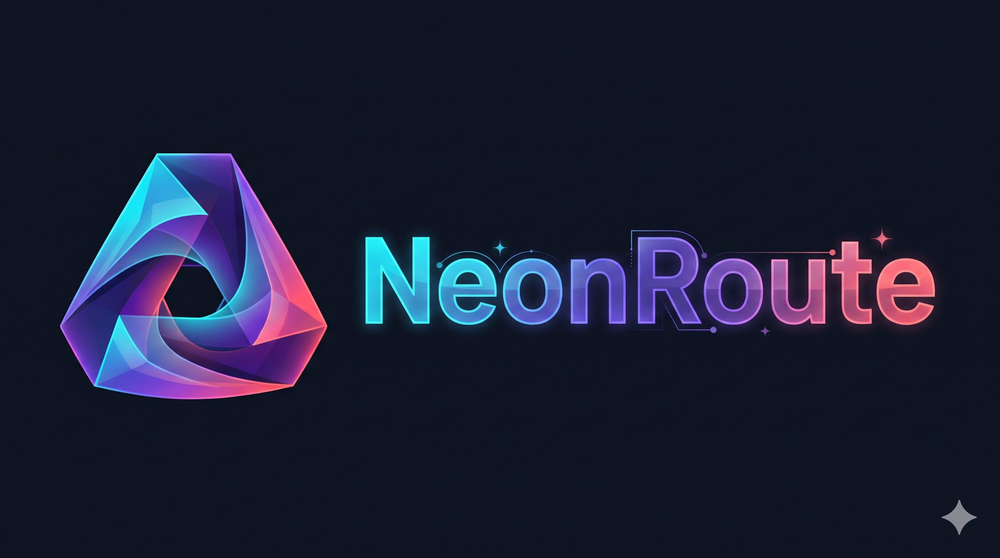
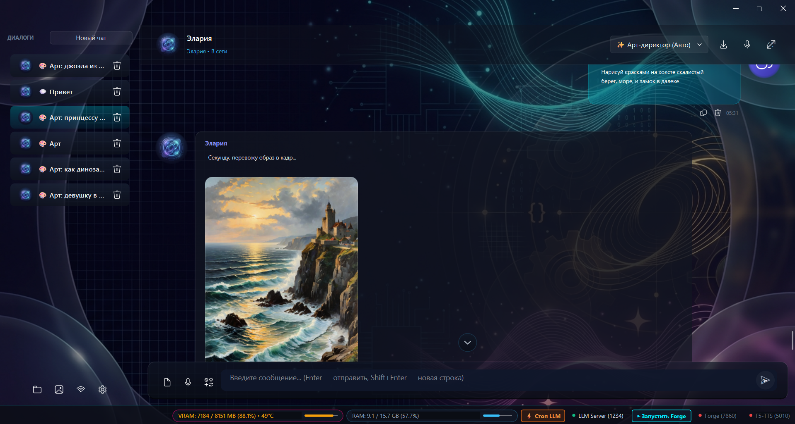

<div align="center">

# NeonRoute



[](https://www.python.org/)
[](https://riverbankcomputing.com/software/pyqt/)
[](https://nvidia.com)
[](https://www.microsoft.com/)

**Универсальный киберпанк-комбайн для Windows, объединяющий локальные языковые модели, генерацию артов через Stable Diffusion Forge и автономную среду разработки в стильном неоновом интерфейсе с эффектом акрилового стекла Windows 11.**

</div>

---

## ⚠️ Важно / Дисклеймер

## **Манифест:** 

> Проект создан «для себя» энтузиастом без опыта коммерческой разработки, при активном участии нейросетей. И подается как есть. Поддержка и обеспечение не гарантируется. 

> Исходный код открыт для таких же исследователей и энтузиастов локального ИИ. Автор ничего не навязывает, не претендует на звание промышленного софта и не несет ответственности за непредвиденные сбои. 
 
> **Безопасность:** в режиме «Инженер» программный код запускается и тестируется **локально на вашей системе**. Всегда проверяйте генерируемые скрипты перед запуском в рабочей среде. 

> Пользуясь проектом вы берете все риски полностью на себя.

## **СУТЬ ПРОЕКТА**

> Что такое **NEONROUTE**: многорежимное десктопное приложение на Python с изолированными режимами ассистента, ролевой игры и   инженера, пользовательскими элементами управления семплированием, автоматической маршрутизацией арта через SD Forge и интеграцией локальных языковых моделей.

> На чем было проверено: на открытых языковые модели размером от 7B до 14B параметров для баланса между погружением в ролевую игру, логическими рассуждениями и синтезом изображений в рамках аппаратных ограничений.

> Я использовал автономного ИИ-агента Google Antigravity для кодинга и разработки. Все идеи которые включены в проект мои личные.

## **ГЕНЕРАЦИЯ ИЗОБРАЖЕНИЙ**

> Эксперименты с локальной генерацией изображений с помощью ИИ, специализируясь на рабочих процессах Stable Diffusion 1.5 и SDXL с использованием SD Forge, ADetailer, ControlNet и кастомного промптинга.

> Задействовал конкретные апскейлеры изображений для SD Forge, такие как 4x_NMKD-Siax_200k, а также модели детектирования ADetailer (face_yolov8m.pt, hand_yolov9c.pt и hand_yolov9n.pt). Для более четких картинок на SD 1.5 рекомендую использовать add_detail.safetensors.
Она в проекте заложена как обязательная, но её использование не обязательно.

> Промпты настроены на, параметры камеры, фокусные расстояния и прорабатываете обработку пересечений рук и оружия в ADetailer для моделей SDXL уровня Juggernaut XL.

---

## ⚠️ БЫСТРЫЙ ЭКСКУРС ПО ПРИЛОЖЕНИЮ (Некоторые функции и возможности могут изменяться в ходе разработки)

## ✨ Три режима работы

NeonRoute переключается между тремя специализированными рабочими пространствами в зависимости от ваших задач:

### 🎭 Режим Roleplay (Chub AI & Живой мир)

Полноценное погружение в текстовые ролевые игры с эффектом присутствия, глубокой памятью и динамической генерацией иллюстраций сцены.


- **Как начать:** Скачайте понравившуюся карточку персонажа. В меню "галерея персонажей" откройте или CHUBAI или просто нажмите "экспорт" и закиньте карточку. Поддерживается прямая загрузка карточек Tavern / Chub AI (форматы `.png` с метаданными и `.json`), а также встроенный поиск и загрузка персонажей прямо из Chub.ai. Нажмите кнопку `[ 🎴 Выбор компаньона ]` и приступайте к диалогу!
- **Интерактивный мир:** Кнопка `[ 📜 Правила мира и Лор ↗ ]` открывает дашборд кампании — отслеживание динамического инвентаря отряда, шкал параметров, состояния спутников, встреченных NPC и подключенных лорбуков.
- **Генерация артов в чате:** ИИ анализирует окружение и одежду героев в каждом сообщении. По кнопке `[ 🎨 Арт сцены ]` под ответом генерируется качественная иллюстрация сцены через SD Forge без выхода из чата.

---

### 💬 Режим Ассистент (Элария & RAG)

Персональный локальный помощник для работы с документами, структурирования мыслей, анализа кода и повседневных задач.



- **База знаний и RAG:** Через меню `⚙️ Система -> Знания Эларии...` загружайте ваши файлы (`.pdf`, `.docx`, `.xlsx`, код, книги и документацию). Элария моментально находит нужные фрагменты и цитирует источники в блоке над ответом.
- **Специализированные микро-скиллы:** Автоматический или ручной выбор профиля ассистента — Системный аналитик, Архитектор кода, Текстовый редактор, Метод Фейнмана, Промпт-инженер, вы также можете добавить свои и задать им триггеры для поиска по векторной базе.
- **Прозрачный ход мыслей:** Для reasoning-моделей поток внутренних рассуждений бережно упакован в сворачиваемый неоновый спойлер `🧠 Ход мыслей (<think>)`.
- **Возможность генерации изображений:** скиньте любую понравившуюся модель в SD Fordge, просто напишите в чате нарисуй, либо что-нибудь связанное с этим, чтобы модель воспользовалась своими возможностями по рисованию.
- **Голосовой ввод:** Нажмите кнопку микрофона `[ 🎙️ ]` в строке ввода, чтобы надиктовать запрос через встроенный локальный Faster-Whisper. (Запланирован на будущее, пока что не реализован и я не знаю буду его реализовывать или нет).

---

### 🛠️ Режим Инженер (Автономная песочница)

Рабочая станция разработчика, способная самостоятельно писать код, раскладывать файлы по проекту, находить синтаксические ошибки и проводить тесты.


- **Встроенная IDE:** Кнопка `[ </> ]` в шапке чата (или `Ctrl + B`) открывает правую панель инспектора песочницы:
  - Интерактивное дерево файлов проекта в изолированном каталоге `workspace/`.
  - Встроенный редактор кода с подсветкой синтаксиса Python, номерами строк и подсветкой ошибок.
- **Изолированный запуск:** Нажмите `F5` прямо в редакторе для быстрого синтаксического анализа и безопасного Smoke-теста без вызова LLM.
- **Авто-коммиты в Git:** Нажатие `Ctrl + S` сохраняет файл и автоматически создает коммит в локальный репозиторий с вашим комментарием, защищая код от случайной перезаписи.

---

### Прямой рендер артов (`!art`)
Вы можете отправлять команды на генерацию картинок в SD Forge прямо из поля ввода чата без обращения к текстовой модели:

```bash
!art cyberpunk girl, neon rain --model cyberrealistic --ar wide
```

Поддерживаются дополнительные параметры кадрирования и рендера, например: `--steps 25`, `--cfg 6.5`, `--denoise 0.35`, `--ar tall`, `--seed 42`.

---

## ❓ Короткий FAQ

**1. Не идут ответы от нейросети или появляется ошибка соединения?**  
> Проверьте индикатор `● LLM Server` в нижней строке статуса. Убедитесь, что сервер в LM Studio запущен и модель загружена в память. Если сервер остановлен, нажмите кнопку `[ ⚡ Старт LLM ]` прямо в статус-баре NeonRoute.

**2. Не генерируются иллюстрации к сообщениям?**  
> Убедитесь, что запущен SD WebUI Forge (индикатор `● Forge` в строке статуса должен светиться зеленым). Вы также можете запустить его в один клик кнопкой `[ ▶ Запустить Forge ]` на нижней панели.

**3. Не хватает видеопамяти и возникает ошибка CUDA Out of Memory?**  
> Откройте верхнее меню `⚙️ Система -> Настройки движка LLM...` и переключите тип буфера KV-кэша на `Q8_0` (экономит 50% видеопамяти контекста) или `Q4_0` (экономит 75% VRAM), после чего перезапустите движок кнопкой в окне.


В чужой (стоковый) SD WebUI Forge будут вноситься только те самые 4 правки, которые уже работают у тебя в C:\neyroGPD, плюс безопасная настройка webui-user.bat для старта API. Больше ни один файл Forge не трогается.

