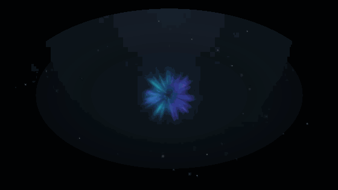
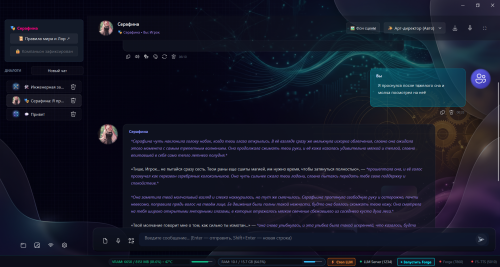
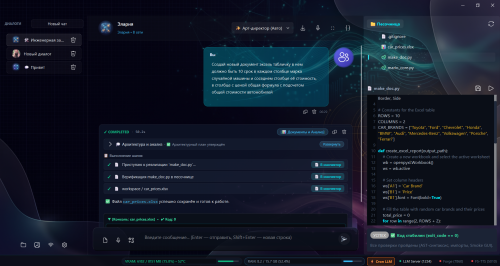
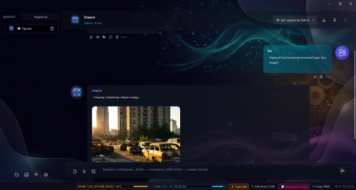
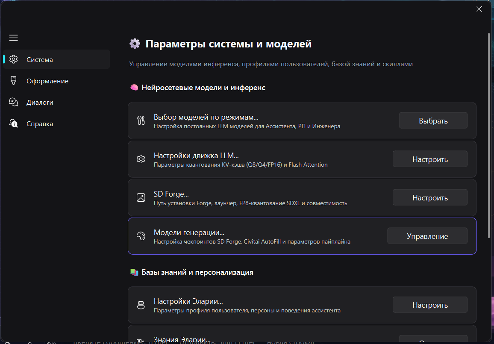
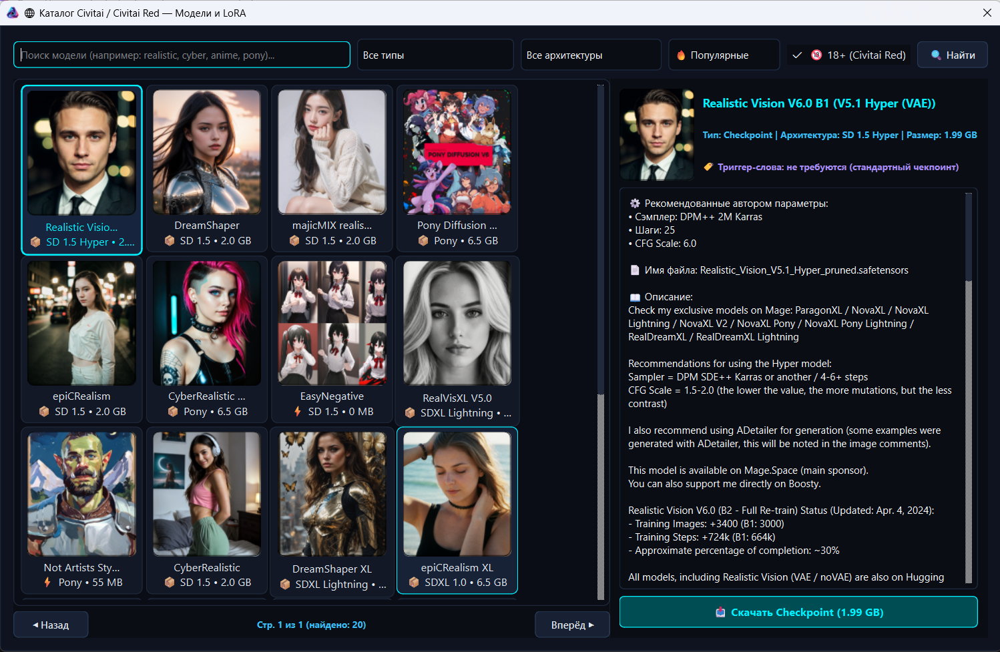
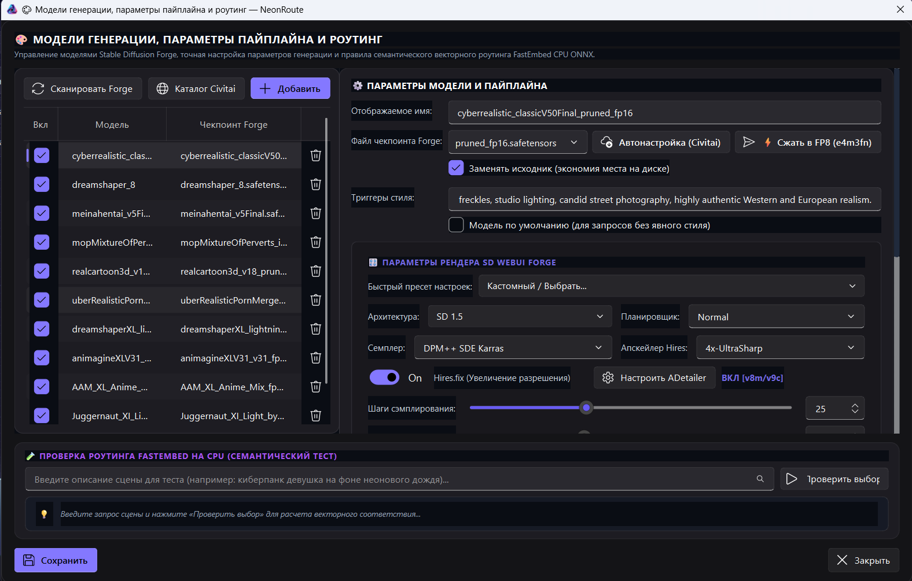
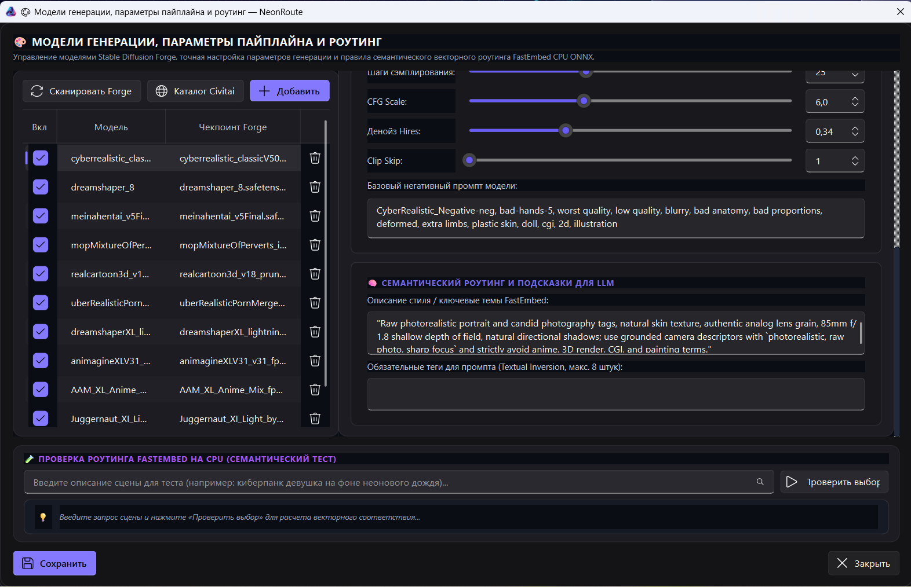

# NeonRoute

  

**NeonRoute** — локальный ИИ-оркестратор (оболочка + инструменты) для Windows. Объединяет текстового ассистента с долговременной памятью, работу с документами, генерацию изображений, ролевой чат и песочницу для кода в одном окне — бесплатно, без подписок и с полной приватностью (работает автономно, данные не покидают ваш ПК).

> **Важно понимать формат проекта:** это не «коробка с готовыми нейросетями внутри», а оркестратор и среда управления. Сама программа весит немного — текстовые модели (`.gguf`) и движок генерации картинок (**SD WebUI Forge** + модели) вы подключаете сами или скачиваете в один клик прямо из интерфейса программы, а **NeonRoute** берёт на себя промпты, память, сценарии и распределение видеопамяти.

## Скриншоты интерфейса

| Ассистент | Инженер | Ролевой чат |
| :---: | :---: | :---: |
|  |  |  |

Окно настроек, каталог Civitai и параметры пайплайна генерации

| Параметры системы и моделей | Встроенный каталог Civitai / Civitai Red |
| :---: | :---: |
|  |  |
| **Параметры рендера, AutoFill и сжатие в FP8** | **Семантический роутинг FastEmbed и тест выбора** |
|  |  |

## ⚡ Ключевые особенности

- **Умный контроль 8 ГБ VRAM:** автоматический расчёт контекста и выгрузка весов между `llama-server` и **SD WebUI Forge** на лету без ручной настройки ползунков и вылетов с `OOM`.
- **Установка в 1 клик из интерфейса:** встроенный менеджер сам определяет вашу видеокарту и позволяет скачать как текстовые GGUF-модели (`Qwen`, `Gemma`, `DeepSeek`), так и готовый **SD WebUI Forge** со стартовым чекпоинтом **DreamShaper 8**, детекторами лиц/рук и любые чекпоинты/LoRA из встроенного каталога Civitai.
- **Локальная память и RAG:** ассистент помнит факты о вас между сессиями и ищет ответы по вашим документам (PDF, Word, Excel, книги) без тормозов интерфейса.
- **Арт-директор с семантическим роутингом:** сам переводит запрос с русского, через локальный **FastEmbed** подбирает модель под стиль сцены, чинит лица/руки и умеет дорабатывать картинку в диалоге.
- **Доступ со смартфона:** можно общаться с домашним ПК через браузер телефона по Wi-Fi или защищённому туннелю.

## 💻 Системные требования

- **ОС:** Windows 10 / 11 (64-bit). *(Заложена совместимость с Linux, но на нём не тестировалось)*.
- **Python:** не требуется — в сборку уже включён портативный Python 3.10 x64 (`runtime\python\`).
- **ОЗУ:** от 16 ГБ RAM.
- **Видеокарта:** NVIDIA GeForce (`GTX 16xx` / `RTX 30xx–50xx`), AMD Radeon (Vulkan), Intel Arc или CPU-режим. *(Для локальной генерации картинок в SD Forge требуется NVIDIA с объёмом от 4 ГБ VRAM; реально протестировано на ноутбучной NVIDIA RTX 5050 8 ГБ)*.
- **Место на диске:** ~1 ГБ для клиента, портативного Python и векторных моделей — **плюс место под сами модели** (~12–15 ГБ под SD WebUI Forge со стартовым чекпоинтом и место под GGUF-модели для текста).

## 🛡️ Дисклеймер и рекомендации

Проект создан энтузиастом без опыта коммерческой разработки «для себя» при активном участии ИИ (`Google Antigravity`, `Gemini`) и распространяется **«как есть»**. Исходный код открыт для исследователей и энтузиастов — вы можете свободно брать его за основу или использовать идеи с указанием авторства: **ZabotaOblizkih**.

**Безопасность и статус:**
- Проект находится в стадии бета-тестирования, возможны невыявленные баги.
- В режиме **«Инженер»** сгенерированный код запускается и тестируется локально на вашем ПК — проверяйте скрипты перед запуском в рабочей среде.
- Качество ответов напрямую зависит от выбранной вами локальной модели и объёма VRAM — не стоит ждать от домашних моделей уровня больших облачных нейросетей.

**Рекомендуемые модели для 8 ГБ VRAM (настройки контекста выставляются автоматически):**
- **Ассистент:** `gemma-4-Q4_K_S` — авто-контекст: 14 000 токенов.
- **Ролевой чат:** `gemma-4-12b-it-Q3_K_M` — авто-контекст: 24 000 токенов.
- **Инженер:** `qwen2.5-coder-7b-instruct-q5_k_m` — авто-контекст: 28 000 токенов (генерация картинок в этом режиме отключена).

**Обратная связь:** о найденных ошибках пишите в раздел **Issues** репозитория (или в тему на 4PDA) с приложением логов (меню *«Шестерёнка» → «Справка» → «Логи»*).

## 🛠️ Подробные возможности NeonRoute

**1. Тянет тяжёлые нейросети даже на ноутбуке с 8 ГБ VRAM**
- **Динамическая балансировка памяти:** при запросе на генерацию картинки NeonRoute освобождает видеопамять от текстовой модели, запускает отрисовку в SD Forge, а затем возвращает LLM обратно — без зависаний и ухода в медленный системный RAM-оффлоад.
- **Автонастройка под железо:** программа сама просчитывает доступную VRAM/RAM и выставляет оптимальные параметры слоёв и контекста (при желании температуру и параметры можно подкрутить вручную).
- **Модульность:** если вам нужен только текстовый ИИ, ставить SD Forge не обязательно.

**🧠🎭👨‍💻 2. Три режима работы**
- **Ассистент (Элария):** повседневный помощник для работы с документами, таблицами, объяснения тем и генерации картинок. Поддерживает кастомные скилы и редактирование системного промпта.
- **Ролевой чат:** интерактивные миры с изолированной векторной памятью под каждый сценарий, трекингом инвентаря, локаций, квестов, одежды и эмоционального фона (всё это автоматически учитывается при генерации арта текущей сцены).
- **Инженер:** планирует задачу, пишет код, запускает тесты в изолированной песочнице и сам исправляет найденные ошибки.

<b>🧠 2.1 Чат «Ассистент (Элария)» — подробнее</b>

- **Межсессионная векторная память (`FastEmbed` + `LanceDB`):** фоновый экстрактор автоматически запоминает важные факты о вас и подтягивает их к месту в новых диалогах (изолированно от базы РП-чата). Управляется прямо из чата командами *«Запомни, что...»*, *«Что ты знаешь обо мне?»* и *«Забудь...»*.
- **Локальный поиск по вашим документам (RAG):** загружайте `.pdf`, `.doc`/`.docx`, `.xlsx`, презентации и книги в папку `knowledge_base` — гибридный поиск (векторный + ключевые слова) находит точные фрагменты и строки в таблицах, отмечая использованные документы значками-источниками.
- **Встроенный Арт-директор с семантическим роутингом:** переводит запрос с русского на язык промптов, через **FastEmbed** подбирает чекпоинт под стиль сцены, отправляет отрицания (*«без очков»*, *«убери оружие»*) строго в негативный промпт и позволяет дорабатывать картинку в диалоге (*«сделай то же самое, но ночью»*) с сохранением `--neg`.
- **Кастомные скилы, персона и режим «Авто» для размышлений:** настраивайте профиль о себе (*Шестерёнка → «Настройка Эларии»*) и добавляйте собственные навыки в меню *«Знания Эларии» → «Скилы»*, а для «думающих» моделей режим **«Авто»** прячет рассуждения (`<think>`) под спойлер и отключает их в простой болтовне для ускорения ответов.
- **Полная приватность и единый доступ со смартфона:** вся память, документы и модели работают локально на вашем ПК без облаков, а продолжить диалог можно со смартфона по домашнему Wi-Fi или туннелю с общей историей и поддержкой Markdown.

<b>🎭 2.2 РП-чат — подробнее</b>

- **Локальная векторная память под каждый мир (`FastEmbed` + `LanceDB`):** у каждого РП-чата своя изолированная база воспоминаний (`rp_memories`), которая не смешивается с обычным ассистентом или другими сценариями — персонажи помнят прошлые события, отношения и детали мира даже спустя сотни сообщений.
- **Живой трекинг сцены без ручной рутины:** фоновый анализатор после каждого хода сам обновляет локацию, одежду персонажей, инвентарь, квесты и эмоциональный фон — всё это доступно для просмотра и правки в окне **«Правила мира и лор»** (как на ПК, так и с телефона).
- **Умный «Арт сцены» в 1 клик:** кнопка под ответом персонажа генерирует иллюстрацию с учётом текущей обстановки, одежды, эмоций и внешности героев, раздельно прорабатывая сцену, лица и кисти рук (**ADetailer**) и сохраняя исключения (`--neg`) между кадрами.
- **Быстрые ответы в длинных сессиях (100% KV-кэш):** карточка персонажа и стартовое приветствие остаются статичными, а динамический лор, векторные воспоминания и контекст сцены подставляются только в конец текущего хода — модели не приходится пересчитывать весь диалог заново.
- **Мульти-персонажи и профили игрока:** поддержка как одиночных карточек, так и групповых сцен, плюс возможность создать несколько разных персонажей игрока под разные вселенные (*Шестерёнка → «Настройка Эларии» → «РП режим»*).

<b>👨‍💻 2.3 Режим «Инженер» — подробнее</b>

- **Субагентный цикл «Архитектор → Инженер → Песочница»:** перед написанием кода модель сначала строит план и JSON-манифест задачи, затем по шагам создаёт или правит файлы и сама проверяет результат запуском в изолированной песочнице (`SandboxManager`).
- **Потоковый захват кода (`CodeStreamExtractor`) и защита от «пустышек» (`SubstanceGuard`):** код пишется напрямую в файлы проекта по мере генерации без захламления чата простынями текста, а встроенный контроль объёма отклоняет неполноценные заготовки (< 350 байт).
- **Точечные правки (`PatchApplier`) и экономия контекста (`ASTSkeletonizer`):** для изменения существующих файлов используется хирургическая замена блоков (`SEARCH / REPLACE`) с сохранением отступов, а крупные файлы (> 600 строк) сжимаются до сигнатур классов и методов без тел функций, чтобы не забивать VRAM.
- **Авто-лечение импортов (`Zero-Token Healing`) и локальный Git:** при перехвате `NameError` система сама подставляет забытые стандартные импорты без лишнего прогона нейросети, а внутри песочницы изолирован собственный локальный `git` (`GitSandboxManager`) для безопасного отката изменений.
- **Максимум ресурсов под код:** в режиме «Инженер» генерация картинок автоматически отключается, отдавая весь доступный бюджет видеопамяти под длинный контекст (до 28 000 токенов на 8 ГБ VRAM).

**🎨 3. Генерация изображений без ручной рутины**
- **Автоустановка SD WebUI Forge:** встроенный инсталлятор сам проверяет вашу видеокарту, скачивает нужный архив Forge, распаковывает его, создаёт совместимый лаунчер `forge_launcher.bat`, применяет патчи выгрузки VRAM и при желании сразу докачивает стартовый чекпоинт **DreamShaper 8** (~2.1 ГБ) вместе с детекторами лиц и рук (**ADetailer**).
- **Встроенный каталог Civitai / Civitai Red:** поиск и скачивание чекпоинтов (`SD 1.5`, `SDXL`, `Lightning` / `Hyper` / `Turbo`, `Pony`) и `LoRA` прямо из интерфейса — с фильтрацией по типу и архитектуре, переключателем **«18+ (Civitai Red)»**, предпросмотром примеров и подстановкой рекомендованных автором параметров (сэмплер, шаги, CFG Scale) и триггер-слов.
- **Встроенный Арт-директор и семантический роутинг:** переводит идею с русского на язык промптов, через локальный **FastEmbed (CPU ONNX)** сам подбирает подходящий чекпоинт по смыслу сцены (портрет, аниме, реализм, киноформат), подключает **ADetailer** для коррекции лиц и кистей рук и понимает отрицания (*«без очков»*, *«убери оружие»*).
- **Оптимизация под 6–8 ГБ VRAM:** сжатие тяжёлых моделей в **FP8 (`e4m3fn`)** в один клик прямо из карточки модели (с опцией замены исходника для экономии места на диске).
- **Итеративная правка в чате:** можно дорабатывать результат командами *«сделай то же самое, но ночью»* или *«покажи в полный рост»*.
- **Безопасный каталог текстовых моделей:** скачивание GGUF-моделей прямо из интерфейса с проверкой целостности файлов и докачкой.

**📱 4. Умные «думающие» модели и мобильный доступ**
- **Режим «Авто» для рассуждений:** скрывает цепочку мыслей (CoT) под спойлер и автоматически отключает долгие раздумья в простой болтовне или при заказе картинок, чтобы ответы приходили быстрее.
- **Единый интерфейс с телефона:** общайтесь со своим домашним ИИ со смартфона с общей историей диалогов и очередью задач.
- **Чистый выход:** при закрытии программы все фоновые процессы гарантированно завершаются и освобождают память.### 🎛️ Готовые наборы моделей под вашу видеокарту

<b>Видеокарты на 2 ГБ VRAM (GT 1030, GTX 1050 2 ГБ, MX150/MX250/MX350, старые ноутбуки)</b>

Сразу скажу честно: чудес на 2 ГБ ждать не стоит, но для базового текстового помощника, работы с вашими документами и простых задач этого хватит. Основная часть модели уйдёт в обычную оперативную память (поэтому желательно иметь от 16 ГБ ОЗУ), ответы будут идти не мгновенно, но вполне читаемо.

- **Текстовая модель (Ассистент / РП / Код):** `Qwen2.5-3B-Instruct-Q4_K_M.gguf` или `gemma-4-4b-it-Q4_K_M.gguf` — весят около 2–2.7 ГБ, почти целиком поместятся в карту или с минимальным уходом в ОЗУ.
- **Генерация картинок (SD WebUI Forge):** на 2 ГБ VRAM ставить Forge не рекомендую — будет крайне медленно и с риском вылетов. Лучше использовать NeonRoute чисто как умного текстового ассистента с памятью и поиском по документам.

<b>Видеокарты на 4 ГБ VRAM (GTX 1050 Ti, GTX 1650, RTX 2050, ноутбучные RTX 3050 4 ГБ, RX 570 4 ГБ)</b>

На 4 ГБ уже можно комфортно общаться с нейросетью и даже рисовать достойные картинки, если не гнаться за тяжёлыми современными моделями.

- **Текстовая модель (универсальная):** `gemma-4-4b-it-Q5_K_M.gguf` или `Qwen2.5-7B-Instruct-Q3_K_M.gguf` — 7B-модель чуть задействует системную ОЗУ, но будет заметно сообразительнее.
- **Движок картинок и модель (SD 1.5):** **SD WebUI Forge + DreamShaper 8** (`dreamshaper_8.safetensors`, ~2.1 ГБ) — устанавливается в 1 клик прямо из меню **«SD Forge...»** (чекбокс стартовой модели включён по умолчанию). Отличный универсал под фэнтези, sci-fi и арты. Опционально можно закинуть LoRA `add_detail.safetensors` для чёткости. Сжимать в FP8 её не нужно — она и так спокойно влезает в 4 ГБ.
- **Настройка:** стартовый `DreamShaper 8` прописывается моделью по умолчанию автоматически; при добавлении других чекпоинтов нажмите **«Автонастройка (Civitai)»** и сохраните.

<b>Видеокарты на 8+ ГБ VRAM (RTX 3060/3070/3080, RTX 4060/4070, RTX 5050/5060, RX 6600/7600 и выше)</b>

Золотая середина (и выше), на которой раскрываются все фишки NeonRoute: и умные модели на 9B–12B параметров, и быстрые SDXL-картинки с автоматической выгрузкой памяти между ними. *(Подходит также для карт на 6 ГБ вроде GTX 1660 / RTX 2060 / RTX 3060 Laptop при использовании сжатия FP8 для картинок)*.

- **Текст (Ассистент и общение):** `gemma-4-Q4_K_S.gguf` — контекст автоматически выставляется на 14 000 токенов.
- **Текст (Ролевой чат):** `gemma-4-12b-it-Q3_K_M.gguf` — живой русский язык, авто-контекст 24 000 токенов.
- **Текст (Инженер / Код):** `qwen2.5-coder-7b-instruct-q5_k_m.gguf` — авто-контекст 28 000 токенов.
- **Движок картинок:** **SD WebUI Forge** — ставится в 1 клик через меню **«SD Forge...»** (для карт серии **RTX 50xx / Blackwell** встроенный детектор автоматически подскажет совместимую ветку под PyTorch 2.6+ / CUDA 12.8+).
- **Модель для картинок (SDXL):** ускоренная **DreamShaper XL (Lightning / Turbo)** — рисует качественные арты в разных стилях (реализм, 3D, мультфильмы) всего за 4–6 шагов (а для быстрого старта можно сразу поставить базовый `DreamShaper 8` через встроенный загрузчик или скачать нужный SDXL-чекпоинт из **«Каталога Civitai»**).
- **Лайфхак для 6–8 ГБ VRAM:** после того как скачаете `DreamShaper XL` в папку Forge, откройте в NeonRoute меню **«Модели генерации...»** и нажмите кнопку **«Сжать в FP8 (e4m3fn)»** (при необходимости отметив замену исходника для экономии места на диске). Визуально разница не превышает 3–5%, зато вес модели уменьшится с ~6.5 ГБ до ~4.2 ГБ — генерация пойдёт ощутимо шустрее. После сжатия нажмите **«Автонастройка (Civitai)»** и сохраните.

<b>Технические детали: что именно патчит и настраивает установщик в SD Forge</b>

Для корректной выгрузки видеопамяти и переключения чекпоинтов на лету NeonRoute создаёт изолированный лаунчер `forge_launcher.bat` (пробрасывающий флаги `--api` и политики VRAM напрямую в `launch.py` в обход сброса `COMMANDLINE_ARGS=` в стандартном `webui-user.bat`) и вносит точечные правки в код Forge. Все оригиналы сохраняются по пути `<Forge>\.neonroute_backup\original\` — откат выполняется в 1 клик кнопкой **«Откатить патч»**. Если сборка несовместима (старый A1111 или сильно изменённый форк), патчер выдаст статус `INCOMPATIBLE` и не тронет файлы.

    1. forge_launcher.bat (создаётся при автоустановке)
       • Настраивает PATH на встроенные в портативный пакет system\python и system\git\bin и запускает python.exe launch.py %*, гарантируя доставку --api, --port 7860 и флагов управления памятью от ProcessManager.

    2. modules/api/api.py (3 правки)
       • Новый эндпоинт POST /sdapi/v1/free-vram (free_vram_api): позволяет на лету менять режим оффлоада (ALWAYS_VRAM_OFFLOAD), лимит памяти (current_inference_memory) и принудительно выгружать веса с очисткой кэша PyTorch/GC.
       • Переключение моделей на лету в set_config (POST /sdapi/v1/options): при смене sd_model_checkpoint или sd_vae добавляется вызов refresh_model_loading_parameters() из modules_forge.main_entry для применения чекпоинта и fp8e4/Auto без перезапуска.
       • Защита списка моделей в get_sd_models: добавляется "config": None в выдаваемый словарь модели.

    3. modules/api/models.py (1 правка)
       • В классе SDModelItem поле config делается необязательным (config: Optional[str] = Field(default=None, title="Config file")), чтобы API не падал на .safetensors без сопутствующего .yaml.

    4. modules/sd_models.py (1 правка)
       • В функции unload_model_weights(sd_model=None, info=None) пустышка pass заменяется на реальную очистку VRAM:
         from backend import memory_management
         memory_management.unload_all_models()
         memory_management.soft_empty_cache()
         gc.collect()
         (Без этого /sdapi/v1/unload-checkpoint не освобождает карту обратно под LLM.)

    5. webui-user.bat (только если нет forge_launcher.bat и API/флаги заблокированы)
       • Сохраняет оригинал и добавляет --api + проброс флагов оптимизации памяти от ProcessManager (--no-half-vae, --always-offload-from-vram, --pin-shared-memory), сохраняя существующие пользовательские аргументы.

<h2>❓ Настройка и частые вопросы</h2>

**Как скачать и настроить модели для генерации изображений?**
1. Если при установке **SD WebUI Forge** вы оставили галочку стартового пакета — `dreamshaper_8.safetensors` и детекторы лиц/рук уже установлены и настроены по умолчанию. Просто запустите SD Forge в правом нижнем углу и напишите в чате запрос с картинкой.
2. Чтобы добавить новые модели: откройте настройки (*Шестерёнка* в левом нижнем углу) → **«Система» → «Модели генерации...» → «Управление»**.
3. Нажмите **«Каталог Civitai»** в левом верхнем углу окна, найдите нужный чекпоинт или LoRA (доступны фильтры по типу, архитектуре и переключатель **«18+ (Civitai Red)»**) и нажмите **«Скачать Checkpoint»**.
4. Если вы скачали чекпоинт вручную и положили его в папку `webui\models\Stable-diffusion` внутри Forge: нажмите **«Сканировать Forge»** (или **«+ Добавить»**), выберите модель в списке слева, в правой панели нажмите **«Автонастройка (Civitai)»** (или выберите готовый шаблон в поле **«Быстрый пресет настроек»**) и нажмите **«Сохранить»**.
5. Для тяжёлых SDXL-чекпоинтов на картах с 6–8 ГБ VRAM там же доступна кнопка **«Сжать в FP8 (e4m3fn)»** (с галочкой замены исходника, чтобы не занимать лишнее место на диске).

**Как настроить пайплайн и автовыбор модели (Арт-директор)?**
В окне **«Модели генерации, параметры пайплайна и роутинг»** для каждого чекпоинта настраиваются две группы параметров:
- **Параметры рендера SD WebUI Forge:** архитектура (`SD 1.5` / `SDXL`), сэмплер, планировщик, шаги сэмплирования, `CFG Scale`, `Clip Skip`, включение и настройка **Hires.fix** (апскейлер, денойз), кнопка **«Настроить ADetailer»** (детекторы лиц и рук) и **«Базовый негативный промпт модели»**.
- **Семантический роутинг и подсказки для LLM:** в поле **«Описание стиля / ключевые темы FastEmbed»** задаётся описание того, для каких сцен подходит модель (плюс обязательные теги Textual Inversion и триггеры стиля). Проверить, какая модель выберется под конкретный запрос, можно прямо внизу окна в блоке **«Проверка роутинга FastEmbed на CPU (семантический тест)»**.
- **Автовыбор vs ручной режим:** если в правом верхнем углу главного окна выбран режим **«Арт-директор (авто)»**, программа сама переключается на наиболее подходящий по смыслу чекпоинт (а для запросов без явного стиля использует модель с галочкой **«Модель по умолчанию»**). Чтобы рисовать конкретным чекпоинтом напрямую, просто выберите его в том же выпадающем списке вручную.

**Как добавить свои документы в базу знаний?**
Положите файлы (`.doc`/`.docx`, `.pdf`, `.xlsx`, `.txt`) в папку `knowledge_base` и задайте вопрос по их содержимому — ассистент найдёт нужный фрагмент или строку в таблице и ответит с опорой на документ.

**Как управлять долговременной памятью?**
Фоновый экстрактор сам запоминает важные факты из диалогов:
- **Добавить факт вручную:** напишите *«Запомни, что я люблю чёрный кофе»*.
- **Посмотреть всё сохранённое:** спросите *«Что ты знаешь обо мне?»* (выведет пронумерованный список).
- **Удалить запись:** напишите *«Забудь 1»* или *«Забудь, что я люблю кофе»*.

**Как настроить скилы, системный промпт и профиль пользователя?**
- **Скилы и промпт:** откройте меню *«Знания Эларии» → «Скилы»* (добавление через **+**) или *«Системный промпт»*.
- **Имя и информация о себе:** *Шестерёнка → «Настройка Эларии»*.
- **Персонаж для РП-чата:** *Шестерёнка → «Настройка Эларии» → «РП режим»* (можно создать несколько профилей под разные чаты).

**В чём особенности РП-чата?**
- Векторная память изолирована строго под каждый отдельный РП-чат.
- Отслеживаются эмоциональный фон, локация, инвентарь и одежда персонажей (доступны для просмотра и правки во вкладке *«Правила мира и лор»*).
- Кнопка **«Арт сцены»** под ответом персонажа генерирует иллюстрацию с учётом всех текущих параметров сцены.
- Поддерживается локальный перевод зарубежных карточек персонажей на русский язык.

**Есть ли техническая документация?**
Есть внутренняя архитектурная документация, сгенерированная для ИИ-агентов. При необходимости по запросам пользователей будет подготовлено отдельное руководство для людей.

