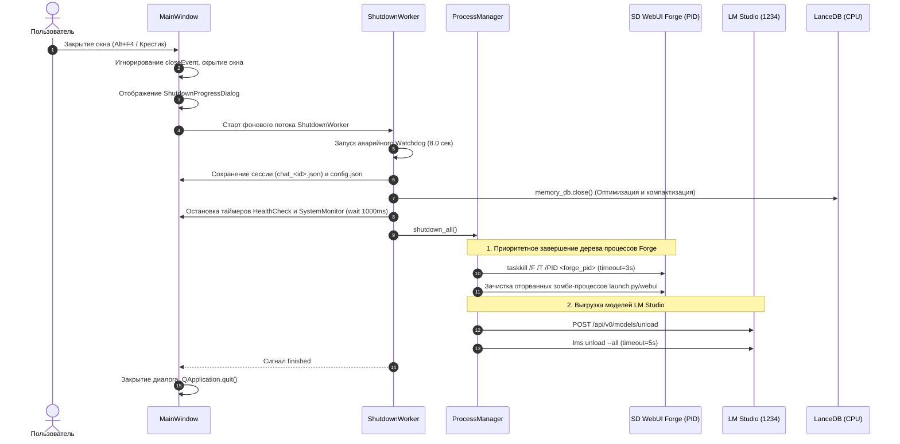

# README.md
# NeonRoute — Local AI Orchestrator

<div align="center">


**Автономный локальный ИИ-оркестратор, персональный диалоговый ассистент, движок ролевых историй и инженер разработки**  
*Аппаратно оптимизирован под мобильные видеокарты с 8 ГБ VRAM (NVIDIA GeForce RTX 5050 Laptop GPU / 16 ГБ RAM)*

</div>

---

## 📌 Оглавление
1. [О проекте](#-о-проекте)
2. [Ключевые архитектурные изменения v0.9.0-beta](#-ключевые-архитектурные-изменения-v080-beta)
3. [Режимы работы (ModeCoordinator)](#-режимы-работы-modecoordinator)
4. [Аппаратный арбитраж VRAM (8 ГБ VRAM Safety)](#-аппаратный-арбитраж-vram-8-гб-vram-safety)
5. [Управление жизненным циклом и выключение (Graceful Shutdown)](#-управление-жизненным-циклом-и-выключение-graceful-shutdown)
6. [Архитектура интерфейса (Декомпозиция MainWindow)](#-архитектура-интерфейса-декомпозиция-mainwindow)
7. [Тестирование и контроль качества (487 тестов)](#-тестирование-и-контроль-качества-487-тестов)
8. [Системные требования](#-системные-требования)
9. [Установка и запуск](#-установка-и-запуск)
10. [Сетевая карта портов и локальные сервисы](#-сетевая-карта-портов-и-локальные-сервисы)
11. [Устранение неполадок (Troubleshooting)](#-устранение-неполадок-troubleshooting)
12. [Лицензия и авторство](#-лицензия-и-авторство)

---

## 📖 О проекте

**NeonRoute** — это десктопный клиент нового поколения для Windows, объединяющий текстовые языковые модели (LLM), генеративную диффузию изображений (Stable Diffusion), локальный RAG на векторной базе (LanceDB + FastEmbed) и автономного агента разработки ПО в единой киберпанк-оболочке на PyQt6.

Приложение работает **100% локально на вашем компьютере**, сохраняет полную конфиденциальность данных, не требует платных API-ключей и облачных подписок, а также эффективно укладывается в **8 ГБ видеопамяти** без взаимных конфликтов между нейросетями.

---

## ⚡ Ключевые архитектурные изменения v0.9.0-beta

Версия **v0.9.0-beta** представляет собой фундаментальный рефакторинг ядра и интерфейса:
- **Декомпозиция главного окна (`ui/main_window.py`)**: Устранен устаревший монолит. Окно собрано из 12 независимых Python-миксинов (`DialogControllerMixin`, `TaskLifecycleMixin`, `WindowStateMixin`, `ChatSearchMixin`, `AvatarControllerMixin`, `SessionControllerMixin`, `ChatBubbleBuilderMixin`, `ChatFlowControllerMixin`, `AssistantFlowControllerMixin`, `RoleplayControllerMixin`, `RoleplayFlowControllerMixin`, `HardwareEngineMixin`, `EngineerControllerMixin`) и выделенного контроллера состояния шапки `HeaderStateController` без конфликтов метаклассов PyQt6.
- **Двухступенчатый гарантированный Shutdown (`ShutdownWorker` + `ProcessManager`)**:
  - Приоритетное рекурсивное завершение дерева процессов SD Forge (`taskkill /F /T /PID`) строго перед выгрузкой моделей LM Studio.
  - Очистка оторванных зомби-процессов Forge через обход `psutil`.
  - Защитный аппаратный сторожевой таймер (**Watchdog на 8.0 секунд**), предотвращающий зависание процесса в диспетчере задач при закрытии окна.
- **VRAM-менеджмент (`VRAMArbiter`)**: Аппаратный арбитраж с монопольной передачей видеопамяти между LLM и SD WebUI Forge, динамический мониторинг освобождения адресного пространства WDDM (порог 3800 МБ) и автоматический сброс диффузионных чекпоинтов в системную RAM.
- **Координатор режимов (`ModeCoordinator`)**: Детерминированный FSM с фазами `Teardown -> Switch -> Boot -> Mount` для полной контекстной изоляции памяти между Ассистентом, Ролевым чатом и Инженерной песочницей.
- **Надежность и тестовое покрытие**: **487 автоматических тестов (pytest)** с прохождением 100%, включая интеграционные тесты жизненного цикла выключения (`test_shutdown_lifecycle.py`), AST-валидатор и точечный патчер кода.

---

## 🎮 Режимы работы (ModeCoordinator)

NeonRoute предлагает три специализированных рабочих режима с жестким разделением контекста:

```
                  ┌──────────────────────────────────────────────┐
                  │          ModeCoordinator (FSM Engine)        │
                  │   Teardown  ──►  Switch  ──►  Boot  ──► Mount│
                  └──────────────────────┬───────────────────────┘
                                         │
         ┌───────────────────────────────┼───────────────────────────────┐
         ▼                               ▼                               ▼
┌───────────────────────┐   ┌─────────────────────────┐   ┌─────────────────────────┐
│     💬 АССИСТЕНТ      │   │     🎭 РОЛЕВОЙ ЧАТ      │   │       ⚡ ИНЖЕНЕР        │
│   (Элария / Напарник) │   │  (SillyTavern / Chub V2)│   │  (Автономная песочница) │
├───────────────────────┤   ├─────────────────────────┤   ├─────────────────────────┤
│ • Контекст: 14K       │   │ • Контекст: 24K         │   │ • Контекст: 28K         │
│ • История: 11K токенов│   │ • История: 18K токенов  │   │ • История: 22K токенов  │
│ • Температура: 0.70   │   │ • Температура: 1.10     │   │ • Температура: 0.15     │
│ • Пассивная память    │   │ • Алгоритм 3-х Якорей   │   │ • ASTSkeletonizer       │
│   LanceDB (CPU ONNX)  │   │ • Каст RPCastManager    │   │ • PatchApplier (Fuzzy)  │
│ • Генерация отчетов   │   │ • 11 ролевых архетипов  │   │ • Git-песочница         │
│   Excel / Word        │   │ • Циклер завязок        │   │ • CodeValidator         │
│ • Арт-директор        │   │ • Режиссура кадров      │   │ • Execution-First запуск│
└───────────────────────┘   └─────────────────────────┘   └─────────────────────────┘
```

### 1. 💬 Режим «Ассистент» (Элария)
- Персональный диалоговый напарник и архитектор задач с теплым, живым характером.
- Оптимизированный контекст **14 336 токенов** (~14K) со скользящим окном диалога.
- **Пассивная долговременная память на CPU**: фоновый поиск фактов в LanceDB с помощью эмбеддингов FastEmbed (`paraphrase-multilingual-MiniLM-L12-v2`, 0 МБ VRAM).
- Мультимодальный анализ прикрепленных изображений и скриншотов через модели Qwen2.5-VL.
- Генерация стилизованных документов Excel (`.xlsx`) с нативными формулами и Word (`.docx`).

### 2. 🎭 Режим «Ролевой чат» (Tavern / Chub V2)
- Глубокий контекст **24 576 токенов** (~24K) для продолжительных литературных кампаний.
- **Архитектура «Трёх Якорей» (Three-Anchors Eviction)**: гарантированное сохранение системного промпта (Якорь 1), канонической завязки сюжета `first_mes` (Якорь 2) и оперативного диалогового хвоста из 12 сообщений (Якорь 3) с вытеснением только реплик из середины.
- **Менеджер каста Вселенной (`RPCastManager` & `cast_<id>.json`)**:
  - Отслеживание отряда спутников (`companions`) и их индивидуального внешнего вида (`visual_dna`).
  - Учет присутствия NPC в сцене (`physical`) или в памяти (`memory`).
  - Динамика эмоционального тона (`dynamic_tone`) и необратимых сдвигов союза (`relationship_shift`).
  - Инвентарь отряда и защита ключевых реликвий от вытеснения.
  - Локация, степень укрытия (`is_enclosed`) и атмосфера сцены (`scene_ambience`).
- **11 жанровых архетипов**: ЛитРПГ/Исекай (`<stats>`), D&D Гейммастер (`<check>`, `<choices>`), Дейт-сим (`<meters>`), Хоррор, CYOA, Детектив, Допрос, Группа спутников и др.
- **Интерактивный циклер завязок (Greeting Cycler)**: переключение между альтернативными вступительными сценами персонажа прямо в чате до первого хода.
- **Кинематографическая режиссура сцен**: автоматический синтез тега `[IMAGE_PROMPT: ...]` по 4 архетипам сцены (*intimate*, *action*, *dialogue*, *exploration*).

### 3. ⚡ Режим «Инженер» (Автономная разработка в песочнице)
- Инженерный контекст **28 672 токена** (~28K) с жестко детерминированной температурой `0.15`.
- **Принцип Execution-First**: код считается правильным только при успешном завершении рантайма (`exit_code == 0`).
- **Сжатие файлов (`ASTSkeletonizer`)**: превращение исходных файлов >350 строк в компактный AST-скелет сигнатур и типов для экономии токенов модели.
- **Хирургический патчер (`PatchApplier`)**: применение правок через блоки `SEARCH/REPLACE` с нечетким сопоставлением пробелов, отступов и кавычек (Fuzzy Matching).
- **Транзакционный координатор (`SelfHealingEngine`)**: автоматический rollback файла при обнаружении синтаксических ошибок до сохранения на диск.
- **Git-песочница (`GitSandboxManager`)**: фиксация baseline до задачи, автоматические чекпоинты и мгновенный откат рабочей папки (`git reset --hard HEAD` и `git clean -fd`) при сбоях.
- **Периметр безопасности (`sandbox_guard.py`)**: запрет сетевых сокетов, процессов и выхода за пределы папки `workspace/projects/<id>/` через `sys.addaudithook`.

---

## 🛡️ Аппаратный арбитраж VRAM (8 ГБ VRAM Safety)

Для стабильной работы на ноутбуках с 8 ГБ VRAM в NeonRoute внедрен централизованный арбитр памяти `VRAMArbiter` и приоритетная очередь `TaskQueueWorker`:

```
                             [ Запрос пользователя ]
                                        │
                                        ▼
                             TaskQueueWorker.enqueue()
                                        │
                         ┌──────────────┴──────────────┐
                         ▼                             ▼
                 [ Priority Queue ]           [ VRAMArbiter ]
                 • PRIORITY_HIGH (LLM)        Координирует GPU:
                 • PRIORITY_NORMAL (Forge)    • GPUOwner.LLM
                 • PRIORITY_LOW (Memory/RAG)  • GPUOwner.DIFFUSION
                         │                             │
                         └──────────────┬──────────────┘
                                        │
                                        ▼
                           [ Последовательный инференс ]
                           (max_workers = 1, 0 CUDA OOM)
```

1. **Взаимное исключение инференса**:
   - При старте задач LLM арбитр выгружает чекпоинт Forge (`/sdapi/v1/unload-checkpoint`) и очищает PyTorch CUDA cache (`/sdapi/v1/free-vram`).
   - При старте генерации арта арбитр выгружает модель из LM Studio (`lms unload --all`) и ожидает освобождения видеопамяти WDDM драйвером до уровня $\ge 3800$ МБ.
2. **Аппаратный VAE Tiling**:
   Флаги `forge_vae_tiling = True` и `sd_vae_tile = True` исключают резкие скачки потребления VRAM в Shared Memory при проходах Hires.fix.
3. **Каскадный откат при рендере (Fallback Cascade)**:
   - Попытка 1: Полный пайплайн с Hires.fix и ADetailer (восстановление лиц face_yolov8n и рук hand_yolov8n).
   - Попытка 2 (при сбое детектора): Повтор с Hires.fix без ADetailer.
   - Попытка 3 (при нехватке памяти OOM): Аварийный проход базового разрешения (`enable_hr: false`).

---

## 🛑 Управление жизненным циклом и выключение (Graceful Shutdown)

Выключение десктопного приложения с тяжелыми фоновыми подпроцессами защищено двухступенчатым механизмом в `ui/workers/shutdown_worker.py`:



- **Аварийный Watchdog (8.0 секунд)**: Если операционная система или сторонний сокет блокируют закрытие дольше 8 секунд, независимый поток-демон принудительно вызывает `os._exit(0)`, предотвращая зависание процесса в фоне.

---

## 🖥️ Архитектура интерфейса (Декомпозиция MainWindow)

Для предотвращения разрастания монолитного кода логика окна разделена на специализированные миксины в каталоге `ui/controllers/` и `ui/builders/`:

| Модуль / Миксин | Ответственность и решаемые задачи |
| :--- | :--- |
| **`MainWindow`** (`ui/main_window.py`) | Точка сборки интерфейса, подключение шины сигналов, инициализация подсистем. |
| **`WindowStateMixin`** | Отрисовка фона с затемнением, полноэкранный режим (F11/Esc), геометрия. |
| **`DialogControllerMixin`** | Модальные окна: настройки Эларии, галерея, кэш, сэмплинг, экспорт сессий. |
| **`TaskLifecycleMixin`** | Маршрутизация задач в `TaskQueue`, обработка прогресса, отмена, лоадер набора. |
| **`ChatSearchMixin`** | Внутричатовый поиск по тексту (Ctrl+F) с подсветкой и навигацией (Enter / Shift+Enter). |
| **`AvatarControllerMixin`** | Синхронизация аватарок по 3 зонам (шапка, баблы, сайдбар), кадрирование, эмоции. |
| **`SessionControllerMixin`** | Создание, переименование, удаление и сохранение сессий диалогов на диске. |
| **`ChatBubbleBuilderMixin`** | Рендеринг сообщений, пагинация истории, кнопка подгрузки ранних реплик. |
| **`ChatFlowControllerMixin`** | Центральный диспетчер реплик пользователя, анти-зацикливание (Anti-Loop). |
| **`AssistantFlowControllerMixin`** | Поток реплик Эларии, контекст 14K, векторный RAG, неоновые чипы генерации арта. |
| **`RoleplayControllerMixin`** | Настройка ролевого режима, фон сцены, галерея Tavern, перевод карточек. |
| **`RoleplayFlowControllerMixin`** | Сборка контекста 24K по 3 якорям, обработка каста `RPCastManager`, арт сцены. |
| **`HardwareEngineMixin`** | Опрос серверов, телеметрия VRAM/RAM, переключение моделей, пайплайн Forge. |
| **`EngineerControllerMixin`** | Режим «Инженер», песочница, исполнение инструментов, запуск скриптов в cmd. |
| **`HeaderStateController`** | Конечный автомат статуса шапки чата (имя, аватар, неоновые цвета). |

---

## 🧪 Тестирование и контроль качества (487 тестов)

Проект покрыт всесторонним набором из **487 автоматических тестов** на базе фреймворка `pytest`:
- **Статус сьюта**: **487 passed, 100% success rate**.
- **Тестируемые подсистемы**:
  - `test_shutdown_lifecycle.py`: валидация двухступенчатого закрытия, приоритета `taskkill` для Forge, работы Watchdog таймера и перехвата зомби-процессов.
  - `test_vram_arbiter.py`: проверка переключения состояний `GPUOwner`, взаимного исключения LLM/диффузии и безопасных интервалов ожидания WDDM.
  - `test_mode_coordinator.py`: переходы конечного автомата, фазы Teardown/Boot, изоляция контекста между ролями.
  - `test_code_engine.py` & `test_code_validator.py`: корректность работы `ASTSkeletonizer`, устойчивость `PatchApplier` к сдвигу отступов, Scope Guard и валидатор вызовов openpyxl/docx.
  - `test_token_budget_manager.py`: оценка токенов BPE для кириллицы/латиницы, калибровка бюджетов контекста 14K/24K/28K.
  - `test_tavern_parser.py`: парсинг форматов Tavern V1/V2, извлечение Visual DNA и статей лорбуков.

Запуск набора тестов:
```powershell
run_tests.bat
```

---

## 💻 Системные требования

### 1. Аппаратное обеспечение (Hardware)
- **Видеокарта (GPU)**: NVIDIA GeForce RTX 3050 / 4050 / 4060 / 5050 Laptop или десктопные аналоги (минимум **8 ГБ VRAM**).
- **Оперативная память (RAM)**: 16 ГБ (рекомендуется 32 ГБ для работы с крупными документами).
- **Процессор (CPU)**: Intel Core i5 / AMD Ryzen 5 (4 ядра / 8 потоков или выше).
- **Накопитель**: Высокоскоростной NVMe SSD (для быстрой подгрузки чекпоинтов SD и весов моделей).

### 2. Стороннее программное обеспечение
1. **LM Studio** (v0.3.0+):
   - Запущенный локальный сервер на порту `1234`.
   - Рекомендуемые модели: `qwen2.5-7b-instruct-abliterated`, `L3-8B-Stheno-v3.2`, `qwen2.5-coder-7b`.
2. **SD WebUI Forge**:
   - Локальная установка на порту `7860` (путь по умолчанию: `C:\neyroGPD\forge_launcher.bat`).
3. **F5-TTS** *(опционально)*:
   - Локальный легковесный сервер синтеза речи на порту `5010`.
4. **Git for Windows**:
   - Установленный Git для мгновенного версионирования и отката песочницы Инженера.

---

## 🚀 Установка и запуск

### Шаг 1. Клонирование репозитория
```powershell
cd C:\
git clone https://github.com/ZabotaOblizkih/NeonRoute.git
cd NeonRoute
```

### Шаг 2. Создание виртуального окружения
```powershell
python -m venv venv
.\venv\Scripts\activate
pip install -r requirements.txt
```

### Шаг 3. Запуск приложения
- **Стандартный запуск без консоли**: Запустите `run.bat` или кликните по ярлыку на рабочем столе.
- **Запуск в режиме отладки с выводом консоли логов**:
  ```powershell
  python main.py
  ```

---

## 🌐 Сетевая карта портов и локальные сервисы

Все сетевые соединения работают строго по адресу обратной петли `127.0.0.1` (localhost):

| Сервис | Порт | Протокол | Назначение |
| :--- | :--- | :--- | :--- |
| **LM Studio API** | `1234` | HTTP REST / SSE | Текстовый инференс, зрение Qwen2.5-VL, Structured Outputs. |
| **SD WebUI Forge** | `7860` | HTTP REST | Диффузионный рендер изображений txt2img, Hires.fix, ADetailer. |
| **F5-TTS Service** | `5010` | HTTP REST | Изолированная озвучка реплик на процессоре (0 VRAM). |

---

## 🛠️ Устранение неполадок (Troubleshooting)

| Проблема / Ошибка | Причина | Решение |
| :--- | :--- | :--- |
| **Индикатор LM Studio красный (`●`)** | Сервер не запущен в LM Studio или порт 1234 занят. | Нажмите кнопку `⚡ Старт LMS` в нижней панели статуса либо активируйте Local Server в интерфейсе LM Studio. |
| **Ошибка `CUDA out of memory` в Forge** | LLM не успела выгрузиться из памяти перед стартом рендера. | Арбитр `VRAMArbiter` автоматически выгружает модель. Убедитесь, что в LM Studio не включен принудительный memory lock. |
| **Скрипт Инженера упал с `EOFError`** | Код вызвал интерактивную команду `input()`. | Песочница работает автономно. Замените `input()` на тестовые константы или аргументы командной строки. |
| **Не применяются стили или обои чата** | Слишком высокое затемнение фона. | Откройте меню **«Оформление» $\rightarrow$ «🖼️ Обои рабочего пространства...»** и снизьте уровень затемнения до 40–50%. |
| **Зависание при закрытии окна** | Процесс Forge удерживает порт или сокет. | Дождитесь 8 секунд: автоматический сторожевой таймер **Watchdog** принудительно завершит процесс без повреждения файлов. |

---

## 📜 Лицензия и авторство

- **Проект**: NeonRoute Open Source Desktop AI Orchestrator.
- **Автор и ведущий разработчик**: ZabotaOblizkih.
- **Версия**: `v0.9.0-beta`.
- **Лицензия**: Apache License 2.0.


