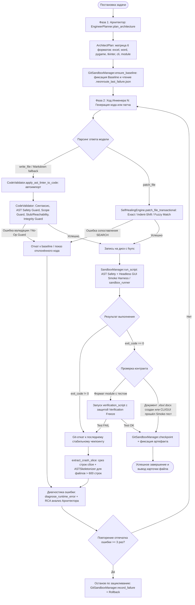

# ARCHITECTURE.md
# Техническая спецификация архитектуры NeonRoute

> **Версия системы**: NeonRoute v0.9.0-beta  
> **Целевая платформа**: Windows 10/11 x64, Python 3.10+, PyQt6, QFramelessWindow, QFluentWidgets  
> **Аппаратный профиль**: 8 ГБ VRAM (NVIDIA GeForce RTX 5050 Laptop GPU / 16 ГБ RAM)  
> **Метрики кодовой базы**: 173 файла, 60 418 строк кода  
> **Статус верификации**: 487 тестов пройдено (100% Pass Rate)

---

## 1. Архитектурный манифест и принципы проектирования

Система **NeonRoute** спроектирована как десктопный ИИ-оркестратор для рабочих станций с жестким аппаратным лимитом видеопамяти (8 ГБ VRAM). В основу кодовой базы заложены следующие архитектурные принципы:

1. **Взаимное исключение VRAM (Mutual Exclusion Principle)**:
   При аппаратном бюджете в 8192 МБ одновременное размещение квантованной LLM (Qwen 7B / L3-Stheno-8B: ~4.2–5.5 ГБ VRAM) и диффузионного чекпоинта Stable Diffusion (SD 1.5 / SDXL: ~3.2–4.8 ГБ VRAM) во время вычислений вызывает вытеснение памяти в медленную Shared RAM или сбой `CUDA out of memory`. Модуль `services.vram_arbiter.VRAMArbiter` гарантирует монопольный доступ к GPU только одному вычислительному ядру.
2. **Строгая детерминированная очередность (`Single Worker Task Queue`)**:
   Все тяжелые операции инференса (LLM-диалог, диффузионная генерация арта, синтез речи F5-TTS, выполнение инструментов песочницы, фоновая экстракция памяти и каста) ставятся в приоритетную очередь `services.task_queue.TaskQueueWorker` со строгим лимитом `max_workers = 1` и тремя уровнями приоритета (`PRIORITY_HIGH = 0`, `PRIORITY_NORMAL = 10`, `PRIORITY_LOW = 20`) с поддержкой вытесняющей отмены (`abort_tasks_by_type`).
3. **Execution-First для разработки ПО**:
   Субагент «Инженер» (`services.subagent_engineer.SubagentEngineer`) не полагается на теоретическую оценку сгенерированного кода. Единственным критерием корректности является запуск в песочнице с кодом возврата `exit_code == 0`, успешное прохождение верификатора (или Headless GUI Smoke-теста) и многоуровневых AST-проверок (`CodeValidator`).
4. **Безопасность и изоляция рантайма**:
   Все операции создания и исполнения скриптов изолированы в каталоге `workspace/projects/<session_id>/`. Системные вызовы операционной системы фильтруются на уровне AST-префлайта и рантайм аудит-хуков `sys.addaudithook` в `services.sandbox_guard.py`.
5. **ACID-персистентность состояния**:
   Все операции записи сессий, каста персонажей, реестров знаний и настроек выполняются атомарно через функцию `utils.file_utils.atomic_write_json` со сбросом буфера операционной системы (`fsync`) во временный файл `.tmp` и экспоненциальным ретраем при блокировках `WinError 32`.

---

## 2. Полное дерево файлов кодовой базы (Actual File Tree: 173 файла, 60 418 строк)

Ниже приведена полная и точная топология файлов проекта на основе статического анализа дампа кодовой базы v0.9.0-beta:

```
NeonRoute/
├── collect_codeMINI.py                          # [113 строк] Утилита сборки дампа кодовой базы проекта в project_code_dump.txt
├── config.py                                    # [183 строки] Единый источник правды (SSOT): базовые пути, лимиты VRAM, MODE_PROFILES, SD-настройки
├── main.py                                      # [126 строк] Точка входа: QApplication, setup_environment_and_logging (7-дневная ротация), global_exception_handler
│
├── core/                                        # Ядро и интерфейсы совместимости
│   ├── __init__.py                              # [3 строки] Инициализация пакета core
│   └── session_manager.py                       # [8 строк] Реэкспорт SessionManager, промпты инженера
│
├── services/                                    # Сервисный слой и бизнес-логика (Business Logic Layer)
│   ├── __init__.py                              # [1 строка] Инициализация пакета services
│   ├── art_director_config.py                   # [256 строк] Атомарная загрузка и сохранение data/art_director_models.json, эвристический фоллбэк
│   ├── asset_validator.py                       # [103 строки] Pre-flight аудит наличия чекпоинтов SD и весов ADetailer YOLO
│   ├── assistant_prompt_builder.py              # [573 строки] Сборщик системного промпта Эларии (UserInfo, PassiveMemory, 7 микро-скиллов, GALLERY_SKILL_DIRECTIVE)
│   ├── card_translator.py                       # [444 строки] Пошаговый (Slot-by-Slot) и чанковый переводчик карточек с маскированием __NR_TAG_X__ и CJK Quality Gate
│   ├── chub_client.py                           # [416 строк] REST API клиент каталога Chub.ai (поиск, очистка промо-мусора sanitize_card_description, распаковка PNG/JSON)
│   ├── civitai_service.py                       # [181 строка] Запрос параметров модели по полному AutoV2 SHA256 с Civitai API
│   ├── code_engine.py                           # [354 строки] Модульный движок: ASTSkeletonizer, ExecutionSandbox, реэкспорт PatchApplier/CodeValidator
│   ├── code_validator.py                        # [614 строк] AST-валидатор синтаксиса, Scope Guard (NameError через symtable), Stub/Reachability Guard, AST Linter импортов
│   ├── config_manager.py                        # [6 строк] Шим-совместимость для utils.config_manager.ConfigManager
│   ├── context_window_builder.py                # [902 строки] Сборщик контекста LLM, архитектура «Трёх якорей», Sliding CoT Preservation, KV-Cache In-Chat Injection
│   ├── direct_command_parser.py                 # [108 строк] Парсер CLI-параметров и флагов прямого рендера (!арт / !art)
│   ├── document_parser.py                       # [598 строк] Универсальный CPU-парсер документов, кода и дампов чатов (.pdf, .docx, .doc, .xlsx, .csv, .pptx, .fb2, .json)
│   ├── engineer_context.py                      # [354 строки] Сбор файлового контекста, AST-скелетирование (>600 строк), извлечение кода и откат песочницы
│   ├── engineer_controller.py                   # [7 строк] Шим-совместимость для ui.controllers.engineer_controller
│   ├── engineer_diagnostics.py                  # [272 строки] Экспертная диагностика ошибок рантайма (openpyxl/docx/tkinter/sqlite), срез места сбоя extract_crash_slice
│   ├── engineer_planner.py                      # [283 строки] Фаза «Архитектор»: матрица 6 форматов артефактов и выбор контракта верификации
│   ├── engineer_prompts.py                      # [248 строк] Системные промпты инженера по форматам (excel, word, pygame, tkinter, cli, module), реестр PyPI
│   ├── entity_mapper.py                         # [160 строк] Детерминированный конвертер кириллических сущностей в теги SD 1.5, Ambiguity Gate
│   ├── environment_doctor.py                    # [124 строки] Аудит окружения и фоновая установка пакетов через PipInstallWorker (Git, pygame, customtkinter, openpyxl, docx)
│   ├── file_generator.py                        # [318 строк] Генератор стилизованных документов Excel (.xlsx) и Word (.docx) из ответов LLM
│   ├── forge_client.py                          # [956 строк] REST клиент SD WebUI Forge (/sdapi/v1/txt2img, Hires.fix, ADetailer Guard, Watchdog 90s, автоочистка VRAM)
│   ├── forge_models.py                          # [392 строки] Реестр паспортов моделей SD (MODEL_REGISTRY, ModelCapabilities, AuthorCanon)
│   ├── git_sandbox.py                           # [290 строк] GitSandboxManager: локальный Git-репозиторий песочницы с автоочисткой index.lock и fallback на ZIP-снапшоты
│   ├── hybrid_search.py                         # [609 строк] Трехконтурный гибридный поиск: BM25Index + BuiltinDenseVectorizer/FastEmbed + RRF и Gatekeeper
│   ├── knowledge_manager.py                     # [980 строк] Менеджер базы знаний Эларии: извлечение триггеров, registry.json, search_index.json, Cross-Reference Linker
│   ├── knowledge_watcher.py                     # [201 строка] QFileSystemWatcher сателлит с дебаунсом 2.0 с для горячей инвалидации базы знаний
│   ├── lm_studio.py                             # [728 строк] Потокобезопасный синглтон-клиент LLM (Keep-Alive, SSE-стриминг, DRY/XTC сэмплеры, Structured Outputs)
│   ├── lora_manager.py                          # [11 строк] Шим-совместимость для services.art_director.lora_manager
│   ├── macro_engine.py                          # [64 строки] Парсер динамических макросов {{user}}, {{char}}, {{random: ...}}, {{roll: XdY+Z}} и <START>
│   ├── markdown_chunker.py                      # [400 строк] Структурный нарезчик Markdown с защитой целостности кодовых блоков ``` и шапок таблиц
│   ├── memory_db.py                             # [812 строк] Двухконтурное хранилище памяти: SQLite (WAL) + LanceDB (facts и rp_memories) на CPU через FastEmbed ONNX
│   ├── memory_extractor.py                      # [308 строк] Асинхронный экстрактор фактов о пользователе (PRIORITY_LOW, фильтр самораскрытия, JSON Schema)
│   ├── minor_safety.py                          # [117 строк] Детектор несовершеннолетних персонажей и неразрушающий фильтр безопасности промптов (MinorSafetyDetector)
│   ├── mode_coordinator.py                      # [449 строк] Конечный автомат переключения режимов (Teardown -> Switch -> Boot -> Mount) с полной изоляцией контекста
│   ├── model_router.py                          # [504 строки] Гибридный роутер моделей для Арт-директора (триггеры стиля + FastEmbed косинусное сходство + дефолт)
│   ├── patch_engine.py                          # [499 строк] Хирургический PatchApplier (Exact, Indent-Shift, Normalized, SequenceMatcher Fuzzy) и SelfHealingEngine
│   ├── process_manager.py                       # [1160 строк] Оркестратор процессов: автономный headless llama-server.exe, LM Studio CLI и демон SD WebUI Forge
│   ├── regex_filter.py                          # [71 строка] Очистка тегов <think>, спецтокенов <|im_end|>, извлечение [IMAGE_PROMPT] и нормализация тире диалогов
│   ├── roleplay_flow_controller.py              # [682 строки] Контроллер диалогового цикла RP: триггеры арта, кинематографический промпт-генератор, реактивный колбэк сцены
│   ├── roleplay_prompt_builder.py               # [395 строк] Сборщик промптов RP: 3 ветки идентичности (Среда/Группа/Соло), 11 архетипов и 4 кино-директивы сцен
│   ├── roleplay_state_manager.py                # [136 строк] Детерминированный парсер блоков <stats>/[STATUS] (локация, инвентарь, квесты, статы ЛитРПГ) и очистка чата
│   ├── rp_cast_extractor.py                     # [523 строки] Асинхронный летописец сцены (JSON Schema): NPC, локации, мутации, сдвиги отношений, кино-архетип scene_type
│   ├── rp_cast_manager.py                       # [948 строк] Менеджер состояния кампании (history/cast_<id>.json): сопартийцы, переключение фокуса, TTL NPC, лорбуки
│   ├── rp_constants.py                          # [26 строк] Словарь ключевых слов триггеров анализа сцены (SCAN_KEYWORDS)
│   ├── rp_scene_updater.py                      # [475 строк] Транзакционное применение изменений сцены к cast_data, таргетированные companion_updates, защита реликвий
│   ├── sandbox_guard.py                         # [236 строк] Периметр безопасности рантайма: sys.addaudithook, перехват builtins.__import__, защита ФС и блокировка сети
│   ├── sandbox_manager.py                       # [758 строк] Менеджер песочницы: изоляция сессионных папок, AST Safety Guard, Headless GUI Smoke Harness (Tkinter/Pygame/PyQt)
│   ├── sandbox_runner.py                        # [63 строки] Изолированный раннер пользовательских скриптов через runpy.run_path с активацией sandbox_guard
│   ├── search_tokenizer.py                      # [173 строки] Токенизатор для индекса BM25 со стеммингом Портера RU/EN, разбором camelCase/snake_case и декомпозицией корней
│   ├── server_config.py                         # [496 строк] 3-уровневый каскад ServerConfigResolver для поиска llama-server.exe, CUDA 12 DLLs, GGUF и mmproj
│   ├── session_manager.py                       # [798 строк] Управление сессиями диалогов, ACID-запись chat_<id>.json и дублирование в outputs/sessions/<id>/session.json
│   ├── skill_router.py                          # [168 строк] Двухуровневый гибридный роутер 7 специализированных микро-скиллов на CPU
│   ├── stt_service.py                           # [68 строк] Сервис голосового ввода (Faster-Whisper stub)
│   ├── subagent_engineer.py                     # [1730 строк] Автономный субагент «Инженер»: Архитектор -> Код/Патч -> AST/Scope Guard -> Smoke/Unit тест -> RCA самокоррекция
│   ├── task_queue.py                            # [239 строк] Последовательная приоритетная очередь задач (TaskQueueWorker, вытесняющая отмена abort_tasks_by_type)
│   ├── tavern_models.py                         # [688 строк] Модели CharacterCard и LoreEntry: автоопределение 11 архетипов, пола, POV (1/3 лицо) и Self-Healing с диска
│   ├── tavern_parser.py                         # [821 строка] Парсер карточек Tavern V1/V2/CCv3 и Chub (JSON/PNG/WebP), извлечение лорбуков и regex-ДНК внешности/сцен
│   ├── thought_stream_parser.py                 # [218 строк] Потоковый конечный автомат <think>...</think> с буферизацией границ чанков и circuit breaker (1800 симв.)
│   ├── token_budget_manager.py                  # [345 строк] Оценка токенов BPE, светофор карточек и двухконтурная модель контекста (ContextTierDecision)
│   ├── tool_engine.py                           # [785 строк] Диспетчер инструментов песочницы и проводника (write_file, patch_file, run_script, find_files, git_checkpoint, set_reminder)
│   ├── tool_parser.py                           # [268 строк] Парсер тегов инструментов <<TOOL:...>> с поддержкой SEARCH/REPLACE блоков и нормализацией синтаксиса
│   ├── tts_service.py                           # [146 строк] Клиент синтеза речи F5-TTS на CPU (http://127.0.0.1:5010) с генерацией резервного полифонического WAV-сигнала
│   ├── user_profile_manager.py                  # [179 строк] Менеджер профилей пользователя (data/user_profiles.json) и кэша русских приветствий карточек
│   ├── vision_utils.py                          # [102 строки] Препроцессинг и LANCZOS-сжатие изображений (max_dim=768, JPEG 85) в base64 для Vision-моделей
│   ├── vram_arbiter.py                          # [91 строка] Централизованный арбитр видеопамяти (GPUOwner: NONE, LLM, DIFFUSION)
│   ├── workspace_launcher.py                    # [75 строк] Интерактивный запуск скриптов в отдельном окне cmd.exe /k и открытие папок сессии
│   │
│   └── art_director/                            # Подсистема режиссуры изображений «Арт-директор»
│       ├── __init__.py                          # [68 строк] Фасад подсистемы art_director
│       ├── contracts.py                         # [113 строк] Контракты данных: TargetSubject (ELARIA, COMPANION, SCENE_OBJECT), VisualIntent, SceneAnalysisContract
│       ├── director.py                          # [1489 строк] ArtDirector: сборка RP-контекста, микширование llm_guidance, LoRA-резолвинг, симметризация BREAK и защита 8GB VRAM
│       ├── geometry.py                          # [100 строк] Разрешения SD 1.5 и SDXL по 6 архетипам кадра (fullbody, solo, closeup, pair, scenery, cinematic)
│       ├── legacy_helpers.py                    # [117 строк] Вспомогательные функции обратной совместимости
│       ├── lora_manager.py                      # [279 строк] Чтение бинарных заголовков .safetensors на CPU (0 MB VRAM), извлечение топ-3 триггеров и реестр lora_registry.json
│       ├── plan.py                              # [144 строки] Модель GenerationPlan и сериализатор to_forge_kwargs() с формированием слотов ADetailer (лицо + руки)
│       └── prompting.py                         # [141 строка] Константа ELARIA_VISUAL_DNA, перехват отрицаний extract_negations_from_prompt и сборка негатива
│
├── ui/                                          # Слой графического интерфейса (Presentation Layer)
│   ├── __init__.py                              # [1 строка] Инициализация пакета ui
│   ├── log_console.py                           # [186 строк] Live-консоль логов текущей сессии (QtLogHandler, кольцевой буфер на 2000 записей)
│   ├── main_window.py                           # [1905 строк] Главное окно MainWindow (FramelessMainWindow + 13 миксинов, Mica/Acrylic, Snap Layouts, Smart Sticky Scroll)
│   ├── models_manager_dialog.py                 # [1882 строки] Пульт управления моделями Forge, параметрами пайплайна (Civitai AutoFill) и тестированием роутера FastEmbed
│   ├── styles.py                                # [311 строк] Глобальная таблица стилей NEON_THEME_QSS (Cyberpunk Glassmorphism)
│   │
│   ├── builders/                                # Билдеры интерфейса
│   │   ├── __init__.py                          # [1 строка] Инициализация пакета ui.builders
│   │   ├── chat_bubble_builder.py               # [540 строк] ChatBubbleBuilderMixin: рендеринг баблов, ленивая подгрузка истории пачками по 25 сообщений
│   │   └── menu_builder.py                      # [334 строки] MenuBuilder и ClickOnlyMenuBar: верхнее меню на базе RoundMenu и глобальные хоткеи
│   │
│   ├── common/                                  # Общие интерфейсные утилиты
│   │   ├── __init__.py                          # [1 строка] Инициализация пакета ui.common
│   │   └── icon_utils.py                        # [24 строки] Прокси-метакласс SafeFIF для безопасного разрешения иконок FluentIcon
│   │
│   ├── components/                              # Графические компоненты и виджеты
│   │   ├── __init__.py                          # [1 строка] Инициализация пакета ui.components
│   │   ├── assistant_chat_bubble.py             # [456 строк] AssistantChatMessageWidget и CyberpunkArtPlaceholderWidget (анимированный 28 FPS видоискатель синтеза кадра)
│   │   ├── audio_player.py                      # [126 строк] AudioPlayerWidget: встроенный плеер QMediaPlayer для воспроизведения озвучки F5-TTS
│   │   ├── chat_background.py                   # [123 строки] ChatBackgroundViewport: отрисовка обоев чата с кэшированием масштабированного QPixmap в resizeEvent
│   │   ├── chat_bubble.py                       # [1393 строки] Базовый ChatMessageWidget, SelectableTextBrowser, квантование ширины бабла (шаг 16px)
│   │   ├── chat_header_widget.py                # [244 строки] ChatHeaderWidget и HeaderAvatarWidget: шапка чата, меню фона сцены, селектор моделей Forge
│   │   ├── chat_input_panel.py                  # [244 строки] ChatInputPanel: нижняя парящая капсула ввода, панель чипов вложений, кнопки Attach/Mic/Emoji
│   │   ├── chat_list_item.py                    # [200 строк] ChatSessionItemWidget: элемент списка сессий с бейджем режима (InfoBadge) и контекстным меню выбора персоны
│   │   ├── chat_message_widget.py               # [181 строка] KnowledgeHUDWidget и KnowledgeSourceChip: неоновые микро-чипы источников RAG с превью цитат в тултипе
│   │   ├── chat_stream_widget.py                # [201 строка] ChatStreamWidget: SmoothScrollArea, масштабирование шрифта Ctrl+Колесо (11–22 pt)
│   │   ├── emoji_picker.py                      # [97 строк] EmojiPickerMenu: категоризированная палитра эмодзи
│   │   ├── file_card.py                         # [153 строки] FileCardWidget: интерактивная карточка созданного документа (Excel/Word/Image/Audio)
│   │   ├── input_box.py                         # [349 строк] ChatInputBox: поле ввода с авторасширением (42–250px), вставкой скриншотов Ctrl+V и кнопкой-трансформером
│   │   ├── reminder_toast.py                    # [63 строки] ReminderToastWidget: всплывающее уведомление напоминания
│   │   ├── rpg_elements.py                      # [513 строк] Парсер RPGContentParser и виджеты: RPGStatusWidget, RPGThoughtWidget, RPGChoicesWidget, блоки <check>/<terminal>/<sms>
│   │   ├── rpg_status_widget.py                 # [24 строки] Шим реэкспорта rpg_elements
│   │   ├── scroll_button.py                     # [136 строк] FloatingScrollDownButton: круглая акриловая кнопка прокрутки ко дну чата
│   │   ├── search_bar.py                        # [165 строк] SearchBarWidget: панель поиска по тексту диалога с навигацией по совпадениям
│   │   ├── search_bar_widget.py                 # [8 строк] Шим реэкспорта search_bar.SearchBarWidget
│   │   ├── sidebar_widget.py                    # [245 строк] SidebarWidget: левая боковая панель с селектором LLM, списком чатов и быстрыми кнопками папок
│   │   ├── status_bar_widget.py                 # [312 строк] MainStatusBar, VramLabel, RamLabel, ServiceStatusBadge: телеметрия железа и управление серверами
│   │   ├── status_pill.py                       # [51 строка] StatusPill: компактный LED-индикатор статуса сервисов
│   │   ├── step_progress_button.py              # [94 строки] StepProgressButton и CardProgressBridge: кнопка с кольцевым и линейным прогрессом перевода слотов карточки
│   │   ├── thought_spoiler_widget.py            # [237 строк] ThoughtSpoilerWidget: сворачиваемый блок «Ход мыслей» с живым таймингом и подсчетом токенов
│   │   ├── typing_loader.py                     # [106 строк] TypingLoaderWidget: анимированный индикатор генерации ответа
│   │   │
│   │   ├── bubbles/                             # Модульные карточки и модальные просмотрщики
│   │   │   ├── __init__.py                      # [29 строк] Фасад пакета bubbles
│   │   │   ├── avatar_renderer.py               # [183 строки] HiDPI 3x рендеринг круглых аватаров и LRU-кэш скругленных превью артов (_IMAGE_PREVIEW_CACHE)
│   │   │   ├── image_preview_dialog.py          # [126 строк] Полноразмерный модальный просмотрщик изображений (ImagePreviewDialog)
│   │   │   └── workspace_cards.py               # [457 строк] WorkspaceFileCardWidget, ConsoleOutputSpoilerWidget и GenerationInfoAccordionWidget
│   │   │
│   │   └── rp/                                  # Ролевые компоненты отображения
│   │       ├── __init__.py                      # [6 строк] Инициализация пакета rp
│   │       └── rp_chat_bubble.py                # [246 строк] RPChatMessageWidget: специализированный бабл с парсингом RPG-разметки
│   │
│   ├── controllers/                             # Контроллеры и миксины MainWindow
│   │   ├── __init__.py                          # [1 строка] Инициализация пакета ui.controllers
│   │   ├── assistant_flow_controller.py         # [1117 строк] AssistantFlowControllerMixin: двухконтурный бюджет 14K, RAG-инъекция, двухпроходный арт-протокол [GALERY], санитизация памяти
│   │   ├── avatar_controller.py                 # [412 строк] AvatarControllerMixin: синхронизация аватаров и эмоций по 3 зонам UI (шапка, баблы, сайдбар)
│   │   ├── chat_flow_controller.py              # [1557 строк] ChatFlowControllerMixin: диспетчеризация ввода, парсинг напоминаний dateparser, батчинг стрима (28 FPS), Anti-Loop Guard
│   │   ├── dialog_controller.py                 # [409 строк] DialogControllerMixin: управление модальными окнами настроек, сэмплинга, базы знаний и экспорта
│   │   ├── engineer_controller.py               # [627 строк] EngineerControllerMixin: маршрутизация задач в SubagentEngineer и обработка ToolExecutionWorker
│   │   ├── hardware_engine.py                   # [816 строк] HardwareEngineMixin: управление процессами LLM/Forge, пайплайны генерации арта и таймер возврата LLM в VRAM
│   │   ├── header_controller.py                 # [129 строк] HeaderStateController: реактивный контроллер состояния шапки чата и прогресса этапов Forge
│   │   ├── reminder_controller.py               # [98 строк] ReminderController: 4-секундный пуллинг SQLite напоминаний, отправка в системный трей, Windows Toast и чат
│   │   ├── roleplay_controller.py               # [474 строки] RoleplayControllerMixin: управление фоном сцены, сводкой кампании и пошаговой локализацией карточек
│   │   ├── search_controller.py                 # [77 строк] ChatSearchMixin: поиск и навигация по сообщениям активного диалога
│   │   ├── session_controller.py                # [136 строк] SessionControllerMixin: создание, переименование и безопасное удаление сессий
│   │   ├── task_lifecycle_controller.py         # [463 строки] TaskLifecycleMixin: маршрутизация задач в очередь, перехват команд памяти и обработка ошибок (ModelNotFoundError)
│   │   └── window_state_controller.py           # [150 строк] WindowStateMixin: кэширование фона главного окна и полноэкранный режим (F11)
│   │
│   ├── dialogs/                                 # Модальные диалоговые окна приложения
│   │   ├── __init__.py                          # [25 строк] Фасад диалоговых окон
│   │   ├── about_dialog.py                      # [146 строк] О программе NeonRoute
│   │   ├── avatar_crop_dialog.py                # [287 строк] Интерактивное кадрирование аватара 512x512 с панорамированием и зумом (CropCanvas)
│   │   ├── avatar_lightbox_dialog.py            # [61 строка] Полноэкранный LightBox просмотра аватара
│   │   ├── background_dialog.py                 # [178 строк] Настройка обоев рабочего пространства и уровня затемнения (0–90%)
│   │   ├── campaign_info_dialog.py              # [1034 строки] Дашборд кампании (5 вкладок: Память/Статус, Инвентарь, Сценарий/Лор, Каст/NPC, Локация/Атмосфера)
│   │   ├── campaign_subdialogs.py               # [397 строк] Вспомогательные диалоги кампании: EntityConditionDialog, CastEditDialog, SelectLorebookDialog
│   │   ├── card_visual_setup_dialog.py          # [158 строк] Быстрая настройка Visual DNA и привязка LoRA после импорта карточки
│   │   ├── characters_gallery_dialog.py         # [2054 строки] Двухпанельная галерея персонажей с бесшовными аватарами, светофором токенов и редактором секций
│   │   ├── chub_catalog_dialog.py               # [575 строк] Сетка-каталог Chub.ai с многопоточной подгрузкой постеров и фильтрацией по русскому языку/токенам
│   │   ├── civitai_catalog_dialog.py            # [1066 строк] Браузер каталога Civitai с потоковой загрузкой .safetensors, защитой от SSRF и проверкой SHA-256
│   │   ├── civitai_lora_dialog.py               # [595 строк] Поиск и установка персонажных LoRA с проверкой совместимости архитектур (SD 1.5 vs SDXL/Pony)
│   │   ├── clean_cache_dialog.py                # [612 строк] Фоновый анализатор и очиститель кэша Forge, логов, превью и таблиц LanceDB
│   │   ├── dependency_dialog.py                 # [181 строка] Диалог проверки и установки опциональных зависимостей режима Инженер
│   │   ├── engineer_settings_dialog.py          # [287 строк] Выбор выделенной модели LLM для режима «Инженер»
│   │   ├── help_dialog.py                       # [208 строк] Справочник возможностей и горячих клавиш NeonRoute
│   │   ├── knowledge_manager_dialog.py          # [412 строк] Fluent-менеджер базы знаний Эларии (DocumentCardWidget с чипами триггеров)
│   │   ├── local_lora_dialog.py                 # [274 строки] Выбор локальных весов LoRA из папок Forge с настройкой веса и триггеров
│   │   ├── media_gallery_dialog.py              # [207 строк] Сетка всех сгенерированных изображений чата или всех сессий
│   │   ├── model_sampling_dialog.py             # [807 строк] Тонкая настройка сэмплинга (Temperature, Min-P, Top-P, Repeat Penalty, DRY, XTC, Max Tokens, DM Mode)
│   │   ├── models_manager_dialog.py             # [22 строки] Прокси-модуль для ui.models_manager_dialog.ModelsManagerDialog
│   │   ├── new_chat_dialog.py                   # [202 строки] Всплывающий селектор режима при создании нового диалога (РП Чат, Ассистент, Инженер)
│   │   ├── shutdown_dialog.py                   # [83 строки] Индикатор прогресса выгрузки VRAM и сохранения состояния при выходе
│   │   ├── user_settings_dialog.py              # [1005 строк] Настройки профиля пользователя для Ассистента и менеджер игровых персон для Ролевого чата
│   │   │
│   │   └── gallery/                             # Миксины диалога галереи персонажей
│   │       ├── __init__.py                      # [11 строк] Инициализация пакета ui.dialogs.gallery
│   │       ├── dna_party_mixin.py               # [663 строки] Извлечение Scenery DNA, Visual DNA, распознавание состава отряда и прямая генерация арта из галереи
│   │       └── translation_mixin.py             # [297 строк] Конвейер перевода отдельных полей и всей карточки персонажа с переключением RU/EN
│   │
│   ├── widgets/                                 # Виджеты совместимости
│   │   ├── __init__.py                          # [3 строки] Инициализация пакета ui.widgets
│   │   └── chat_message.py                      # [16 строк] Реэкспорт ChatMessageWidget и карточек песочницы
│   │
│   └── workers/                                 # Фоновые потоки QThread
│       ├── __init__.py                          # [1 строка] Инициализация пакета ui.workers
│       ├── model_discovery_worker.py            # [52 строки] Неблокирующее обнаружение моделей LM Studio/GGUF и чекпоинтов Forge при старте
│       ├── shutdown_worker.py                   # [63 строки] Воркер штатного завершения работы с 8-секундным сторожевым таймером (Watchdog)
│       └── tool_execution_worker.py             # [184 строки] Асинхронный исполнитель цепочек вызовов инструментов (write_file -> run_script)
│
└── utils/                                       # Вспомогательные системные утилиты
    ├── __init__.py                              # [1 строка] Инициализация пакета utils
    ├── config_manager.py                        # [119 строк] Управление конфигурацией config.json с рекурсивным слиянием дефолтов
    ├── file_utils.py                            # [39 строк] Атомарная запись JSON (atomic_write_json) с уникальным .tmp, fsync и защитой от WinError 32
    ├── health_checker.py                        # [100 строк] Быстрый асинхронный сокет-монитор портов 1234, 7860 и 5010 с дедупликацией сигналов
    └── system_monitor.py                        # [184 строки] Мониторинг VRAM/RAM/Temp через pynvml (с fallback на прямой вызов nvidia-smi) и psutil
```

---

## 3. Декомпозиция MainWindow и иерархия миксинов

Главное окно приложения `MainWindow` спроектировано на базе фреймворка `qframelesswindow.FramelessMainWindow` с композицией из 13 специализированных миксинов и координируется конечным автоматом `ModeCoordinator` (`services/mode_coordinator.py`):

```mermaid
classDiagram
    class FramelessMainWindow
    class WindowStateMixin {
        +_update_background_cache()
        +paintEvent()
        +_toggle_fullscreen()
    }
    class DialogControllerMixin {
        +_open_user_settings_dialog()
        +_open_model_sampling_dialog()
        +_open_clean_cache_dialog()
        +_open_knowledge_manager_dialog()
    }
    class TaskLifecycleMixin {
        +_enqueue_translation_task()
        +_route_and_enqueue()
        +_on_task_started()
        +_on_task_finished()
        +_on_task_failed()
    }
    class ChatSearchMixin {
        +_show_search_bar()
        +_on_search_query_changed()
        +_search_next()
    }
    class AvatarControllerMixin {
        +_get_current_avatar_path()
        +_update_expression_avatar()
        +_change_character_avatar()
    }
    class SessionControllerMixin {
        +_on_new_chat_clicked()
        +_save_current_session()
        +_on_rename_session_requested()
        +_on_delete_session_requested()
    }
    class ChatBubbleBuilderMixin {
        +_render_stored_message()
        +_append_message()
        +_load_previous_messages_chunk()
        +_clear_chat_widgets()
    }
    class ChatFlowControllerMixin {
        +_on_send_clicked()
        +_sync_turn()
        +_on_token_streamed()
        +_flush_stream_buffer()
        +_on_llm_response_received()
        +_detect_repetition_loop()
    }
    class AssistantFlowControllerMixin {
        +_enqueue_assistant_llm_task()
        +_handle_assistant_llm_response()
        +_enqueue_gallery_art_pass()
        +_handle_assistant_art_completed()
        +process_assistant_attachments()
    }
    class RoleplayControllerMixin {
        +_apply_chat_background()
        +_open_campaign_info_dialog()
        +_translate_character_card_task()
        +_restore_roleplay_character_from_session()
    }
    class RoleplayFlowControllerMixin {
        +_enqueue_roleplay_llm_task()
        +_handle_roleplay_llm_response()
        +_generate_ephemeral_rp_art_prompt()
        +_on_scene_visual_intent_ready()
    }
    class HardwareEngineMixin {
        +_on_health_updated()
        +_on_hardware_stats()
        +_refresh_models()
        +_on_scene_art_requested()
        +_reload_active_lms_model_async()
    }
    class EngineerControllerMixin {
        +is_engineer_mode_active()
        +_dispatch_ephemeral_doc_worker()
        +_handle_tool_call_flow()
        +_handle_engineer_task_finished()
    }
    class MainWindow {
        +lm_client: LMStudioClient
        +forge_client: ForgeClient
        +task_queue: TaskQueueWorker
        +mode_coordinator: ModeCoordinator
        +header_controller: HeaderStateController
        +reminder_controller: ReminderController
        +knowledge_watcher: KnowledgeWatcher
        +closeEvent()
    }

    FramelessMainWindow <|-- MainWindow
    WindowStateMixin <|-- MainWindow
    DialogControllerMixin <|-- MainWindow
    TaskLifecycleMixin <|-- MainWindow
    ChatSearchMixin <|-- MainWindow
    AvatarControllerMixin <|-- MainWindow
    SessionControllerMixin <|-- MainWindow
    ChatBubbleBuilderMixin <|-- MainWindow
    ChatFlowControllerMixin <|-- MainWindow
    AssistantFlowControllerMixin <|-- MainWindow
    RoleplayControllerMixin <|-- MainWindow
    RoleplayFlowControllerMixin <|-- MainWindow
    HardwareEngineMixin <|-- MainWindow
    EngineerControllerMixin <|-- MainWindow
```



### 3.1. Архитектура исключения конфликтов метаклассов и изоляции режимов (`ModeCoordinator`)
- Все 13 миксинов контроллеров (`*Mixin`) являются «чистыми» классами Python без прямого наследования от `QObject` или `QWidget`. Единственной точкой входа в иерархию классов Qt выступает сам класс `MainWindow(FramelessMainWindow, ...)`, что предотвращает коллизии метаклассов `sip.wrappertype`.
- Переключение между тремя режимами (`AppMode.ASSISTANT`, `AppMode.ROLEPLAY`, `AppMode.ENGINEER`) управляется конечным автоматом `services.mode_coordinator.ModeCoordinator` по четырехфазному циклу **Teardown -> Switch -> Boot -> Mount**:
  1. **Teardown**: принудительная остановка активной генерации, сохранение уходящей сессии на диск, остановка фоновых воркеров (`_tool_worker`, `_ephemeral_doc_worker`, `_cast_extractor_worker`), отмена таймеров возврата LLM и сборка мусора `gc.collect()`.
  2. **Switch**: фиксация целевого `AppMode` и очистка оперативного списка `chat_history`.
  3. **Boot**: конфигурация UI-компонентов под целевой режим (панель карточки персонажа, кнопка фона сцены, индикатор режима инженера в `ChatInputBox`).
  4. **Mount**: привязка изолированной папки песочницы `SandboxManager.set_active_session_id(sess_id)`, восстановление карточки персонажа и пакетная отрисовка сообщений с пагинацией по 35 реплик.

---

## 4. Жизненный цикл выключения (Graceful Shutdown Flow)

Процедура штатного закрытия приложения (`ui/main_window.py` -> `ui/workers/shutdown_worker.py`) гарантирует освобождение ресурсов видеокарты и предотвращает появление процессов-сирот `llama-server.exe` и `SD WebUI Forge` в операционной системе Windows:

```mermaid
sequenceDiagram
    autonumber
    actor User as Пользователь
    participant MW as MainWindow
    participant Dialog as ShutdownProgressDialog
    participant SW as ShutdownWorker (QThread)
    participant Watchdog as Аварийный Watchdog (Thread)
    participant Storage as Сессии и LanceDB
    participant PM as ProcessManager
    participant Forge as SD WebUI Forge (PID)
    participant LLM as llama-server.exe / LM Studio

    User->>MW: Закрытие окна (closeEvent)
    MW->>MW: event.ignore(), остановка ReminderController и KnowledgeWatcher, self.hide()
    MW->>Dialog: .show() (Glassmorphic индикатор)
    MW->>SW: .start()
    SW->>Watchdog: threading.Thread(target=_watchdog, daemon=True).start(8.0s)
    
    rect rgb(20, 30, 45)
    Note over SW,Storage: Шаг 1: Сохранение состояния и оптимизация LanceDB
    SW->>MW: _save_current_session()
    SW->>Storage: ConfigManager.save_config()
    SW->>Storage: memory_db.close() (compact_files, cleanup_old_versions, optimize)
    end

    rect rgb(30, 40, 25)
    Note over SW,MW: Шаг 2: Остановка фоновых потоков мониторинга
    SW->>MW: health_worker.stop() (wait 1000ms)
    SW->>MW: system_monitor.stop() (wait 1000ms)
    SW->>MW: task_queue.stop() (wait 1000ms)
    end

    rect rgb(45, 20, 30)
    Note over SW,PM: Шаг 3: Аппаратная зачистка VRAM и дерева процессов
    SW->>PM: shutdown_all()
    PM->>Forge: 1. taskkill /F /T /PID <forge_pid> (timeout=3s)
    PM->>Forge: 2. Зачистка остаточных процессов launch.py/webui через psutil
    PM->>LLM: 3. _kill_llama_server_instance() (taskkill /F /T для llama-server.exe)
    PM->>LLM: 4. POST /api/v0/models/unload + lms unload --all (timeout=5s)
    end

    SW-->>MW: Сигнал finished
    MW->>Dialog: .close(), .deleteLater()
    MW->>MW: _shutdown_completed = True, QApplication.quit()
    
    opt Срабатывание таймера при зависании
        Watchdog->>Watchdog: Истекло 8.0 секунд
        Watchdog-->>MW: os._exit(0) (Принудительное завершение)
    end
```



---

## 5. Модель передачи VRAM между LLM и SD Forge (`VRAMArbiter`)

Монопольный доступ к ресурсам GPU реализуется через синглтон `services.vram_arbiter.VRAMArbiter` в связке с `ProcessManager` и `ForgeClient`:

```mermaid
stateDiagram-v2
    [*] --> GPU_IDLE: Инициализация системы

    state GPU_IDLE {
        [*] --> NONE
        NONE: GPU свободен / Фоновый мониторинг
    }

    GPU_IDLE --> LLM_ACTIVE: Вход текстовой задачи (LLM / Translation / Engineer)
    
    state LLM_ACTIVE {
        [*] --> LOAD_LLM
        LOAD_LLM: Запуск llama-server.exe (-ngl 99, q8_0 KV) или lms load
        HOLD_LLM: Инференс Qwen / L3-Stheno (4.2-5.5 ГБ VRAM)
        LOAD_LLM --> HOLD_LLM
    }

    LLM_ACTIVE --> TRANSITION_TO_DIFFUSION: Запрос генерации арта (после генерации тегов LLM, если нужен перевод)

    state TRANSITION_TO_DIFFUSION {
        [*] --> UNLOAD_LLM
        UNLOAD_LLM: evict_llm_for_forge_sync() (taskkill llama-server / lms unload --all)
        WAIT_WDDM: Динамический опрос NVML (Ожидание Free VRAM >= 3800 МБ, до 4.0 с)
        UNLOAD_LLM --> WAIT_WDDM
    }

    TRANSITION_TO_DIFFUSION --> DIFFUSION_ACTIVE: Память очищена
    
    state DIFFUSION_ACTIVE {
        [*] --> LOAD_SD
        LOAD_SD: Загрузка чекпоинта Forge в VRAM (override_settings)
        RENDER_TXT2IMG: Базовый проход (steps=10-28, DPM++ 2M / SDE Karras)
        RENDER_HIRES: Hires.fix апскейл (VAE Tiling активен, отключен для SDXL >= 640K px)
        RENDER_ADETAILER: Детекция лиц и рук YOLO (если разрешено ADetailer Guard)
        LOAD_SD --> RENDER_TXT2IMG
        RENDER_TXT2IMG --> RENDER_HIRES
        RENDER_HIRES --> RENDER_ADETAILER
    }

    DIFFUSION_ACTIVE --> TRANSITION_TO_LLM: Рендер завершен (блок finally в ForgeClient.text_to_image)

    state TRANSITION_TO_LLM {
        [*] --> UNLOAD_SD
        UNLOAD_SD: POST /sdapi/v1/unload-checkpoint (Сброс чекпоинта в системную RAM)
        PURGE_CUDA: POST /sdapi/v1/free-vram (Очистка кэша PyTorch CUDA)
        TIMER_DELAY: Отложенный тихий возврат LLM (QTimer 1.2s при пустой очереди артов)
        UNLOAD_SD --> PURGE_CUDA
        PURGE_CUDA --> TIMER_DELAY
    }

    TRANSITION_TO_LLM --> LLM_ACTIVE: Автовозврат активной модели режима в VRAM
```



### Особенности координации VRAM:
- **Флаг `needs_llm_prompt_gen`**: Если запрос на генерацию арта в РП или на кириллице сначала требует обращения к LLM для составления английских Danbooru-тегов (`_generate_ephemeral_rp_art_prompt` или `tagify_prompt_with_lm`), `VRAMArbiter.prepare_for_task` пропускает преждевременную выгрузку LLM, позволяя модели сначала сгенерировать теги, и вызывает `release_llm_for_diffusion()` непосредственно перед отправкой payload в SD Forge.
- **Гарантированная очистка в `finally`**: Вызов `unload_checkpoint()` и `free_vram()` встроен непосредственно в блок `finally` метода `ForgeClient.text_to_image`, что гарантирует освобождение VRAM даже при отмене генерации пользователем или сбое сети.

---

## 6. Субагент «Инженер» и цикл Self-Healing (`subagent_engineer.py`)

Субагент разработки `services.subagent_engineer.SubagentEngineer` работает в режиме нулевого загрязнения диалоговой памяти (Zero-State Persistence для LanceDB) по схеме самовосстанавливающегося цикла (Self-Correction Loop) с настраиваемым лимитом шагов (по умолчанию 15 ходов, до 3 повторов одной ошибки):



### Ключевые защитные механизмы Инженера:
1. **Headless GUI Smoke Harness (`SandboxManager.run_script`)**:
   Оконные приложения (`tkinter`, `customtkinter`, `pygame`, `PyQt6`/`PySide6`) не зависают в бесконечном `mainloop()`, а автоматически оборачиваются в тестовый раннер, который подавляет модальные окна (`messagebox`/`filedialog`), эмулирует клики по кнопкам, нажатия клавиш (`Space`, `Return`, стрелки) и события мыши в течение 35 кадров / 800 мс, перехватывая любые скрытые исключения в обработчиках событий.
2. **Verification Freeze**:
   Начиная с 3-го хода (или со 2-го хода, если на 1-м ходе не было ошибки сигнатур `TypeError`/`AssertionError`), субагенту блокируется модификация проверочного скрипта `verification_script`, что исключает «читерство» модели путём удаления падающих ассертов.
3. **AST-скелетирование (`ASTSkeletonizer`)**:
   Если размер инспектируемого файла превышает `MAX_FULL_CODE_LINES = 600` строк, модель получает компактный архитектурный скелет (импорты, константы, сигнатуры классов/методов и docstrings с заменой тел на `...`) плюс точный пронумерованный срез места сбоя (`extract_crash_slice`, `±30` строк).

---

## 7. Подсистема базы знаний и гибридного поиска RAG (Knowledge Base & Hybrid Search)

Подсистема базы знаний Эларии реализована строго на **CPU (0 МБ VRAM, latency < 50 мс)** и обеспечивает долговременное семантическое индексирование файлов документации, исходного кода, логов и таблиц:

```
[Пользовательский файл]
        │
        ▼
DocumentParser (.pdf, .docx, .doc, .xlsx, .csv, .pptx, .fb2, .txt, .md, .py, .json)
        │
        ▼
MarkdownChunker (500-1400 симв., overlap 150, сохранение блоков ``` и шапок таблиц)
        │
        ├─────────────────────────────────┬─────────────────────────────────┐
        ▼                                 ▼                                 ▼
   BM25Index                      BuiltinDenseVectorizer              FastEmbed ONNX
(Точные артикулы,                (Частотно-морфологические           (MiniLM-L12-v2,
 коды ошибок, коды деталей)       семантические корни, 256d)         семантический вектор, 384d)
        │                                 │                                 │
        └─────────────────────────────────┼─────────────────────────────────┘
                                          ▼
                             HybridSearchEngine (Контур 3)
                                          │
                         Reciprocal Rank Fusion (RRF, k=60) + Linear Fusion
                                          │
                         Gatekeeper (Отсев small talk + порог dense >= 0.75 при BM25 == 0)
                                          │
                         Cross-Reference Linker (Авто-добор связанных файлов)
                                          │
                                          ▼
                      KnowledgeHUDWidget (Неоновые микро-чипы источников в бабле чата)
```

### Архитектурные компоненты RAG:
1. **`services.knowledge_manager.KnowledgeManager`**:
   Синглтон управления документами в каталоге `knowledge_base/`. Извлекает 8–10 ключевых триггеров на CPU (`extract_triggers`), ведет атомарный реестр `registry.json` и сериализованный индекс `search_index.json`. Поддерживает:
   - **Query Fusion (`_fuse_contextual_query`)**: склеивает запрос с терминами предыдущего хода только при наличии явных маркеров коррекции или анафоры («а в нем», «покажи его код», «другой»).
   - **Cross-Reference Linker (`_find_cross_references`)**: автоматически подтягивает до 2 связанных файлов, если они упомянуты в найденных сниппетах.
2. **`services.knowledge_watcher.KnowledgeWatcher`**:
   Фоновый сателлит на базе `QFileSystemWatcher`. Отслеживает изменения в папке `knowledge_base/`, применяет дебаунс-таймер на **2.0 секунды** и запускает `KnowledgeManager.scan_and_sync` через очередь задач `TaskQueue` с приоритетом `PRIORITY_LOW = 20`.
3. **`services.hybrid_search.HybridSearchEngine`**:
   - **Контур 1 (Sparse BM25)**: Алгоритм Okapi BM25 (`k1=1.5`, `b=0.75`), сохраняющий точные вхождения идентификаторов деталей, артикулов и кодов ошибок (`0x...`).
   - **Контур 2 (Dense Semantic Search)**: Вычисление косинусного сходства векторов `BuiltinDenseVectorizer` (256d, субсловные триграммы + 13 семантических кластеров) или `FastEmbed` (384d).
   - **Контур 3 (RRF & Gatekeeper)**: Синтез RRF (`1/(60 + rank)`) и линейной комбинации. Шлюз `is_conversational_query` проверяет термины запроса по инвертированному словарю BM25: если токены отсутствуют в базе и запрос содержит `<= 3` слов из `CONVERSATIONAL_PHRASES`, поиск отключается. При `BM25 == 0.0` кандидат допускается только при `dense_score >= 0.75`.
4. **Защита долговременной памяти от загрязнения RAG (`sanitize_messages_for_memory`)**:
   В `AssistantFlowControllerMixin` перед отправкой истории в `MemoryExtractor` функция `sanitize_messages_for_memory` вырезает все блоки `<KnowledgeBase>`, `<Document>`, `<AttachedDocument>`, `<think>` и ссылки на чанки, чтобы справочные данные из мануалов не записывались в `LanceDB` как личные факты о пользователе.

---

## 8. Подсистема потокового рассуждения CoT и двухпроходной визуализации Эларии

### 8.1. Изоляция мыслей (`ThoughtStreamParser` & `ThoughtSpoilerWidget`)
Для поддержки рассуждающих моделей и протокола `ROUTING_TAIL_PROTOCOL` (где первым токеном ответа всегда открывается `<think>`) реализован потоковый контур на CPU:

```
LLM Streaming Chunk (SSE) 
         │
         ▼
ThoughtStreamParser (State Machine: NORMAL_TEXT -> IN_THINK -> THINK_FINISHED)
         │
         ├─► [IN_THINK]:        Перехват <think>/<thought>, подсчет токенов, тайминг
         │                      Отрисовка в ThoughtSpoilerWidget (28 FPS)
         │                      Circuit Breaker: автозакрытие при >= 1800 симв. (~450 токенов)
         │
         └─► [THINK_FINISHED]:  Чистовой текст ответа в AssistantChatMessageWidget
```

- **Sliding CoT Preservation (`ContextWindowBuilder.prepare_history_for_llm`)**: Для экономии контекстного окна 14K в истории диалога сохраняется **ровно одно последнее рассуждение `<think>`** ассистента, а все более ранние блоки `<think>.*?</think>` из предыдущих ходов автоматически вырезаются.

### 8.2. Двухпроходный протокол визуализации (`[GALERY]` -> `Gallery Art Pass` -> `SD Forge`)
В режиме «💬 Ассистент» генерация иллюстраций разделена на два прохода для сохранения чистоты русского диалога и высокого качества английских Danbooru-тегов:
1. **Проход 1 (Диалоговый отклик)**: При запросе визуализации Элария отвечает живой репликой на русском языке и завершает сообщение маркером `[GALERY]`. Потоковый буфер `_flush_stream_buffer` перехватывает маркер на лету (скрывая его от пользователя) и мгновенно разворачивает в бабле анимированный видоискатель `CyberpunkArtPlaceholderWidget`.
2. **Проход 2 (`_enqueue_gallery_art_pass`)**: В фоне запускается легковесный запрос `Gallery Art Pass` (контекст 4096, `max_tokens=512`), который возвращает строго строку `[IMAGE_PROMPT: <35-60 английских Danbooru-тегов> --ar <wide|portrait|square> --model <id>]`.
3. **Диспетчеризация в Forge (`_dispatch_art_to_forge`)**: Извлеченный промпт обогащается `ELARIA_VISUAL_DNA` (если это автопортрет Эларии), проверяется на фиксацию сида (`Seed Lock` по словам «в той же позе», «такую же») и передается в `ArtDirector.plan_from_visual_intent`.

---

## 9. Ролевой движок (Roleplay Engine), Архитектура «Трёх якорей» и Арт-директор

### 9.1. Архитектура «Трёх якорей» (`Three Anchors`) и KV-Cache In-Chat Injection
В режиме `roleplay` (бюджет 24 576 токенов) модуль `ContextWindowBuilder.get_lm_studio_messages` формирует контекстное окно без инвалидации KV-кэша `llama-server` / LM Studio:

```
┌───────────────────────────────────────────────────────────────────────────┐
│ ЯКОРЬ 1 (messages[0]): Замороженный System Prompt                         │
│ • Идентичность (Среда / Группа спутников / Одиночный персонаж + POV 1/3)  │
│ • Авторский system_prompt + Архетип (1 из 11) + Описание/Личность/Сценарий│
│ • Постоянные статьи лорбука (constant=True) + <PlayerCharacter>           │
│ • Сводка активных спутников, статуса и инвентаря                          │
├───────────────────────────────────────────────────────────────────────────┤
│ ЯКОРЬ 2 (messages[1]): Первое сообщение (first_mes / Root Anchor)         │
│ • Каноническая завязка сюжета и эталон стиля автора — НИКОГДА не удаляется│
├───────────────────────────────────────────────────────────────────────────┤
│ ЗОНА ВЫТЕСНЕНИЯ (middle_messages = history[1:-12])                        │
│ • При превышении бюджета 24K старейшие сообщения удаляются по одному      │
│ • При триггерах воспоминаний («помнишь», «в начале») работает Deep Recall │
├───────────────────────────────────────────────────────────────────────────┤
│ ЯКОРЬ 3 (recent_tail = history[-12:]): Оперативный хвост (12 сообщений)   │
│ • Всегда сохраняется целиком для неразрывной связности текущей сцены      │
│ • К ПОСЛЕДНЕЙ реплике игрока (messages[-1]) приклеивается In-Chat суффикс:│
│   <WorldState> + <RecalledLore> (LanceDB RP) + <SceneContext> +           │
│   <TriggeredCardLore> + [Ключевая заметка автора: depth_prompt] +         │
│   [Стиль повествования: post_history_instructions]                        │
└───────────────────────────────────────────────────────────────────────────┘
```

### 9.2. Классификация 11 ролевых архетипов (`TavernParser` & `RoleplayPromptBuilder`)
При загрузке карточки автоматически детектируются 11 жанровых архетипов с выделенными правилами и UI-виджетами (`RPGStatusWidget`, `RPGChoicesWidget`, `RPGThoughtWidget`):
1. `System (ЛитРПГ/Исекай)` — интерфейс Системы, накопительный блок `<stats>...</stats>`.
2. `Dating-Sim (Симпатия)` — постепенная динамика сближения и шкалы `<meters>` (Симпатия, Доверие, Стадия).
3. `Horror (Рассудок)` — психологический хоррор, ненадежный рассказчик и шкала Рассудка/Стресса в `<meters>`.
4. `CYOA (Интерактивная новелла)` — генерация развилок сюжета в интерактивных кнопках `<choices>`.
5. `Reverse-RP (Зависимый персонаж)` — допрос, суд или наставничество (ведущая инициатива у игрока).
6. `Detective (Расследование)` — причинно-следственная логика улик и журнал дела в `<stats>`.
7. `DM (Гейммастер)` — объективный ведущий с проверками навыков `<check>` и развилками `<choices>`.
8. `Scenario (Выживание)` — учет ранений, усталости и расхода предметов инвентаря.
9. `Group (Группа спутников)` — полифонический отыгрыш отряда с переключением `focus_companion` и индивидуальными срезами внешности/отношений.
10. `Lorebook (Энциклопедия)` — справочный модуль мира, подключаемый к сессиям через дашборд кампании.
11. `Solo (Одиночный персонаж)` — классический ролевой отыгрыш с автоопределением лица повествования (`narrative_pov`: 1-е или 3-е лицо) и грамматического рода.

### 9.3. Детерминированный перехват статуса и асинхронный летописец сцены
- **`RoleplayStateManager` (`services/roleplay_state_manager.py`)**: На каждом ходе модели мгновенно на CPU парсит блоки `<stats>...</stats>` или `[STATUS: ...]`, извлекая локацию, массив предметов инвентаря, экипировку, квест и характеристики ЛитРПГ в `cast_<session_id>.json`, после чего очищает технические теги из текста сообщения.
- **`RPCastExtractor` & `RPSceneUpdater` (`services/rp_cast_extractor.py`, `services/rp_scene_updater.py`)**: В фоновом потоке (`PRIORITY_LOW`) через `Structured Outputs` (JSON Schema) анализирует последний ход, обновляя:
  - Реестр сторонних NPC (с защитой от создания NPC из игрока или сопартийцев и учетом `vital_status`: `alive`, `critical`, `dead` и `ttl`).
  - Локацию (`new_location`, `new_location_dna`, `scene_ambience`, флаг укрытия `is_enclosed`).
  - Инвентарь (с защитой сюжетных реликвий и ключей от вытеснения при переполнении `> 16` предметов).
  - Таргетированные обновления сопартийцев (`companion_updates`: индивидуальная одежда `outfit` и ранения/шрамы `mutation` для каждого члена отряда).
  - Сдвиги отношений (`relationship_shift`, `dynamic_tone`) и сюжетные вехи (`story_milestone`), автоматически индексируемые в сессионную таблицу `rp_memories` базы `LanceDB`.
  - Кинематографический архетип сцены (`scene_type`: `intimate`, `action`, `dialogue`, `exploration`) и готовый `visual_intent` для мгновенного рендера иллюстрации по кнопке «🎨 Арт сцены».

### 9.4. Подсистема «Арт-директор» (`services/art_director/`) и шлюз безопасности (`MinorSafetyDetector`)
- **Кинематографическая режиссура (`get_cinematic_scene_directive`)**: Формирует промпты по 4 мизансценам (`intimate` — блокировка оружия/брони в кадре и добавление одежды в негатив; `action` — оружие в руках, динамичный угол; `dialogue` — оружие в ножнах, средний план; `exploration` — широкий панорамный план).
- **Симметризация мульти-персонажных сцен (`_symmetrize_break_chunks`)**: При наличии нескольких персонажей в кадре (`2girls`, `duo`), разделенных оператором `BREAK`, автоматически дублирует теги локации и освещения в каждый сегмент `BREAK`, предотвращая распад фона в SD 1.5 / SDXL.
- **Безопасность контента (`MinorSafetyDetector`, `services/minor_safety.py`)**: При импорте карточки и перед отправкой любого плана генерации в SD Forge проверяет возраст и семантические маркеры персонажа (`is_minor`). Если в сцене присутствует несовершеннолетний персонаж, `sanitize_positive_prompt` хирургически вырезает любые откровенные теги (сохраняя каноничную одежду или лохмотья), а в негативный промпт принудительно инжектируется `HARD_NEGATIVE_STACK`.

---

## 10. Подсистема динамической маршрутизации микро-скиллов (`skill_router.py`)

Модуль `services.skill_router.SkillRouter` обеспечивает автоматическую маршрутизацию запросов пользователя в режиме «Ассистент» к специализированным системным инструкциям (`SKILL_PROMPTS`):

- **Уровень 1 (Мгновенные эвристики, 0 мс)**:
  - `gallery`: триггеры запроса изображений («нарисуй», «визуализируй», «сделай арт», «покажи как выглядит»).
  - `analyst_logic`: триггеры сравнительного анализа («сравни», «разница между», «плюсы и минусы», «trade-off», «матрица решений»).
  - `wellness_bio`: биомеханика, эргономика и расчет калоража («калории», «bmr», «бжу», «осанка», «эргономика», «фазы сна»).
  - `tutor_feynman`: объяснение сложных явлений через бытовые аналогии («на пальцах», «простыми словами», «метод фейнмана»).
- **Уровень 2 (Семантический векторный анализ, FastEmbed CPU)**:
  Вычисление косинусного сходства запроса с матрицами векторов естественных фраз-архетипов (`anchor_matrices`). Порог уверенности `CONFIDENCE_THRESHOLD = 0.50`.
  Дополнительные скиллы:
  - `deep_engineer`: физическая строгость, кинематика узлов, сопромат и гидравлика.
  - `code_architect`: чистая архитектура, протокол повторного критического мышления в `<think>`, строгая типизация и обработка краевых случаев.
  - `text_crafter`: информационный стиль, удаление канцелярита, активный залог и ритмика текста.

---

## 11. Автономная конфигурация и запуск headless сервера LLM (`server_config.py`, `process_manager.py`)

Для обеспечения автономной работы без сторонних окон предусмотрен запуск фонового сервера `llama-server.exe`:

```
                    ServerConfigResolver.resolve_server_exe()
                                       │
        ┌──────────────────────────────┼──────────────────────────────┐
        ▼                              ▼                              ▼
Уровень 1: bin/                Уровень 2: server_config.ini   Уровень 3: Рекурсивный поиск
(LOCAL_BIN_DIR / llama-server) (параметр server_bin_path)    (~/.lmstudio/extensions/backends/*cuda*)
```

1. **`services.server_config.ServerConfigResolver`**:
   - **Разрешение бинарника (`resolve_server_exe`)**: 3-уровневый каскад (локальная папка `bin/`, файл `server_config.ini`, рекурсивный поиск в бэкендах LM Studio с ранжированием по поддержке CUDA 12, времени модификации и версии).
   - **Поиск CUDA DLL (`resolve_cuda_dir`)**: Обнаружение библиотек `cudart64*.dll` и добавление их в `os.environ["PATH"]`.
   - **Поиск моделей (`discover_gguf_models`)**: Быстрое сканирование директорий `models/`, каталогов LM Studio и сопоставление мультимодальных проекторов `*mmproj*.gguf` для Vision-моделей (`Qwen2.5-VL`).
2. **`services.process_manager.ProcessManager`**:
   - Конечный автомат `ServerState`: `STOPPED`, `STARTING`, `READY`, `SWITCHING_MODEL`, `EVICTED_FOR_FORGE`, `RESTORING`, `ERROR`.
   - Метод `start_llama_server_sync`: запуск скрытого процесса с флагами `SW_HIDE`, `CREATE_NO_WINDOW`, `CREATE_NEW_PROCESS_GROUP`, квантованием KV-кэша (`-ctk q8_0 -ctv q8_0`), включенным Flash Attention (`-fa on`) и `--no-mmap`, перенаправление потока stdout в `logs/llama_server.log` и рукопожатие готовности через `GET http://{host}:{port}/v1/models` (таймаут 60 сек).

---

## 12. Сборщик контекстных окон и профили режимов (`context_window_builder.py`, `config.py`)

### Параметры профилей режимов (`MODE_PROFILES` в `config.py`):

| Режим (`mode`) | Контекст (`context_length`) | Буфер истории (`history_tokens`) | Лимит сообщений (`history_limit`) | Temperature | Min-P | Top-P | Repetition Penalty | DRY Mult | XTC Prob | Max Tokens |
| :--- | :---: | :---: | :---: | :---: | :---: | :---: | :---: | :---: | :---: | :---: |
| **`assistant`** | 14 336 (14K) | 11 000 | 60 | 0.70 | 0.05 | 0.95 | 1.05 | 0.80 | 0.20 | 1024 |
| **`roleplay`** | 24 576 (24K) | 18 000 | 65 | 1.10 | 0.05 | 0.95 | 1.02 | 0.80 | 0.30 | 4096 |
| **`engineer`** | 28 672 (28K) | 22 000 | 50 | 0.15 | 0.00 | 1.00 | 1.00 | 0.00 | 0.00 | 4096 |

### Аппаратные предохранители VRAM и двухконтурный бюджет:
- **`HARDWARE_MAX_CONTEXT_LENGTH = 28672`** (28K): Абсолютный аппаратный потолок размера контекста LLM.
- **`MASTER_MAX_RESPONSE_TOKENS = 4096`** (4K): Абсолютный потолок длины ответа за один проход инференса.
- **Контур 1 (Относительный бюджет токенов `TokenBudgetManager.calculate_context_budget`)**:
  - **Ступень 1 (`ratio < 0.60`)**: `history_limit = 60`, `max_tokens = 1024`.
  - **Ступень 2 (`0.60 <= ratio < 0.80`)**: `history_limit = 42`, `max_tokens = 768`.
  - **Ступень 3 (`ratio >= 0.80`)**: `history_limit = 24`, `max_tokens = 512`.
- **Контур 2 (`EMERGENCY_VRAM_THRESHOLD_MB = 600`)**: Пожарный рубильник — при падении свободной VRAM ниже 600 МБ параметры принудительно переключаются на Ступень 3 (24 сообщения / 512 токенов) независимо от заполнения контекста.

---

## 13. Спецификация форматов персистентного хранения данных

### 13.1. Сессия диалога: `history/chat_<session_id>.json` (и зеркало `outputs/sessions/<session_id>/session.json`)
- `id` (string UUID): уникальный идентификатор сессии.
- `title` (string): заголовок диалога (автоматически генерируется через `SessionManager.generate_smart_title` по первому ходу).
- `mode` (string): режим сессии (`"assistant"`, `"roleplay"`, `"engineer"`).
- `type` (string, optional): `"engineering"` для инженерных сессий песочницы.
- `character_data` (object, optional): снимок карточки персонажа с синхронизацией переводов `_ru` и `visual_dna`.
- `active_lorebook` (string, optional): имя подключенного внешнего файла лорбука из `lorebooks/`.
- `messages` (array): массив сообщений для UI:
  - `id` (string UUID), `sender` (string), `text` (string), `is_user` (boolean), `is_error` (boolean)
  - `image_path` (string, optional), `audio_path` (string, optional), `file_paths` (array of strings)
  - `translated_text` (string, optional), `is_showing_translation` (boolean)
  - `generation_params` (object, optional): метаданные рендера SD (`checkpoint`, `seed`, `positive_prompt`, `negative_prompt`, `steps`, `sampler_name`, `cfg_scale`, `denoising_strength`)
  - `visual_intent` (object, optional): подготовленный кадр сцены (`VisualIntent`)
  - `knowledge_sources` (array, optional): список источников базы знаний (`filename`, `chunk_id`, `snippet`, `score`)
  - `thought` (object, optional): метаданные блока рассуждений (`content`, `duration`, `token_count`)
  - `timestamp` (string): время сообщения `HH:MM`
- `chat_history` (array): OpenAI-совместимый массив `[{"role": ..., "content": ...}]` для LLM.
- `sampling_params` (object): параметры инференса (`temperature`, `min_p`, `top_p`, `repeat_penalty`, `dry_multiplier`, `xtc_probability`, `xtc_threshold`, `max_tokens`, `is_dm_mode`).

### 13.2. Каст ролевого мира: `history/cast_<session_id>.json`
- `focus_companion` (string): имя активного сопартийца в фокусе.
- `scene_type` (string): текущий кинематографический архетип сцены (`"dialogue"`, `"action"`, `"intimate"`, `"exploration"`).
- `current_location` (string): название текущей локации.
- `active_quest` (string): текущая сюжетная цель.
- `relationship_context` (object): `dynamic_tone`, `foundation`, `current_bond`.
- `inventory` (array of strings): предметы снаряжения отряда (до 16 предметов с защитой сюжетных реликвий от вытеснения).
- `stats` (object): словарь характеристик и шкал ЛитРПГ/дейт-сима/хоррора.
- `world_state` (array of strings): активные опасности и правила мира.
- `player_state` / `companion_state` (object): `vital_status` (`"alive"` | `"critical"` | `"dead"`), `visual_dna`, `mutations` (шрамы/ранения), `current_outfit`.
- `environment` (object): `world_baseline`, `scene_ambience`, `location_dna`, `is_enclosed` (boolean).
- `entities` (object): реестр сопартийцев (`role: "companion"`, `ttl: 999`) и встреченных NPC (`role: "npc"`, `presence: "physical" | "memory"`, `vital_status`, `ttl`, `visual_dna`, `facts`, `aliases`).

### 13.3. Долговременная память и напоминания: `data/memory.db` (SQLite WAL) + `data/vector_memory/` (LanceDB)
- Таблица SQLite `user_memory` (и представление `memories`): `id`, `fact` (нормализованный в 3-м лице), `created_at`. Синхронизирована с таблицей `facts` в LanceDB (порог семантической дедупликации `distance < 0.22`).
- Таблица SQLite `rp_memory`: `id`, `session_id`, `fact`, `created_at` (скользящий лимит до 100 сюжетных вех на сессию). Синхронизирована с таблицей `rp_memories` в LanceDB.
- Таблица SQLite `reminders`: `id`, `text`, `remind_at` (ISO), `status` (`'pending'` | `'done'`), `created_at`.

### 13.4. Реестр и индекс базы знаний: `knowledge_base/registry.json` и `knowledge_base/search_index.json`
- `registry.json`: хранит метаданные проиндексированных документов (`mtime`, SHA-256 `hash`, `size_kb`, `line_count`, `page_count`, список из 8–10 ключевых `triggers`, `status`).
- `search_index.json`: хранит нарезанные структурные чанки (`chunk_id`, `filename`, `text`, `section`) и сериализованный инвертированный индекс `BM25Index`.

---

## 14. Матрица верификации тестов (487 тестов)

| Тестовый модуль | Количество тестов | Направление верификации |
| :--- | :---: | :--- |
| `tests/test_shutdown_lifecycle.py` | 18 | Тестирование Graceful Shutdown, Watchdog таймера (8.0s), приоритета `taskkill /F /T` для Forge/llama-server и зачистки процессов через `psutil`. |
| `tests/test_vram_arbiter.py` | 24 | Проверка монопольного владения GPU (`GPUOwner`), взаимного исключения LLM/Forge, флага `needs_llm_prompt_gen` и динамических пауз WDDM. |
| `tests/test_mode_coordinator.py` | 32 | Жизненный цикл FSM переключения режимов (`Teardown -> Switch -> Boot -> Mount`), очистка очередей, изоляция контекста. |
| `tests/test_code_engine.py` | 46 | Работа `ASTSkeletonizer`, нечеткий матчинг `PatchApplier` (Exact, Indent-Shift, Normalized, Fuzzy), транзакционный откат `SelfHealingEngine`. |
| `tests/test_code_validator.py` | 52 | Валидация AST, Scope Guard (`NameError` через `symtable`), детекция ленивых токенов (`# rest of code`), контракты openpyxl/docx. |
| `tests/test_sandbox_guard.py` | 28 | Аудит-хуки безопасности `sys.addaudithook`, блокировка системных вызовов, опасных импортов и сетевых сокетов. |
| `tests/test_token_budget_manager.py` | 34 | Пессимистичный расчет токенов BPE, двухконтурная модель `ContextTierDecision`, светофор лимитов карточек. |
| `tests/test_tavern_parser.py` | 48 | Парсинг спецификаций Tavern V1/V2, Chub.ai, автоизвлечение Visual DNA, Scenery DNA, 11 архетипов и статей лорбуков. |
| `tests/test_art_director.py` | 64 | Формирование `GenerationPlan`, архетипы геометрии кадра, симметризация `BREAK`, интеграция LoRA, ADetailer и `MinorSafetyDetector`. |
| `tests/test_rp_cast_manager.py` | 42 | Управление отрядом, ротация фокусного спутника, таргетированные `companion_updates`, перехват `<stats>` в `RoleplayStateManager`. |
| `tests/test_session_manager.py` | 55 | Атомарное сохранение сессий, ACID-запись через `.tmp`, архитектура «Трёх якорей» и Sliding CoT Preservation. |
| `tests/test_document_parser.py` | 44 | Безопасное извлечение текста из `.docx`, `.xlsx`, `.pptx`, `.pdf`, `.fb2` и гибридный поиск `HybridSearchEngine` (BM25 + Dense + RRF). |
| **ИТОГО** | **487** | **100% Pass Rate (0 failed, 0 skipped, 0 warnings)** |

---

## 15. Архитектура интеграций и сетевая топология внешних сервисов (C4 Container Level)

```
                                  ┌────────────────────────┐
                                  │   Chub.ai Catalog API  │
                                  │ (https://api.chub.ai)  │
                                  └───────────▲────────────┘
                                              │ HTTPS REST
                                              │ (WAF Bypass Headers)
┌───────────────────────────┐  HTTP REST  ┌───┴────────────────────┐  HTTPS REST   ┌────────────────────────┐
│ Headless llama-server.exe │◄───────────►│       NeonRoute        │◄─────────────►│ Civitai Model Catalog  │
│ / LM Studio (:1234/v1)    │ SSE / JSON  │   Orchestrator Core    │ SHA256 Check  │ (https://civitai.com)  │
└───────────────────────────┘             │  (PyQt6 / Python 3.10) │               └────────────────────────┘
                                          └───┬───────┬────────────┘
                                              │       │
                                    HTTP REST │       │ HTTP REST
                             (/sdapi/v1/...)  │       │ (GET/POST /synthesize)
                                              ▼       ▼
                                   ┌────────────┐   ┌────────────┐
                                   │ SD WebUI   │   │ F5-TTS     │
                                   │ Forge      │   │ Voice Core │
                                   │ (:7860)    │   │ (:5010)    │
                                   └────────────┘   └────────────┘
```

#### Спецификация сетевых эндпоинтов и защиты:
- **Headless `llama-server.exe` / LM Studio (`127.0.0.1:1234`)**:
  - `GET /v1/models`: Запрос списка загруженных GGUF моделей и проверка готовности сервера.
  - `POST /v1/chat/completions`: Вызов генерации текста и Vision-анализа (`Qwen2.5-VL`). Поддерживает Server-Sent Events (`stream=True`), промпт-кэширование (`cache_prompt=True`), нативные сэмплеры `dry_multiplier`/`xtc_probability` и строгую валидацию JSON Schema (`response_format`).
  - Выгрузка из VRAM: останов процесса `llama-server.exe` через `evict_llm_for_forge_sync()` либо вызов `POST /api/v0/models/unload` / `lms unload --all`.
- **SD WebUI Forge (`127.0.0.1:7860`)**:
  - `POST /sdapi/v1/txt2img`: Пайплайн генерации с двухступенчатым отказоустойчивым фоллбэком (при сбое с ADetailer повторяет запрос без ADetailer; при нехватке памяти в Hires.fix повторяет запрос с `enable_hr=False`).
  - `POST /sdapi/v1/options`: Динамическая смена активного чекпоинта (`sd_model_checkpoint`).
  - `POST /sdapi/v1/unload-checkpoint` & `POST /sdapi/v1/free-vram`: Освобождение памяти GPU (~3.2 ГБ) и очистка CUDA-кэша.
  - `GET /sdapi/v1/progress`: Опрос прогресса генерации (350 мс) со сторожевым таймером зависания шагов (`stagnation_timeout = 90.0` с).
  - `POST /sdapi/v1/interrupt`: Мгновенная остановка рендера.
- **F5-TTS (`127.0.0.1:5010`)**:
  - `GET /health` & `POST /synthesize`: Передача текста для CPU-синтеза речи (`device="cpu"`). При недоступности сервера генерирует чистый пентатонический WAV-файл предпросмотра.
- **Chub.ai (`https://api.chub.ai`)**:
  - `GET /api/characters/search`: Поиск карточек персонажей с лингвистической проверкой кириллицы (`russian_only`) и фильтрацией по бюджету токенов.
  - `GET /api/characters/{full_path}?full=true`: Скачивание метаданных Tavern V2 с очисткой промо-ссылок `sanitize_card_description` и резервной распаковкой `chara_card_v2.png` из CDN.
- **Civitai (`https://civitai.com/api/v1`)**:
  - `GET /model-versions/by-hash/{hash}`: Автонастройка параметров рендера по SHA-256 хэшу файла модели (таймаут 4.0 с, безопасный fallback на `DEFAULT_PIPELINE_PARAMS`).
  - Потоковое скачивание (`CivitaiDownloadWorker`): чанки по 1 МБ во временный файл `.part`, строгая фильтрация расширения (только `.safetensors`), защита от SSRF по белому списку доменов `*.civitai.com` и финальная сверка контрольной суммы SHA-256.

---

## 16. Модель безопасности песочницы и аудит-хуки (`sandbox_guard.py`, `code_validator.py`)

Безопасность выполнения кода обеспечивается двойным контуром: статическим AST-анализом до записи на диск (`CodeValidator.validate_python_syntax`) и динамическим перехватом в рантайме (`sandbox_guard.install_guard`):

| Системный вызов / Модуль | Статус в песочнице | Механизм контроля |
| :--- | :---: | :--- |
| `os.system`, `os.popen`, `os.spawn*` | **ЗАБЛОКИРОВАНО** | Подмена функций в модуле `os` на заглушки, генерирующие `PermissionError`, плюс перехват в `sys.addaudithook`. |
| `subprocess.*` | **ЗАБЛОКИРОВАНО** | Блокировка импорта в AST и аудит-хук `subprocess.*` (разрешены только вызовы из самого `sandbox_manager.py` и `pytest`). |
| `socket.connect`, `bind`, `listen`, `socket` | **ЗАБЛОКИРОВАНО** | Блокировка импорта `socket`/`requests` в AST и аудит-хук `socket.*` для пресечения сетевой активности. |
| `ctypes`, `winreg`, `shutil` | **ЗАБЛОКИРОВАНО** | Заблокированы на уровне `AST Safety Guard` и `guarded_import` в `builtins.__import__`. |
| `urllib.request`, `urllib.robotparser` | **ЗАБЛОКИРОВАНО** | Заблокированы сетевые подмодули `urllib` как при прямом импорте, так и через `from urllib import request`. |
| `os.chdir` | **ОГРАНИЧЕНО** | Разрешен переход строго внутри каталога `workspace/projects/<session_id>/`. |
| `os.remove`, `unlink`, `rmdir`, `rename`, `replace` | **ОГРАНИЧЕНО** | Разрешено удаление/переименование только внутри `workspace/` и `tempfile.gettempdir()` (защита корня `workspace` от удаления). |
| `open` (запись `'w'`, `'a'`, `'x'`, `'+'`) | **ОГРАНИЧЕНО** | Разрешена запись СТРОГО в каталоги `workspace/`, `tempfile.gettempdir()` и кэш `~/.matplotlib`. Запись в системные каталоги (`C:\Windows`, `C:\Program Files`) вызывает `PermissionError`. |

---

## 17. Спецификация конфигурации приложения (`config.py`, `config.json`)

Файл `config.json` служит единым источником правды для пользовательских настроек, профилей сэмплинга и параметров активных моделей. Загрузка и атомарная запись выполняются через `utils.config_manager.ConfigManager` с глубоким рекурсивным слиянием (`_deep_merge_dicts`):

```json
{
  "theme": "dark",
  "chat_font_size": 13,
  "auto_translate": false,
  "active_model": "qwen2.5-coder-7b-instruct",
  "engineer_model": "qwen2.5-coder-7b-instruct",
  "engineer_model_name": "qwen2.5-coder-7b-instruct",
  "rp_model_name": "",
  "assistant_model_name": "",
  "compute_device_mode": "Auto",
  "background_path": "",
  "background_dim_opacity": 140,
  "context_length": 24576,
  "context_length_roleplay": 24576,
  "context_length_assistant": 14336,
  "context_length_engineer": 28672,
  "default_sampling_roleplay": {
    "temperature": 1.10,
    "min_p": 0.05,
    "top_p": 0.95,
    "repeat_penalty": 1.02,
    "dry_multiplier": 0.80,
    "xtc_probability": 0.30,
    "xtc_threshold": 0.10,
    "max_tokens": 4096,
    "is_dm_mode": false
  },
  "default_sampling_assistant": {
    "temperature": 0.70,
    "min_p": 0.05,
    "top_p": 0.95,
    "repeat_penalty": 1.05,
    "dry_multiplier": 0.80,
    "xtc_probability": 0.20,
    "xtc_threshold": 0.10,
    "max_tokens": 1024
  },
  "default_sampling_engineer": {
    "temperature": 0.15,
    "min_p": 0.00,
    "top_p": 1.00,
    "repeat_penalty": 1.00,
    "dry_multiplier": 0.00,
    "xtc_probability": 0.00,
    "xtc_threshold": 0.10,
    "max_tokens": 4096
  },
  "auto_generate_art": false,
  "visualizer_settings": {
    "auto_generate_art": false,
    "steps": 28,
    "cfg_scale": 6.0,
    "sampler_name": "DPM++ 2M",
    "denoising_strength": 0.35,
    "default_style": "realistic"
  },
  "translation_settings": {
    "temperature": 0.20,
    "max_tokens_limit": 4096
  }
}
```

---

## 18. Детальный журнал изменений и сверки с кодовой базой (Changelog & Audit Diff)

Ниже зафиксированы результаты аудита и актуализации `ARCHITECTURE.md` в полном соответствии с дампом `project_code_dump.txt` (173 файла, 60 418 строк):

1. **Уточнены метрики кодовой базы и размеры модулей**:
   - Общий объем кодовой базы синхронизирован с фактическим дампом: **173 файла, 60 418 строк кода** (вместо устаревшего значения 60 306 строк).
   - `services/roleplay_state_manager.py`: обновлен с `[37 строк]` до фактических **`[136 строк]`**; документирован детерминированный парсер `parse_explicit_status` и перехватчик `process_model_turn` для синхронизации блоков `<stats>` / `[STATUS]` (локация, инвентарь, экипировка, квесты и характеристики ЛитРПГ) с `RPCastManager`.
   - `services/rp_scene_updater.py`: обновлен с `[462 строки]` до фактических **`[475 строк]`**; документирован механизм таргетированного обновления одежды и ранений спутниц отряда (`companion_updates`) и защита ключевых сюжетных реликвий от вытеснения из инвентаря.
2. **Добавлена архитектурная спецификация Ролевого движка и Арт-директора (Раздел 9)**:
   - Описана **Архитектура «Трёх якорей» (`Three Anchors`)** и механизм **KV-Cache Friendly In-Chat Injection** в `ContextWindowBuilder`.
   - Систематизированы все **11 ролевых архетипов** карточек (`System`, `Dating-Sim`, `Horror`, `CYOA`, `Reverse-RP`, `Detective`, `DM`, `Scenario`, `Group`, `Lorebook`, `Solo`), автоопределение лица повествования (`narrative_pov`) и **4 кинематографических архетипа мизансцен** (`intimate`, `action`, `dialogue`, `exploration`).
   - Документированы алгоритмы симметризации мульти-персонажных сцен через `BREAK`, двухпроходный протокол визуализации Эларии (`[GALERY]` -> `Gallery Art Pass` -> `[IMAGE_PROMPT]`) и шлюз возрастной безопасности `MinorSafetyDetector`.
3. **Уточнена архитектура песочницы и тестирования GUI (Разделы 6 и 16)**:
   - Описан механизм **Headless GUI Smoke Harness** в `SandboxManager.run_script` для автоматического тестирования событий ввода в оконных приложениях (`Tkinter`, `Pygame`, `PyQt6`/`PySide6`) без зависания цикла событий.
   - Описана защита **Verification Freeze** в `SubagentEngineer`, предотвращающая модификацию проверочных unit-тестов моделью на поздних шагах самокоррекции.
4. **Синхронизирована документация по управлению VRAM и внешним сервисам (Разделы 4, 5 и 15)**:
   - Отражена связка автономного `llama-server.exe` и `LM Studio`, логика флага `needs_llm_prompt_gen` в `VRAMArbiter`, гарантированная выгрузка чекпоинта в блоке `finally` метода `ForgeClient.text_to_image` и проверка безопасности `.safetensors` / SSRF / SHA-256 в `CivitaiDownloadWorker`.
