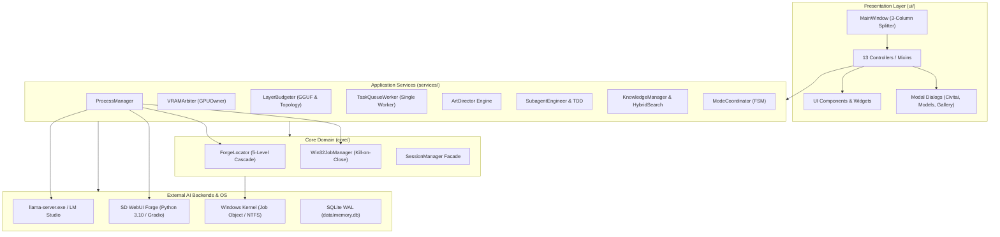
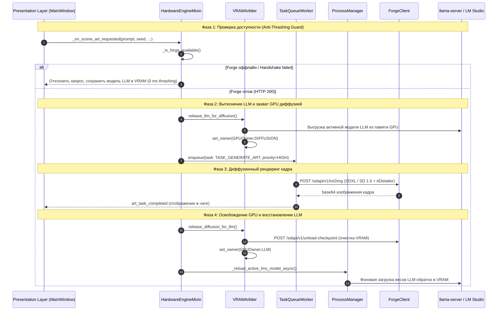

# Техническая спецификация архитектуры NeonRoute

> **Версия системы**: NeonRoute v0.9.0-beta  
> **Целевая платформа**: Windows 10/11 x64, Python 3.10+, PyQt6, QFramelessWindow, QFluentWidgets, FastAPI (Mobile Gateway)  
> **Аппаратный профиль**: 8 ГБ VRAM (NVIDIA GeForce RTX 4060 / RTX 5050 Laptop GPU / 16 ГБ RAM)  
> **Метрики кодовой базы**: 233 файла Python, ~80 800 строк кода  
> **Статус верификации**: 189 тестов пройдено (100% Pass Rate)

---

## 1. Обзор системы (System Overview & Tech Stack)

Система **NeonRoute** — это мультимодальный десктопный ИИ-клиент и headless-шлюз (Mobile BFF Gateway) для локального инференса нейросетевых моделей в условиях жесткого аппаратного бюджета видеопамяти (8 ГБ VRAM). Система бесшовно объединяет:

1. **Большие языковые модели (LLM)**: многомодальный контекст, три режима работы (Ассистент «Элария», Ролевой чат с поддержкой карточек Tavern/Chub, автономный агент разработки ПО «Инженер»).
2. **Диффузионный рендеринг (Stable Diffusion WebUI Forge)**: фотореалистичный синтез сцен, портретов персонажей и окружения на базе архитектур SD 1.5, SDXL, Pony, с поддержкой LoRA, ADetailer и нативной квантизации FP8 E4M3FN.
3. **Голосовой интерфейс**: синтез речи F5-TTS на CPU и голосовой ввод через Faster-Whisper.
4. **Гибридный RAG и ассоциативная память**: трехконтурный семантический поиск (BM25 + плотные эмбеддинги FastEmbed + Reciprocal Rank Fusion) и долговременная память на базе SQLite WAL и LanceDB.

### Аппаратный манифест 8 ГБ VRAM

При аппаратном лимите в 8192 МБ одновременная аллокация квантованной LLM (Qwen 7B / L3-Stheno-8B: ~4.2–5.5 ГБ VRAM) и диффузионного чекпоинта SDXL (~3.2–4.8 ГБ VRAM) неизбежно приводит к падению в Shared System RAM (падение скорости инференса в 10–20 раз) или критическому сбою `CUDA out of memory` (OOM).

В основу NeonRoute заложен **принцип взаимного исключения видеопамяти (Mutual Exclusion Principle)**:
- В каждый момент времени доступ к тяжелым вычислительным тензорам GPU имеет строго одно вычислительное ядро (LLM или Diffusion).
- Переключение контекста управляется централизованным арбитром `services.vram_arbiter.VRAMArbiter`.
- На системах с объемом памяти $\le 8$ ГБ инжектируется принудительная политика оффлоада `--always-offload-from-vram`.

### Технологический стек

| Слой | Технологии и компоненты |
| :--- | :--- |
| **Рантайм и Ядро** | Python 3.10+, Standard Library (`ctypes`, `subprocess`, `urllib.request`, `socket`, `configparser`, `shutil`) |
| **Графический интерфейс** | PyQt6, QFramelessWindow (Cyberpunk Glassmorphism / Acrylic), QFluentWidgets |
| **Хранение данных** | SQLite 3 (`PRAGMA journal_mode=WAL; PRAGMA synchronous=NORMAL;`), LanceDB (векторные таблицы), Zero-Fsync JSON-зеркала |
| **Сетевые контракты** | FastAPI / Uvicorn (Mobile BFF Gateway REST + Server-Sent Events), Gradio/Automatic1111 REST API, HTTP-Keep-Alive |
| **Управление ОС и процессами** | Win32 API (`kernel32.dll`: Windows Job Objects `JOB_OBJECT_LIMIT_KILL_ON_JOB_CLOSE = 0x2000`, дескрипторы скрытых процессов `CREATE_NO_WINDOW`) |
| **Контроль качества** | Pytest, pytest-mock, pytest-cov, Headless GUI Smoke Harness, AST CodeValidator, SubstanceGuard (189 тестов) |

---

## 2. Компонентная топология (Component Architecture)

### 2.1. Разграничение ответственности (Layer Boundaries)

Архитектура системы четко разделена на независимые слои с направлением зависимостей снаружи внутрь:



1. **Core Domain (`core/`)**:
   - `core/forge_locator.py`: 5-уровневый каскад обнаружения директории Forge, парсинг аргументов лаунчера (`--models-dir`, `--ckpt-dir`, `--lora-dir`), разрешение NTFS-симлинков и Junctions, изоляция окружения `get_clean_forge_env`, запись в `server_config.ini`.
   - `core/win32_job.py`: `Win32JobManager` (Singleton) на чистом `ctypes` — привязка дочерних процессов к Windows Job Object с флагом `JOB_OBJECT_LIMIT_KILL_ON_JOB_CLOSE (0x2000)`.
   - `core/session_manager.py`: фасад реэкспорта сессий.
2. **Application Services (`services/`)**:
   - `services/process_manager.py`: оркестратор жизненного цикла внешних процессов (`llama-server.exe`, LM Studio CLI, SD WebUI Forge) с двухфакторной проверкой сокетов (L4 TCP + L7 HTTP Handshake).
   - `services/vram_arbiter.py`: арбитраж монопольного владения GPU (`GPUOwner.NONE`, `GPUOwner.LLM`, `GPUOwner.DIFFUSION`).
   - `services/layer_budgeter.py`: топологический аудитор GPU, парсер бинарных заголовков GGUF и калькулятор слоев `-ngl` с Pre-flight RAM Guard.
   - `services/forge_client.py`: асинхронный REST-клиент SD Forge API с Watchdog, автоочисткой VRAM и ADetailer Guard.
   - `services/lm_studio.py`: клиент LLM инференса (SSE streaming, Keep-Alive, DRY/XTC сэмплеры).
   - `services/art_director/`: подсистема режиссуры кадра (резолвинг стилей, LoRA, негативов, ADetailer, геометрия кадра, политика оффлоада).
   - `services/task_queue.py`: приоритетная однопоточная очередь инференса (`max_workers=1`, уровни `HIGH=0`, `NORMAL=10`, `LOW=20`).
   - `services/subagent_engineer.py`, `services/engineer_tdd.py`, `services/tool_engine.py`, `services/sandbox_manager.py`: песочница и двухфазный TDD-пайплайн.
   - `services/knowledge_manager.py`, `services/hybrid_search.py`, `services/memory_db.py`: гибридный поиск RAG и двухконтурная память.
   - `services/mode_coordinator.py`: конечный автомат переключения режимов (Ассистент, Ролевой чат, Инженер).
3. **Presentation Layer (`ui/`)**:
   - `ui/main_window.py`: главное окно с 3-колоночным сплиттером (`SidebarWidget` | `MainContent` | `WorkspaceInspectorWidget`).
   - `ui/controllers/`: 13 специализированных миксинов контроллеров без множественного наследования от `QObject`.
   - `ui/components/`: виджеты ввода, баблов сообщений, статуса, шапки, инспектора песочницы.
   - `ui/dialogs/`: модальные диалоги настроек, моделей, Civitai браузера с AutoV2 SHA-256 и безопасными путями, галереи персонажей.
4. **Configuration & Utilities (`config.py`, `utils/`)**:
   - `config.py`: единый источник правды (SSOT) путей, лимитов памяти, профилей режимов, динамический метод `get_forge_models_dir()`.
   - `utils/`: `system_monitor.py` (NVML/psutil), `health_checker.py` (сокетный опрос без блокировок), `file_utils.py` (атомарная запись `atomic_write_json`), `config_manager.py`.

### 2.2. Топология файлов репозитория

```text
NeonRoute/
├── config.py                            # [214 строк] Единый источник правды (SSOT): пути, лимиты VRAM, get_forge_models_dir()
├── main.py                              # [126 строк] Точка входа: QApplication, setup_environment_and_logging, exception handler
├── run_mobile_server.py                 # [45 строк] Точка входа Headless Mobile Gateway Server (FastAPI на порту 8000)
├── server_config.ini                    # Пользовательская конфигурация путей [PATHS] (forge_root_dir, forge_path)
│
├── core/                                # Ядро и системные привязки Windows
│   ├── __init__.py                      # Инициализация пакета core
│   ├── forge_locator.py                 # [353 строки] 5-уровневый каскад поиска Forge, парсер аргументов, изоляция env
│   ├── session_manager.py               # [8 строк] Фасад совместимости SessionManager
│   └── win32_job.py                     # [113 строк] Win32JobManager: привязка к Job Object (KILL_ON_JOB_CLOSE = 0x2000)
│
├── services/                            # Сервисный слой и бизнес-логика (Business Logic Layer)
│   ├── __init__.py                      # Инициализация пакета services
│   ├── art_director_config.py           # [256 строк] Загрузка/сохранение data/art_director_models.json
│   ├── asset_validator.py               # [103 строки] Pre-flight аудит наличия чекпоинтов SD и весов ADetailer
│   ├── assistant_prompt_builder.py      # [674 строки] Сборщик системного промпта Эларии (UserInfo, PassiveMemory, скиллы)
│   ├── card_translator.py               # [444 строки] Пошаговый переводчик карточек с CJK Quality Gate
│   ├── chub_client.py                   # [416 строк] REST API клиент каталога Chub.ai (поиск, очистка промо-мусора)
│   ├── civitai_service.py               # [181 строка] Запрос параметров модели по AutoV2 SHA-256 с Civitai API
│   ├── code_engine.py                   # [327 строк] ASTSkeletonizer, ExecutionSandbox, AutoImporter (Zero-Token Healing)
│   ├── code_validator.py                # [614 строк] AST-валидатор синтаксиса, Scope Guard, Stub/Reachability Guard
│   ├── context_window_builder.py        # [838 строк] Сборщик контекста LLM, архитектура «Трех якорей», Sliding CoT
│   ├── direct_command_parser.py         # [108 строк] Парсер CLI-параметров прямого рендера (!арт / !art)
│   ├── document_parser.py               # [598 строк] Универсальный CPU-парсер документов (.pdf, .docx, .xlsx, .pptx, etc.)
│   ├── engineer_context.py              # [354 строки] Сбор файлового контекста и AST-скелетирование песочницы
│   ├── engineer_diagnostics.py          # [351 строка] Очистка стектрейсов clean_traceback, экспертная диагностика
│   ├── engineer_parser.py               # [371 строка] Парсер ответов LLM, извлечение инструментов
│   ├── engineer_planner.py              # [519 строк] Фаза «Архитектор»: 3-уровневая AST-локализация узлов >250 строк
│   ├── engineer_prompts.py              # [128 строк] Мета-промпты Архитектора, Инженера и RCA
│   ├── engineer_review.py               # [169 строк] Ветка статического аудита, Git Diff и чекпоинтов
│   ├── engineer_skill_router.py         # [605 строк] Векторный роутер 5 инженерных архетипов на CPU (FastEmbed)
│   ├── engineer_stream.py               # [79 строк] Потоковый парсинг токенов LLM (CodeStreamExtractor)
│   ├── engineer_tdd.py                  # [678 строк] Двухфазный Code-First TDD пайплайн (NEW_MODULE / INCREMENTAL_FEATURE)
│   ├── entity_mapper.py                 # [160 строк] Детерминированный конвертер кириллических сущностей в теги SD 1.5
│   ├── environment_doctor.py            # [124 строки] Аудит окружения и фоновая установка пакетов через PipInstallWorker
│   ├── file_generator.py                # [318 строк] Генератор стилизованных документов Excel (.xlsx) и Word (.docx)
│   ├── forge_client.py                  # [1075 строк] REST-клиент SD WebUI Forge (/sdapi/v1/txt2img, Watchdog 90s, ADetailer)
│   ├── forge_models.py                  # [392 строки] Реестр паспортов моделей SD (MODEL_REGISTRY, Capabilities)
│   ├── git_sandbox.py                   # [333 строки] GitSandboxManager: локальный Git репозиторий песочницы
│   ├── hybrid_search.py                 # [609 строк] Гибридный поиск: BM25Index + BuiltinDenseVectorizer/FastEmbed + RRF
│   ├── knowledge_manager.py             # [980 строк] Менеджер базы знаний: extract_triggers, registry.json, search_index.json
│   ├── knowledge_watcher.py             # [201 строка] QFileSystemWatcher сателлит с дебаунсом 2.0 с
│   ├── layer_budgeter.py                # [628 строк] Топологический аудитор GPU, парсер GGUF и калькулятор слоев NGL
│   ├── lm_studio.py                     # [735 строк] Клиент LLM (Keep-Alive, SSE-стриминг, DRY/XTC сэмплеры)
│   ├── macro_engine.py                  # [64 строки] Парсер макросов {{user}}, {{char}}, {{random: ...}}, {{roll: XdY+Z}}
│   ├── markdown_chunker.py              # [400 строк] Структурный нарезчик Markdown с защитой целостности кодовых блоков
│   ├── memory_db.py                     # [812 строк] Хранилище памяти: SQLite (WAL) + LanceDB (facts и rp_memories)
│   ├── memory_extractor.py              # [308 строк] Асинхронный экстрактор фактов о пользователе (PRIORITY_LOW)
│   ├── minor_safety.py                  # [117 строк] Детектор несовершеннолетних персонажей и фильтр безопасности
│   ├── mode_coordinator.py              # [480 строк] Конечный автомат режимов (Teardown -> Switch -> Boot -> Mount)
│   ├── model_router.py                  # [531 строка] Гибридный роутер моделей Арт-директора (триггеры + FastEmbed)
│   ├── patch_engine.py                  # [499 строк] Хирургический PatchApplier и SelfHealingEngine
│   ├── process_manager.py               # [1458 строк] Оркестратор процессов: llama-server, LM Studio, SD Forge, L4+L7 checks
│   ├── regex_filter.py                  # [71 строка] Очистка тегов <think>, спецтокенов, нормализация тире
│   ├── roleplay_flow_controller.py      # [610 строк] Контроллер диалогового цикла RP: Depth-0 якорь, кино-директивы арта
│   ├── roleplay_prompt_builder.py       # [534 строки] Сборщик промптов RP: Depth-0 якоря, 11 архетипов, 4 кино-директивы
│   ├── roleplay_state_manager.py        # [137 строк] Парсер блоков <stats>/[STATUS] (локация, инвентарь, квесты)
│   ├── rp_cast_extractor.py             # [553 строки] Асинхронный летописец сцены: NPC, локации, мутации, scene_type
│   ├── rp_cast_manager.py               # [978 строк] Менеджер состояния кампании (history/cast_<id>.json): сопартийцы
│   ├── rp_constants.py                  # [26 строк] Словарь ключевых слов триггеров анализа сцены (SCAN_KEYWORDS)
│   ├── rp_scene_updater.py              # [475 строк] Транзакционное применение изменений сцены к cast_data
│   ├── sandbox_guard.py                 # [236 строк] Периметр безопасности рантайма: sys.addaudithook, блокировка сети
│   ├── sandbox_manager.py               # [934 строки] Менеджер песочницы: изоляция проектов, Headless GUI Smoke Harness
│   ├── sandbox_runner.py                # [63 строки] Изолированный раннер пользовательских скриптов
│   ├── search_tokenizer.py              # [173 строки] Токенизатор для BM25 со стеммингом Портера RU/EN
│   ├── server_config.py                 # [496 строк] 3-уровневый каскад ServerConfigResolver (llama-server, CUDA, GGUF)
│   ├── session_manager.py               # [993 строки] Управление сессиями диалогов (SQLite WAL + Zero-fsync JSON mirror)
│   ├── skill_router.py                  # [391 строка] Роутер микро-скиллов Ассистента (7 базовых + custom)
│   ├── stt_service.py                   # [68 строк] Сервис голосового ввода (Faster-Whisper stub)
│   ├── subagent_engineer.py             # [1787 строк] Автономный субагент «Инженер»: Review/Git, TDD, SubstanceGuard
│   ├── task_queue.py                    # [239 строк] Однопоточная приоритетная очередь задач (TaskQueueWorker)
│   ├── tavern_models.py                 # [692 строки] Модели CharacterCard и LoreEntry: 11 архетипов, пол, POV
│   ├── tavern_parser.py                 # [864 строки] Парсер карточек Tavern V1/V2/CCv3 и Chub (JSON/PNG/WebP)
│   ├── thought_stream_parser.py         # [218 строк] Потоковый FSM тегов <think>...</think> с буферизацией чанков
│   ├── token_budget_manager.py          # [345 строк] Оценка токенов BPE, светофор карточек и 2-контурный бюджет
│   ├── tool_engine.py                   # [849 строк] Диспетчер инструментов песочницы (write_file, patch_file, run_pytest)
│   ├── tool_parser.py                   # [308 строк] Парсер тегов <TOOL:...> с поддержкой SEARCH/REPLACE
│   ├── tts_service.py                   # [146 строк] Клиент синтеза речи F5-TTS на CPU с резервным WAV-генератором
│   ├── user_profile_manager.py          # [179 строк] Менеджер профилей пользователя и кэша приветствий карточек
│   ├── vision_utils.py                  # [102 строки] LANCZOS-сжатие изображений в base64 для Vision-моделей
│   ├── vram_arbiter.py                  # [91 строка] Централизованный арбитр видеопамяти (GPUOwner)
│   ├── workspace_launcher.py            # [75 строк] Интерактивный запуск скриптов в отдельном окне cmd.exe /k
│   │
│   └── art_director/                    # Подсистема режиссуры изображений «Арт-директор»
│       ├── __init__.py                  # [68 строк] Фасад подсистемы art_director
│       ├── contracts.py                 # [113 строк] Контракты данных: TargetSubject, VisualIntent, SceneAnalysisContract
│       ├── director.py                  # [1661 строка] ArtDirector: RP-контекст, LoRA-резолвинг, BREAK-симметризация
│       ├── geometry.py                  # [104 строки] Разрешения SD 1.5 и SDXL по 6 архетипам кадра
│       ├── legacy_helpers.py            # [117 строк] Вспомогательные функции обратной совместимости
│       ├── lora_manager.py              # [284 строки] Чтение заголовков .safetensors на CPU (0 MB VRAM)
│       ├── plan.py                      # [194 строки] Модель GenerationPlan и сериализатор to_forge_kwargs()
│       ├── prompting.py                 # [141 строка] Константа ELARIA_VISUAL_DNA, перехват отрицаний, негатив
│       └── vram_policy.py               # [261 строка] Калькулятор бюджета VRAM, max_hires_canvas_area, offload-политика
│
├── ui/                                  # Слой графического интерфейса (Presentation Layer)
│   ├── __init__.py                      # Инициализация пакета ui
│   ├── main_window.py                   # [2096 строк] Главное окно MainWindow (3-колоночный сплиттер, дебаунс моделей)
│   ├── models_manager_dialog.py         # [2463 строки] Пульт управления моделями Forge, Civitai AutoFill, FP8
│   ├── engineer_skills_dialog.py        # [998 строк] Центр управления знаниями инженера (Skills Hub)
│   ├── log_console.py                   # [187 строк] Live-консоль логов (QtLogHandler, кольцевой буфер на 2000 записей)
│   ├── styles.py                        # [311 строк] Глобальная таблица стилей NEON_THEME_QSS
│   │
│   ├── controllers/                     # 13 чистых Python-миксинов контроллеров MainWindow
│   │   ├── assistant_flow_controller.py # [1181 строка] 2-контурный бюджет 14K, RAG-инъекция, галерейный арт-протокол
│   │   ├── avatar_controller.py         # [787 строк] Синхронизация аватаров, меню скиллов, вызов диалогов
│   │   ├── chat_flow_controller.py      # [1568 строк] Диспетчеризация ввода, парсинг дат, стрим 28 FPS, Anti-Loop Guard
│   │   ├── dialog_controller.py         # [418 строк] Управление модальными окнами настроек, базы знаний, экспорта
│   │   ├── engineer_controller.py       # [772 строки] Маршрутизация задач в SubagentEngineer, синхронизация инспектора
│   │   ├── hardware_engine.py           # [1027 строк] Управление процессами LLM/Forge, автотюн KV, guard VRAM thrashing
│   │   ├── header_controller.py         # [129 строк] Реактивный контроллер шапки чата и прогресса Forge
│   │   ├── reminder_controller.py       # [98 строк] Пуллинг напоминаний SQLite, трей, Windows Toast
│   │   ├── roleplay_controller.py       # [492 строки] Фон сцены, сводка кампании, локализация карточек
│   │   ├── search_controller.py         # [77 строк] Поиск и навигация по тексту диалога
│   │   ├── session_controller.py        # [138 строк] Создание, переименование и удаление сессий
│   │   ├── task_lifecycle_controller.py # [467 строк] Маршрутизация задач в очередь, перехват команд памяти
│   │   └── window_state_controller.py   # [150 строк] Кэширование фона главного окна и полный экран (F11)
│   │
│   ├── dialogs/                         # Модальные диалоговые окна приложения
│   │   ├── civitai_catalog_dialog.py    # [1069 строк] Каталог Civitai: безопасное скачивание .safetensors, SHA-256, symlinks
│   │   ├── characters_gallery_dialog.py # [1725 строк] Двухпанельная галерея персонажей, светофор токенов
│   │   ├── knowledge_manager_dialog.py  # [997 строк] Центр «Знания Эларии»: документы, скиллы, системный промпт
│   │   ├── campaign_info_dialog.py      # [1034 строки] Дашборд кампании (Память, Инвентарь, Сценарий, Каст, Локация)
│   │   ├── user_settings_dialog.py      # [1005 строк] Профили пользователя и игровые персоны
│   │   └── clean_cache_dialog.py        # [612 строк] Очиститель кэша Forge, логов, превью и LanceDB
│   │
│   └── components/                      # Графические компоненты и виджеты
│       ├── workspace_inspector.py       # [748 строк] Правая панель песочницы (дерево файлов, редактор кода, Git, Smoke F5)
│       ├── status_bar_widget.py         # [313 строк] MainStatusBar: телеметрия VRAM/RAM, LED-индикаторы
│       ├── chat_input_panel.py          # [244 строки] Нижняя парящая капсула ввода с чипами вложений
│       └── assistant_chat_bubble.py     # [456 строк] Бабл ассистента с видоискателем арт-генерации (28 FPS)
│
├── utils/                               # Системные вспомогательные утилиты
│   ├── config_manager.py                # [129 строк] Управление конфигурацией config.json со слиянием дефолтов
│   ├── file_utils.py                    # [40 строк] Атомарная запись JSON (atomic_write_json) с fsync и защитой от WinError 32
│   ├── health_checker.py                # [100 строк] Асинхронный сокет-монитор портов (1234, 7860, 5010) без блокировок
│   └── system_monitor.py                # [204 строки] Мониторинг VRAM/RAM через pynvml / nvidia-smi / psutil
│
└── tests/                               # Пирамида тестирования (189 тестов, 100% Pass Rate)
    ├── conftest.py                      # Airgap-фикстуры (_apply_airgap_paths, check_sandbox_state_leak)
    ├── smoke/                           # 16 сьютов смоук-тестирования компонентов и сквозных цепочек
    │   ├── test_forge_baseline.py       # Базовые пути Forge, аргументы запуска, фильтрация процессов, диалоги
    │   ├── test_forge_edge_cases.py     # 6 краевых случаев: юникод/пробелы, битый INI, directory trap, re-entrancy
    │   ├── test_smoke_mainwindow_lifecycle.py # Zero-Freeze Startup Pipeline, проверка времени старта < 1000 мс
    │   └── ...                          # Смоук-тесты арт-пайплайна, песочницы, ролевой игры, сессий WAL
    ├── unit/                            # 6 сьютов изолированных модульных тестов
    │   ├── test_forge_custom_paths.py   # Парсинг --models-dir, --ckpt-dir, пробелов, кавычек, разрешение симлинков
    │   ├── test_win32_job.py            # Windows Job Objects: Singleton, fallback на Linux, Popen handle, сбои Win32 API
    │   ├── test_forge_handshake.py      # Двухфакторная проверка: L4 TCP сокет + L7 HTTP handshake (/sdapi/v1/options)
    │   ├── test_forge_vram_policy.py    # Гарантированный оффлоад VRAM (--always-offload-from-vram) для <= 8 ГБ
    │   ├── test_vram_guard.py           # Защита от VRAM Thrashing при оффлайн Forge
    │   └── test_forge_locator.py        # 10 тестов: каскад поиска, INI, изоляция get_clean_forge_env
    └── test_*.py                        # 8 интеграционных и регрессионных сьютов (парсинг, токен-бюджет, FP8)
```

---

## 3. Подсистема управления внешними AI-рантаймами (Runtime & Process Lifecycle)

### 3.1. Интеграция LLM рантаймов (LM Studio / llama-server)

NeonRoute поддерживает двойной контур инференса больших языковых моделей:
1. **Headless `llama-server.exe` (Основной контур)**:
   - Обнаружение бинарного файла через 3-уровневый каскад `ServerConfigResolver` (`services/server_config.py`): сконфигурированный путь -> `bin/` -> системный PATH.
   - Запуск через `ProcessManager.start_llama_server_sync`: скрытые флаги Windows (`CREATE_NO_WINDOW`, `CREATE_NEW_PROCESS_GROUP`), неблокирующий стриминг `stdout` в `logs/llama_server.log`.
   - Автоматическая подвязка CUDA 12 рантайма (`ServerConfigResolver.resolve_cuda_dir`).
   - Интеграция с `LayerBudgeter`: расчет безопасного числа трансформерных слоев (`-ngl`), параметров квантования KV-кэша (`-ctk`, `-ctv`: `q8_0`, `q4_0`, `f16`) и активации Flash Attention (`-fa on/off`).
2. **LM Studio CLI (`lms`) (Резервный контур)**:
   - Взаимодействие через CLI-команды `lms server start` / `lms server stop`.
   - Автоподключение к запущенному серверу на порту 1234 через постоянный `HTTP Keep-Alive`.

### 3.2. Архитектура интеграции SD WebUI Forge

Подсистема SD WebUI Forge решает задачи автоматического обнаружения, безопасного старта, изоляции зависимостей и динамического разрешения моделей:

```mermaid
flowchart TD
    subgraph Discovery ["1. Каскадный локатор (core/forge_locator.py)"]
        D1["1. configured_path"] --> D2["2. os.environ['FORGE_ROOT_DIR']"]
        D2 --> D3["3. server_config.ini ([PATHS] -> forge_root_dir)"]
        D3 --> D4["4. Относительные каталоги (../neyroGPD, ../sd-webui-forge)"]
        D4 --> D5["5. Сканирование корней дисков (C:/, D:/ ... Z:/)"]
        D5 --> D6["6. Фоллбек по умолчанию: C:\\neyroGPD"]
    end

    subgraph Args ["2. Динамический резолвер путей моделей"]
        PARSER["parse_forge_launcher_args(launcher_path)"]
        PARSER --> FLAG_CKPT["--ckpt-dir (Приоритет 1)"]
        PARSER --> FLAG_MODELS["--models-dir / Stable-diffusion (Приоритет 2)"]
        PARSER --> FLAG_DEFAULT["forge_root / models / Stable-diffusion (Приоритет 3)"]
        FLAG_CKPT & FLAG_MODELS & FLAG_DEFAULT --> RESOLVE["Path.resolve() (NTFS Junctions & Symlinks)"]
    end

    subgraph Isolation ["3. Изоляция окружения (get_clean_forge_env)"]
        ENV["os.environ"] --> POP_VENV["Удаление VIRTUAL_ENV, PYTHONPATH, PYTHONHOME"]
        POP_VENV --> CLEAN_PATH["Санитация PATH (удаление .venv/Scripts и .venv/bin)"]
        CLEAN_PATH --> CLEAN_ENV["Изолированный словарь env"]
    end

    subgraph Verification ["4. Двухфакторная проверка доступности"]
        L4["Фаза 1: L4 Сокет (is_port_open, timeout=0.3s)"] -->|Открыт| L7["Фаза 2: L7 HTTP Handshake (verify_forge_http_handshake, timeout=0.8s)"]
        L7 -->|HTTP 200 на /sdapi/v1/options| READY["Сервер готов к инференсу"]
        L7 -->|Таймаут или 404/502| PORT_CONFLICT["Конфликт портов! Gradio -> порт 7861"]
    end

    subgraph Hardening ["5. Защита процессов (Win32JobManager)"]
        JOB["CreateJobObjectW(KILL_ON_JOB_CLOSE = 0x2000)"]
        PROC["subprocess.Popen(env=clean_env)"] --> ASSIGN["AssignProcessToJobObject(job, proc._handle)"]
        JOB -.->|Авто-уничтожение при аварии родителя| KILLED["Уничтожение cmd.exe / python.exe"]
    end
```



#### Каскадный локатор (`core/forge_locator.py`)
Разрешение рабочей директории Forge осуществляется через строгий 5-уровневый каскад:
1. **`configured_path`**: Явный параметр вызова API.
2. **`os.environ["FORGE_ROOT_DIR"]`**: Переменная окружения. Имеет абсолютный приоритет над INI-файлом, гарантируя изоляцию в CI/CD и тестах.
3. **`server_config.ini` (`[PATHS] -> forge_root_dir` / `forge_path`)**: Пользовательская настройка в конфигурационном файле. Поддерживает UTF-8 пути с кириллицей и пробелами.
4. **Относительные каталоги портативных сборок**: Поиск относительно корня NeonRoute (`../neyroGPD`, `../sd-webui-forge`, `../Forge`, `./forge`).
5. **Автосканирование смонтированных дисков**: Быстрая проверка без рекурсии стандартных папок верхнего уровня на всех доступных дисках Windows (`C:/`, `D:/` ... `Z:/`): `<диск>:/neyroGPD`, `<диск>:/sd-webui-forge`, `<диск>:/Forge`, `<диск>:/AI/Forge`, `<диск>:/webui_forge`.
6. **Безопасный фоллбек**: Путь по умолчанию `Path(r"C:\neyroGPD")`.

Критерий валидности каталога (`is_valid_forge_dir`): директория признается рабочей только при наличии хотя бы одного исполняемого файла лаунчера (`forge_launcher.bat`, `webui-user.bat`, `run.bat`, `launch.py`) с обязательной проверкой `p.is_file()`, что предотвращает directory-trap ошибки при наличии подпапок с именами лаунчеров.

#### Динамическое разрешение путей моделей и симлинков (`core/forge_locator.py`)
Пользователи часто выносят тяжелые веса моделей и LoRA на внешние SSD/HDD (например, `E:\Models`), указывая параметры запуска в лаунчерах.
- Функция `parse_forge_launcher_args(launcher_path: Optional[Path]) -> Dict[str, Path]` извлекает флаги `--models-dir`, `--ckpt-dir`, `--lora-dir`, `--embeddings-dir` из bat/cmd/sh файлов, корректно обрабатывая пути в кавычках, пробелы и синтаксис вида `--models-dir="E:\Models"`.
- Функция `resolve_forge_models_directory(forge_root, launcher_path)` применяет строгий каскад приоритетов:
  1. `--ckpt-dir` из аргументов лаунчера (если существует или задан).
  2. `--models-dir / "Stable-diffusion"` из аргументов лаунчера.
  3. `forge_root / "models" / "Stable-diffusion"`.
  4. Фоллбек `C:\neyroGPD\models\Stable-diffusion`.
- Все пути нормализуются через `Path.resolve()`, что прозрачно раскрывает NTFS Junctions (`mklink /J`) и символические ссылки Windows. Это гарантирует, что `CivitaiCatalogDialog` при вычислении соседней папки LoRA через `self.target_dir.resolve().parent / "Lora"` попадает в реальный внешний каталог моделей, а не на системный диск `C:`.

#### Изоляция окружения дочернего процесса (`get_clean_forge_env`)
Для предотвращения конфликтов библиотек (DLL Hell) и несовместимости версий PyTorch/CUDA между NeonRoute (Python 3.10) и встроенным портативным Python дистрибутива Forge:
- Из словаря переменных окружения дочернего процесса Forge безусловно удаляются `VIRTUAL_ENV`, `PYTHONPATH`, `PYTHONHOME`.
- Из переменной `PATH` удаляются директории активного виртуального окружения NeonRoute (`.venv\Scripts`, `.venv\bin` и любые подкаталоги `VIRTUAL_ENV`), включая пути с точками и в любом регистре символов.
- Сохраняются критические системные каталоги Windows (`System32`, `SystemRoot`, `ComSpec`, `TEMP`) и пути к NVIDIA CUDA Toolkit (`CUDA\v12.1\bin`).
- Очищенный словарь передается в `subprocess.Popen(..., env=clean_env)`.

#### Двухфакторная верификация доступности (L4 TCP + L7 HTTP Handshake)
Для устранения ложных срабатываний и «зависания» ожидания старта сервера Forge:
- Функция `verify_forge_http_handshake(host="127.0.0.1", port=7860, timeout=0.8) -> bool` на базе стандартной библиотеки `urllib.request` выполняет легковесный GET-запрос к эндпоинту `/sdapi/v1/options` с заголовком `User-Agent: NeonRoute-Handshake/1.0`.
- Возвращает `True` строго при получении HTTP-статуса `200 OK`.
- При кодах `404 Not Found` или `502 Bad Gateway` (сигнализирующих, что порт 7860 занят посторонним локальным веб-сервером или трекером) хэндшейк возвращает `False`, логируя предупреждение о конфликте портов и возможном автоматическом переключении Gradio на порт 7861.

#### Устранение ложного завершения процессов
В методах `_run_forge_stop` и `shutdown_all` сервиса `services/process_manager.py` устранена проверка короткого имени папки (`forge_name in cmd_str`), приводившая к случайному принудительному закрытию редакторов кода и терминалов разработчика. Фильтрация процессов `psutil` выполняется строго по полному пути рабочей папки (`forge_dir_str in cmd_str`) или специфичному легаси-маркеру `neyrogpd`.

### 3.3. Защита от процессов-сирот через Windows Job Objects (`core/win32_job.py`)

При аварийном завершении NeonRoute (сбой C-расширений, закрытие через Диспетчер задач / `taskkill /F`, сбой питания) деструкторы Python и обработчик `closeEvent()` главного окна не вызываются. Дочерние процессы `cmd.exe`, `python.exe` (Forge) и `llama-server.exe` становятся процессами-сиротами (orphans), продолжая невидимо висеть в памяти Windows, удерживать порты 7860 / 1234 и блокировать до 8 ГБ VRAM.

Для решения проблемы на уровне ядра Windows разработан изолированный модуль [`core/win32_job.py`](file:///C:/NeonRoute/core/win32_job.py):
- **Синглтон `Win32JobManager`**: реализован строго через встроенный модуль `ctypes` стандартной библиотеки Python (без сторонних зависимостей вроде `pywin32`).
- **Флаг ядра `JOB_OBJECT_LIMIT_KILL_ON_JOB_CLOSE (0x2000)`**: настраивается через вызов Win32 API `SetInformationJobObject` с классом информации `JobObjectExtendedLimitInformation (9)`.
- **Автоматическая привязка процессов**: при старте процессов `self._forge_process` в `_run_forge_start` и `self._llama_process` в `start_llama_server_sync` дескриптор процесса извлекается (`int(proc._handle)`) и привязывается к объекту задания через `AssignProcessToJobObject`.
- **Аппаратная гарантия**: при закрытии дескриптора родительского процесса ядро Windows безусловно и мгновенно уничтожает все дочерние процессы дерева задания.
- **Кроссплатформенная безопасность**: при `sys.platform != "win32"` или возникновении сбоев Win32 API модуль плавно деградирует (возвращает `False` без выброса необработанных исключений).

---

## 4. Арбитраж ресурсов и бюджетирование памяти (VRAM & Memory Management)

### 4.1. Модель разделения 8 ГБ VRAM

Видеопамять объемом 8192 МБ делится между компонентами системы по математической модели бюджетирования:

| Сегмент памяти | Объем (МБ) | Назначение |
| :--- | :---: | :--- |
| **Total VRAM Budget** | 8192 | Полный физический объем видеопамяти NVIDIA GeForce RTX 5050 / 4060 |
| **OS Reserve (dGPU)** | 700 | Резерв Windows DWM / Desktop Rendering для первичного дисплея |
| **OS Reserve (iGPU)** | 150 | Резерв в режиме `PURE COMPUTE` (дисплей подключен к процессору) |
| **Forge VRAM Reserve** | 450 | Неснижаемый контекст PyTorch CUDA для SD WebUI Forge |
| **Safety Margin VRAM** | 150 | Буфер предотвращения срабатывания Windows TDR (таймаут видеодрайвера) |
| **Emergency VRAM Limit** | 150 | Порог экстренной остановки инференса при опасном исчерпании VRAM |
| **Usable VRAM (Active Model)** | ~6742–7292 | Полезный бюджет для квантов LLM либо диффузионного чекпоинта |

### 4.2. Централизованный арбитр `VRAMArbiter`

Синглтон `services.vram_arbiter.VRAMArbiter` управляет эксклюзивным владением графическим процессором через состояние `GPUOwner` (`NONE`, `LLM`, `DIFFUSION`):



### 4.3. Защита от паразитного VRAM Thrashing

На системах с 8 ГБ VRAM холостой цикл «выгрузить LLM -> упасть на оффлайн Forge -> загрузить LLM обратно» приводил к потере 15–30 секунд и сильной деградации отзывчивости GUI.
В `ui/controllers/hardware_engine.py` внедрен строгий Guard доступности:
- В методах `_scene_art_pipeline`, `_on_scene_art_requested`, `_generate_scene_art_async`, `_enqueue_image_task` и `_enqueue_direct_image_task` перед вызовом `release_llm_for_diffusion()` выполняется неблокирующая проверка:
  `ProcessManager.is_forge_running()` и `ForgeClient.get_instance().is_server_ready(timeout=0.3)`.
- Если сервер Forge оффлайн, не сконфигурирован или не прошел двухфакторный хэндшейк, выгрузка LLM из VRAM **категорически блокируется**. Запрос мягко отклоняется с уведомлением пользователя, видеопамять остается стабильной.

### 4.4. Гарантированный оффлоад VRAM (`--always-offload-from-vram`)

Для архитектур SD 1.5 и SDXL при разрешении $1024 \times 1024$ и двухпроходном ADetailer (лицо + руки) пиковое потребление памяти без оффлоада превышает 8 ГБ, вызывая падение PyTorch в OOM.
1. В `services/process_manager.py` (строка ~1180) при расчете флагов запуска для систем с $\le 8.0$ ГБ VRAM флаг `--always-offload-from-vram` принудительно добавляется в аргументы командной строки запуска Forge.
2. В `services/art_director/vram_policy.py` функция `resolve_forge_offload_policy(vram_gb)` откалибрована: для любых конфигураций с $\le 8.0$ ГБ VRAM оффлоад признается обязательным независимо от базовой архитектуры модели.

### 4.5. Математическая модель `LayerBudgeter` (`services/layer_budgeter.py`)

Перед запуском `llama-server.exe` модуль `LayerBudgeter` вычисляет безопасное число слоев оффлоада:
1. **Детекция топологии**: проверка `nvmlDeviceGetDisplayActive` и процессов `dwm.exe`. Выбор резерва: 700 МБ (`PRIMARY DISPLAY`) или 150 МБ (`PURE COMPUTE`).
2. **Формула полезной видеопамяти**:
   $$\text{Usable\_VRAM} = \text{Total\_VRAM} - \text{OS\_Reserve} - \text{FORGE\_RESERVE}\,(450) - \text{SAFETY\_MARGIN}\,(150) - \text{KV\_Cache}$$
3. **KV-кэш**: расчет размера с 15% буфером CUDA (~64 КБ/токен для `q8_0`, ~36 КБ/токен для `q4_0`, ~128 КБ/токен для `f16`).
4. **Гистерезис слоев**: если $\Delta \text{ngl} \le 3$, текущее значение сохраняется во избежание лишних перезапусков.
5. **Pre-flight RAM Guard**: при частичном оффлоаде на CPU проверяется наличие свободной системной ОЗУ с запасом 1024–1500 МБ для операционной системы.

---

## 5. Презентационный слой и взаимодействие (UI, EventBus & Dialogs)

### 5.1. Архитектура MainWindow и шина событий (EventBus)

Главное окно `ui/main_window.py` спроектировано на базе `qframelesswindow.FramelessMainWindow` с композицией из 13 специализированных миксинов контроллеров:

```mermaid
classDiagram
    class FramelessMainWindow
    class WindowStateMixin {
        +_update_background_cache()
        +paintEvent()
        +_toggle_fullscreen()
    }
    class DialogControllerMixin {
        +_open_user_settings_dialog()
        +_open_model_sampling_dialog()
        +_open_clean_cache_dialog()
        +_open_knowledge_manager_dialog()
        +_open_engineer_skills_dialog()
    }
    class TaskLifecycleMixin {
        +_enqueue_translation_task()
        +_route_and_enqueue()
        +_on_task_started()
        +_on_task_finished()
        +_on_task_failed()
    }
    class ChatSearchMixin {
        +_show_search_bar()
        +_on_search_query_changed()
        +_search_next()
    }
    class AvatarControllerMixin {
        +_get_current_avatar_path()
        +_update_expression_avatar()
        +_on_select_engineer_skill()
        +_on_select_assistant_skill()
        +_open_anchor_dialog()
        +_open_prompts_dialog()
    }
    class SessionControllerMixin {
        +_on_new_chat_clicked()
        +_save_current_session()
        +_on_rename_session_requested()
        +_on_delete_session_requested()
    }
    class ChatBubbleBuilderMixin {
        +_render_stored_message()
        +_append_message()
        +_load_previous_messages_chunk()
        +_clear_chat_widgets()
    }
    class ChatFlowControllerMixin {
        +_on_send_clicked()
        +_sync_turn()
        +_on_token_streamed()
        +_flush_stream_buffer()
        +_on_llm_response_received()
        +_detect_repetition_loop()
    }
    class AssistantFlowControllerMixin {
        +_enqueue_assistant_llm_task()
        +_handle_assistant_llm_response()
        +_enqueue_gallery_art_pass()
        +_handle_assistant_art_completed()
        +process_assistant_attachments()
    }
    class RoleplayControllerMixin {
        +_apply_chat_background()
        +_open_campaign_info_dialog()
        +_translate_character_card_task()
        +_restore_roleplay_character_from_session()
    }
    class RoleplayFlowControllerMixin {
        +_enqueue_roleplay_llm_task()
        +_handle_roleplay_llm_response()
        +_generate_ephemeral_rp_art_prompt()
        +_on_scene_visual_intent_ready()
    }
    class HardwareEngineMixin {
        +_on_health_updated()
        +_on_hardware_stats()
        +_perform_hardware_kv_autotune()
        +_on_scene_art_requested()
        +_reload_active_lms_model_async()
    }
    class EngineerControllerMixin {
        +is_engineer_mode_active()
        +_open_mode_model_settings_dialog()
        +_dispatch_ephemeral_doc_worker()
        +_handle_tool_call_flow()
        +_handle_engineer_task_finished()
    }
    class MainWindow {
        +lm_client: LMStudioClient
        +forge_client: ForgeClient
        +task_queue: TaskQueueWorker
        +mode_coordinator: ModeCoordinator
        +workspace_inspector: WorkspaceInspectorWidget
        +header_controller: HeaderStateController
        +reminder_controller: ReminderController
        +knowledge_watcher: KnowledgeWatcher
        +toggle_workspace_inspector()
        +closeEvent()
    }

    FramelessMainWindow <|-- MainWindow
    WindowStateMixin <|-- MainWindow
    DialogControllerMixin <|-- MainWindow
    TaskLifecycleMixin <|-- MainWindow
    ChatSearchMixin <|-- MainWindow
    AvatarControllerMixin <|-- MainWindow
    SessionControllerMixin <|-- MainWindow
    ChatBubbleBuilderMixin <|-- MainWindow
    ChatFlowControllerMixin <|-- MainWindow
    AssistantFlowControllerMixin <|-- MainWindow
    RoleplayControllerMixin <|-- MainWindow
    RoleplayFlowControllerMixin <|-- MainWindow
    HardwareEngineMixin <|-- MainWindow
    EngineerControllerMixin <|-- MainWindow
```



- **Предотвращение коллизий sip.wrappertype**: все 13 миксинов контроллеров являются чистыми классами Python без прямого наследования от `QObject` или `QWidget`. Точкой входа в метакласс Qt выступает сам `MainWindow`.
- **Шина событий (EventBus)**: контроллеры общаются между собой и с воркерами фоновых потоков через сигналы и слоты PyQt6 (`lms_status_changed`, `forge_status_changed`, `action_completed`, `model_installed`, `hardware_stats`), обеспечивая слабую связность компонентов.
- **Единый источник правды (UIContext SSOT)**: состояние интерфейса, активной сессии и текущего хода генерации изолировано в объекте `ui.common.ui_context.UIContext`.

### 5.2. Асинхронные очереди инференса (`services/task_queue.py`)

Все ресурсоемкие фоновые задачи (инференс LLM, диффузия Forge, синтез речи F5-TTS, компиляция песочницы, RAG-индексация) ставятся в приоритетную очередь `TaskQueueWorker`:
- **Лимит параллелизма**: `max_workers = 1` (строгий последовательный инференс на GPU).
- **Уровни приоритетов**: `PRIORITY_HIGH = 0` (пользовательский ввод и прямой рендер), `PRIORITY_NORMAL = 10` (арт сцены, озвучка), `PRIORITY_LOW = 20` (экстракция фактов, RAG-индексация).
- **Вытесняющая отмена (`abort_tasks_by_type`)**: при остановке генерации или смене сессии неприоритетные задачи мгновенно сбрасываются из очереди.

### 5.3. Жизненный цикл диалогов и UI Re-entrancy Guards

1. **Re-entrancy Guard локатора (`_is_locating_forge`)**: флаг-блокиратор в `core/forge_locator.py` предотвращает лавинное открытие диалоговых окон выбора директории при серии быстрых кликов пользователя.
2. **Правило мягкого отказа**: если пользователь закрывает окно поиска Forge кнопкой «Отмена», статус Forge переходит в `STOPPED`, а система продолжает полноценную работу в текстовых и инженерных режимах без блокировки GUI.
3. **Безопасность каталога Civitai (`ui/dialogs/civitai_catalog_dialog.py`)**:
   - Потоковое скачивание чекпоинтов с расчетом AutoV2 SHA-256 на лету.
   - Разрешение целевой папки через `config.get_forge_models_dir()` с автоматическим раскрытием NTFS Junctions и символических ссылок.
   - Строгая фильтрация расширений: загрузка разрешена исключительно для безопасного формата `.safetensors` (файлы `.ckpt` и `.pt` блокируются).

---

## 6. Хранилище данных и RAG (Data Persistence & Context)

### 6.1. Двухконтурный движок сессий (`SQLite WAL + Zero-Fsync JSON Mirror`)

Для устранения накладных расходов диска и блокировок `os.fsync` при частых обновлениях диалогов (600+ сообщений с метаданными генерации) в `services/session_manager.py` реализована двухконтурная архитектура:

1. **Транзакционное ядро SQLite WAL (`data/memory.db`)**:
   - Режим `PRAGMA journal_mode = WAL; PRAGMA synchronous = NORMAL;`.
   - Таблицы `chat_sessions` и `chat_messages` с индексом `idx_chat_messages_sess`.
   - Скорость записи хода диалога `~0.1 мс`. Поля режимов (`knowledge_sources`, `thought`, `visual_intent`, `character_data`, `generation_params`) сохраняются в JSON-колонках без потерь.
   - Считывание списка сессий в левой боковой панели выполняется за один SQL-запрос со сверкой `st_mtime`.
2. **Быстрое файловое зеркало (`Zero-Fsync JSON Mirror`)**:
   - Файлы `history/chat_<id>.json` и `outputs/sessions/<id>/session.json` обновляются через атомарный `os.replace` без вызова `os.fsync`, сохраняя совместимость с мобильным шлюзом `mobile_server` и внешним экспортом.
   - При внешнем редактировании файла JSON `load_session()` детектирует изменение `st_mtime` и автоматически обновляет данные в SQLite WAL.

### 6.2. Персоны и парсинг карточек персонажей (`services/tavern_parser.py`)

- Поддержка стандартов карточек Tavern V1, Tavern V2, Character Card V3 (CCv3) и формата Chub.ai (PNG chunk tEXt/zTXt, JSON, WebP).
- Автоматическая классификация архетипа карточки `detect_card_archetype` (11 архетипов: Fantasy, Cyberpunk, Sci-Fi, LitRPG, Modern/Slice-of-life, etc.), определение пола и POV (первое/третье лицо).
- Извлечение и динамическое подключение встроенных лорбуков (Lorebooks).
- Слотный переводчик `CardTranslator`: пошаговый перевод полей с CJK Quality Gate и защитой плейсхолдеров (`{{char}}`, `{{user}}`).

### 6.3. Контекстное окно и архитектура «Трех якорей»

Для предотвращения деградации ролевой идентичности и контекстной амнезии в `services/context_window_builder.py` реализована модель трех несменяемых якорей:
1. **System Prompt Anchor (Anchor 1)**: базовые правила личности, ограничения безопасности, доступные микро-скиллы.
2. **Depth-0 Scene Anchor (Anchor 2)**: неизменяемый снимок канонического описания персонажа, стартового окружения и отношений.
3. **User Identity Anchor (Anchor 3)**: профиль пользователя и факты активной персоны.
4. **Динамическое контекстное окно (Sliding CoT Preservation)**:
   - При приближении к лимиту токена контекста старые ходы диалога сжимаются и вытесняются, но цепочки мыслей `<think>` последних $N$ ходов сохраняются для когерентности рассуждений.

### 6.4. Трехконтурный гибридный поиск RAG (`services/hybrid_search.py`)

Поиск по базе знаний Эларии выполняется строго на CPU (0 МБ VRAM, латентность $< 50$ мс):

```text
[Пользовательский файл]
        │
        ▼
DocumentParser (.pdf, .docx, .doc, .xlsx, .csv, .pptx, .fb2, .txt, .md, .py, .json)
        │
        ▼
MarkdownChunker (500–1400 симв., overlap 150, сохранение кодовых блоков ``` и таблиц)
        │
        ├─────────────────────────────────┬─────────────────────────────────┐
        ▼                                 ▼                                 ▼
   BM25Index                      BuiltinDenseVectorizer              FastEmbed ONNX
(Точные артикулы,                (Частотно-морфологические           (MiniLM-L12-v2,
 коды ошибок, коды деталей)       семантические корни, 256d)         семантический вектор, 384d)
        │                                 │                                 │
        └─────────────────────────────────┼─────────────────────────────────┘
                                          ▼
                             HybridSearchEngine (Контур 3)
                                          │
                         Reciprocal Rank Fusion (RRF, k=60) + Linear Fusion
                                          │
                         Gatekeeper (Отсев small talk + порог dense >= 0.75 при BM25 == 0)
                                          │
                         Cross-Reference Linker (Авто-добор связанных файлов)
                                          │
                                          ▼
                      KnowledgeHUDWidget (Неоновые микро-чипы источников в чате)
```

---

## 7. Контроль качества и тестовая инфраструктура (Testing & Quality Gates)

### 7.1. Структура тестового сьюта (189 тестов, 100% Pass Rate)

Пирамида тестирования NeonRoute состоит из 189 автоматических тестов, разделенных на три изолированных контура:

| Контур | Файлов | Тестов | Область покрытия |
| :--- | :---: | :---: | :--- |
| **`tests/smoke/`** | 16 | 73 | Быстрые сквозные смоук-тесты: арт-пайплайн, жизненный цикл MainWindow, смена 3 режимов, SQLite WAL, изоляция песочницы, baseline и краевые случаи Forge |
| **`tests/unit/`** | 6 | 28 | Изолированное модульное тестирование: кастомные пути и симлинки Forge, Windows Job Objects, L4+L7 хэндшейк, VRAM Guard, VRAM Policy, каскадный локатор |
| **`tests/` (root)** | 8 | 88 | Интеграционные и регрессионные тесты: Token Budget Manager, Tavern Parser, Thought Stream Parser, Layer Budgeter, Three Anchors, FP8 Safety, Engineer Task Card |
| **ИТОГО** | **30** | **189** | **100% Pass Rate во всех средах** |

### 7.2. Карта unit-тестов подсистем Forge и рантайма

Специализированный каталог `tests/unit/` обеспечивает строгое модульное покрытие критических механизмов:

1. **`test_forge_custom_paths.py` (4 теста)**:
   - `test_parse_forge_launcher_args_quoted_and_spaces`: парсинг путей с кавычками и пробелами (`--models-dir "D:\My Models\ForgeModels"`).
   - `test_parse_forge_launcher_args_missing_or_empty`: устойчивость к пустым батникам, отсутствующим файлам и значениям `None`.
   - `test_resolve_forge_models_directory_prefers_custom_dir`: проверка каскада приоритетов (`--ckpt-dir` > `--models-dir` > `forge_root`).
   - `test_symlink_and_junction_resolution`: корректность разрешения NTFS Junctions и символических ссылок через `.resolve()`.
2. **`test_win32_job.py` (4 теста)**:
   - `test_win32_job_manager_singleton`: проверка паттерна Singleton для `Win32JobManager.get_instance()`.
   - `test_win32_job_non_windows_fallback`: проверка мягкой деградации (возврат `False` без падений) при `sys.platform = "linux"`.
   - `test_win32_job_assign_popen_mock`: корректное извлечение дескриптора `_handle` из объекта `subprocess.Popen` и вызов `AssignProcessToJobObject`.
   - `test_win32_job_handles_api_failure`: устойчивость при возврате `0` или `None` из вызовов Win32 API ядра Windows.
3. **`test_forge_handshake.py` (4 теста)**:
   - `test_handshake_success_on_200`: успешная верификация Forge API при HTTP 200 на `/sdapi/v1/options`.
   - `test_handshake_fails_on_connection_error`: перехват сетевых таймаутов и отказов сокета.
   - `test_handshake_fails_on_foreign_http_status`: отсев посторонних сервисов при HTTP 404/502.
   - `test_process_manager_two_factor_is_forge_running`: совместная работа L4 сокета и L7 хэндшейка в `is_forge_running()`.
4. **`test_forge_vram_policy.py` (2 теста)**:
   - Проверка обязательного включения флага `--always-offload-from-vram` для GPU с $\le 8.0$ ГБ VRAM.
   - Верификация расчета политики оффлоада в `services/art_director/vram_policy.py`.
5. **`test_vram_guard.py` (2 теста)**:
   - Блокировка вызова `release_llm_for_diffusion` при недоступном или оффлайн сервере Forge.
   - Предотвращение трэшинга видеопамяти при пакетных запросах арта.
6. **`test_forge_locator.py` (10 тестов)**:
   - 5 уровней каскада локатора, чтение и запись `server_config.ini`, очистка окружения `get_clean_forge_env`.

### 7.3. Стандарты изоляции тестов от ОС и GUI

1. **Airgap-фикстура (`tests/conftest.py`)**:
   - Метод `_apply_airgap_paths` в начале тестовой сессии подменяет системные пути (`history`, `outputs`, `workspace`, `logs`, `data`) на временную папку `tmp_path`, гарантируя нулевое воздействие на рабочую директорию пользователя.
   - Фикстура `check_sandbox_state_leak` контролирует неизменность снимка директорий до и после каждого теста.
2. **Подавление модальных окон**:
   - Прямые вызовы GUI-диалогов (`QMessageBox.exec`, `QFileDialog.getExistingDirectory`) в тестах изолируются через моки, предотвращая зависание тестов в CI/CD.
3. **Маркер `PYTEST_CURRENT_TEST`**:
   - Все фоновые службы проверяют наличие переменной `PYTEST_CURRENT_TEST` в `os.environ` или `pytest` в `sys.modules`, отключая тяжелый фоновый прогрев векторов и долгие сетевые сторожевые таймеры.
