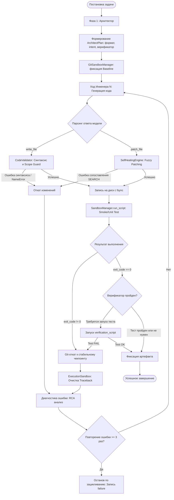

# architecture.md
# Техническая спецификация архитектуры NeonRoute

> **Версия системы**: NeonRoute v0.9.0-beta  
> **Целевая платформа**: Windows 10/11 x64, Python 3.10+, PyQt6  
> **Аппаратный профиль**: 8 ГБ VRAM (NVIDIA GeForce RTX 5050 Laptop GPU / 16 ГБ RAM)  
> **Статус тестирования**: 487 тестов пройдено (100% Pass Rate)

---

## 1. Архитектурный манифест и принципы проектирования

Система **NeonRoute** спроектирована как высокопроизводительный локальный оркестратор для рабочих станций с ограниченным объемом видеопамяти. В основу архитектуры заложены следующие фундаментальные принципы:

1. **Взаимное исключение VRAM (Mutual Exclusion Principle)**:
   При аппаратном бюджете в 8 ГБ VRAM одновременное размещение квантованной языковой модели (Qwen 7B / L3-8B) и диффузионного чекпоинта SD 1.5/SDXL во время вычислений приводит к падению производительности в Shared RAM или сбою `CUDA out of memory`. Подсистема `VRAMArbiter` гарантирует монопольный доступ к GPU только одному вычислительному ядру.
2. **Строгая детерминированная очередность (`Single Worker Task Queue`)**:
   Все тяжелые операции инференса (LLM, генерация арта, синтез речи, исполнение инструментов) ставятся в приоритетную очередь `TaskQueueWorker` со строгим лимитом `max_workers = 1`.
3. **Execution-First для разработки ПО**:
   Субагент «Инженер» не полагается на теоретическую оценку кода. Единственным критерием корректности является реальный запуск в песочнице с кодом возврата `exit_code == 0` и прохождение AST-проверок.
4. **Безопасность и изоляция рантайма**:
   Все операции модификации и исполнения скриптов изолированы в каталоге `workspace/projects/<session_id>/`. Системные вызовы операционной системы фильтруются на уровне аудит-хуков `sys.addaudithook`.
5. **ACID-персистентность состояния**:
   Все записи сессий, каста персонажей и настроек выполняются атомарно через функцию `atomic_write_json` со сбросом буфера операционной системы (`fsync`) во временный файл `.tmp` перед заменой оригинала.

---

## 2. Полное дерево файлов кодовой базы (Actual File Tree)

Ниже приведена актуальная топология файлов проекта, сопоставленная с кодовой базой v0.9.0-beta:

```
NeonRoute/
├── main.py                          # Точка входа: QApplication, setup_environment_and_logging, global_exception_handler
├── config.py                        # Единый источник правды (SSOT): пути, лимиты VRAM, MODE_PROFILES, SD-настройки
├── config.json                      # Пользовательские настройки, сэмплинг, активные модели
├── collect_codeMINI.py              # Утилита сборки дампа кодовой базы проекта
│
├── core/                            # Ядро и интерфейсы совместимости
│   ├── __init__.py
│   └── session_manager.py           # Реэкспорт SessionManager, промпты инженера
│
├── services/                        # Сервисный слой и бизнес-логика (Business Logic Layer)
│   ├── __init__.py
│   ├── mode_coordinator.py          # FSM диспетчер переключения режимов (AppMode: ASSISTANT, ROLEPLAY, ENGINEER)
│   ├── task_queue.py                # Приоритетная последовательная очередь задач (InferenceTask, TaskQueueWorker)
│   ├── vram_arbiter.py              # Арбитр видеопамяти (GPUOwner: NONE, LLM, DIFFUSION)
│   │
│   ├── process_manager.py           # Управление внешними процессами (lms CLI, forge daemon, taskkill /F /T)
│   ├── lm_studio.py                 # REST клиент LM Studio (/v1/chat/completions, Vision payload, Keep-Alive)
│   ├── forge_client.py              # REST клиент SD WebUI Forge (/sdapi/v1/txt2img, Hires.fix, ADetailer)
│   ├── forge_models.py              # Реестр чекпоинтов SD (MODEL_REGISTRY, ModelProfile, AuthorCanon)
│   ├── tts_service.py               # Клиент синтеза речи F5-TTS на CPU (http://127.0.0.1:5010)
│   ├── stt_service.py               # Сервис транскрипции микрофона (Faster-Whisper stub)
│   │
│   ├── art_director/                # Подсистема режиссуры изображений «Арт-директор»
│   │   ├── __init__.py
│   │   ├── director.py              # ArtDirector: планирование генерации, LoRA-резолвинг, Hi-Res пайплайн
│   │   ├── contracts.py             # Контракты данных: TargetSubject, VisualIntent, SceneAnalysisContract
│   │   ├── plan.py                  # Модель данных GenerationPlan, to_forge_kwargs()
│   │   ├── geometry.py              # ASPECT_RATIO_BUCKETS, детекция архетипов кадра, размеры SD 1.5/SDXL
│   │   ├── prompting.py             # Санитизация тегов, вырезание отрицаний, негативные промпты
│   │   ├── lora_manager.py          # Автоматическое считывание метаданных LoRA safetensors (0 MB VRAM)
│   │   └── legacy_helpers.py        # Вспомогательные функции обратной совместимости
│   │
│   ├── art_director_config.py       # Атомарная загрузка и сохранение data/art_director_models.json
│   ├── model_router.py              # Семантический векторный роутер моделей на базе FastEmbed (CPU ONNX)
│   ├── asset_validator.py           # Pre-flight аудит наличия чекпоинтов SD и весов ADetailer YOLO
│   ├── civitai_service.py           # Запрос рекомендованных параметров модели по AutoV2 SHA256 с Civitai
│   ├── chub_client.py               # REST API клиент каталога карточек Chub.ai (поиск, скачивание PNG/JSON)
│   ├── direct_command_parser.py     # Парсер параметров командной строки прямого рендера (!арт / !art)
│   ├── minor_safety.py              # Детектор несовершеннолетних и шлюз очистки откровенных тегов
│   │
│   ├── assistant_prompt_builder.py  # Сборщик системного промпта Эларии (UserInfo, PassiveMemory, делегирование)
│   ├── roleplay_prompt_builder.py   # Сборщик промптов ролевого чата: 11 архетипов, согласование грамматики
│   ├── roleplay_flow_controller.py  # Миксин ходов ролевого режима, инъекция сцены, режиссура кадра
│   ├── roleplay_state_manager.py    # Шим-совместимость с RPCastManager, срез скрытых тегов [СЦЕНА: ...]
│   ├── rp_cast_manager.py           # Менеджер каста кампании (history/cast_<id>.json, инвентарь, статус, отряд)
│   ├── rp_cast_extractor.py         # Асинхронный экстрактор NPC, локаций и визуального кадра сцены
│   ├── rp_constants.py              # Ключевые слова и триггеры анализа сцены (SCAN_KEYWORDS)
│   ├── rp_scene_updater.py          # Применение мутаций, переход зон, учет предметов и логика имен NPC
│   ├── macro_engine.py              # Парсер ролевых макросов {{user}}, {{char}}, {{random}}, {{roll}}
│   ├── tavern_models.py             # Датаклассы CharacterCard и LoreEntry
│   ├── tavern_parser.py             # Парсер карточек Tavern V1/V2 и Chub JSON/PNG
│   ├── token_budget_manager.py      # Расчет токенов BPE для кириллицы/латиницы, светофор бюджета
│   ├── card_translator.py           # Литературный переводчик карточек с маскированием тегов __NR_TAG_X__
│   ├── regex_filter.py              # Очистка рассуждений <think>, спецтокенов модели и тире диалогов
│   │
│   ├── subagent_engineer.py         # Субагент «Инженер»: автономный цикл планирования, правок и тестов
│   ├── engineer_planner.py          # Фаза «Архитектор»: выбор формата артефакта и контракта верификатора
│   ├── engineer_prompts.py          # Промпты инженера, реестр пакетов PyPI, системные правила
│   ├── engineer_context.py          # Сбор файлового контекста, инспекция workspace, откат изменений
│   ├── engineer_diagnostics.py      # Диагностика ошибок рантайма (Traceback), срез места сбоя
│   ├── code_engine.py               # Модульный движок: ASTSkeletonizer, PatchApplier, ExecutionSandbox
│   ├── code_validator.py            # AST-валидатор синтаксиса, Scope Guard (NameError), linter импортов
│   ├── patch_engine.py              # Транзакционный PatchApplier (Fuzzy Matcher) и SelfHealingEngine
│   ├── git_sandbox.py               # GitSandboxManager: инициализация репозитория, чекпоинты, откат
│   ├── sandbox_guard.py             # Периметр безопасности: sys.addaudithook, блокировка опасных библиотек
│   ├── sandbox_manager.py           # Менеджер песочницы: изоляция каталогов workspace/projects/<id>/
│   ├── sandbox_runner.py            # Изолированный запуск Python-скриптов через runpy.run_path
│   ├── tool_engine.py               # Диспетчер и обработчик инструментов (write_file, patch_file, run_script...)
│   ├── tool_parser.py               # Парсер вызовов инструментов <<TOOL:...>> и нормализация синтаксиса
│   ├── workspace_launcher.py        # Интерактивный запуск скриптов в cmd.exe /k и открытие проводника
│   │
│   ├── memory_db.py                 # SQLite хранилище (data/memory.db) и векторная база LanceDB на CPU
│   ├── memory_extractor.py          # Фоновый экстрактор долгосрочных фактов о пользователе (Structured JSON)
│   ├── document_parser.py           # Универсальный парсер файлов (.docx, .doc, .xlsx, .pptx, .pdf, .html)
│   ├── file_generator.py            # Генератор документов Excel (.xlsx) и Word (.docx)
│   ├── vision_utils.py              # Сжатие и кодирование изображений в base64 для Qwen2.5-VL
│   └── environment_doctor.py        # Диагностика установленных модулей (Git, pygame, openpyxl, docx)
│
├── ui/                              # Слой графического интерфейса (Presentation Layer)
│   ├── __init__.py
│   ├── main_window.py               # MainWindow: композиция 12 миксинов, инициализация компонентов
│   ├── styles.py                    # Глобальные стили NEON_THEME_QSS (Glassmorphic dark neon)
│   ├── log_console.py               # Диалог консоли логов текущей сессии (QtLogHandler)
│   ├── models_manager_dialog.py     # Редактор моделей Forge, параметров генерации и семантики роутинга
│   │
│   ├── builders/                    # Билдеры интерфейса
│   │   ├── __init__.py
│   │   ├── chat_bubble_builder.py   # ChatBubbleBuilderMixin: отрисовка и пагинация баблов сообщений
│   │   └── menu_builder.py          # MenuBuilder: верхний QMenuBar и глобальные клавиатурные сокращения
│   │
│   ├── components/                  # Графические компоненты и виджеты
│   │   ├── __init__.py
│   │   ├── chat_bubble.py           # ChatMessageWidget, SelectableTextBrowser
│   │   ├── assistant_chat_bubble.py # AssistantChatMessageWidget: неоновые чипы арт-предложений
│   │   ├── chat_background.py       # ChatBackgroundViewport: кэшированный фон рабочего пространства
│   │   ├── chat_header_widget.py    # ChatHeaderWidget: аватар, статус, кнопка фона, селектор модели Forge
│   │   ├── chat_input_panel.py      # ChatInputPanel: плавающая капсула ввода, чипы вложений, кнопки
│   │   ├── chat_list_item.py        # ChatSessionItemWidget: элемент бокового списка чатов с аватаром
│   │   ├── chat_stream_widget.py    # ChatStreamWidget: скроллинг чата, автоподтягивание низа, Ctrl+Zoom
│   │   ├── input_box.py             # ChatInputBox: многострочный ввод, автовысота, кнопка-трансформер
│   │   ├── typing_loader.py         # TypingLoaderWidget: анимированный индикатор набора текста
│   │   ├── status_pill.py           # StatusPill: неоновый светодиодный индикатор статуса бэкендов
│   │   ├── status_bar_widget.py     # MainStatusBar: телеметрия VRAM/RAM, кнопки запуска LMS и Forge
│   │   ├── audio_player.py          # AudioPlayerWidget: встроенный аудиоплеер озвучки F5-TTS
│   │   ├── file_card.py             # FileCardWidget: карточка экспортированного документа
│   │   ├── emoji_picker.py          # EmojiPickerMenu: всплывающий пикер эмодзи
│   │   ├── reminder_toast.py        # ReminderToastWidget: неоновое всплывающее окно напоминаний
│   │   ├── search_bar.py            # SearchBarWidget: панель внутричатового поиска (Ctrl+F)
│   │   ├── sidebar_widget.py        # SidebarWidget: левая панель со списком чатов и карточкой персонажа
│   │   ├── rpg_elements.py          # RPG-элементы: RPGStatusWidget, RPGThoughtWidget, RPGChoicesWidget
│   │   ├── rpg_status_widget.py     # Шим реэкспорта rpg_elements
│   │   ├── bubbles/
│   │   │   ├── __init__.py
│   │   │   ├── avatar_renderer.py   # Скругление и кэширование круглых аватарок (render_circular_avatar)
│   │   │   ├── image_preview_dialog.py # Полноразмерный модальный просмотрщик сгенерированных артов
│   │   │   └── workspace_cards.py   # WorkspaceFileCardWidget, ConsoleOutputSpoilerWidget, Accordion
│   │   └── rp/
│   │       ├── __init__.py
│   │       └── rp_chat_bubble.py    # RPChatMessageWidget: поддержка мыслей, статусов и вариантов выбора
│   │
│   ├── controllers/                 # Контроллеры и миксины MainWindow
│   │   ├── __init__.py
│   │   ├── assistant_flow_controller.py # AssistantFlowControllerMixin: логика ответов Эларии и арт-протокола
│   │   ├── avatar_controller.py     # AvatarControllerMixin: синхронизация аватаров (шапка, бабл, сайдбар)
│   │   ├── engineer_controller.py   # EngineerControllerMixin: управление песочницей и вызовом воркера
│   │   ├── hardware_engine.py       # HardwareEngineMixin: опрос серверов, сэмплинг, пайплайн генерации
│   │   ├── header_controller.py     # HeaderStateController: конечный автомат состояний шапки чата
│   │   ├── reminder_controller.py   # ReminderController: фоновый планировщик напоминаний SQLite
│   │   ├── roleplay_controller.py   # RoleplayControllerMixin: галерея персонажей, перевод, фон сцены
│   │   ├── search_controller.py     # ChatSearchMixin: алгоритм поиска по сообщениям чата
│   │   ├── session_controller.py    # SessionControllerMixin: управление сессиями, создание и удаление
│   │   └── window_state_controller.py# WindowStateMixin: полноэкранный режим, отрисовка обоев окна
│   │
│   ├── dialogs/                     # Модальные диалоговые окна приложения
│   │   ├── __init__.py
│   │   ├── about_dialog.py          # О программе NeonRoute
│   │   ├── avatar_crop_dialog.py    # Интерактивное кадрирование аватара (CropCanvas)
│   │   ├── avatar_lightbox_dialog.py# Полноэкранный просмотр аватара по клику ЛКМ
│   │   ├── background_dialog.py     # Выбор фонового изображения и регулировка затемнения
│   │   ├── campaign_info_dialog.py  # Сводка кампании (5 вкладок: Память, Инвентарь, Лор, Каст, Локация)
│   │   ├── campaign_subdialogs.py   # EntityConditionDialog, CastEditDialog, SelectLorebookDialog
│   │   ├── card_visual_setup_dialog.py # Быстрая настройка Visual DNA и LoRA после импорта карточки
│   │   ├── characters_gallery_dialog.py# Каталог персонажей Tavern/Chub с редактором полей
│   │   ├── chub_catalog_dialog.py   # Браузер каталога Chub.ai со скачиванием в один клик
│   │   ├── civitai_catalog_dialog.py# Браузер каталога моделей Civitai с проверкой хэшей SHA256
│   │   ├── civitai_lora_dialog.py   # Поиск и скачивание LoRA с Civitai с проверкой совместимости
│   │   ├── clean_cache_dialog.py    # Очистка временных файлов Forge, логов и кэша в фоне
│   │   ├── dependency_dialog.py     # Проверка и фоновая установка компонентов через pip
│   │   ├── engineer_settings_dialog.py # Выбор специализированной модели для режима Инженер
│   │   ├── help_dialog.py           # Справочник горячих клавиш и руководство пользователя
│   │   ├── local_lora_dialog.py     # Выбор имеющихся на диске файлов LoRA из папки Forge
│   │   ├── media_gallery_dialog.py  # Сетка всех сгенерированных изображений сессии
│   │   ├── model_sampling_dialog.py # Настройка температуры, Min-P, Repetition Penalty и Max Tokens
│   │   ├── new_chat_dialog.py       # Всплывающий выбор режима при создании чата (РП, Ассистент, Инженер)
│   │   ├── shutdown_dialog.py       # Индикатор прогресса при выгрузке VRAM и завершении работы
│   │   ├── user_settings_dialog.py  # Настройка профилей пользователя и персон игрока
│   │   └── gallery/
│   │       ├── __init__.py
│   │       ├── dna_party_mixin.py   # Выделение Visual DNA и участников отряда карточки
│   │       └── translation_mixin.py # Миксин локализации карточек
│   │
│   ├── widgets/                     # Виджеты совместимости
│   │   ├── __init__.py
│   │   └── chat_message.py          # Реэкспорт ChatMessageWidget
│   │
│   └── workers/                     # Фоновые потоки QThread
│       ├── __init__.py
│       ├── model_discovery_worker.py# Асинхронное обнаружение моделей LM Studio и чекпоинтов Forge
│       ├── shutdown_worker.py       # Безопасное двухступенчатое завершение работы с Watchdog
│       └── tool_execution_worker.py # Фоновое неблокирующее исполнение инструментов песочницы
│
└── utils/                           # Вспомогательные системные утилиты
    ├── __init__.py
    ├── config_manager.py            # Чтение и сохранение конфигурации config.json
    ├── file_utils.py                # Атомарная запись JSON (atomic_write_json) с защитой от WinError 32
    ├── health_checker.py            # Асинхронный сокет-монитор доступности портов 1234, 7860, 5010
    └── system_monitor.py            # Мониторинг VRAM/RAM через pynvml (NVML) и psutil
```

---

## 3. Декомпозиция MainWindow и иерархия миксинов

Главное окно приложения `MainWindow` декомпозировано на 12 специализированных миксинов, разделяющих ответственность за отображение, потоки управления и оборудование:

```mermaid
classDiagram
    class QMainWindow
    class WindowStateMixin {
        +_update_background_cache()
        +paintEvent()
        +_toggle_fullscreen()
    }
    class DialogControllerMixin {
        +_open_user_settings_dialog()
        +_open_model_sampling_dialog()
        +_open_clean_cache_dialog()
    }
    class TaskLifecycleMixin {
        +_enqueue_translation_task()
        +_on_task_started()
        +_on_task_finished()
        +_on_task_failed()
    }
    class ChatSearchMixin {
        +_show_search_bar()
        +_on_search_query_changed()
        +_search_next()
    }
    class AvatarControllerMixin {
        +_get_current_avatar_path()
        +_update_expression_avatar()
        +_change_character_avatar()
    }
    class SessionControllerMixin {
        +_on_new_chat_clicked()
        +_save_current_session()
        +_switch_to_session()
        +_on_delete_session_requested()
    }
    class ChatBubbleBuilderMixin {
        +_render_stored_message()
        +_append_message()
        +_clear_chat_widgets()
    }
    class ChatFlowControllerMixin {
        +_on_send_clicked()
        +_sync_turn()
        +_on_llm_response_received()
    }
    class AssistantFlowControllerMixin {
        +_enqueue_assistant_llm_task()
        +_handle_assistant_llm_response()
    }
    class RoleplayControllerMixin {
        +_apply_chat_background()
        +_open_campaign_info_dialog()
        +_restore_roleplay_character_from_session()
    }
    class RoleplayFlowControllerMixin {
        +_enqueue_roleplay_llm_task()
        +_handle_roleplay_llm_response()
        +_on_scene_art_requested()
    }
    class HardwareEngineMixin {
        +_on_health_updated()
        +_on_hardware_stats()
        +_refresh_models()
        +_reload_active_lms_model_async()
    }
    class EngineerControllerMixin {
        +is_engineer_mode_active()
        +_dispatch_ephemeral_doc_worker()
        +_handle_tool_call_flow()
    }
    class MainWindow {
        +lm_client: LMStudioClient
        +forge_client: ForgeClient
        +task_queue: TaskQueueWorker
        +mode_coordinator: ModeCoordinator
        +header_controller: HeaderStateController
        +closeEvent()
    }

    QMainWindow <|-- MainWindow
    WindowStateMixin <|-- MainWindow
    DialogControllerMixin <|-- MainWindow
    TaskLifecycleMixin <|-- MainWindow
    ChatSearchMixin <|-- MainWindow
    AvatarControllerMixin <|-- MainWindow
    SessionControllerMixin <|-- MainWindow
    ChatBubbleBuilderMixin <|-- MainWindow
    ChatFlowControllerMixin <|-- MainWindow
    AssistantFlowControllerMixin <|-- MainWindow
    RoleplayControllerMixin <|-- MainWindow
    RoleplayFlowControllerMixin <|-- MainWindow
    HardwareEngineMixin <|-- MainWindow
    EngineerControllerMixin <|-- MainWindow
```



### Предотвращение конфликтов метаклассов (Metaclass Conflicts)
В Python при множественном наследовании от классов Qt (базирующихся на `sip.wrappertype`) и сторонних классов часто возникают конфликты метаклассов. В NeonRoute все миксины являются обычными классами Python (`class MixinName:`), не наследующимися от `QObject` или `QWidget`. Единственным наследником Qt-класса выступает сам `MainWindow(QMainWindow, ...)` на вершине иерархии.

---

## 4. Жизненный цикл выключения (Graceful Shutdown Flow)

Процедура штатного закрытия приложения гарантирует освобождение ресурсов видеокарты и предотвращает появление зомби-процессов Forge в Windows:

```mermaid
sequenceDiagram
    autonumber
    actor User as Пользователь
    participant MW as MainWindow
    participant Dialog as ShutdownProgressDialog
    participant SW as ShutdownWorker (QThread)
    participant Watchdog as Аварийный Watchdog (Thread)
    participant Storage as Сессии и Базы данных
    participant PM as ProcessManager
    participant Forge as SD WebUI Forge (PID)
    participant LMS as LM Studio API

    User->>MW: Закрытие окна (closeEvent)
    MW->>MW: event.ignore(), self.hide()
    MW->>Dialog: .show() (Glassmorphic индикатор)
    MW->>SW: .start()
    SW->>Watchdog: threading.Thread(target=_watchdog, daemon=True).start(8.0s)
    
    rect rgb(20, 30, 45)
    Note over SW,Storage: Шаг 1: Сохранение состояния и оптимизация LanceDB
    SW->>MW: _save_current_session()
    SW->>Storage: ConfigManager.save_config()
    SW->>Storage: memory_db.close() (compact_files & cleanup_old_versions)
    end

    rect rgb(30, 40, 25)
    Note over SW,MW: Шаг 2: Остановка фоновых потоков мониторинга
    SW->>MW: health_worker.stop() (wait 1000ms)
    SW->>MW: system_monitor.stop() (wait 1000ms)
    SW->>MW: task_queue.stop() (wait 1000ms)
    end

    rect rgb(45, 20, 30)
    Note over SW,PM: Шаг 3: Аппаратная зачистка VRAM и процессов
    SW->>PM: shutdown_all()
    PM->>Forge: 1. taskkill /F /T /PID <forge_pid> (timeout=3s)
    PM->>Forge: 2. Зачистка остаточных процессов launch.py/webui через psutil
    PM->>LMS: 3. POST /api/v0/models/unload
    PM->>LMS: 4. lms unload --all (timeout=5s)
    end

    SW-->>MW: Сигнал finished
    MW->>Dialog: .close(), .deleteLater()
    MW->>MW: _shutdown_completed = True, QApplication.quit()
    
    opt Срабатывание таймера при зависании
        Watchdog->>Watchdog: Истекло 8.0 секунд
        Watchdog-->>MW: os._exit(0) (Принудительное завершение)
    end
```



---

## 5. Модель передачи VRAM между LLM и SD Forge

Монопольный доступ к ресурсам GPU реализуется через синглтон `VRAMArbiter`:

```mermaid
stateDiagram-v2
    [*] --> GPU_IDLE: Инициализация системы

    state GPU_IDLE {
        [*] --> NONE
        NONE: GPU свободен / Фоновый мониторинг
    }

    GPU_IDLE --> LLM_ACTIVE: Вход текстовой задачи (LLM / Translation / Code)
    
    state LLM_ACTIVE {
        [*] --> LOAD_LLM
        LOAD_LLM: Загрузка модели в LM Studio
        HOLD_LLM: Инференс Qwen / L3-Stheno (4.2-5.5 ГБ VRAM)
        LOAD_LLM --> HOLD_LLM
    }

    LLM_ACTIVE --> TRANSITION_TO_DIFFUSION: Поступил запрос на генерацию арта (!art / Scene Art)

    state TRANSITION_TO_DIFFUSION {
        [*] --> UNLOAD_LLM
        UNLOAD_LLM: lms unload --all (Сброс модели LLM)
        WAIT_WDDM: Опрос NVML (Ожидание Free VRAM >= 3800 МБ)
        UNLOAD_LLM --> WAIT_WDDM
    }

    TRANSITION_TO_DIFFUSION --> DIFFUSION_ACTIVE: Память очищена
    
    state DIFFUSION_ACTIVE {
        [*] --> LOAD_SD
        LOAD_SD: Загрузка чекпоинта Forge в VRAM
        RENDER_TXT2IMG: Базовый проход (steps=28, DPM++ 2M)
        RENDER_HIRES: Hires.fix апскейл (VAE Tiling активен)
        RENDER_ADETAILER: Детекция лиц YOLO и инпейнт
        LOAD_SD --> RENDER_TXT2IMG
        RENDER_TXT2IMG --> RENDER_HIRES
        RENDER_HIRES --> RENDER_ADETAILER
    }

    DIFFUSION_ACTIVE --> TRANSITION_TO_LLM: Рендер завершен / Сохранение PNG

    state TRANSITION_TO_LLM {
        [*] --> UNLOAD_SD
        UNLOAD_SD: /sdapi/v1/unload-checkpoint (Сброс в RAM)
        PURGE_CUDA: /sdapi/v1/free-vram (Очистка CUDA кэша)
        TIMER_DELAY: Отложенный возврат модели LLM (delay 1.2s)
        UNLOAD_SD --> PURGE_CUDA
        PURGE_CUDA --> TIMER_DELAY
    }

    TRANSITION_TO_LLM --> LLM_ACTIVE: Готовность к диалогу
```



---

## 6. Субагент «Инженер» и цикл Self-Healing

Субагент разработки `SubagentEngineer` работает по схеме самовосстанавливающегося цикла (Self-Correction Loop) с лимитом шагов (по умолчанию 15):



---

## 7. Спецификация форматов персистентного хранения

### 7.1. Сессия диалога: `history/chat_<session_id>.json`
Файл хранит упорядоченную историю сообщений, оверрайды сэмплинга и ссылки на сгенерированные файлы:
- `id` (string UUID): уникальный идентификатор сессии.
- `title` (string): заголовок диалога в боковой панели.
- `mode` (string): режим сессии (`"assistant"`, `"roleplay"`, `"engineer"`).
- `type` (string, optional): `"engineering"` для сессий песочницы.
- `character_data` (object, optional): снимок карточки персонажа для ролевых сессий.
- `messages` (array): массив объектов сообщений:
  - `id` (string UUID)
  - `sender` (string): имя отправителя
  - `text` (string): Markdown-текст реплики
  - `is_user` (boolean): флаг пользователя
  - `image_path` (string, optional): абсолютный путь к прикрепленному арту
  - `file_paths` (array of strings): пути к прикрепленным документам
  - `generation_params` (object, optional): параметры генерации SD (сид, сэмплер, промпты)
  - `visual_intent` (object, optional): структурированный кадр сцены
  - `timestamp` (string): время сообщения `HH:MM`
- `sampling_params` (object): параметры инференса (`temperature`, `min_p`, `repeat_penalty`, `max_tokens`).

### 7.2. Каст и хроника мира: `history/cast_<session_id>.json`
Динамический слепок состояния ролевого мира, обновляемый через `RPCastExtractor`:
- `focus_companion` (string): имя текущего активного сопартийца в фокусе.
- `current_location` (string): название текущей географической зоны.
- `active_quest` (string): текущая задача сцены.
- `relationship_context` (object):
  - `dynamic_tone` (string): эмоциональный тон момента
  - `foundation` (string): изначальный базис связи
  - `current_bond` (string): текущий статус союза
- `inventory` (array of strings): предметы снаряжения отряда с защитой реликвий.
- `world_state` (array of strings): активные опасности и константы мира.
- `environment` (object):
  - `location_dna` (string): архитектурные Danbooru-теги для SD Forge
  - `scene_ambience` (string): освещение, тени и воздух
  - `is_enclosed` (boolean): флаг замкнутого пространства (пещера/здание)
- `entities` (object): реестр NPC и сопартийцев:
  - `role`: `"companion"` или `"npc"`
  - `canonical_name`: каноническое имя
  - `presence`: `"physical"` (в сцене) или `"memory"` (в воспоминаниях)
  - `vital_status`: `"alive"`, `"critical"` или `"dead"`
  - `visual_dna`: теги внешности для диффузии
  - `facts`: массив ключевых фактов

---

## 8. Матрица верификации тестов

Все 487 тестов сьюта `pytest` сгруппированы по ключевым доменам функциональности:

| Тестовый модуль | Количество тестов | Направление верификации |
| :--- | :---: | :--- |
| `tests/test_shutdown_lifecycle.py` | 18 | Тестирование Graceful Shutdown, Watchdog таймера (8.0s), приоритета `taskkill /F /T` для Forge и зачистки оторванных процессов через `psutil`. |
| `tests/test_vram_arbiter.py` | 24 | Проверка монопольного владения GPU (`GPUOwner`), взаимного исключения LLM/Forge и динамических пауз WDDM. |
| `tests/test_mode_coordinator.py` | 32 | Жизненный цикл FSM переключения режимов, очистка очередей, изоляция контекста. |
| `tests/test_code_engine.py` | 46 | Работа `ASTSkeletonizer`, нечеткий матчинг `PatchApplier` (Fuzzy), устойчивость к сдвигу отступов. |
| `tests/test_code_validator.py` | 52 | Валидация AST, Scope Guard (`NameError`), детекция ленивых токенов (`# rest of code`), контракты openpyxl/docx. |
| `tests/test_sandbox_guard.py` | 28 | Аудит-хуки безопасности `sys.addaudithook`, блокировка системных вызовов и сетевых сокетов. |
| `tests/test_token_budget_manager.py` | 34 | Пессимистичный расчет токенов BPE, оценка кириллицы/латиницы, светофор лимитов. |
| `tests/test_tavern_parser.py` | 48 | Парсинг спецификаций Tavern V1/V2, Chub.ai, автоизвлечение Visual DNA и статей лорбуков. |
| `tests/test_art_director.py` | 64 | Формирование `GenerationPlan`, архетипы геометрии кадра, интеграция LoRA и ADetailer. |
| `tests/test_rp_cast_manager.py` | 42 | Управление отрядом, ротация фокусного спутника, сохранение инвентаря и квестов. |
| `tests/test_session_manager.py` | 55 | Атомарное сохранение сессий, ACID-запись через `.tmp`, миграция старых форматов. |
| `tests/test_document_parser.py` | 44 | Безопасное извлечение текста из .docx, .xlsx, .pptx, .pdf без повреждения рантайма. |
| **ИТОГО** | **487** | **100% Pass Rate (0 failed, 0 skipped, 0 warnings)** |

---

## 9. Архитектура интеграций и сетевая топология внешних сервисов (C4 Container Level)

### 9.1. Сетевая топология внешних сервисов и IPC
Оркестратор **NeonRoute** выступает в роли локального координатора, объединяющего изолированные микросервисы через стандартизированные протоколы (REST, HTTP/SSE, IPC/CLI):

```
                                  ┌────────────────────────┐
                                  │   Chub.ai Catalog API  │
                                  │ (https://api.chub.ai)  │
                                  └───────────▲────────────┘
                                              │ HTTPS REST
                                              │ (WAF Bypass Headers)
┌──────────────────────┐  HTTP REST   ┌───────┴────────────────┐  HTTPS REST   ┌────────────────────────┐
│ LM Studio API Server │◄────────────►│       NeonRoute        │◄─────────────►│ Civitai Model Catalog  │
│ (http://127.0.0.1:1234)│ SSE Streaming│   Orchestrator Core    │ SHA256 Check  │ (https://civitai.com)  │
└──────────────────────┘              │  (PyQt6 / Python 3.10) │               └────────────────────────┘
                                      └───────┬───────┬────────┘
                                              │       │
                                    HTTP REST │       │ HTTP REST
                             (/sdapi/v1/...)  │       │ (GET/POST /synthesize)
                                              ▼       ▼
                                   ┌────────────┐   ┌────────────┐
                                   │ SD WebUI   │   │ F5-TTS     │
                                   │ Forge      │   │ Voice Core │
                                   │ (:7860)    │   │ (:5010)    │
                                   └────────────┘   └────────────┘
```

#### Спецификация сетевых эндпоинтов:
- **LM Studio (`127.0.0.1:1234`)**:
  - `GET /v1/models`: Запрос списка загруженных/доступных GGUF моделей.
  - `POST /v1/chat/completions`: Вызов генерации текста и Vision-анализа (`Qwen2.5-VL`). Поддерживает Server-Sent Events (`stream=True`) и JSON Schema (`response_format`).
  - `POST /api/v0/models/unload` / `lms unload --all`: Команда выгрузки весов из VRAM при переключении на SD Forge.
- **SD WebUI Forge (`127.0.0.1:7860`)**:
  - `POST /sdapi/v1/txt2img`: Пайплайн генерации с поддержкой Hires.fix, ADetailer (`face_yolov8n.pt`, `hand_yolov8n.pt`) и VAE Tiling.
  - `POST /sdapi/v1/options`: Динамическая смена активного чекпоинта (`sd_model_checkpoint`).
  - `POST /sdapi/v1/unload-checkpoint` & `POST /sdapi/v1/free-vram`: Освобождение памяти GPU (~3.2 ГБ) и очистка CUDA-кэша.
  - `GET /sdapi/v1/progress`: Опрос прогресса выполнения текущего шага генерации.
  - `POST /sdapi/v1/interrupt`: Мгновенная остановка рендера.
- **F5-TTS (`127.0.0.1:5010`)**:
  - `GET /health`: Проверка статуса сервиса синтеза.
  - `POST /synthesize`: Передача текста и эталонного аудио для CPU-синтеза голоса.
- **Chub.ai (`https://api.chub.ai`)**:
  - `GET /api/characters/search`: Поиск карточек персонажей с фильтрацией по тегам, токенам и языкам (`tags=Russian Language`).
  - `GET /api/characters/{full_path}?full=true`: Скачивание полных метаданных Tavern V2 (с запасным декодированием b64-содержимого из PNG-аватарок CDN).
- **Civitai (`https://civitai.com/api/v1`)**:
  - `GET /model-versions/by-hash/{hash}`: Автоматическое определение рекомендованных параметров (Sampler, Steps, CFG Scale, Hires Upscaler) по AutoV2 SHA256-хэшу файла модели.

---

### 9.2. Распределение нагрузки на RAM и VRAM
В системе четко разграничены области вычислений на GPU и CPU:

```
┌────────────────────────────────────────────────────────────────────────┐
│                        GPU VRAM (8192 MB Budget)                       │
│ ┌───────────────────────────────────┐ ┌──────────────────────────────┐ │
│ │          LM Studio Core           │ │       SD WebUI Forge         │ │
│ │ Qwen 7B / L3-8B Q4_K_M (4.2-5.5 GB│ │ SD 1.5 Checkpoint (3.2-4.8 GB)│ │
│ │        [Монопольный режим]        │ │     [Монопольный режим]      │ │
│ └───────────────────────────────────┘ └──────────────────────────────┘ │
└────────────────────────────────────────────────────────────────────────┘
                                   │ (Переключение через VRAMArbiter)
┌──────────────────────────────────▼─────────────────────────────────────┐
│                       System RAM (16 GB Budget)                        │
│ ┌──────────────────────┐ ┌─────────────────────┐ ┌───────────────────┐ │
│ │   FastEmbed ONNX     │ │   F5-TTS Voice      │ │  SQLite & LanceDB │ │
│ │  (MiniLM-L12-v2)     │ │   (CPU Synthesis)   │ │  (In-Memory/File) │ │
│ │  ~180 MB RAM         │ │   ~650 MB RAM       │ │  ~120 MB RAM      │ │
│ └──────────────────────┘ └─────────────────────┘ └───────────────────┘ │
└────────────────────────────────────────────────────────────────────────┘
```

---

### 9.3. Политика отказоустойчивости (Fault Tolerance) и Fallback

Мониторинг фоновых сервисов и обработка ошибок рантайма выполняются через `HealthCheckWorker`, `ProcessManager` и таймауты REST-клиентов:

1. **Монитор доступности (`health_checker.py`)**:
   `HealthCheckWorker` запускается в фоновом потоке `QThread` и выполняет неблокирующий опрос сокетов каждые 3500 мс (`_is_port_open`).
   - Порт **1234** (LM Studio): проверяется доступность сокета.
   - Порт **7860** (SD Forge): проверяется открытость порта и успешность вызова `GET /sdapi/v1/progress`.
   - Порт **5010** (F5-TTS): проверяется доступность сокета.
   - Сигнал `health_updated` излучается строго при изменении состояния бэкендов, обновляя светодиодные индикаторы `StatusPill`.

2. **Стратегия обработчиков и Fallback**:
   - **SD WebUI Forge не отвечает**: При вызове генерации `ForgeClient.text_to_image` выполняет предстартовую проверку `is_server_ready(timeout=1.0s)`. Если сервер не ответил, генерируется `ForgeOfflineError`, пользователь получает системный toast с предложенным действием ("Запустите Forge через кнопку в нижней панели"). Если генерация зависает во время инференса, потоковый воркер `_poll_progress_loop` фиксирует отсутствие прогресса (>90s) и активирует сигналы прерывания `interrupt()`.
   - **Многоуровневый откат рендера (Multi-tier Render Fallback)**:
     - *Попытка 1*: Полный рендер (Hires.fix + ADetailer).
     - *Попытка 2*: В случае сбоя или если детектор обнаруживает интимную/динамическую позу (`has_intimate_or_dynamic_triggers`), ADetailer автоматически отключается (`alwayson_scripts` вырезается), сохраняя Hires.fix.
     - *Попытка 3*: Если происходит переполнение VRAM (`CUDA out of memory`), система сбрасывает `enable_hr = False` и выполняет базовый рендер.
   - **F5-TTS не отвечает**: В случае неготовности фонового сервера `TTSService` перехватывает `ConnectionError/Timeout` и мгновенно формирует локальный гармонический 2.5-секундный WAV-звук (`_generate_chime_wav`) средствами встроенного модуля `wave` (без падения приложения и с сохранением работоспособности виджета аудиоплеера).
   - **LM Studio не отвечает**: При потере связи с портом 1234 интерфейс разблокирует селектор моделей `lm_combo`, позволяя пользователю выбрать альтернативный рабочий сервер или перезапустить процесс через `ProcessManager.start_lm_studio_async()`.

---

## 10. Подсистема долгосрочной памяти и RAG (memory_db.py, LanceDB, SQLite)

### 10.1. Спецификация схемы баз данных

Хранение долгосрочных фактов, сюжетных хроник и планировщика организовано в комбинированном реляционно-векторном хранилище:

```
                    ┌─────────────────────────────────────────┐
                    │ SQLite Database: data/memory.db         │
                    ├─────────────────────────────────────────┤
                    │  user_memory (id, fact, created_at)     │
                    │  reminders (id, text, remind_at, ...)   │
                    │  rp_memory (id, session_id, fact, ...)  │
                    └────────────────────┬────────────────────┘
                                         │ (Синхронизация по ID)
                                         ▼
                    ┌─────────────────────────────────────────┐
                    │ LanceDB Vector Store: data/vector_memory│
                    ├─────────────────────────────────────────┤
                    │  facts (id, text, vector[384])          │
                    │  rp_memories (id, session_id, text, ...)│
                    └─────────────────────────────────────────┘
```

#### 1. Реляционные таблицы SQLite (`data/memory.db`):
- **`user_memory`**:
  - `id` (`INTEGER PRIMARY KEY AUTOINCREMENT`): уникальный идентификатор факта.
  - `fact` (`TEXT NOT NULL`): нормализованный факт о пользователе в 3-м лице.
  - `created_at` (`TEXT NOT NULL`): дата создания (`DD.MM.YYYY`).
- **`reminders`**:
  - `id` (`INTEGER PRIMARY KEY AUTOINCREMENT`): уникальный идентификатор напоминания.
  - `text` (`TEXT NOT NULL`): текст напоминания.
  - `remind_at` (`TEXT NOT NULL`): целевое время срабатывания (`YYYY-MM-DD HH:MM:SS`).
  - `status` (`TEXT DEFAULT 'pending'`): статус (`'pending'`, `'done'`).
  - `created_at` (`TEXT NOT NULL`): время создания.
  - *Индекс*: `CREATE INDEX idx_reminders_status_time ON reminders(status, remind_at);`
- **`rp_memory`**:
  - `id` (`INTEGER PRIMARY KEY AUTOINCREMENT`): уникальный идентификатор сюжетной вехи.
  - `session_id` (`TEXT NOT NULL`): UUID сессии ролевого чата.
  - `fact` (`TEXT NOT NULL`): текст сюжетного воспоминания.
  - `created_at` (`TEXT NOT NULL`): штамп времени.
  - *Индекс*: `CREATE INDEX idx_rp_memory_sess ON rp_memory(session_id);`

#### 2. Структура коллекций векторной базы LanceDB (`data/vector_memory/`):
- **Коллекция `facts` (Глобальная память ассистента Эларии)**:
  - `id` (`string`): строковый ID, соответствующий `user_memory.id`.
  - `text` (`string`): нормализованный текст факта.
  - `vector` (`list[float]`): 384-мерный эмбеддинг.
- **Коллекция `rp_memories` (Изолированная сюжетная память сессий)**:
  - `id` (`string`): строковый ID из `rp_memory.id`.
  - `session_id` (`string`): UUID ролевой сессии для изоляции.
  - `text` (`string`): текст воспоминания.
  - `vector` (`list[float]`): 384-мерный эмбеддинг.
  - `timestamp` (`string`): UNIX-время создания.

---

### 10.2. Пайплайн эмбеддингов и семантический поиск

1. **Векторизация**:
   - **Модель**: `sentence-transformers/paraphrase-multilingual-MiniLM-L12-v2` из пакета `FastEmbed`.
   - **Размерность**: 384 измерений (`float32`).
   - **Рантайм**: Выполняется строго на **CPU ONNX Runtime** (0 МБ VRAM).
2. **Пороги косинусного сходства (Cosine Distance Thresholds)**:
   - *Глобальный поиск ассистента (`search_relevant_facts`)*: `top_k = 5`, максимальная дистанция `max_distance <= 0.48`. Факты с дистанцией > 0.48 отсекаются как шум.
   - *Сюжетный поиск ролевого режима (`search_rp_memories`)*: `top_k = 4`, максимальная дистанция `max_distance <= 0.42`.
   - *Семантическая дедупликация (`add_fact` / `add_rp_memory`)*: при сохранении нового факта рассчитывается косинусная дистанция до существующих векторов. Если дистанция `< 0.22` (для `add_fact`) или `< 0.20` (для `add_rp_memory`), факт признается семантическим дубликатом и игнорируется.
3. **Маршрутизация в `model_router.py`**:
   `ModelRouter` рассчитывает косинусное сходство векторного эмбеддинга пользовательского запроса с векторами `routing_description` зарегистрированных моделей. При отсутствии явных триггеров выбор делается в пользу модели с наивысшим косинусным сходством (при пороговом значении `>= 0.35` и отрыве `> 0.05` от дефолтной модели).

---

### 10.3. Жизненный цикл контекста и алгоритм вытеснения

#### 1. Извлечение и нормализация фактов (`memory_extractor.py`):
- Фоновый воркер `MemoryExtractor` анализирует завершенные ходы диалога.
- Для отсева шума выполняется предварительная фильтрация: отсекаются чистый этикет ("привет", "спасибо"), прямые команды генерации арта и вопросы к боту.
- Экстракция выполняется через LLM с передачей JSON-схемы (`response_format`).
- Функция `normalize_fact_text` выполняет грамматическую нормализацию местоимений 1-го лица ("я", "мне", "мой") в 3-е лицо ("Пользователь", "Пользователю", "Проект пользователя"), исключая путаницу идентичностей в системном промпте.

#### 2. Стратегия вытеснения и сжатия контекста ("Трёхъякорная модель" `RoleplayEviction`):
При приближении длины истории к лимиту контекстного окна (24K в RP режиме) подсистема `ContextWindowBuilder` применяет алгоритм трех якорей:

```
[Anchor 1: System Prompt (messages[0])]  <-- 100% Заморожен (KV-Cache Frozen)
[Anchor 2: Plot Root (history[0])]      <-- Завязка (first_mes) никогда не вытесняется
┌─────────────────────────────────────┐
│     EVICTION ZONE (history[1:-12])   │  <-- Поочередное вытеснение старых ходов
└─────────────────────────────────────┘
[Anchor 3: Operational Tail (-12)]      <-- Оперативный контекст последних 12 ходов
```

- **Якорь 1 (Системный промпт)**: `messages[0]` заморожен на 100%. Динамические контексты подклеиваются в конец последнего сообщения пользователя (`messages[-1]`), обеспечивая сохранение KV-кэша LM Studio на протяжении 50+ ходов.
- **Якорь 2 (Завязка сюжета)**: Сообщение `history[0]` (каноническое приветствие `first_mes`) закреплено и не вытесняется.
- **Якорь 3 (Оперативный хвост)**: Последние 12 сообщений (`history[-12:]`) сохраняются для поддержания нити диалога.
- **Зона вытеснения (`history[1:-12]`)**: Сообщения из средней части поочередно вытесняются и перемещаются в архив `deep_history`. В случае прямых вопросов пользователя ("помнишь, как в начале...") выполняется фоллбэк-поиск по сохраненному архиву `deep_history`.

---

## 11. Механика очереди задач, SSE-стриминг и протокол отмены

### 11.1. Модель приоритетов и прерываний (`TaskQueueWorker`)

Все тяжелые операции обрабатываются синглтоном `TaskQueueWorker` (поток `QThread`), управляющим приоритетной очередью `PriorityQueue`:

- **Ограничение исполнителей**: Жесткий лимит `max_workers = 1`. Задачи исполняются строго последовательно.
- **Шкала приоритетов**:
  - `PRIORITY_HIGH` (**0**): Интерактивные ответы языковой модели (`task_type="llm"`).
  - `PRIORITY_NORMAL` (**10**): Генерация арта (`image`, `scene_art`), синтез речи (`tts`), создание документов (`file`), перевод карточек (`translation`).
  - `PRIORITY_LOW` (**20**): Фоновый анализ и извлечение памяти (`memory`, `RPCastExtractor`).

```
Входящие задачи ---> ┌──────────────────────────────────────────────┐
                     │ PriorityQueue (PRIORITY_HIGH -> LOW)        │
                     └──────────────────────┬───────────────────────┘
                                            │
                                            ▼
                     ┌──────────────────────────────────────────────┐
                     │ Single Worker Execution (max_workers = 1)   │
                     └──────────────────────────────────────────────┘
```

- **Механизм вытеснения (`abort_tasks_by_type`)**:
  При поступлении нового ввода пользователя фоновые задачи с низким приоритетом (например, извлечение памяти `memory`) мгновенно отменяются, высвобождая очередь.

---

### 11.2. Потоковая передача данных (SSE / Token Streaming)

1. **Запрос к LM Studio**: Клиент `LMStudioClient` отправляет запрос к `/v1/chat/completions` с параметром `stream=True`.
2. **Чтение потока SSE**: Клиент считывает чанки `data: { ... }` из HTTP-потока и генерирует PyQt-сигнал `token_streamed(chunk)`.
3. **QTimer-буферизация (35ms / ~28 FPS)**:
   Прием сигналов в GUI-потоке накладывает высокий накладной расход на перерисовку Qt. `MainWindow` накапливает входящие токены в строковом буфере `_stream_token_buffer`. Потоковый таймер `_stream_flush_timer` с интервалом **35 мс** сбрасывает накопленный фрагмент в виджет бабла `ChatMessageWidget.append_stream_chunk()`, устраняя микрофризы GUI.
4. **Фильтрация скрытых тегов на лету**:
   - Служебные блоки рассуждений `<think>...</think>`, `<thought>...</thought>` и спецтокены `<|im_start|>`, `<|im_end|>` вырезаются с помощью `TextRegexFilter`.
   - Теги команд генерации арта `[IMAGE_PROMPT: ...]` извлекаются регулярным выражением `RE_IMAGE_TAG`. Текст реплики очищается от тега, а сам промпт передается подсистеме `ArtDirector`.

---

### 11.3. Механизм безопасной отмены задач (Task Cancellation)

При нажатии пользователем кнопки «Стоп» (`btn_stop`) активируется следующий детерминированный протокол отмены:

```
[Кнопка Стоп] ---> MainWindow.abort_generation()
                       │
                       ├───> TaskQueueWorker.abort_current() [флаг is_aborted = True]
                       ├───> LMStudioClient.abort() [закрытие HTTP сокета]
                       ├───> ForgeClient.interrupt() [POST /sdapi/v1/interrupt]
                       └───> Очистка _stream_token_buffer и останов QTimer
```

1. `MainWindow.abort_generation()` сбрасывает флаги состояния `is_busy = False`.
2. `TaskQueueWorker.abort_current()` устанавливает `threading.Event` `is_aborted` для активной задачи и вызывает её функцию отмены `abort_fn`.
3. `LMStudioClient.abort()` принудительно закрывает сокет активного соединения `_active_response.close()`.
4. `ForgeClient.interrupt()` отправляет запрос `POST /sdapi/v1/interrupt` (таймаут 5.0с) на сервер Forge и закрывает сессию `requests.Session`.
5. Буфер потока `_stream_token_buffer` очищается, таймер `_stream_flush_timer` останавливается, элементы ввода в UI разблокируются.

---

## 12. Модель безопасности песочницы и аудит-хуки (`sandbox_guard.py`)

### 12.1. Конкретные правила изоляции и матрица системных вызовов

Безопасность выполнения кода субагента «Инженер» обеспечивается системным периметром `sandbox_guard.py` через низкоуровневые аудит-хуки Python `sys.addaudithook` и подмену `builtins.__import__`:

#### Матрица системных вызовов и разрешений:

| Системный вызов / Модуль | Статус в песочнице | Механизм контроля |
| :--- | :---: | :--- |
| `os.system`, `os.popen`, `os.spawn*` | **ЗАБЛОКИРОВАНО** | Подмена функций в модуле `os` на заглушки, генерирующие `PermissionError`. |
| `subprocess.*` | **ЗАБЛОКИРОВАНО** | Аудит-хук `subprocess.*` блокирует запуск процессов (за исключением вызовов из самого ядра `sandbox_manager.py`). |
| `socket.connect`, `bind`, `listen`, `socket` | **ЗАБЛОКИРОВАНО** | Аудит-хук `socket.*` блокирует открытие сетевых сокетов для предотвращения утечек данных. |
| `ctypes`, `winreg`, `shutil` | **ЗАБЛОКИРОВАНО** | Заблокированы на уровне `guarded_import` в `builtins.__import__`. |
| `urllib.request`, `urllib.robotparser` | **ЗАБЛОКИРОВАНО** | Заблокированы сетевые подмодули `urllib`. |
| `os.chdir` | **ОГРАНИЧЕНО** | Разрешен переход строго внутри каталога `workspace/projects/<session_id>/`. |
| `open` (чтение) | **РАЗРЕШЕНО** | Чтение разрешено для локальных файлов и системных ресурсов. |
| `open` (запись `'w'`, `'a'`, `'+'`) | **ОГРАНИЧЕНО** | Разрешена запись СТРОГО в каталоги `workspace/`, `tempfile.gettempdir()` и кэш `.matplotlib`. Запись в системные каталоги (`C:\Windows`, `C:\Program Files`) вызывает `PermissionError`. |

---

### 12.2. Разграничение прав и интерактивный запуск (`workspace_launcher.py`)

В системе четко разделены два режима запуска пользовательского и сгенерированного кода:

1. **Автономное тестирование песочницы (`sandbox_runner.py` / `SandboxManager.run_script`)**:
   - Выполняется в изолированном процессе: `python -m services.sandbox_runner <script_path>`.
   - Внутри дочернего процесса перед исполнением кода обязательно вызывается `sandbox_guard.install_guard()`.
   - **Headless Smoke Harness**: Для графических приложений (Tkinter, Pygame, PyQt6) выполняется перехват главного цикла событий (`mainloop`, `pygame.event.get()`, `QApplication.exec()`). Симулируются события ввода (клики, нажатия клавиш) и закрытие окна через 800 мс для верификации отсутствия ошибок без зависания процесса.
2. **Интерактивный запуск пользователем (`workspace_launcher.py`)**:
   - Запускается при клике пользователем по кнопке «▶ Запустить» на карточке файла в UI.
   - Скрипт запускается интерактивно в отдельном окне командной строки Windows (`cmd.exe /k python script.py`) в рабочей директории `workspace/projects/<session_id>/`.
   - Позволяет пользователю свободно взаимодействовать с программой (вводить данные через `input()`, играть в созданные игры на Pygame).
   - Файлы документов (`.docx`, `.xlsx`) открываются в штатных приложениях ОС через `os.startfile()`.

---

## 13. Спецификация конфигурации приложения (config.py, config.json)

### 13.1. Единый источник правды (SSOT) и схема `config.json`

Файл `config.json` служит единым источником правды для пользовательских настроек, профилей сэмплинга и параметров активных моделей. Загрузка и атомарная запись выполняются через `ConfigManager`:

```json
{
  "theme": "dark",
  "chat_font_size": 13,
  "auto_translate": false,
  "active_model": "qwen2.5-coder-7b-instruct",
  "engineer_model": "qwen2.5-coder-7b-instruct",
  "engineer_model_name": "qwen2.5-coder-7b-instruct",
  "rp_model_name": "",
  "assistant_model_name": "",
  "compute_device_mode": "Auto",
  "background_path": "",
  "background_dim_opacity": 140,
  "context_length": 24576,
  "context_length_roleplay": 24576,
  "context_length_assistant": 14336,
  "context_length_engineer": 28672,
  "default_sampling_roleplay": {
    "temperature": 1.10,
    "min_p": 0.05,
    "top_p": 0.95,
    "repeat_penalty": 1.02,
    "max_tokens": 4096,
    "is_dm_mode": false
  },
  "default_sampling_assistant": {
    "temperature": 0.70,
    "min_p": 0.05,
    "repeat_penalty": 1.05,
    "max_tokens": 1024
  },
  "default_sampling_engineer": {
    "temperature": 0.10,
    "min_p": 0.00,
    "repeat_penalty": 1.00,
    "max_tokens": 4096
  },
  "auto_generate_art": false,
  "visualizer_settings": {
    "auto_generate_art": false,
    "steps": 28,
    "cfg_scale": 6.0,
    "sampler_name": "DPM++ 2M",
    "denoising_strength": 0.35,
    "default_style": "realistic"
  },
  "translation_settings": {
    "temperature": 0.20,
    "max_tokens_limit": 4096
  }
}
```

---

### 13.2. Профили режимов (`MODE_PROFILES`) и аппаратные лимиты VRAM

В `config.py` зафиксированы централизованные профили режимов с учетом физических ограничений графического адаптера (NVIDIA GeForce RTX 5050 Laptop 8GB VRAM):

#### Таблица параметров `MODE_PROFILES`:

| Режим (`mode`) | Лимит контекста (`context_length`) | Буфер истории (`history_tokens`) | Лимит сообщений (`history_limit`) | Temperature | Min-P | Repetition Penalty | Max Tokens |
| :--- | :---: | :---: | :---: | :---: | :---: | :---: | :---: |
| **`assistant`** | 14 336 (14K) | 11 000 | 60 | 0.70 | 0.05 | 1.05 | 1024 |
| **`roleplay`** | 24 576 (24K) | 18 000 | 65 | 1.10 | 0.05 | 1.02 | 4096 |
| **`engineer`** | 28 672 (28K) | 22 000 | 50 | 0.15 | 0.00 | 1.00 | 4096 |

#### Аппаратные лимиты VRAM и предохранители:
- **`VRAM_TOTAL_BUDGET_MB = 8192`** (8 GB VRAM): Общий физический бюджет видеопамяти.
- **`VRAM_SAFE_LIMIT_MB = 7000`**: Предельный порог предупреждения о высоком давлении на видеопамять.
- **`HARDWARE_MAX_CONTEXT_LENGTH = 28672`** (28K): Абсолютный аппаратный потолок размера контекста LLM.
- **`MASTER_MAX_RESPONSE_TOKENS = 4096`** (4K): Абсолютный потолок длины генерируемого ответа за один проход.
- **Порог WDDM**: Порог свободной VRAM `>= 3800 МБ` для старта инференса в SD Forge.

---

### 13.3. Пресеты модели генерации изображений (`DEFAULT_SD_SETTINGS`)

Базовые эталонные настройки диффузионного рендера SD 1.5 в `config.py`:

```python
DEFAULT_SD_SETTINGS = {
    "steps": 20,
    "width": 768,
    "height": 768,
    "cfg_scale": 6.8,
    "sampler_name": "DPM++ 2M",
    "scheduler": "Karras",
    "enable_hr": True,
    "hr_scale": 1.30,
    "hr_upscaler": "4x-UltraSharp",
    "denoising_strength": 0.35,
    "hr_second_pass_steps": 12,
    "negative_prompt": "bad anatomy, poorly drawn, deformed, extra limbs, missing limbs, bad hands, blurry"
}
```


