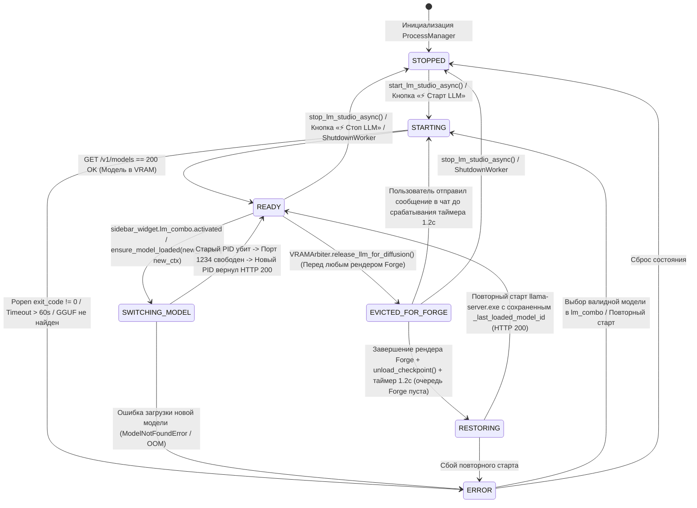

# МАСТЕР-ДОКУМЕНТ: Архитектура и пошаговый план миграции NeonRoute на автономный сервер llama-server.exe

> **Проект**: NeonRoute v0.8.0-beta -> v1.0.0-headless  
> **Назначение документа**: Исчерпывающее техническое задание для агента-программиста (Antigravity)  
> **Стек**: Python 3.10+, PyQt6, Headless `llama-server.exe` (llama.cpp), SD WebUI Forge  
> **Целевое оборудование**: NVIDIA GeForce RTX 5050 Laptop GPU (Строгий бюджет **8192 МБ VRAM** / 16 ГБ RAM)

---

## 1. ДЕРЕВО АРХИТЕКТУРЫ И СВЯЗЕЙ (Component & Dependency Tree)

### 1.1. Сквозная диаграмма вызовов: от нажатия кнопок в UI до субпроцессов Windows

```
┌──────────────────────────────────────────────────────────────────────────────────────────────────────────┐
│                                      СЛОЙ ПРЕДСТАВЛЕНИЯ (PyQt6 UI Layer)                                 │
├──────────────────────────────┬───────────────────────────────────────┬───────────────────────────────────┤
│  ui/components/              │  ui/components/                       │  ui/components/                   │
│  status_bar_widget.py        │  sidebar_widget.py                    │  input_box.py / chat_bubble.py    │
│  • btn_lms_toggle.clicked    │  • lm_combo.activated[int]            │  • action_btn.clicked (Send/Stop) │
│  • btn_forge_toggle.clicked  │  • btn_refresh_models.clicked         │  • ArtProposalChip.clicked        │
│  • pill_lm (порт 1234)       │                                       │  • btn_scene_art.clicked (RP)     │
└──────────────┬───────────────┴───────────────────┬───────────────────┴─────────────────┬─────────────────┘
               │                                   │                                     │
               ▼                                   ▼                                     ▼
┌──────────────────────────────────────────────────────────────────────────────────────────────────────────┐
│                                  СЛОЙ КОНТРОЛЛЕРОВ (MainWindow Mixins)                                   │
├──────────────────────────────┬───────────────────────────────────────┬───────────────────────────────────┤
│  ui/controllers/             │  ui/controllers/                      │  ui/controllers/                  │
│  hardware_engine.py          │  task_lifecycle_controller.py         │  chat_flow_controller.py          │
│  • _toggle_lms_server()      │  • _route_and_enqueue()               │  • _on_send_clicked()             │
│  • _on_lms_model_activated() │  • _enqueue_direct_image_task()       │  • _on_token_streamed() (35ms)    │
│  • _refresh_models()         │  • _enqueue_translation_task()        │  • abort_generation()             │
│  • _on_scene_art_requested() │                                       │                                   │
└──────────────┬───────────────┴───────────────────┬───────────────────┴─────────────────┬─────────────────┘
               │                                   │                                     │
               │ (Прямое управление демоном)       ▼                                     ▼
               │               ┌───────────────────────────────────────────────────────────────────────────┐
               │               │              ОЧЕРЕДЬ И АРБИТРАЖ (services/task_queue.py)                  │
               │               │  TaskQueueWorker (QThread, PriorityQueue, max_workers = 1)                │
               │               │    ├─► PRIORITY_HIGH (0)   : LLM диалог ('llm')                           │
               │               │    ├─► PRIORITY_NORMAL (10): Forge ('image', 'scene_art', 'scene_bg')     │
               │               │    └─► PRIORITY_LOW (20)   : Фоновая память ('memory', 'RPCastExtractor') │
               │               │                              │                                            │
               │               │                              ▼                                            │
               │               │         VRAMArbiter.get_instance().prepare_for_task(task_type, meta)      │
               │               └───────────────────┬─────────────────────────────────────┬─────────────────┘
               │                                   │ (GPUOwner.LLM)                      │ (GPUOwner.DIFFUSION)
               ▼                                   ▼                                     ▼
┌──────────────────────────────────────────────────────────┐           ┌───────────────────────────────────┐
│        ОРКЕСТРАТОР СЕРВЕРОВ И КЛИЕНТ LLM                 │           │       КЛИЕНТ ДИФФУЗИИ SD FORGE    │
│  services/lm_studio.py (LMStudioClient Singleton)        │           │  services/forge_client.py         │
│    • ensure_model_loaded(model, ctx, gpu_ratio)          │           │    • _wait_for_vram_clear(>=3800) │
│    • unload_models_cli() ──► evict_llm_for_forge_sync()  │           │    • set_model(checkpoint)        │
│    • chat_completion() ──► POST 127.0.0.1:1234/v1/...    │           │    • text_to_image() (:7860)      │
│                         │                                │           │    • unload_checkpoint()          │
│                         ▼                                │           │    • free_vram()                  │
│  services/process_manager.py (ProcessManager)            │           └─────────────────┬─────────────────┘
│    • ServerConfigResolver (3-уровневый каскад путей)     │                             │
│    • start_llama_server_sync() / restart_with_model()    │                             │
│    • _kill_llama_server_instance()                       │                             │
└─────────────────────────┬────────────────────────────────┘                             │
                          │                                                              │
                          ▼                                                              ▼
┌──────────────────────────────────────────────────────────┐           ┌───────────────────────────────────┐
│        СУБПРОЦЕСС WINDOWS: LLAMA-SERVER.EXE              │           │    СУБПРОЦЕСС WINDOWS: FORGE      │
│  subprocess.Popen([SERVER_EXE, "-m", MODEL_PATH,         │           │  cmd.exe /c forge_launcher.bat    │
│    "-c", CTX, "-ngl", "99", "-fa", "on", "-ctk", "q8_0", │           │  Порт: 127.0.0.1:7860             │
│    "-ctv", "q8_0", "-np", "1", "--port", "1234"])        │           │  Флаги: CREATE_NO_WINDOW          │
│  Флаги: CREATE_NO_WINDOW | CREATE_NEW_PROCESS_GROUP      │           │  Завершение: taskkill /F /T /PID  │
│  Лог: logs/llama_server.log                              │           │  Лог: logs/forge.log              │
└──────────────────────────────────────────────────────────┘           └───────────────────────────────────┘
```

### 1.2. Аудит жестких привязок к путям (`%USERPROFILE%\.lmstudio`) и их замена на 3-уровневый каскад

В текущей кодовой базе обнаружены **6 узлов жесткой привязки** к инфраструктуре LM Studio. Каждая привязка заменяется на детерминированный **3-уровневый каскад (`ServerConfigResolver`)**:
- **Уровень 1 (Portable Local)**: локальные папки внутри корня проекта `BASE_DIR / "bin"` и `BASE_DIR / "models"`.
- **Уровень 2 (Config Driven)**: явные пути, заданные пользователем в `BASE_DIR / "server_config.ini"` (секция `[PATHS]`).
- **Уровень 3 (System Fallback)**: автоматический поиск в `%USERPROFILE%\.lmstudio\extensions\backends` и `%USERPROFILE%\.lmstudio\models` (с финальным фоллбэком на `lms.exe`, если `llama-server.exe` отсутствует).

| № | Файл и строки | Текущий метод / код | Уровень 1 (Локальная папка) | Уровень 2 (`server_config.ini`) | Уровень 3 (Системный поиск / Fallback) |
| :- | :--- | :--- | :--- | :--- | :--- |
| **1** | `services/process_manager.py` (стр. 59–74) | `ProcessManager.locate_lms()` ищет только `lms.exe` в `~/.lmstudio/bin` и `%LOCALAPPDATA%/LM-Studio`. | `BASE_DIR / "bin" / "llama-server.exe"` или `BASE_DIR / "llama-server.exe"` | `[PATHS] server_bin_path` | Поиск `*cuda*llama-server.exe` в `~/.lmstudio/extensions/backends/` -> любой `llama-server.exe` -> fallback на `lms.exe`. |
| **2** | `services/process_manager.py` (стр. 202–297) | `get_available_lms_models()` вызывает `lms ls --json` и сканирует только `~/.lmstudio/models`. | Рекурсивный обход `BASE_DIR / "models" / "*.gguf"` (исключая `*mmproj*`). | Рекурсивный обход `[PATHS] models_dir / "*.gguf"` + проверка `default_model`. | Рекурсивный обход `~/.lmstudio/models/*.gguf` и `~/.cache/lm-studio/models/*.gguf`. |
| **3** | `services/process_manager.py` (стр. 98–178) | `_run_lms_start()` и `_run_lms_stop()` вызывают `lms server start/stop` или запускают GUI `LM Studio.exe`. | Прямой запуск `llama-server.exe` через `subprocess.Popen` (с полным контролем PID). | Параметры `HOST`, `PORT`, `CONTEXT`, `GPU_LAYERS`, `FLASH_ATTN` берутся из `[SERVER]`. | Если `llama-server.exe` не найден ни на одном уровне — fallback на `lms server start`. |
| **4** | `services/lm_studio.py` (стр. 252–367) | `ensure_model_loaded()` вызывает блокирующий `subprocess.run(["lms", "load", model_name, ...])`. | Разрешение имени модели в полный путь `.gguf` через реестр `ProcessManager`. | Перезапуск `llama-server.exe` с аргументами `-m "<gguf_path>" -c <target_ctx> -ngl <layers>`. | Вызов `lms load` только если используется legacy-режим `lms`. |
| **5** | `services/lm_studio.py` (стр. 198–238) | `unload_models_cli()` шлет POST на `/api/v0/model/unload` и запускает `lms unload --all`. | Синхронный вызов `process_manager.evict_llm_for_forge_sync()` (`taskkill /F /T /PID`). | Ожидание закрытия порта `PORT` (1234) и освобождения VRAM драйвером WDDM. | Если процесс был запущен внешне без PID — поиск `llama-server.exe` по порту 1234 через `psutil` и `taskkill`. |
| **6** | `run_llama_server.bat` (стр. 18–103) | Батник ищет модели только в `%USERPROFILE%\.lmstudio\models` и не читает `server_config.ini`. | Проверка `%~dp0bin\llama-server.exe` и `%~dp0models\*.gguf`. | Чтение всех ключей из `%~dp0server_config.ini` с защитой от пробелов и кавычек. | Системный поиск в `%USERPROFILE%\.lmstudio\extensions\backends` и `models`. |

---

## 2. ДИАГРАММА СОСТОЯНИЙ СЕРВЕРА (Server Lifecycle State Machine)

### 2.1. Граф переходов состояний (State Machine Diagram)



### 2.2. Спецификация состояний `ServerState`

| Состояние | Статус порта 1234 | Потребление VRAM (RTX 5050) | Поведение UI и сигналы PyQt6 |
| :--- | :--- | :--- | :--- |
| **`STOPPED`** | Закрыт | **0 МБ** | `pill_lm`: красный `●`, `btn_lms_toggle`: «⚡ Старт LLM». Сигнал: `lms_status_changed(False, "Сервер LLM остановлен")`. |
| **`STARTING`** | Инициализация сокета | **0 -> 5400 МБ** | Статус-бар: «⏳ Запуск llama-server (загрузка весов)...». Фоновый поток опрашивает `GET /v1/models` каждые 0.4с. |
| **`READY`** | `LISTENING` (HTTP 200) | **5200–5800 МБ** | `pill_lm`: зеленый `●`, `btn_lms_toggle`: «⚡ Стоп LLM», `btn_send` активна. Сигнал: `action_completed("lms_start", True, ...)`. |
| **`SWITCHING_MODEL`** | Рестарт сокета | **5500 -> 150 -> 5500 МБ** | `btn_send` временно заблокирована (`setEnabled(False)`). Статус-бар: «⏳ Загрузка модели '<name>' в память...». |
| **`EVICTED_FOR_FORGE`** | Закрыт (уступлен Forge) | **0 МБ** (`Free >= 3800 МБ`) | Процесс `llama-server.exe` завершен, но `LMStudioClient._last_loaded_model_id` сохранен в памяти для автовозврата. |
| **`RESTORING`** | Инициализация сокета | **200 -> 5400 МБ** | Тихая фоновая задача в `TaskQueueWorker` (`priority=PRIORITY_LOW, silent=True`). Не блокирует интерфейс. |
| **`ERROR`** | Закрыт | **0 МБ** | Вывод читаемой ошибки в чат/статус-бар, разблокировка `lm_combo.setEnabled(True)` для выбора другой модели. |

### 2.3. Протокол перезапуска при смене модели в сайдбаре (`sidebar_widget.py`)

Когда пользователь выбирает новую модель в выпадающем списке `self.sidebar.lm_combo` (сигнал `lm_combo.activated[int]` -> `HardwareEngineMixin._on_lms_model_activated`):

1. **Блокировка UI от гонок**: `self.btn_send.setEnabled(False)`, сохранение выбранного идентификатора в `self.active_lms_model` и `config.json`.
2. **Вход в `ProcessManager.load_lms_model_async(model_key, device_mode)`**:
   - Делегирует выполнение в фоновый поток `_run_lms_load` -> `lm_client.ensure_model_loaded(model_key)`.
3. **Graceful Shutdown старого процесса (`_kill_llama_server_instance`)**:
   - Захватывается мьютекс `with self._process_lock:`.
   - Состояние переводится в `ServerState.SWITCHING_MODEL`.
   - Если `self._llama_process` существует и `self._llama_process.poll() is None`: вызывается `subprocess.run(["taskkill", "/F", "/T", "/PID", str(self._llama_process.pid)], creationflags=CREATE_NO_WINDOW, timeout=5)`.
   - **Контрольная зачистка порта 1234**: через `psutil.net_connections()` (или `psutil.process_iter`) проверяется отсутствие любых остаточных процессов `llama-server.exe`, удерживающих порт `1234`.
   - **Ожидание освобождения сокета OS**: цикл до `3.0 сек` с шагом `0.1 сек` проверяет `not self.is_port_open("127.0.0.1", port)` и стабилизацию свободной VRAM (`Free VRAM >= 3800 МБ`).
4. **Старт нового `llama-server.exe` с аргументом `-m`**:
   - `ServerConfigResolver.resolve_model_path(model_key)` возвращает абсолютный путь `Path` к выбранному `.gguf` файлу.
   - Проверяется наличие мультимодального проектора `*mmproj*.gguf` в той же папке (для Vision-моделей вроде Qwen2.5-VL); если найден — добавляется `["--mmproj", str(mmproj_path)]`.
   - Запускается новый `subprocess.Popen` с `-m str(model_path)` и целевым `-c str(target_ctx)`.
   - Выполняется поллинг `GET http://127.0.0.1:1234/v1/models` до получения HTTP 200 OK.
   - По готовности испускается сигнал `action_completed.emit("lms_load", True, f"Модель {model_key} готова к работе.")`, который в `_on_process_action_completed` разблокирует `self.btn_send.setEnabled(True)`.

### 2.4. Очистка PID и дочерних процессов при закрытии приложения или сбоях

В `ProcessManager.shutdown_all()` (вызываемом из `ShutdownWorker.run()` при закрытии окна):
1. Первым шагом синхронно уничтожается дерево процессов `SD WebUI Forge` (`taskkill /F /T /PID <forge_pid>`).
2. Вторым шагом синхронно уничтожается дерево процессов `self._llama_process` (`taskkill /F /T /PID <llama_pid>`).
3. Третьим шагом выполняется контрольный обход `psutil.process_iter(['pid', 'name', 'cmdline'])`: любые сиротские процессы с именем `llama-server.exe` принудительно завершаются, дескриптор лог-файла `self._llama_log_file` закрывается. Вся процедура занимает **< 0.4 секунды**, исключая срабатывание 8-секундного `ShutdownWorker._watchdog`.

---

## 3. СКВОЗНОЙ ПАЙПЛАЙН АРБИТРАЖА VRAM (VRAM Arbitrage Pipeline)

### 3.1. Централизованная матрица перехвата всех 6 точек входа в SD WebUI Forge

На видеокарте **NVIDIA RTX 5050 (8192 МБ VRAM)** сервер `llama-server.exe` с моделью 7B–8B Q4_K_M и KV-кэшем 14K–28K занимает **5300–6000 МБ VRAM**. Чекпоинт SD 1.5 / SDXL в Forge вместе с VAE и ADetailer требует **3900–5500 МБ VRAM**. В отличие от LM Studio, `llama-server.exe` не имеет REST-эндпоинта для выгрузки весов в системную ОЗУ без завершения процесса. Следовательно, **единственный надежный способ освободить 100% VRAM под Forge — завершение процесса `llama-server.exe` перед рендером и его автоматический перезапуск после выгрузки чекпоинта Forge**.

Ниже описаны все **6 точек инициации генерации графики** и точный механизм их перехвата в `TaskQueueWorker` / `VRAMArbiter`:

| № | Точка входа в UI / Коде | Файл-источник и метод | Тип задачи в `TaskQueue` | Требуется ли LLM ДО рендера Forge? (`needs_llm_prompt_gen`) | Протокол перехвата и точка выгрузки `llama-server.exe` |
| :- | :--- | :--- | :---: | :---: | :--- |
| **1** | **Прямые команды чата** (`!art`, `!арт`, `!img`, `!картинка`) | `ui/controllers/task_lifecycle_controller.py` (`_route_and_enqueue`) -> `hardware_engine.py` (`_enqueue_direct_image_task`) | `"image"` | **Да**, если в промпте есть кириллица (`tagify_prompt_with_lm`). **Нет**, если промпт на латинице. | В `_direct_image_worker`: сначала вызывается `art_director.build_direct_plan()` (который при кириллице обращается к еще живому `lm_client`). Сразу после получения `plan` вызывается `VRAMArbiter.get_instance().release_llm_for_diffusion()`, и только затем `forge_client.text_to_image()`. |
| **2** | **Арт-чип под ответом ассистента** (`ArtProposalChip`) | `ui/components/assistant_chat_bubble.py` (`add_art_proposal_chip`) -> `hardware_engine.py` (`_on_scene_art_requested`) | `"scene_art"` | **Нет** (`v_intent` уже содержит готовые английские теги из `[IMAGE_PROMPT: ...]`). | `metadata["needs_llm_prompt_gen"] = False`. `VRAMArbiter.prepare_for_task("scene_art")` убивает `llama-server.exe` еще до входа в `_scene_art_pipeline`. `plan_from_visual_intent()` выполняется за 2 мс на CPU. |
| **3** | **Кнопка «🎨 Арт сцены» в футере бабла ролевки** (`RPChatMessageWidget`) | `ui/components/chat_bubble.py` (`btn_scene_art` -> `_on_scene_art_click`) -> `hardware_engine.py` (`_on_scene_art_requested`) | `"scene_art"` | **Нет**, если `widget.visual_intent` уже готов. **Да**, если `visual_intent is None`. | Если `visual_intent is None`, `needs_llm_prompt_gen = True`: `VRAMArbiter.prepare_for_task` пропускает предварительную выгрузку; внутри `_scene_art_pipeline` вызывается `_generate_ephemeral_rp_art_prompt()` на живом `llama-server`, после чего **немедленно** вызывается `VRAMArbiter.get_instance().release_llm_for_diffusion()` перед `text_to_image()`. |
| **4** | **Автоматический фоновый рендер по тегу визуализации** (`auto_generate_art = True`) | `assistant_flow_controller.py` (`_handle_assistant_llm_response`) и `roleplay_flow_controller.py` (`_handle_roleplay_llm_response`, `_on_scene_visual_intent_ready`) | `"scene_art"` | **Нет** (`v_intent` уже извлечен из ответа модели или `RPCastExtractor`). | При входе в `_on_scene_art_requested` вызывается `task_queue.abort_tasks_by_type("memory")` и `_cancel_lms_reload()`. `VRAMArbiter.prepare_for_task` останавливает `llama-server.exe`, ждет `Free VRAM >= 3800 МБ` и запускает Forge. |
| **5** | **Меню «🖼️ Фон сцены» -> «🎨 Сгенерировать фон (Forge)»** в `ChatHeaderWidget` | `ui/components/chat_header_widget.py` (`act_gen_bg`) -> `ui/controllers/roleplay_controller.py` (`_on_generate_background_clicked`) | `"scene_background"` | **Да**, если `loc_dna` пуст и `scene_desc` на русском языке. **Нет**, если есть `loc_dna`. | В `_bg_pipeline`: если требуется перевод `scene_desc` через `plan_generation`, он выполняется ДО выгрузки LLM, затем вызывается `VRAMArbiter.get_instance().release_llm_for_diffusion()`, выполняется `forge_client.text_to_image()`, а в конце обязательно добавляется `self._reload_active_lms_model_async(delay=1.2)`! |
| **6** | **Тестовый рендер «🎨 Сгенерировать арт» в `CharactersGalleryDialog`** по Visual DNA | `ui/dialogs/gallery/dna_party_mixin.py` (`_on_gallery_generate_art_clicked`) | `"scene_art"` | **Нет** (поле `input_visual_dna` содержит готовые английские SD-теги). | Вызывает `parent_win._on_scene_art_requested(visual_intent=v_intent, character_name=comp_name)`. Проходит через единый конвейер `VRAMArbiter.prepare_for_task("scene_art")` -> выгрузка `llama-server` -> рендер Forge -> выгрузка чекпоинта -> возврат `llama-server`. |

### 3.2. Пошаговая временная диаграмма и протокол арбитража VRAM (Sequence & Timing Diagram)

```mermaid
sequenceDiagram
    autonumber
    participant UI as UI Trigger (1 из 6 источников)
    participant TQ as TaskQueueWorker (Single Thread)
    participant VA as VRAMArbiter
    participant PM as ProcessManager (llama-server.exe)
    participant NVML as SystemMonitor (pynvml / WDDM)
    participant FC as ForgeClient (127.0.0.1:7860)

    UI->>TQ: enqueue(InferenceTask(task_type="scene_art" | "image" | "scene_background"))
    TQ->>TQ: abort_tasks_by_type("memory") & _cancel_lms_reload()
    TQ->>VA: prepare_for_task(task.task_type, task.metadata)

    alt metadata["needs_llm_prompt_gen"] == True (Нужен промпт/перевод от LLM)
        VA-->>TQ: Пропуск ранней выгрузки (LLM остается в VRAM)
        TQ->>PM: POST /v1/chat/completions (Генерация английских тегов ~1.5с)
        PM-->>TQ: Готовый английский SD-промпт
        TQ->>VA: release_llm_for_diffusion()
    end

    rect rgb(45, 20, 30)
    Note over VA,NVML: ФАЗА 1: Выгрузка LLM и ожидание очистки WDDM (T = 0.0s .. 0.8s)
    VA->>PM: lm_client.unload_models_cli() -> evict_llm_for_forge_sync()
    PM->>PM: taskkill /F /T /PID <llama_pid> (CREATE_NO_WINDOW)
    PM->>PM: ServerState = EVICTED_FOR_FORGE
    VA->>FC: _wait_for_vram_clear() (Polling каждые 150 мс до 4.0 с)
    loop Каждые 150 мс (макс 4.0 с)
        FC->>NVML: get_free_vram_mb()
        NVML-->>FC: Free VRAM >= 3800 MB подтверждено (~7200 MB свободно)
    end
    VA->>VA: _current_owner = GPUOwner.DIFFUSION
    end

    rect rgb(20, 35, 50)
    Note over TQ,FC: ФАЗА 2: Генерация изображения в SD WebUI Forge (T = 0.8s .. 14.0s)
    TQ->>FC: text_to_image(**forge_kwargs)
    FC->>FC: POST /sdapi/v1/txt2img (Base pass + Hires.fix + ADetailer + VAE Tiling)
    FC-->>TQ: Сохранение 100% PNG в outputs/sessions/<id>/images/
    end

    rect rgb(20, 45, 30)
    Note over FC,PM: ФАЗА 3: Очистка Forge и автовозврат llama-server (T = 14.0s .. 17.5s)
    FC->>FC: finally: POST /sdapi/v1/unload-checkpoint (Сброс весов SD в системную RAM)
    FC->>FC: finally: POST /sdapi/v1/free-vram (Очистка кэша PyTorch CUDA)
    TQ->>UI: Отрисовка готового арта в ChatMessageWidget
    TQ->>TQ: _reload_active_lms_model_async(delay=1.2s)
    Note over TQ: Если за 1.2с в очереди нет новых задач Forge:
    TQ->>PM: InferenceTask("Возврат LLM в VRAM", priority=PRIORITY_LOW, silent=True)
    PM->>PM: start_llama_server_sync(model=_last_loaded_model_id, ctx=_current_loaded_ctx)
    PM->>PM: ServerState = READY (GPUOwner = GPUOwner.LLM)
    end
```



---

## 4. СПЕЦИФИКАЦИЯ КОНФИГУРАЦИИ (`server_config.ini`)

### 4.1. Полная таблица ключей `server_config.ini`

| Секция | Ключ в INI | Флаг CLI `llama-server.exe` | Значение по умолчанию | Допустимые значения и тип | Назначение и влияние на бюджет 8 ГБ VRAM |
| :--- | :--- | :--- | :--- | :--- | :--- |
| `[SERVER]` | `host` | `--host` | `127.0.0.1` | Строка IPv4 | Привязка сокета строго к localhost для безопасности песочницы. |
| `[SERVER]` | `port` | `--port` | `1234` | `int` (`1024..65535`) | TCP-порт OpenAI-совместимого сервера (`/v1/models`, `/v1/chat/completions`). |
| `[SERVER]` | `default_context` | `-c` | `14336` | `int` (`2048..28672`) | Размер контекстного окна по умолчанию (14K для Ассистента). При смене режима переопределяется до 24576 (РП) или 28672 (Инженер). |
| `[SERVER]` | `gpu_layers` | `-ngl` | `99` | `int` (`0..999`) | Число слоев модели, выгружаемых в VRAM. `99` = 100% слоев 7B–8B модели в GPU (~4.4 ГБ VRAM). `0` = только CPU. |
| `[SERVER]` | `flash_attn` | `-fa` | `on` | `on` / `off` / `auto` | Аппаратное ускорение Flash Attention. Экономит до 400 МБ VRAM на контекстах 24K–28K и обязательно для квантования V-кэша. |
| `[SERVER]` | `cache_type_k` | `-ctk` | `q8_0` | `f16` / `q8_0` / `q4_0` | Квантование K-кэша внимания. `q8_0` сокращает потребление VRAM KV-кэшем вдвое без деградации кодинга и прозы. |
| `[SERVER]` | `cache_type_v` | `-ctv` | `q8_0` | `f16` / `q8_0` / `q4_0` | Квантование V-кэша внимания (работает в паре с `-fa on`). |
| `[SERVER]` | `parallel_slots` | `-np` | `1` | `int` (строго `1`) | Количество параллельных слотов декодирования. Строго `1`, чтобы не умножать размер KV-кэша в VRAM. |
| `[PATHS]` | `server_bin_path` | *(путь к exe)* | *(пусто)* | Абсолютный или относительный путь | Уровень 2 каскада поиска `llama-server.exe`. Если пусто — ищется в `./bin/llama-server.exe`, затем в `.lmstudio`. |
| `[PATHS]` | `cuda_dll_dir` | *(в `PATH`)* | *(пусто)* | Путь к директории | Папка с `cudart64_*.dll` и `cublas64_*.dll`. Добавляется в начало `os.environ["PATH"]`. |
| `[PATHS]` | `models_dir` | *(каталог поиска)* | *(пусто)* | Путь к директории | Пользовательская папка с моделями `.gguf`. Сканируется рекурсивно вместе с `./models`. |
| `[PATHS]` | `default_model` | `-m` | *(пусто)* | Имя файла `.gguf` или путь | Модель, загружаемая при первом запуске, если в `config.json` не задана `active_model`. |
| `[LOGGING]` | `verbose` | `--verbose` | `false` | `true` / `false` | Если `false` — детальный технический шум подавляется, в лог пишутся основные этапы загрузки. |
| `[LOGGING]` | `log_file` | *(stdout/stderr)* | `logs/llama_server.log` | Относительный путь | Файл ротации логов процесса `llama-server.exe`. |

### 4.2. Защита от ошибок ввода (Санитизация INI, пробелы вокруг `=`, кириллица и пробелы в путях)

1. **Пробелы вокруг знака `=` и кавычки**:
   - В Python используется `configparser.ConfigParser(interpolation=None)` (отключение интерполяции предотвращает падение `InterpolationSyntaxError`, если в пути встретится символ `%`), а каждое считанное строковое значение проходит через санитизатор:
     ```python
     def _clean_ini_val(raw: str) -> str:
         if not raw:
             return ""
         # Срезаем inline-комментарии (; или #), если они не внутри кавычек, затем убираем пробелы и кавычки
         val = raw.strip()
         if (val.startswith('"') and val.endswith('"')) or (val.startswith("'") and val.endswith("'")):
             val = val[1:-1]
         return val.strip()
     ```
   - В `run_llama_server.bat` используется `tokens=1,* delims==` с последующей обрезкой пробелов слева/справа как у ключа (`CLEAN_KEY`), так и у значения (`CLEAN_VAL`), и удалением двойных кавычек `set "CLEAN_VAL=!CLEAN_VAL:"=!"`, чтобы строки вида `models_dir = "D:\Мои Модели\GGUF Files"` и `models_dir=D:\Мои Модели\GGUF Files` обрабатывались одинаково безошибочно.
2. **Поддержка кириллицы и пробелов в путях Windows**:
   - В Python при вызове `subprocess.Popen` команда передается **строго списком аргументов** (`cmd = [str(server_exe), "-m", str(model_path), ...]`, `shell=False`). Python Win32 API (`CreateProcessW`) передает аргументы как нативные UTF-16 строки напрямую в `llama-server.exe`, полностью исключая проблемы с кодировкой `cp866`/`cp1251` и пробелами.
   - В `run_llama_server.bat` первой исполняемой командой стоит `chcp 65001 > nul` (перевод консоли в UTF-8), а все пути в команде запуска оборачиваются в двойные кавычки: `"!SERVER_EXE!" -m "!MODEL_PATH!"`.
3. **Защита флага `-fa` (Flash Attention) в разных ревизиях `llama-server.exe`**:
   - Современные сборки `llama-server.exe` (включая бэкенды LM Studio b4000+) принимают `-fa on` (или `--flash-attn`). В `ServerConfigResolver` значение `flash_attn` нормализуется: если указано `true` / `1` / `on` -> передается `["-fa", "on"]` (с автоматическим фоллбэком на булев флаг `["--flash-attn"]`, если бинарник старой ревизии вернул ошибку парсинга аргумента `-fa`).

### 4.3. Эталонное содержимое `server_config.ini`

```ini
; =====================================================================
; NeonRoute Autonomous Headless LLM Server Configuration
; Целевой профиль: NVIDIA GeForce RTX 5050 Laptop (8 GB VRAM / 16 GB RAM)
; Кодировка файла: строго UTF-8 без BOM
; =====================================================================

[SERVER]
host = 127.0.0.1
port = 1234
default_context = 14336
gpu_layers = 99
flash_attn = on
cache_type_k = q8_0
cache_type_v = q8_0
parallel_slots = 1

[PATHS]
; Уровень 2 каскада путей (если пусто — проверяется ./bin и ./models, затем %USERPROFILE%\.lmstudio)
; Примеры:
; server_bin_path = C:\NeonRoute\bin\llama-server.exe
; cuda_dll_dir = C:\NeonRoute\bin
; models_dir = D:\AI_Models\GGUF
; default_model = Qwen2.5-Coder-7B-Instruct-Q4_K_M.gguf
server_bin_path = 
cuda_dll_dir = 
models_dir = 
default_model = 

[LOGGING]
verbose = false
log_file = logs/llama_server.log
```

### 4.4. Эталонное содержимое `run_llama_server.bat`

```bat
@echo off
setlocal EnableDelayedExpansion
chcp 65001 > nul
title NeonRoute Local LLM Server (Universal Portable & Config Driven)

:: =====================================================================
:: 0. ИНИЦИАЛИЗАЦИЯ И ЧТЕНИЕ SERVER_CONFIG.INI (ЗАЩИТА ОТ ПРОБЕЛОВ И КАВЫЧЕК)
:: =====================================================================
set "SCRIPT_DIR=%~dp0"
set "CONFIG_FILE=%SCRIPT_DIR%server_config.ini"

set "HOST=127.0.0.1"
set "PORT=1234"
set "CONTEXT=14336"
set "GPU_LAYERS=99"
set "FLASH_ATTN=on"
set "CACHE_K=q8_0"
set "CACHE_V=q8_0"
set "SLOTS=1"

set "CFG_SERVER_BIN="
set "CFG_CUDA_DIR="
set "CFG_MODELS_DIR="
set "CFG_DEFAULT_MODEL="

if exist "%CONFIG_FILE%" (
    for /f "usebackq tokens=1,* delims==" %%A in ("%CONFIG_FILE%") do (
        set "RAW_KEY=%%A"
        set "RAW_VAL=%%B"
        if not "!RAW_KEY!"=="" (
            set "FIRST_CHAR=!RAW_KEY:~0,1!"
            if not "!FIRST_CHAR!"==";" if not "!FIRST_CHAR!"=="#" if not "!FIRST_CHAR!"=="[" (
                :: Очистка ключа от пробелов и табуляций
                for /f "tokens=* delims= 	" %%K in ("!RAW_KEY!") do set "CLEAN_KEY=%%K"
                for /l %%i in (1,1,32) do if "!CLEAN_KEY:~-1!"==" " set "CLEAN_KEY=!CLEAN_KEY:~0,-1!"

                :: Очистка значения от ведущих/концевых пробелов и кавычек
                set "CLEAN_VAL=!RAW_VAL!"
                if defined CLEAN_VAL (
                    for /f "tokens=* delims= 	" %%V in ("!CLEAN_VAL!") do set "CLEAN_VAL=%%V"
                    for /l %%i in (1,1,32) do if "!CLEAN_VAL:~-1!"==" " set "CLEAN_VAL=!CLEAN_VAL:~0,-1!"
                    set "CLEAN_VAL=!CLEAN_VAL:"=!"
                )

                if /i "!CLEAN_KEY!"=="host" if defined CLEAN_VAL set "HOST=!CLEAN_VAL!"
                if /i "!CLEAN_KEY!"=="port" if defined CLEAN_VAL set "PORT=!CLEAN_VAL!"
                if /i "!CLEAN_KEY!"=="default_context" if defined CLEAN_VAL set "CONTEXT=!CLEAN_VAL!"
                if /i "!CLEAN_KEY!"=="gpu_layers" if defined CLEAN_VAL set "GPU_LAYERS=!CLEAN_VAL!"
                if /i "!CLEAN_KEY!"=="flash_attn" if defined CLEAN_VAL set "FLASH_ATTN=!CLEAN_VAL!"
                if /i "!CLEAN_KEY!"=="cache_type_k" if defined CLEAN_VAL set "CACHE_K=!CLEAN_VAL!"
                if /i "!CLEAN_KEY!"=="cache_type_v" if defined CLEAN_VAL set "CACHE_V=!CLEAN_VAL!"
                if /i "!CLEAN_KEY!"=="parallel_slots" if defined CLEAN_VAL set "SLOTS=!CLEAN_VAL!"
                if /i "!CLEAN_KEY!"=="server_bin_path" set "CFG_SERVER_BIN=!CLEAN_VAL!"
                if /i "!CLEAN_KEY!"=="cuda_dll_dir" set "CFG_CUDA_DIR=!CLEAN_VAL!"
                if /i "!CLEAN_KEY!"=="models_dir" set "CFG_MODELS_DIR=!CLEAN_VAL!"
                if /i "!CLEAN_KEY!"=="default_model" set "CFG_DEFAULT_MODEL=!CLEAN_VAL!"
            )
        )
    )
)

:: Позиционные переопределения из ProcessManager (%~2 = CONTEXT, %~3 = GPU_LAYERS)
if not "%~2"=="" set "CONTEXT=%~2"
if not "%~3"=="" set "GPU_LAYERS=%~3"

:: =====================================================================
:: 1. 3-УРОВНЕВЫЙ КАСКАД ПОИСКА LLAMA-SERVER.EXE
:: =====================================================================
set "SERVER_EXE="

:: Уровень 1: Локальная папка проекта (./bin или корень)
if exist "%SCRIPT_DIR%bin\llama-server.exe" set "SERVER_EXE=%SCRIPT_DIR%bin\llama-server.exe"
if not defined SERVER_EXE if exist "%SCRIPT_DIR%llama-server.exe" set "SERVER_EXE=%SCRIPT_DIR%llama-server.exe"

:: Уровень 2: Путь из server_config.ini
if not defined SERVER_EXE if defined CFG_SERVER_BIN (
    if exist "!CFG_SERVER_BIN!" set "SERVER_EXE=!CFG_SERVER_BIN!"
    if not defined SERVER_EXE if exist "%SCRIPT_DIR%!CFG_SERVER_BIN!" set "SERVER_EXE=%SCRIPT_DIR%!CFG_SERVER_BIN!"
)

:: Уровень 3: Системный поиск в LM Studio backends
if not defined SERVER_EXE (
    for /f "delims=" %%I in ('dir /b /s "%USERPROFILE%\.lmstudio\extensions\backends\*cuda*llama-server.exe" 2^>nul') do (
        set "SERVER_EXE=%%I"
        goto :found_server
    )
)
if not defined SERVER_EXE (
    for /f "delims=" %%I in ('dir /b /s "%USERPROFILE%\.lmstudio\extensions\backends\llama-server.exe" 2^>nul') do (
        set "SERVER_EXE=%%I"
        goto :found_server
    )
)

:found_server
if not defined SERVER_EXE (
    echo [ОШИБКА] Исполняемый файл llama-server.exe не обнаружен!
    echo Положите llama-server.exe в папку bin\ или укажите server_bin_path в server_config.ini.
    exit /b 1
)

:: =====================================================================
:: 2. 3-УРОВНЕВЫЙ КАСКАД ПОИСКА CUDA DLL
:: =====================================================================
set "CUDA_DIR="
for %%I in ("!SERVER_EXE!") do set "SERVER_DIR=%%~dpI"

:: Уровень 1: Рядом с бинарником или в ./bin
if exist "!SERVER_DIR!cudart64*.dll" set "CUDA_DIR=!SERVER_DIR!"
if not defined CUDA_DIR if exist "%SCRIPT_DIR%bin\cudart64*.dll" set "CUDA_DIR=%SCRIPT_DIR%bin"

:: Уровень 2: Из server_config.ini
if not defined CUDA_DIR if defined CFG_CUDA_DIR (
    if exist "!CFG_CUDA_DIR!\cudart64*.dll" set "CUDA_DIR=!CFG_CUDA_DIR!"
)

:: Уровень 3: Вендоры LM Studio
if not defined CUDA_DIR (
    for /f "delims=" %%D in ('dir /b /s /ad "%USERPROFILE%\.lmstudio\extensions\backends\vendor\*cuda12*" 2^>nul') do (
        if exist "%%D\cudart64*.dll" (
            set "CUDA_DIR=%%D"
            goto :found_cuda
        )
    )
)
if not defined CUDA_DIR (
    for /f "delims=" %%D in ('dir /b /s /ad "%USERPROFILE%\.lmstudio\extensions\backends\vendor\*cuda*" 2^>nul') do (
        if exist "%%D\cudart64*.dll" (
            set "CUDA_DIR=%%D"
            goto :found_cuda
        )
    )
)

:found_cuda
if defined CUDA_DIR set "PATH=!CUDA_DIR!;%PATH%"

:: =====================================================================
:: 3. 3-УРОВНЕВЫЙ КАСКАД ОПРЕДЕЛЕНИЯ МОДЕЛИ (.GGUF)
:: =====================================================================
set "MODEL_PATH="

:: 3.0. Явный аргумент командной строки или Drag-and-Drop (%~1)
if not "%~1"=="" (
    if exist "%~1" set "MODEL_PATH=%~1"
    if not defined MODEL_PATH if exist "%SCRIPT_DIR%models\%~1" set "MODEL_PATH=%SCRIPT_DIR%models\%~1"
    if not defined MODEL_PATH if defined CFG_MODELS_DIR if exist "!CFG_MODELS_DIR!\%~1" set "MODEL_PATH=!CFG_MODELS_DIR!\%~1"
)

:: 3.1. Модель по умолчанию из server_config.ini
if not defined MODEL_PATH if defined CFG_DEFAULT_MODEL (
    if exist "!CFG_DEFAULT_MODEL!" set "MODEL_PATH=!CFG_DEFAULT_MODEL!"
    if not defined MODEL_PATH if exist "%SCRIPT_DIR%models\!CFG_DEFAULT_MODEL!" set "MODEL_PATH=%SCRIPT_DIR%models\!CFG_DEFAULT_MODEL!"
    if not defined MODEL_PATH if defined CFG_MODELS_DIR if exist "!CFG_MODELS_DIR!\!CFG_DEFAULT_MODEL!" set "MODEL_PATH=!CFG_MODELS_DIR!\!CFG_DEFAULT_MODEL!"
)

:: 3.2. Уровень 1: Локальная папка проекта ./models
if not defined MODEL_PATH if exist "%SCRIPT_DIR%models\" (
    for /f "delims=" %%M in ('dir /b /s "%SCRIPT_DIR%models\*.gguf" 2^>nul') do (
        echo %%~nxM | findstr /i /v "mmproj" >nul
        if not errorlevel 1 (
            set "MODEL_PATH=%%M"
            goto :check_model
        )
    )
)

:: 3.3. Уровень 2: Папка models_dir из server_config.ini
if not defined MODEL_PATH if defined CFG_MODELS_DIR if exist "!CFG_MODELS_DIR!" (
    for /f "delims=" %%M in ('dir /b /s "!CFG_MODELS_DIR!\*.gguf" 2^>nul') do (
        echo %%~nxM | findstr /i /v "mmproj" >nul
        if not errorlevel 1 (
            set "MODEL_PATH=%%M"
            goto :check_model
        )
    )
)

:: 3.4. Уровень 3: Системный каталог LM Studio
if not defined MODEL_PATH (
    for /f "delims=" %%M in ('dir /b /s "%USERPROFILE%\.lmstudio\models\*.gguf" 2^>nul') do (
        echo %%~nxM | findstr /i /v "mmproj" >nul
        if not errorlevel 1 (
            set "MODEL_PATH=%%M"
            goto :check_model
        )
    )
)

:check_model
if not defined MODEL_PATH (
    echo [ОШИБКА] Файлы моделей (.gguf) не найдены!
    exit /b 1
)

:: Автопоиск мультимодального проектора (mmproj) рядом с моделью
for %%I in ("!MODEL_PATH!") do set "MODEL_DIR=%%~dpI"
set "MMPROJ_ARG="
for /f "delims=" %%F in ('dir /b "!MODEL_DIR!*mmproj*.gguf" 2^>nul') do (
    set "MMPROJ_ARG=--mmproj "!MODEL_DIR!%%F""
    goto :mmproj_done
)
:mmproj_done

:: =====================================================================
:: 4. ОСВОБОЖДЕНИЕ ПОРТА 1234 ПЕРЕД СТАРТОМ
:: =====================================================================
for /f "tokens=5" %%a in ('netstat -aon ^| findstr :%PORT% ^| findstr LISTENING') do (
    taskkill /F /T /PID %%a >nul 2>&1
)

:: =====================================================================
:: 5. ЗАПУСК АВТОНОМНОГО СЕРВЕРА
:: =====================================================================
echo =====================================================================
echo  NeonRoute Autonomous Headless LLM Server
echo =====================================================================
echo  Сервер:    "!SERVER_EXE!"
echo  Модель:    "!MODEL_PATH!"
echo  Контекст:  !CONTEXT! токенов ^| GPU Layers: !GPU_LAYERS! ^| Слоты: !SLOTS!
echo  Адрес:     http://!HOST!:!PORT!/v1
echo =====================================================================

"!SERVER_EXE!" ^
  -m "!MODEL_PATH!" ^
  -c !CONTEXT! ^
  -ngl !GPU_LAYERS! ^
  -fa !FLASH_ATTN! ^
  -ctk !CACHE_K! ^
  -ctv !CACHE_V! ^
  -np !SLOTS! ^
  !MMPROJ_ARG! ^
  --port !PORT! ^
  --host !HOST!

exit /b %ERRORLEVEL%
```

---

## 5. ПОШАГОВЫЙ ПЛАН РЕАЛИЗАЦИИ ДЛЯ АНТИГРАВИТИ (Granular Task Roadmap)

Ниже представлен строго последовательный план работ из **6 атомарных шагов**. Каждый шаг сохраняет работоспособность приложения и всех 487 существующих модульных тестов.

---

### ШАГ 1: Создание модуля `services/server_config.py`, файла `server_config.ini` и констант в `config.py`

#### 1. Файлы для изменения / создания:
- `server_config.ini` *(создать в корне проекта)*
- `config.py` *(дополнить константами путей)*
- `services/server_config.py` *(создать новый модуль)*

#### 2. Что именно добавить / переписать:
- В `config.py` добавить:
  ```python
  SERVER_CONFIG_INI_PATH = BASE_DIR / "server_config.ini"
  LOCAL_BIN_DIR = BASE_DIR / "bin"
  LOCAL_MODELS_DIR = BASE_DIR / "models"
  LLAMA_SERVER_BAT_PATH = BASE_DIR / "run_llama_server.bat"
  ```
  И включить `LOCAL_BIN_DIR`, `LOCAL_MODELS_DIR` в цикл `folder.mkdir(parents=True, exist_ok=True)`.
- Создать `services/server_config.py` с классом `ServerConfigResolver`:
  - `load_ini() -> Dict[str, Any]`: читает `SERVER_CONFIG_INI_PATH` через `configparser.ConfigParser(interpolation=None)` в кодировке `utf-8-sig` (безопасно как для UTF-8 без BOM, так и с BOM). Возвращает словарь со всеми ключами и безопасными дефолтами.
  - `resolve_server_exe() -> Optional[Path]`:
    1. Проверяет `LOCAL_BIN_DIR / "llama-server.exe"` и `BASE_DIR / "llama-server.exe"`.
    2. Проверяет путь `server_bin_path` из `server_config.ini`.
    3. Ищет в `Path.home() / ".lmstudio" / "extensions" / "backends"` сначала `*cuda*llama-server.exe`, затем любой `llama-server.exe` (сортируя по `stat().st_mtime` по убыванию, чтобы брать самую свежую сборку).
  - `resolve_cuda_dir(server_exe: Optional[Path] = None) -> Optional[Path]`:
    1. Проверяет наличие `cudart64*.dll` в папке `server_exe.parent` и в `LOCAL_BIN_DIR`.
    2. Проверяет `cuda_dll_dir` из `server_config.ini`.
    3. Ищет в `Path.home() / ".lmstudio" / "extensions" / "backends" / "vendor"` подпапки `*cuda12*` и `*cuda*` с `cudart64*.dll`.
  - `discover_gguf_models() -> Dict[str, Path]`:
    - Сканирует в порядке приоритета: 1) `LOCAL_MODELS_DIR`, 2) `models_dir` из `server_config.ini`, 3) `Path.home() / ".lmstudio" / "models"` и `Path.home() / ".cache" / "lm-studio" / "models"`.
    - Пропускает файлы, в имени которых есть `"mmproj"` (регистронезависимо).
    - Формирует упорядоченный словарь `{model_key: full_path_to_gguf}`, где `model_key` — это `f"{gguf.parent.name}/{gguf.name}"` (или `gguf.stem`), обеспечивая 100% совместимость с текущими именами в `config.json`.
  - `resolve_model_path(model_identifier: Optional[str] = None) -> Optional[Path]`:
    - Принимает ключ модели, имя файла, `stem` или прямой путь. Ищет точное или частичное совпадение в `discover_gguf_models()`. Если `model_identifier` пуст — берет `default_model` из `server_config.ini`, а если и он пуст — первую модель из `discover_gguf_models()`.
  - `resolve_mmproj_for_model(model_path: Path) -> Optional[Path]`:
    - Ищет в `model_path.parent` файл по маске `*mmproj*.gguf`.

#### 3. Чего категорически нельзя ломать:
- Не удалять `LM_STUDIO_CLI_CMD = "lms"` и не менять существующие константы `DEFAULT_LM_STUDIO_URL`, `MODE_PROFILES` в `config.py`.

#### 4. Критерии приемки (Checklist):
- [ ] Вызов `ServerConfigResolver.load_ini()` не падает, даже если `server_config.ini` отсутствует или содержит пробелы вокруг `=` и пути в кавычках.
- [ ] `ServerConfigResolver.resolve_server_exe()` находит `llama-server.exe` локально или в `.lmstudio`.
- [ ] `ServerConfigResolver.discover_gguf_models()` возвращает словарь моделей и не включает в него `mmproj` файлы.

---

### ШАГ 2: Обновление портативного батника `run_llama_server.bat`

#### 1. Файлы для изменения:
- `run_llama_server.bat`

#### 2. Что именно добавить / переписать:
- Заменить содержимое `run_llama_server.bat` на эталонный скрипт из Раздела 4.4 данного документа.
- Обеспечить поддержку запуска как без аргументов (двойной клик), так и с аргументами `run_llama_server.bat "<model_path>" <context_length> <gpu_layers>`.

#### 3. Чего категорически нельзя ломать:
- Сохранить `chcp 65001 > nul` и автоподключение `--mmproj`.

#### 4. Критерии приемки (Checklist):
- [ ] Запуск `run_llama_server.bat` поднимает `llama-server.exe` на `127.0.0.1:1234`.
- [ ] Передача пути с пробелами и кириллицей первым аргументом корректно загружает указанную модель.

---

### ШАГ 3: Модернизация `services/process_manager.py` (State Machine, Popen, Graceful Shutdown)

#### 1. Файлы для изменения:
- `services/process_manager.py`

#### 2. Что именно добавить / переписать:
- Импортировать `ServerConfigResolver` из `services.server_config` и `Enum` из `enum`.
- Объявить `class ServerState(str, Enum)` со значениями: `STOPPED`, `STARTING`, `READY`, `SWITCHING_MODEL`, `EVICTED_FOR_FORGE`, `RESTORING`, `ERROR`.
- В `ProcessManager` добавить сигнал `server_state_changed = pyqtSignal(str, str)` и поля:
  ```python
  self._llama_process: Optional[subprocess.Popen] = None
  self._llama_log_file: Optional[Any] = None
  self._server_state: ServerState = ServerState.STOPPED
  self._process_lock = threading.RLock()
  ```
- Реализовать метод `has_headless_server() -> bool`, возвращающий `ServerConfigResolver.resolve_server_exe() is not None`.
- Реализовать метод `_kill_llama_server_instance(for_forge_eviction: bool = False)`:
  - Завершает `self._llama_process` через `taskkill /F /T /PID <pid>` (с `_get_win32_hidden_process_flags()`).
  - Дополнительно проверяет через `psutil.process_iter(['pid', 'name', 'cmdline'])` любые процессы `llama-server.exe` и завершает их.
  - Ожидает закрытия порта `1234` (до 3.0 сек с шагом 0.1 сек).
  - Устанавливает `self._server_state = ServerState.EVICTED_FOR_FORGE if for_forge_eviction else ServerState.STOPPED`.
- Реализовать метод `start_llama_server_sync(self, model_identifier: Optional[str] = None, context_length: Optional[int] = None, gpu_layers: Optional[int] = None, is_restore: bool = False) -> bool`:
  - Под `with self._process_lock:` вызывает `self._kill_llama_server_instance()`.
  - Переводит состояние в `ServerState.RESTORING if is_restore else ServerState.STARTING`.
  - Считывает настройки `ini_cfg = ServerConfigResolver.load_ini()`.
  - Определяет `server_exe = ServerConfigResolver.resolve_server_exe()`. Если `None` — делегирует в legacy `_run_lms_cli_fallback()`.
  - Разрешает `model_path = ServerConfigResolver.resolve_model_path(model_identifier or getattr(self.lm_client, "_last_loaded_model_id", None))`. Если `model_path is None` — переводит в `ServerState.ERROR` и возвращает `False`.
  - Добавляет `cuda_dir` в `env["PATH"]`.
  - Собирает список аргументов:
    ```python
    cmd = [
        str(server_exe),
        "-m", str(model_path),
        "-c", str(effective_ctx),
        "-ngl", str(effective_ngl),
        "-fa", str(ini_cfg["flash_attn"]),
        "-ctk", str(ini_cfg["cache_type_k"]),
        "-ctv", str(ini_cfg["cache_type_v"]),
        "-np", str(ini_cfg["parallel_slots"]),
        "--port", str(ini_cfg["port"]),
        "--host", str(ini_cfg["host"]),
    ]
    mmproj = ServerConfigResolver.resolve_mmproj_for_model(model_path)
    if mmproj:
        cmd.extend(["--mmproj", str(mmproj)])
    ```
  - Открывает лог `logs/llama_server.log` и запускает `self._llama_process = subprocess.Popen(cmd, cwd=str(server_exe.parent), env=env, stdout=subprocess.PIPE, stderr=subprocess.STDOUT, text=True, encoding="utf-8", errors="replace", bufsize=1, startupinfo=startupinfo, creationflags=flags)`.
  - Запускает daemon-поток чтения `stdout` в `logs/llama_server.log` и логгер `NeonRoute.LlamaServer`.
  - В цикле (до 60 сек с шагом 0.35 сек) проверяет `self._llama_process.poll() is None` и опрашивает `GET http://{host}:{port}/v1/models`. При HTTP 200 устанавливает `self._server_state = ServerState.READY`, синхронизирует `self.lm_client._last_loaded_model_id = model_path.stem`, `self.lm_client._is_model_unloaded = False` и возвращает `True`.
- Обновить `_run_lms_start()`, `_run_lms_stop()`, `_run_lms_load()`, `get_available_lms_models()`, `get_loaded_lms_models()`, `unload_all_lms_models()` и `shutdown_all()` для работы через `start_llama_server_sync()` и `_kill_llama_server_instance()`.

#### 3. Чего категорически нельзя ломать:
- Не менять сигнатуры сигналов `lms_status_changed(bool, str)`, `forge_status_changed(bool, str)`, `action_completed(str, bool, str)`.
- Не блокировать главный поток PyQt6: все вызовы из UI должны идти через `start_lm_studio_async()`, `stop_lm_studio_async()`, `load_lms_model_async()`.

#### 4. Критерии приемки (Checklist):
- [ ] `ProcessManager.get_available_lms_models()` мгновенно (< 20 мс, без вызова медленного `lms ls`) возвращает список моделей из каскада папок.
- [ ] `start_lm_studio_async()` запускает `llama-server.exe`, дожидается HTTP 200 на `/v1/models` и зажигает зеленый индикатор в статус-баре.
- [ ] `stop_lm_studio_async()` мгновенно убивает `llama-server.exe` и переводит индикатор в красный цвет.

---

### ШАГ 4: Модернизация `services/lm_studio.py` (`LMStudioClient`)

#### 1. Файлы для изменения:
- `services/lm_studio.py`

#### 2. Что именно добавить / переписать:
- Добавить атрибут `self.process_manager: Optional[Any] = None` и метод `set_process_manager(self, pm: Any) -> None`.
- Переписать `is_model_loaded(self, model_name: Optional[str] = None) -> bool`:
  - Если `self._is_model_unloaded` равно `True` — возвращать `False`.
  - Сравнивать `target` и `self._last_loaded_model_id` как по полному совпадению строки, так и по `Path(target).stem.lower() == Path(last_id).stem.lower()`, чтобы исключить ложные перезагрузки из-за разницы между `"folder/model.gguf"` и `"model"`.
- Переписать `unload_models_cli(self) -> bool`:
  - Если `self.process_manager and self.process_manager.has_headless_server()`: вызывать `self.process_manager.evict_llm_for_forge_sync()`.
  - Иначе (legacy fallback): выполнять прежний код с `lms unload --all`.
  - Устанавливать `self._is_model_unloaded = True`, `self._current_ctx = 0`, `self._current_loaded_ctx = 0`, но **СОХРАНЯТЬ** `self._last_loaded_model_id` неизменным!
- Переписать `ensure_model_loaded(self, preferred_model: Optional[str] = None, context_length: Optional[int] = None, gpu_ratio: Optional[str] = None, **kwargs) -> bool`:
  - Под `with self._reload_lock:` вычислять `target_model`, `target_ctx` и `target_gpu`.
  - Проверять условие пропуска перезагрузки:
    ```python
    if (
        not getattr(self, "_is_model_unloaded", False)
        and self.is_model_loaded(target_model)
        and getattr(self, "_current_loaded_ctx", 0) >= target_ctx
        and getattr(self, "_current_loaded_gpu", "1.0") == target_gpu
        and self.check_health()[0]
    ):
        return True
    ```
  - Если `self.process_manager and self.process_manager.has_headless_server()`:
    - Вычислять `ngl = 0 if target_gpu in ("0", "0.0", "cpu") else ServerConfigResolver.load_ini().get("gpu_layers", 99)`.
    - Вызывать `ok = self.process_manager.start_llama_server_sync(model_identifier=target_model, context_length=target_ctx, gpu_layers=ngl)`.
    - Если `not ok`: выбрасывать `ModelNotFoundError(str(target_model))`.
    - При успехе обновлять `self._is_model_unloaded = False`, `self._last_loaded_model_id = target_model`, `self._current_loaded_ctx = target_ctx`, `self._current_loaded_gpu = target_gpu` и возвращать `True`.

#### 3. Чего категорически нельзя ломать:
- Сохранить класс исключения `ModelNotFoundError`.
- Сохранить потоковую обработку `chat_completion()` и сигналы `response_received`, `token_streamed`, `error_occurred`.

#### 4. Критерии приемки (Checklist):
- [ ] Вызов `lm_client.unload_models_cli()` физически завершает процесс `llama-server.exe` и освобождает ~5.5 ГБ VRAM.
- [ ] Последующий вызов `lm_client.ensure_model_loaded()` поднимает `llama-server.exe` обратно с сохраненной моделью и нужным контекстом.

---

### ШАГ 5: Сквозная синхронизация `VRAMArbiter` и всех 6 точек вызова Forge

#### 1. Файлы для изменения:
- `services/vram_arbiter.py`
- `services/forge_client.py`
- `ui/controllers/hardware_engine.py`
- `ui/controllers/roleplay_controller.py`
- `ui/dialogs/gallery/dna_party_mixin.py`

#### 2. Что именно добавить / переписать:
- В `services/forge_client.py` (`_wait_for_vram_clear`):
  - Увеличить максимальное время ожидания освобождения VRAM драйвером Windows WDDM с `2.0` до `4.0` секунд (шаг `0.15` с) до достижения `free_mb >= 3800`, логируя фактический объем освобожденной памяти.
- В `ui/controllers/hardware_engine.py`:
  - В `_enqueue_direct_image_task`: определить `has_cyrillic = bool(re.search(r"[а-яА-ЯёЁ]", prompt))`. Передать в `InferenceTask(..., metadata={"prompt": prompt, "is_direct": True, "needs_llm_prompt_gen": has_cyrillic})`. Внутри `_direct_image_worker` сразу после `plan = self.art_director.build_direct_plan(...)` вызывать `VRAMArbiter.get_instance().release_llm_for_diffusion()`.
  - В `_enqueue_image_task`: аналогично выставлять `metadata={"prompt": prompt, "needs_llm_prompt_gen": bool(re.search(r"[а-яА-ЯёЁ]", prompt))}` и вызывать `VRAMArbiter.get_instance().release_llm_for_diffusion()` сразу после `self.art_director.plan_generation()`.
  - В `_on_scene_art_requested`: вычислять `needs_llm_gen = bool((captured_mode in ("roleplay", "rp") and not v_intent) or (not v_intent and re.search(r"[а-яА-ЯёЁ]", raw_scene_text)))`. Внутри `_scene_art_pipeline` в ветке `else:` (когда вызывается `self.art_director.plan_generation`) добавить `VRAMArbiter.get_instance().release_llm_for_diffusion()` перед `self.forge_client.text_to_image(**kwargs)`.
- В `ui/controllers/roleplay_controller.py` (`_on_generate_background_clicked`):
  - Вычислять `needs_llm_gen = bool(not loc_dna and re.search(r"[а-яА-ЯёЁ]", prompt_seed))`.
  - Передавать `metadata={"is_scene_background": True, "needs_llm_prompt_gen": needs_llm_gen}`.
  - Внутри `_bg_pipeline` после `plan = self.art_director.plan_generation(...)` вызывать `VRAMArbiter.get_instance().release_llm_for_diffusion()`, а после `self.forge_client.text_to_image(**kwargs)` вызывать `self._reload_active_lms_model_async(delay=1.2)`.

#### 3. Чего категорически нельзя ломать:
- Не менять сигнатуры `VRAMArbiter.get_instance().prepare_for_task(task_type, metadata)` и `release_llm_for_diffusion()`.

#### 4. Критерии приемки (Checklist):
- [ ] Прямая команда `!арт киберпанк самурай под дождем` (на русском языке!) сначала переводится в английские теги на живом `llama-server.exe`, затем убивает `llama-server.exe`, ждет `Free VRAM >= 3800 МБ`, рендерит картинку в Forge, выгружает чекпоинт Forge и через 1.2с возвращает `llama-server.exe`.
- [ ] Генерация фона сцены («🖼️ Фон сцены» -> «🎨 Сгенерировать фон») корректно выгружает LLM до рендера и автоматически возвращает LLM в VRAM после установки обоев чата.

---

### ШАГ 6: Связывание в `MainWindow` и обновление индикации UI

#### 1. Файлы для изменения:
- `ui/main_window.py`
- `ui/components/status_bar_widget.py`
- `ui/controllers/hardware_engine.py`

#### 2. Что именно добавить / переписать:
- В `ui/main_window.py` (`MainWindow.__init__`):
  - Сразу после создания `self.process_manager = ProcessManager(self)` и `self.process_manager.lm_client = self.lm_client` добавить обратную привязку:
    ```python
    self.lm_client.set_process_manager(self.process_manager)
    ```
- В `ui/components/status_bar_widget.py` и `ui/controllers/hardware_engine.py`:
  - Обновить текст кнопки `btn_lms_toggle` на `"⚡ Старт LLM"` / `"⚡ Стоп LLM"` и тултип на `"Запустить / остановить локальный сервер llama-server.exe (порт 1234)"`.

#### 3. Чего категорически нельзя ломать:
- Сохранить имена атрибутов `self.btn_lms_toggle`, `self.pill_lm`, `self.lm_combo` в `MainWindow` и `MainStatusBar`.

#### 4. Критерии приемки (Checklist):
- [ ] При старте приложения `MainWindow` автоматически запускает `llama-server.exe` в фоне, заполняет `lm_combo` найденными `.gguf` моделями и переводит индикатор порта 1234 в `Online`.
- [ ] Все существующие тесты проекта (`pytest`) проходят со статусом 100% Pass.
