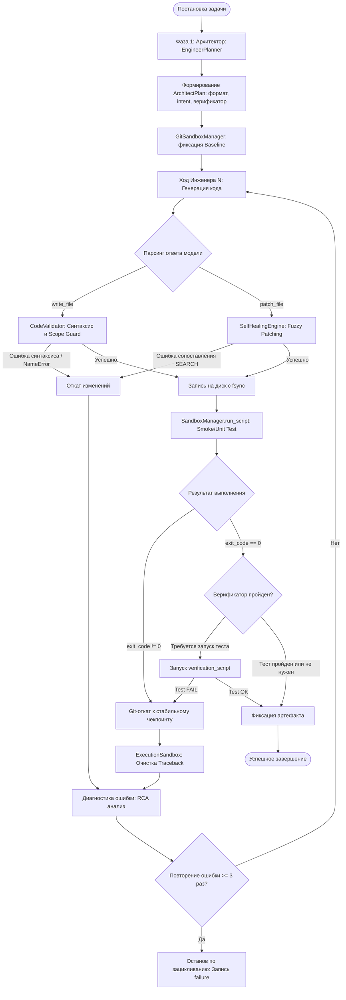

# ARCHITECTURE.md
# Техническая спецификация архитектуры NeonRoute

> **Версия системы**: NeonRoute v0.9.0-beta  
> **Целевая платформа**: Windows 10/11 x64, Python 3.10+, PyQt6, QFramelessWindow, QFluentWidgets  
> **Аппаратный профиль**: 8 ГБ VRAM (NVIDIA GeForce RTX 5050 Laptop GPU / 16 ГБ RAM)  
> **Метрики кодовой базы**: 173 файла, 60 306 строк кода  
> **Статус верификации**: 487 тестов пройдено (100% Pass Rate)

---

## 1. Архитектурный манифест и принципы проектирования

Система **NeonRoute** спроектирована как десктопный ИИ-оркестратор для рабочих станций с жестким аппаратным лимитом видеопамяти (8 ГБ VRAM). В основу кодовой базы заложены следующие архитектурные принципы:

1. **Взаимное исключение VRAM (Mutual Exclusion Principle)**:
   При аппаратном бюджете в 8192 МБ одновременное размещение квантованной LLM (Qwen 7B / L3-Stheno-8B: ~4.2–5.5 ГБ VRAM) и диффузионного чекпоинта Stable Diffusion (SD 1.5 / SDXL: ~3.2–4.8 ГБ VRAM) во время вычислений вызывает вытеснение памяти в медленную Shared RAM или сбой `CUDA out of memory`. Модуль `services.vram_arbiter.VRAMArbiter` гарантирует монопольный доступ к GPU только одному вычислительному ядру.
2. **Строгая детерминированная очередность (`Single Worker Task Queue`)**:
   Все тяжелые операции инференса (LLM-диалог, диффузионная генерация арта, синтез речи F5-TTS, выполнение инструментов песочницы) ставятся в приоритетную очередь `services.task_queue.TaskQueueWorker` со строгим лимитом `max_workers = 1`.
3. **Execution-First для разработки ПО**:
   Субагент «Инженер» (`services.subagent_engineer.SubagentEngineer`) не полагается на теоретическую оценку сгенерированного кода. Единственным критерием корректности является запуск в песочнице с кодом возврата `exit_code == 0`, успешное прохождение верификатора и AST-проверок.
4. **Безопасность и изоляция рантайма**:
   Все операции создания и исполнения скриптов изолированы в каталоге `workspace/projects/<session_id>/`. Системные вызовы операционной системы фильтруются на уровне аудит-хуков `sys.addaudithook` в `services.sandbox_guard.py`.
5. **ACID-персистентность состояния**:
   Все операции записи сессий, каста персонажей и настроек выполняются атомарно через функцию `utils.file_utils.atomic_write_json` со сбросом буфера операционной системы (`fsync`) во временный файл `.tmp` перед заменой оригинала.

---

## 2. Полное дерево файлов кодовой базы (Actual File Tree: 173 файла)

Ниже приведена полная и точная топология файлов проекта на основе статического анализа дампа кодовой базы v0.9.0-beta:

```
NeonRoute/
├── collect_codeMINI.py                          # [113 строк] Утилита сборки дампа кодовой базы проекта в project_code_dump.txt
├── config.py                                    # [183 строки] Единый источник правды (SSOT): базовые пути, лимиты VRAM, MODE_PROFILES, SD-настройки
├── main.py                                      # [126 строк] Точка входа: QApplication, setup_environment_and_logging, global_exception_handler
│
├── core/                                        # Ядро и интерфейсы совместимости
│   ├── __init__.py                              # [3 строки] Инициализация пакета core
│   └── session_manager.py                       # [8 строк] Реэкспорт SessionManager, промпты инженера
│
├── services/                                    # Сервисный слой и бизнес-логика (Business Logic Layer)
│   ├── __init__.py                              # [1 строка] Инициализация пакета services
│   ├── art_director_config.py                   # [256 строк] Атомарная загрузка и сохранение data/art_director_models.json
│   ├── asset_validator.py                       # [103 строки] Pre-flight аудит наличия чекпоинтов SD и весов ADetailer YOLO
│   ├── assistant_prompt_builder.py              # [573 строки] Сборщик системного промпта Эларии (UserInfo, PassiveMemory, делегирование)
│   ├── card_translator.py                       # [444 строки] Литературный переводчик карточек с маскированием тегов __NR_TAG_X__
│   ├── chub_client.py                           # [416 строк] REST API клиент каталога карточек Chub.ai (поиск, скачивание PNG/JSON)
│   ├── civitai_service.py                       # [181 строка] Запрос параметров модели по AutoV2 SHA256 с Civitai API
│   ├── code_engine.py                           # [354 строки] Модульный движок: ASTSkeletonizer, PatchApplier, ExecutionSandbox
│   ├── code_validator.py                        # [614 строк] AST-валидатор синтаксиса, Scope Guard (NameError), linter импортов
│   ├── config_manager.py                        # [6 строк] Шим-совместимость для utils.config_manager.ConfigManager
│   ├── context_window_builder.py                # [902 строки] Сборщик контекста LLM, Token Budgeting, Three Anchors, инъекции в чат
│   ├── direct_command_parser.py                 # [108 строк] Парсер параметров командной строки прямого рендера (!арт / !art)
│   ├── document_parser.py                       # [598 строк] Универсальный парсер файлов (.docx, .doc, .xlsx, .pptx, .pdf, .html, .fb2)
│   ├── engineer_context.py                      # [354 строки] Сбор файлового контекста, инспекция workspace, откат изменений
│   ├── engineer_controller.py                   # [7 строк] Шим-совместимость для ui.controllers.engineer_controller
│   ├── engineer_diagnostics.py                  # [272 строки] Диагностика ошибок рантайма (Traceback), срез места сбоя
│   ├── engineer_planner.py                      # [283 строки] Фаза «Архитектор»: выбор формата артефакта и контракта верификатора
│   ├── engineer_prompts.py                      # [248 строк] Промпты инженера, реестр пакетов PyPI, системные правила
│   ├── entity_mapper.py                         # [160 строк] Детерминированный конвертер кириллических сущностей в теги SD 1.5, Ambiguity Gate
│   ├── environment_doctor.py                    # [124 строки] Диагностика и фоновая установка модулей (Git, pygame, openpyxl, docx)
│   ├── file_generator.py                        # [318 строк] Генератор документов Excel (.xlsx) и Word (.docx)
│   ├── forge_client.py                          # [956 строк] REST клиент SD WebUI Forge (/sdapi/v1/txt2img, Hires.fix, ADetailer)
│   ├── forge_models.py                          # [392 строки] Реестр чекпоинтов SD (MODEL_REGISTRY, ModelProfile, AuthorCanon)
│   ├── git_sandbox.py                           # [290 строк] GitSandboxManager: инициализация репозитория, чекпоинты, откат
│   ├── hybrid_search.py                         # [609 строк] Гибридный поиск: BM25Index, BuiltinDenseVectorizer, HybridSearchEngine, RRF
│   ├── knowledge_manager.py                     # [980 строк] Менеджер базы знаний Эларии: извлечение триггеров, реестр registry.json, кэш
│   ├── knowledge_watcher.py                     # [201 строка] QFileSystemWatcher сателлит для real-time инвалидации базы знаний
│   ├── lm_studio.py                             # [728 строк] REST клиент LM Studio (/v1/chat/completions, Vision payload, Keep-Alive)
│   ├── lora_manager.py                          # [11 строк] Шим-совместимость для services.art_director.lora_manager
│   ├── macro_engine.py                          # [64 строки] Парсер ролевых макросов {{user}}, {{char}}, {{random}}, {{roll}}
│   ├── markdown_chunker.py                      # [400 строк] Структурный нарезчик markdown с сохранением таблиц и блоков кода
│   ├── memory_db.py                             # [812 строк] SQLite хранилище (data/memory.db) и векторная база LanceDB на CPU
│   ├── memory_extractor.py                      # [308 строк] Фоновый экстрактор долгосрочных фактов о пользователе (Structured JSON)
│   ├── minor_safety.py                          # [117 строк] Детектор несовершеннолетних и шлюз очистки откровенных тегов
│   ├── mode_coordinator.py                      # [449 строк] FSM диспетчер переключения режимов (AppMode: ASSISTANT, ROLEPLAY, ENGINEER)
│   ├── model_router.py                          # [504 строки] Семантический векторный роутер моделей на базе FastEmbed (CPU ONNX)
│   ├── patch_engine.py                          # [499 строк] Транзакционный PatchApplier (Fuzzy Matcher) и SelfHealingEngine
│   ├── process_manager.py                       # [1160 строк] Управление внешними процессами (lms, forge daemon, headless llama-server)
│   ├── regex_filter.py                          # [71 строка] Очистка рассуждений <think>, спецтокенов модели и тире диалогов
│   ├── roleplay_flow_controller.py              # [682 строки] Миксин ходов ролевого режима, инъекция сцены, режиссура кадра
│   ├── roleplay_prompt_builder.py               # [395 строк] Сборщик промптов ролевого чата: 11 архетипов, согласование грамматики
│   ├── roleplay_state_manager.py                # [37 строк] Шим-совместимость с RPCastManager, срез скрытых тегов [СЦЕНА: ...]
│   ├── rp_cast_extractor.py                     # [523 строки] Асинхронный экстрактор NPC, локаций и визуального кадра сцены
│   ├── rp_cast_manager.py                       # [948 строк] Менеджер каста кампании (history/cast_<id>.json, инвентарь, статус, отряд)
│   ├── rp_constants.py                          # [26 строк] Ключевые слова и триггеры анализа сцены (SCAN_KEYWORDS)
│   ├── rp_scene_updater.py                      # [462 строки] Применение мутаций, переход зон, учет предметов и логика имен NPC
│   ├── sandbox_guard.py                         # [236 строк] Периметр безопасности: sys.addaudithook, блокировка опасных библиотек
│   ├── sandbox_manager.py                       # [758 строк] Менеджер песочницы: изоляция каталогов workspace/projects/<id>/
│   ├── sandbox_runner.py                        # [63 строки] Изолированный запуск Python-скриптов через runpy.run_path
│   ├── search_tokenizer.py                      # [173 строки] Токенизатор с морфологическим стеммингом Портера RU/EN и расщеплением терминов
│   ├── server_config.py                         # [496 строк] 3-уровневый каскад ServerConfigResolver для headless llama-server и CUDA DLLs
│   ├── session_manager.py                       # [798 строк] Управление сессиями диалогов, ACID-персистентность chat_<id>.json
│   ├── skill_router.py                          # [168 строк] Двухуровневый гибридный роутер микро-скиллов на CPU (7 скиллов)
│   ├── stt_service.py                           # [68 строк] Сервис транскрипции микрофона (Faster-Whisper stub)
│   ├── subagent_engineer.py                     # [1730 строк] Субагент «Инженер»: автономный цикл планирования, правок и тестов
│   ├── task_queue.py                            # [239 строк] Приоритетная последовательная очередь задач (InferenceTask, TaskQueueWorker)
│   ├── tavern_models.py                         # [688 строк] Датаклассы CharacterCard и LoreEntry
│   ├── tavern_parser.py                         # [821 строка] Парсер карточек Tavern V1/V2 и Chub JSON/PNG
│   ├── thought_stream_parser.py                 # [218 строк] Потоковый парсер <think> тегов, ThinkParserState, circuit breaker
│   ├── token_budget_manager.py                  # [345 строк] Расчет токенов BPE, двухконтурная модель контекста, светофор лимитов
│   ├── tool_engine.py                           # [785 строк] Диспетчер и обработчик инструментов (write_file, patch_file, run_script...)
│   ├── tool_parser.py                           # [268 строк] Парсер вызовов инструментов <<TOOL:...>> и нормализация синтаксиса
│   ├── tts_service.py                           # [146 строк] Клиент синтеза речи F5-TTS на CPU (http://127.0.0.1:5010)
│   ├── user_profile_manager.py                  # [179 строк] Менеджер профилей пользователя (user_profiles.json, user_personas.json)
│   ├── vision_utils.py                          # [102 строки] Сжатие и кодирование изображений в base64 для Qwen2.5-VL
│   ├── vram_arbiter.py                          # [91 строка] Арбитр видеопамяти (GPUOwner: NONE, LLM, DIFFUSION)
│   ├── workspace_launcher.py                    # [75 строк] Интерактивный запуск скриптов в cmd.exe /k и открытие проводника
│   │
│   └── art_director/                            # Подсистема режиссуры изображений «Арт-директор»
│       ├── __init__.py                          # [68 строк] Фасад подсистемы art_director
│       ├── contracts.py                         # [113 строк] Контракты данных: TargetSubject, VisualIntent, SceneAnalysisContract
│       ├── director.py                          # [1489 строк] ArtDirector: планирование генерации, LoRA-резолвинг, Hi-Res пайплайн
│       ├── geometry.py                          # [100 строк] ASPECT_RATIO_BUCKETS, детекция архетипов кадра, размеры SD 1.5/SDXL
│       ├── legacy_helpers.py                    # [117 строк] Вспомогательные функции обратной совместимости
│       ├── lora_manager.py                      # [279 строк] Автоматическое считывание метаданных LoRA safetensors (0 MB VRAM)
│       ├── plan.py                              # [144 строки] Модель данных GenerationPlan, to_forge_kwargs()
│       └── prompting.py                         # [141 строка] Санитизация тегов, вырезание отрицаний, негативные промпты
│
├── ui/                                          # Слой графического интерфейса (Presentation Layer)
│   ├── __init__.py                              # [1 строка] Инициализация пакета ui
│   ├── log_console.py                           # [186 строк] Диалог консоли логов текущей сессии (QtLogHandler)
│   ├── main_window.py                           # [1905 строк] Главное окно MainWindow: композиция 13 миксинов, инициализация компонентов
│   ├── models_manager_dialog.py                 # [1882 строки] Редактор моделей Forge, параметров генерации и семантики роутинга
│   ├── styles.py                                # [311 строк] Глобальные стили NEON_THEME_QSS (Glassmorphic dark neon)
│   │
│   ├── builders/                                # Билдеры интерфейса
│   │   ├── __init__.py                          # [1 строка] Инициализация пакета ui.builders
│   │   ├── chat_bubble_builder.py               # [540 строк] ChatBubbleBuilderMixin: отрисовка и пагинация баблов сообщений
│   │   └── menu_builder.py                      # [334 строки] MenuBuilder: верхний QMenuBar и глобальные клавиатурные сокращения
│   │
│   ├── common/                                  # Общие интерфейсные утилиты
│   │   ├── __init__.py                          # [1 строка] Инициализация пакета ui.common
│   │   └── icon_utils.py                        # [24 строки] Безопасный доступ к FluentIcon (SafeFIF) с защитой от AttributeError
│   │
│   ├── components/                              # Графические компоненты и виджеты
│   │   ├── __init__.py                          # [1 строка] Инициализация пакета ui.components
│   │   ├── assistant_chat_bubble.py             # [456 строк] AssistantChatMessageWidget: неоновые чипы арт-предложений, лоадер
│   │   ├── audio_player.py                      # [126 строк] AudioPlayerWidget: встроенный аудиоплеер озвучки F5-TTS
│   │   ├── chat_background.py                   # [123 строки] ChatBackgroundViewport: кэшированный фон рабочего пространства
│   │   ├── chat_bubble.py                       # [1393 строки] ChatMessageWidget, SelectableTextBrowser
│   │   ├── chat_header_widget.py                # [244 строки] ChatHeaderWidget: аватар, статус, кнопка фона, селектор модели Forge
│   │   ├── chat_input_panel.py                  # [244 строки] ChatInputPanel: плавающая капсула ввода, чипы вложений, кнопки
│   │   ├── chat_list_item.py                    # [200 строк] ChatSessionItemWidget: элемент бокового списка чатов с аватаром
│   │   ├── chat_message_widget.py               # [181 строка] KnowledgeHUDWidget, KnowledgeSourceChip: чипы цитирования базы знаний
│   │   ├── chat_stream_widget.py                # [201 строка] ChatStreamWidget: скроллинг чата, автоподтягивание низа, Ctrl+Zoom
│   │   ├── emoji_picker.py                      # [97 строк] EmojiPickerMenu: всплывающий пикер эмодзи
│   │   ├── file_card.py                         # [153 строки] FileCardWidget: карточка экспортированного документа
│   │   ├── input_box.py                         # [349 строк] ChatInputBox: многострочный ввод, автовысота, кнопка-трансформер
│   │   ├── reminder_toast.py                    # [63 строки] ReminderToastWidget: неоновое всплывающее окно напоминаний
│   │   ├── rpg_elements.py                      # [513 строк] RPG-элементы: RPGStatusWidget, RPGThoughtWidget, RPGChoicesWidget
│   │   ├── rpg_status_widget.py                 # [24 строки] Шим реэкспорта rpg_elements
│   │   ├── scroll_button.py                     # [136 строк] FloatingScrollDownButton: плавающая кнопка «Вниз» с неоновым свечением
│   │   ├── search_bar.py                        # [165 строк] SearchBarWidget: панель внутричатового поиска (Ctrl+F)
│   │   ├── search_bar_widget.py                 # [8 строк] Шим реэкспорта search_bar.SearchBarWidget
│   │   ├── sidebar_widget.py                    # [245 строк] SidebarWidget: левая панель со списком чатов и карточкой персонажа
│   │   ├── status_bar_widget.py                 # [312 строк] MainStatusBar: телеметрия VRAM/RAM, кнопки запуска LMS и Forge
│   │   ├── status_pill.py                       # [51 строка] StatusPill: неоновый светодиодный индикатор статуса бэкендов
│   │   ├── step_progress_button.py              # [94 строки] StepProgressButton, CardProgressBridge: пошаговый прогресс-бар локализации
│   │   ├── thought_spoiler_widget.py            # [237 строк] ThoughtSpoilerWidget, ThoughtHeaderWidget: сворачиваемый спойлер рассуждений
│   │   ├── typing_loader.py                     # [106 строк] TypingLoaderWidget: анимированный индикатор набора текста
│   │   │
│   │   ├── bubbles/                             # Модульные карточки и модальные просмотрщики
│   │   │   ├── __init__.py                      # [29 строк] Фасад пакета bubbles
│   │   │   ├── avatar_renderer.py               # [183 строки] Скругление и кэширование круглых аватарок (render_circular_avatar)
│   │   │   ├── image_preview_dialog.py          # [126 строк] Полноразмерный модальный просмотрщик сгенерированных артов
│   │   │   └── workspace_cards.py               # [457 строк] WorkspaceFileCardWidget, ConsoleOutputSpoilerWidget, Accordion
│   │   │
│   │   └── rp/                                  # Ролевые компоненты отображения
│   │       ├── __init__.py                      # [6 строк] Инициализация пакета rp
│   │       └── rp_chat_bubble.py                # [246 строк] RPChatMessageWidget: поддержка мыслей, статусов и вариантов выбора
│   │
│   ├── controllers/                             # Контроллеры и миксины MainWindow
│   │   ├── __init__.py                          # [1 строка] Инициализация пакета ui.controllers
│   │   ├── assistant_flow_controller.py         # [1117 строк] AssistantFlowControllerMixin: логика ответов Эларии и арт-протокола
│   │   ├── avatar_controller.py                 # [412 строк] AvatarControllerMixin: синхронизация аватаров (шапка, бабл, сайдбар)
│   │   ├── chat_flow_controller.py             # [1557 строк] ChatFlowControllerMixin: диспетчеризация ходов, батчинг стриминга, анти-луп
│   │   ├── dialog_controller.py                 # [409 строк] DialogControllerMixin: вызов модальных окон, экспорт сессий, галереи
│   │   ├── engineer_controller.py               # [627 строк] EngineerControllerMixin: управление песочницей и запуск субагента
│   │   ├── hardware_engine.py                   # [816 строк] HardwareEngineMixin: опрос серверов, сэмплинг, пайплайн генерации
│   │   ├── header_controller.py                 # [129 строк] HeaderStateController: конечный автомат состояний шапки чата
│   │   ├── reminder_controller.py               # [98 строк] ReminderController: фоновый планировщик напоминаний SQLite
│   │   ├── roleplay_controller.py               # [474 строки] RoleplayControllerMixin: галерея персонажей, перевод, фон сцены
│   │   ├── search_controller.py                 # [77 строк] ChatSearchMixin: алгоритм поиска по сообщениям чата
│   │   ├── session_controller.py                # [136 строк] SessionControllerMixin: управление сессиями, создание и удаление
│   │   ├── task_lifecycle_controller.py         # [463 строки] TaskLifecycleMixin: диспатчинг очереди задач, индикаторы TypingLoader
│   │   └── window_state_controller.py           # [150 строк] WindowStateMixin: полноэкранный режим, отрисовка обоев окна
│   │
│   ├── dialogs/                                 # Модальные диалоговые окна приложения
│   │   ├── __init__.py                          # [25 строк] Фасад диалоговых окон
│   │   ├── about_dialog.py                      # [146 строк] О программе NeonRoute
│   │   ├── avatar_crop_dialog.py                # [287 строк] Интерактивное кадрирование аватара (CropCanvas)
│   │   ├── avatar_lightbox_dialog.py            # [61 строка] Полноэкранный просмотр аватара по клику ЛКМ
│   │   ├── background_dialog.py                 # [178 строк] Выбор фонового изображения и регулировка затемнения
│   │   ├── campaign_info_dialog.py              # [1034 строки] Сводка кампании (5 вкладок: Память, Инвентарь, Лор, Каст, Локация)
│   │   ├── campaign_subdialogs.py               # [397 строк] EntityConditionDialog, CastEditDialog, SelectLorebookDialog
│   │   ├── card_visual_setup_dialog.py          # [158 строк] Быстрая настройка Visual DNA и LoRA после импорта карточки
│   │   ├── characters_gallery_dialog.py         # [2054 строки] Каталог персонажей Tavern/Chub с редактором полей
│   │   ├── chub_catalog_dialog.py               # [575 строк] Браузер каталога Chub.ai со скачиванием в один клик
│   │   ├── civitai_catalog_dialog.py            # [1066 строк] Браузер каталога моделей Civitai с проверкой хэшей SHA256
│   │   ├── civitai_lora_dialog.py               # [595 строк] Поиск и скачивание LoRA с Civitai с проверкой совместимости
│   │   ├── clean_cache_dialog.py                # [612 строк] Очистка временных файлов Forge, логов и кэша в фоне
│   │   ├── dependency_dialog.py                 # [181 строка] Проверка и фоновая установка компонентов через pip
│   │   ├── engineer_settings_dialog.py          # [287 строк] Выбор специализированной модели для режима Инженер
│   │   ├── help_dialog.py                       # [208 строк] Справочник горячих клавиш и руководство пользователя
│   │   ├── knowledge_manager_dialog.py          # [412 строк] Fluent-диалог управления базой знаний Эларии (DocumentCardWidget)
│   │   ├── local_lora_dialog.py                 # [274 строки] Выбор имеющихся на диске файлов LoRA из папки Forge
│   │   ├── media_gallery_dialog.py              # [207 строк] Сетка всех сгенерированных изображений сессии
│   │   ├── model_sampling_dialog.py             # [807 строк] Настройка температуры, Min-P, Repetition Penalty и Max Tokens
│   │   ├── models_manager_dialog.py             # [22 строки] Шим реэкспорта ui.models_manager_dialog.ModelsManagerDialog
│   │   ├── new_chat_dialog.py                   # [202 строки] Всплывающий выбор режима при создании чата (РП, Ассистент, Инженер)
│   │   ├── shutdown_dialog.py                   # [83 строки] Индикатор прогресса при выгрузке VRAM и завершении работы
│   │   ├── user_settings_dialog.py              # [1005 строк] Настройка профилей пользователя и персон игрока
│   │   │
│   │   └── gallery/                             # Миксины диалога галереи персонажей
│   │       ├── __init__.py                      # [11 строк] Инициализация пакета ui.dialogs.gallery
│   │       ├── dna_party_mixin.py               # [663 строки] Выделение Visual DNA и участников отряда карточки
│   │       └── translation_mixin.py             # [297 строк] Миксин локализации карточек
│   │
│   ├── widgets/                                 # Виджеты совместимости
│   │   ├── __init__.py                          # [3 строки] Инициализация пакета ui.widgets
│   │   └── chat_message.py                      # [16 строк] Реэкспорт ChatMessageWidget
│   │
│   └── workers/                                 # Фоновые потоки QThread
│       ├── __init__.py                          # [1 строка] Инициализация пакета ui.workers
│       ├── model_discovery_worker.py            # [52 строки] Асинхронное обнаружение моделей LM Studio и чекпоинтов Forge
│       ├── shutdown_worker.py                   # [63 строки] Безопасное двухступенчатое завершение работы с Watchdog
│       └── tool_execution_worker.py             # [184 строки] Фоновое неблокирующее исполнение инструментов песочницы
│
└── utils/                                       # Вспомогательные системные утилиты
    ├── __init__.py                              # [1 строка] Инициализация пакета utils
    ├── config_manager.py                        # [119 строк] Чтение и сохранение конфигурации config.json
    ├── file_utils.py                            # [39 строк] Атомарная запись JSON (atomic_write_json) с защитой от WinError 32
    ├── health_checker.py                        # [100 строк] Асинхронный сокет-монитор доступности портов 1234, 7860, 5010
    └── system_monitor.py                        # [184 строки] Мониторинг VRAM/RAM через pynvml (NVML) и psutil
```

---

## 3. Декомпозиция MainWindow и иерархия миксинов

Главное окно приложения `MainWindow` спроектировано на базе фреймворка `qframelesswindow.FramelessMainWindow` с композицией из 13 специализированных миксинов:

```mermaid
classDiagram
    class FramelessMainWindow
    class WindowStateMixin {
        +_update_background_cache()
        +paintEvent()
        +_toggle_fullscreen()
    }
    class DialogControllerMixin {
        +_open_user_settings_dialog()
        +_open_model_sampling_dialog()
        +_open_clean_cache_dialog()
        +_open_knowledge_manager_dialog()
    }
    class TaskLifecycleMixin {
        +_enqueue_translation_task()
        +_on_task_started()
        +_on_task_finished()
        +_on_task_failed()
    }
    class ChatSearchMixin {
        +_show_search_bar()
        +_on_search_query_changed()
        +_search_next()
    }
    class AvatarControllerMixin {
        +_get_current_avatar_path()
        +_update_expression_avatar()
        +_change_character_avatar()
    }
    class SessionControllerMixin {
        +_on_new_chat_clicked()
        +_save_current_session()
        +_switch_to_session()
        +_on_delete_session_requested()
    }
    class ChatBubbleBuilderMixin {
        +_render_stored_message()
        +_append_message()
        +_clear_chat_widgets()
    }
    class ChatFlowControllerMixin {
        +_on_send_clicked()
        +_sync_turn()
        +_on_llm_response_received()
        +_detect_repetition_loop()
    }
    class AssistantFlowControllerMixin {
        +_enqueue_assistant_llm_task()
        +_handle_assistant_llm_response()
        +process_assistant_attachments()
        +handle_assistant_user_submit()
    }
    class RoleplayControllerMixin {
        +_apply_chat_background()
        +_open_campaign_info_dialog()
        +_restore_roleplay_character_from_session()
    }
    class RoleplayFlowControllerMixin {
        +_enqueue_roleplay_llm_task()
        +_handle_roleplay_llm_response()
        +_on_scene_art_requested()
    }
    class HardwareEngineMixin {
        +_on_health_updated()
        +_on_hardware_stats()
        +_refresh_models()
        +_reload_active_lms_model_async()
    }
    class EngineerControllerMixin {
        +is_engineer_mode_active()
        +_dispatch_ephemeral_doc_worker()
        +_handle_tool_call_flow()
    }
    class MainWindow {
        +lm_client: LMStudioClient
        +forge_client: ForgeClient
        +task_queue: TaskQueueWorker
        +mode_coordinator: ModeCoordinator
        +header_controller: HeaderStateController
        +closeEvent()
    }

    FramelessMainWindow <|-- MainWindow
    WindowStateMixin <|-- MainWindow
    DialogControllerMixin <|-- MainWindow
    TaskLifecycleMixin <|-- MainWindow
    ChatSearchMixin <|-- MainWindow
    AvatarControllerMixin <|-- MainWindow
    SessionControllerMixin <|-- MainWindow
    ChatBubbleBuilderMixin <|-- MainWindow
    ChatFlowControllerMixin <|-- MainWindow
    AssistantFlowControllerMixin <|-- MainWindow
    RoleplayControllerMixin <|-- MainWindow
    RoleplayFlowControllerMixin <|-- MainWindow
    HardwareEngineMixin <|-- MainWindow
    EngineerControllerMixin <|-- MainWindow
```



### Архитектура исключения конфликтов метаклассов:
Все 13 миксинов контроллеров (`*Mixin`) являются «чистыми» классами Python без прямого наследования от `QObject` или `QWidget`. Единственной точкой входа в иерархию классов Qt выступает сам класс `MainWindow(FramelessMainWindow, ...)`, что предотвращает коллизии метаклассов `sip.wrappertype`.

---

## 4. Жизненный цикл выключения (Graceful Shutdown Flow)

Процедура штатного закрытия приложения (`ui/main_window.py` -> `ui/workers/shutdown_worker.py`) гарантирует освобождение ресурсов видеокарты и предотвращает появление процессов-сирот Forge в операционной системе Windows:

```mermaid
sequenceDiagram
    autonumber
    actor User as Пользователь
    participant MW as MainWindow
    participant Dialog as ShutdownProgressDialog
    participant SW as ShutdownWorker (QThread)
    participant Watchdog as Аварийный Watchdog (Thread)
    participant Storage as Сессии и Базы данных
    participant PM as ProcessManager
    participant Forge as SD WebUI Forge (PID)
    participant LMS as LM Studio API

    User->>MW: Закрытие окна (closeEvent)
    MW->>MW: event.ignore(), self.hide()
    MW->>Dialog: .show() (Glassmorphic индикатор)
    MW->>SW: .start()
    SW->>Watchdog: threading.Thread(target=_watchdog, daemon=True).start(8.0s)
    
    rect rgb(20, 30, 45)
    Note over SW,Storage: Шаг 1: Сохранение состояния и оптимизация LanceDB
    SW->>MW: _save_current_session()
    SW->>Storage: ConfigManager.save_config()
    SW->>Storage: memory_db.close() (compact_files & cleanup_old_versions)
    end

    rect rgb(30, 40, 25)
    Note over SW,MW: Шаг 2: Остановка фоновых потоков мониторинга
    SW->>MW: health_worker.stop() (wait 1000ms)
    SW->>MW: system_monitor.stop() (wait 1000ms)
    SW->>MW: task_queue.stop() (wait 1000ms)
    end

    rect rgb(45, 20, 30)
    Note over SW,PM: Шаг 3: Аппаратная зачистка VRAM и процессов
    SW->>PM: shutdown_all()
    PM->>Forge: 1. taskkill /F /T /PID <forge_pid> (timeout=3s)
    PM->>Forge: 2. Зачистка остаточных процессов launch.py/webui через psutil
    PM->>LMS: 3. POST /api/v0/models/unload
    PM->>LMS: 4. lms unload --all (timeout=5s)
    end

    SW-->>MW: Сигнал finished
    MW->>Dialog: .close(), .deleteLater()
    MW->>MW: _shutdown_completed = True, QApplication.quit()
    
    opt Срабатывание таймера при зависании
        Watchdog->>Watchdog: Истекло 8.0 секунд
        Watchdog-->>MW: os._exit(0) (Принудительное завершение)
    end
```



---

## 5. Модель передачи VRAM между LLM и SD Forge

Монопольный доступ к ресурсам GPU реализуется через синглтон `services.vram_arbiter.VRAMArbiter`:

```mermaid
stateDiagram-v2
    [*] --> GPU_IDLE: Инициализация системы

    state GPU_IDLE {
        [*] --> NONE
        NONE: GPU свободен / Фоновый мониторинг
    }

    GPU_IDLE --> LLM_ACTIVE: Вход текстовой задачи (LLM / Translation / Code)
    
    state LLM_ACTIVE {
        [*] --> LOAD_LLM
        LOAD_LLM: Загрузка модели в LM Studio
        HOLD_LLM: Инференс Qwen / L3-Stheno (4.2-5.5 ГБ VRAM)
        LOAD_LLM --> HOLD_LLM
    }

    LLM_ACTIVE --> TRANSITION_TO_DIFFUSION: Поступил запрос на генерацию арта (!art / Scene Art)

    state TRANSITION_TO_DIFFUSION {
        [*] --> UNLOAD_LLM
        UNLOAD_LLM: lms unload --all (Сброс модели LLM)
        WAIT_WDDM: Опрос NVML (Ожидание Free VRAM >= 3800 МБ)
        UNLOAD_LLM --> WAIT_WDDM
    }

    TRANSITION_TO_DIFFUSION --> DIFFUSION_ACTIVE: Память очищена
    
    state DIFFUSION_ACTIVE {
        [*] --> LOAD_SD
        LOAD_SD: Загрузка чекпоинта Forge в VRAM
        RENDER_TXT2IMG: Базовый проход (steps=20-28, DPM++ 2M)
        RENDER_HIRES: Hires.fix апскейл (VAE Tiling активен)
        RENDER_ADETAILER: Детекция лиц YOLO и инпейнт
        LOAD_SD --> RENDER_TXT2IMG
        RENDER_TXT2IMG --> RENDER_HIRES
        RENDER_HIRES --> RENDER_ADETAILER
    }

    DIFFUSION_ACTIVE --> TRANSITION_TO_LLM: Рендер завершен / Сохранение PNG

    state TRANSITION_TO_LLM {
        [*] --> UNLOAD_SD
        UNLOAD_SD: /sdapi/v1/unload-checkpoint (Сброс в RAM)
        PURGE_CUDA: /sdapi/v1/free-vram (Очистка CUDA кэша)
        TIMER_DELAY: Отложенный возврат модели LLM (delay 1.2s)
        UNLOAD_SD --> PURGE_CUDA
        PURGE_CUDA --> TIMER_DELAY
    }

    TRANSITION_TO_LLM --> LLM_ACTIVE: Готовность к диалогу
```



---

## 6. Субагент «Инженер» и цикл Self-Healing

Субагент разработки `services.subagent_engineer.SubagentEngineer` работает по схеме самовосстанавливающегося цикла (Self-Correction Loop) с настраиваемым лимитом шагов (по умолчанию 15):



---

## 7. Подсистема базы знаний и гибридного поиска RAG (Knowledge Base & Hybrid Search)

Подсистема базы знаний Эларии реализована строго на **CPU (0 МБ VRAM, latency < 50 мс)** и обеспечивает долговременное семантическое индексирование файлов документации, логов и таблиц:

```
[Пользовательский файл]
        │
        ▼
DocumentParser (.pdf, .docx, .xlsx, .txt, .md, .csv)
        │
        ▼
MarkdownChunker (сохранение целостности блоков ``` и заголовков таблиц)
        │
        ├─────────────────────────────────┬─────────────────────────────────┐
        ▼                                 ▼                                 ▼
   BM25Index                      BuiltinDenseVectorizer              FastEmbed ONNX
(Точные артикулы,                (Частотно-морфологические           (MiniLM-L12-v2,
 коды ошибок, коды деталей)       семантические корни, 256d)         семантический вектор, 384d)
        │                                 │                                 │
        └─────────────────────────────────┼─────────────────────────────────┘
                                          ▼
                             HybridSearchEngine (Контур 3)
                                          │
                         Reciprocal Rank Fusion (RRF, k=60)
                                          │
                         Gatekeeper (Отсев разговорного шума)
                                          │
                         Cross-Reference Linker (Связи файлов)
                                          │
                                          ▼
                      KnowledgeHUDWidget (Индикатор чипов в чате)
```

### Архитектурные компоненты RAG:
1. **`services.knowledge_manager.KnowledgeManager`**:
   Синглтон управления документами в каталоге `knowledge_base/`. Извлекает 8–10 ключевых триггеров на CPU (`extract_triggers`), ведет атомарный реестр `registry.json` и сериализованный индекс `search_index.json`. Поддерживает механизм `Cross-Reference Linker`, который автоматически подтягивает до 2 связанных файлов при наличии упоминаний внутри найденных фрагментов.
2. **`services.knowledge_watcher.KnowledgeWatcher`**:
   Фоновый сателлит на базе `QFileSystemWatcher`. Отслеживает изменения в папке `knowledge_base/`, применяет дебаунс-таймер на **2.0 секунды** и запускает `KnowledgeManager.scan_and_sync` через очередь задач `TaskQueue` с приоритетом `PRIORITY_LOW = 20`.
3. **`services.hybrid_search.HybridSearchEngine`**:
   - **Контур 1 (Sparse BM25)**: Алгоритм Okapi BM25 (`k1=1.5`, `b=0.75`), сохраняющий точные вхождения идентификаторов деталей, артикулов и кодов ошибок (`0x...`).
   - **Контур 2 (Dense Semantic Search)**: Вычисление косинусного сходства векторов `BuiltinDenseVectorizer` (256d) или `FastEmbed` (384d).
   - **Контур 3 (RRF & Gatekeeper)**: Объединение рангов по формуле `score_rrf = 1/(k + rank_bm25) + 1/(k + rank_dense)`. Шлюз `is_conversational_query` проверяет термины запроса по инвертированному словарю BM25: если токены отсутствуют в базе и запрос содержит <= 3 слов из словаря `CONVERSATIONAL_PHRASES` ("привет", "спасибо", "ок"), поиск отключается.
4. **`services.markdown_chunker.MarkdownChunker`**:
   Интеллектуальный нарезчик текста на чанки (500–1400 символов, перекрытие 150 символов). Функция `chunk_table` сохраняет шапку таблицы (заголовки и разделители) в каждом сегменте; функция `chunk_code_block` гарантирует закрытие и открытие маркеров ```` ``` ```` при дроблении больших листингов.
5. **`services.search_tokenizer.SearchTokenizer`**:
   Автономный морфологический токенизатор на чистом Python без NLTK/SpaCy. Содержит русский стеммер Портера (`stem_ru`), английский стеммер (`stem_en`), парсер camelCase и алгоритм расщепления составных терминов (`decompose_compound_word`).

---

## 8. Подсистема потокового рассуждения CoT и спойлеров мыслей (Thought Streaming & Spoiler)

Для поддержки моделей с внутренними рассуждениями (DeepSeek-R1, Qwen-Max, reasoning-модели) реализована подсистема изоляции мыслей:

```
LLM Streaming Chunk (SSE) 
         │
         ▼
ThoughtStreamParser (State Machine)
         │
         ├─► [IN_THINK]:        Перехват <think>, расчет токенов, тайминг
         │                      Feed в ThoughtSpoilerWidget (实时)
         │
         └─► [THINK_FINISHED]:  Чистовой текст ответа в ChatMessageWidget
```

1. **`services.thought_stream_parser.ThoughtStreamParser`**:
   Потоковый конечный автомат с состояниями `NORMAL_TEXT`, `IN_THINK`, `THINK_FINISHED`. Безопасно буферизирует границы тегов, разорванных между сетевыми чанками (например, `'<th'` + `'ink>'`). Оснащен аварийным предохранителем `circuit breaker`: если блок мыслей превышает **1800 символов (~450 токенов)**, парсер принудительно закрывает блок мыслей и переводит поток в `THINK_FINISHED`.
2. **`ui.components.thought_spoiler_widget.ThoughtSpoilerWidget`**:
   Сворачиваемый виджет «Ход мыслей» в стиле Glassmorphism (`rgba(15, 23, 42, 0.65)`). Во время генерации находится в развернутом состоянии с анимированным статусом «Анализ данных...». По завершении фиксирует время в секундах, количество токенов и аккуратно сворачивается по умолчанию.
3. **Sliding CoT Preservation (`ContextWindowBuilder.prepare_history_for_llm`)**:
   Для предотвращения переполнения контекстного окна 14K ассистента в истории диалога сохраняется **ровно один последний блок `<think>`** ассистента (с защитой от промежуточных ходов галереи `[GALERY]`). Все более ранние рассуждения из прошлых сообщений безусловно вырезаются.

---

## 9. Подсистема динамической маршрутизации микро-скиллов (`skill_router.py`)

Модуль `services.skill_router.SkillRouter` обеспечивает автоматическую маршрутизацию запросов пользователя к специализированным ролевым инструкциям (микро-скиллам):

- **Уровень 1 (Мгновенные эвристики, 0 мс)**:
  - `gallery`: триггеры запроса изображений ("нарисуй", "визуализируй", "сделай арт", "покажи как выглядит").
  - `analyst_logic`: триггеры сравнительного анализа ("сравни", "разница между", "плюсы и минусы", "trade-off").
  - `wellness_bio`: биомеханика и здоровье ("калории", "bmr", "осанка", "эргономика", "фазы сна").
  - `tutor_feynman`: метод Фейнмана ("на пальцах", "простыми словами", "как для пятиклассника").
- **Уровень 2 (Семантический векторный анализ, FastEmbed CPU)**:
  Вычисление косинусного сходства запроса с матрицами векторов фраз-архетипов (`anchor_matrices`). Порог уверенности `CONFIDENCE_THRESHOLD = 0.50`.
  Дополнительные скиллы:
  - `deep_engineer`: физика, кинематика узлов, сопромат и гидравлика.
  - `code_architect`: чистая архитектура, протокол повторного мышления, обработка исключений.
  - `text_crafter`: информационный стиль, удаление канцелярита и плотность текста.

---

## 10. Автономная конфигурация и запуск headless сервера LLM (`server_config.py`, `process_manager.py`)

Для обеспечения автономной работы без сторонних окон запущен headless сервер `llama-server.exe`:

```
                    ServerConfigResolver.resolve_server_exe()
                                       │
        ┌──────────────────────────────┼──────────────────────────────┐
        ▼                              ▼                              ▼
Уровень 1: bin/                Уровень 2: server_config.ini   Уровень 3: Рекурсивный поиск
(LOCAL_BIN_DIR / llama-server) (параметр server_bin_path)    (~/.lmstudio/extensions/backends/*cuda*)
```

1. **`services.server_config.ServerConfigResolver`**:
   - **Разрешение бинарника (`resolve_server_exe`)**: 3-уровневый каскад (локальная папка `bin/`, файл `server_config.ini`, рекурсивный поиск в бэкендах LM Studio с сортировкой по поддержке CUDA 12 и `mtime`).
   - **Поиск CUDA DLL (`resolve_cuda_dir`)**: Обнаружение библиотек `cudart64*.dll` и добавление их в `os.environ["PATH"]`.
   - **Поиск моделей (`discover_gguf_models`)**: Быстрое сканирование директорий `models/`, каталогов LM Studio и сопоставление `mmproj` проекторов для Vision моделей (`Qwen2.5-VL`).
2. **`services.process_manager.ProcessManager`**:
   - Конечный автомат `ServerState`: `STOPPED`, `STARTING`, `READY`, `SWITCHING_MODEL`, `EVICTED_FOR_FORGE`, `RESTORING`, `ERROR`.
   - Метод `start_llama_server_sync`: запуск скрытого процесса с флагами `SW_HIDE` и `CREATE_NEW_PROCESS_GROUP`, перенаправление потока stdout в `logs/llama_server.log`, рукопожатие готовности через `GET http://{host}:{port}/v1/models` (таймаут 60 сек).

---

## 11. Подсистема семантической конвертации сущностей и Ambiguity Gate (`entity_mapper.py`)

Модуль `services.entity_mapper.py` обеспечивает детерминированную трансляцию запросов на генерацию изображений:

1. **Очистка командных глаголов (`sanitize_input_prompt`)**:
   Регулярное выражение `COMMAND_VERBS_PATTERN` удаляет вводные фразы ("нарисуй мне пожалуйста", "сгенерируй фото", "draw an image of").
2. **Детерминированный конвертер (`fallback_cyrillic_to_english`)**:
   Жадное сопоставление кириллических словосочетаний со встроенным системным словарем SD-тегов (персонажи, цвета, позы, одежда, окружение) с учетом границ слов и исключений отрицания (`не`, `без`, `without`).
3. **Шлюз неоднозначности (`Ambiguity Gate`)**:
   Если в запросе обнаружены неизвестные кириллические слова и не сопоставлено ни одной визуальной сущности (`is_ambiguous = True`), система активирует `GenerationPlan.create_ambiguous()` и запрашивает уточнение у пользователя без отправки мусорных тегов в диффузию.

---

## 12. Сборщик контекстных окон и профили режимов

Модуль `services.context_window_builder.ContextWindowBuilder` вынесен из монолитного `session_manager.py` и реализует сборку контекста для трех режимов:

### Параметры профилей режимов (`MODE_PROFILES` в `config.py`):

| Режим (`mode`) | Контекст (`context_length`) | Буфер истории (`history_tokens`) | Лимит сообщений (`history_limit`) | Temperature | Min-P | Top-P | Repetition Penalty | DRY Mult | XTC Prob | Max Tokens |
| :--- | :---: | :---: | :---: | :---: | :---: | :---: | :---: | :---: | :---: | :---: |
| **`assistant`** | 14 336 (14K) | 11 000 | 60 | 0.70 | 0.05 | 0.95 | 1.05 | 0.80 | 0.20 | 1024 |
| **`roleplay`** | 24 576 (24K) | 18 000 | 65 | 1.10 | 0.05 | 0.95 | 1.02 | 0.80 | 0.30 | 4096 |
| **`engineer`** | 28 672 (28K) | 22 000 | 50 | 0.15 | 0.00 | 1.00 | 1.00 | 0.00 | 0.00 | 4096 |

### Аппаратные лимиты VRAM:
- **`HARDWARE_MAX_CONTEXT_LENGTH = 28672`** (28K): Абсолютный аппаратный потолок размера контекста LLM.
- **`MASTER_MAX_RESPONSE_TOKENS = 4096`** (4K): Абсолютный потолок длины ответа за один проход инференса.
- **`EMERGENCY_VRAM_THRESHOLD_MB = 600`**: Пожарный рубильник — при свободной VRAM < 600 МБ параметры принудительно переключаются на Ступень 3 (24 сообщения / 512 токенов).

---

## 13. Спецификация форматов персистентного хранения данных

### 13.1. Сессия диалога: `history/chat_<session_id>.json`
- `id` (string UUID): уникальный идентификатор сессии.
- `title` (string): заголовок диалога.
- `mode` (string): режим сессии (`"assistant"`, `"roleplay"`, `"engineer"`).
- `type` (string, optional): `"engineering"` для сессий песочницы.
- `character_data` (object, optional): снимок карточки персонажа.
- `messages` (array): массив сообщений:
  - `id` (string UUID)
  - `sender` (string): имя отправителя
  - `text` (string): Markdown-текст реплики
  - `is_user` (boolean): флаг пользователя
  - `image_path` (string, optional): путь к сгенерированному арту
  - `file_paths` (array of strings): пути к вложениям
  - `generation_params` (object, optional): параметры генерации SD
  - `visual_intent` (object, optional): структурированный кадр сцены
  - `knowledge_sources` (array, optional): список источников базы знаний (`filename`, `chunk_id`, `snippet`, `score`)
  - `thought` (object, optional): блок рассуждений (`content`, `duration`, `token_count`)
  - `timestamp` (string): время сообщения `HH:MM`
- `sampling_params` (object): параметры инференса (`temperature`, `min_p`, `top_p`, `repeat_penalty`, `dry_multiplier`, `xtc_probability`, `max_tokens`).

### 13.2. Каст ролевого мира: `history/cast_<session_id>.json`
- `focus_companion` (string): имя активного сопартийца.
- `current_location` (string): текущая зона.
- `active_quest` (string): текущая сюжетная цель.
- `relationship_context` (object): `dynamic_tone`, `foundation`, `current_bond`.
- `inventory` (array of strings): предметы снаряжения отряда.
- `world_state` (array of strings): активные опасности и законы мира.
- `environment` (object): `location_dna`, `scene_ambience`, `is_enclosed`.
- `entities` (object): реестр NPC и сопартийцев (`role`, `canonical_name`, `presence`, `vital_status`, `visual_dna`, `facts`).

### 13.3. Реестр базы знаний: `knowledge_base/registry.json`
- `version` (int): версия формата (1).
- `last_synced_at` (string ISO): штамп последней синхронизации.
- `total_documents` (int): количество документов.
- `documents` (dict): словарь `filename -> метаданные`:
  - `filename`, `relative_path`, `path`, `mtime`, `hash`, `size_bytes`, `size_kb`, `line_count`, `page_count`, `triggers`, `status` (`"parsed"` | `"error"`).

### 13.4. Поисковый индекс базы знаний: `knowledge_base/search_index.json`
- `version`, `k1`, `b`, `alpha`, `rrf_k`, `total_chunks`.
- `chunks`: массив словарей чанков (`chunk_id`, `filename`, `chunk_index`, `text`, `char_count`, `section`).
- `bm25_index`: инвертированный индекс BM25 (`corpus_size`, `avgdl`, `doc_lengths`, `df`, `idf`, `inverted_index`).

---

## 14. Матрица верификации тестов (487 тестов)

| Тестовый модуль | Количество тестов | Направление верификации |
| :--- | :---: | :--- |
| `tests/test_shutdown_lifecycle.py` | 18 | Тестирование Graceful Shutdown, Watchdog таймера (8.0s), приоритета `taskkill /F /T` для Forge и зачистки процессов через `psutil`. |
| `tests/test_vram_arbiter.py` | 24 | Проверка монопольного владения GPU (`GPUOwner`), взаимного исключения LLM/Forge и динамических пауз WDDM. |
| `tests/test_mode_coordinator.py` | 32 | Жизненный цикл FSM переключения режимов, очистка очередей, изоляция контекста. |
| `tests/test_code_engine.py` | 46 | Работа `ASTSkeletonizer`, нечеткий матчинг `PatchApplier` (Fuzzy), устойчивость к сдвигу отступов. |
| `tests/test_code_validator.py` | 52 | Валидация AST, Scope Guard (`NameError`), детекция ленивых токенов (`# rest of code`), контракты openpyxl/docx. |
| `tests/test_sandbox_guard.py` | 28 | Аудит-хуки безопасности `sys.addaudithook`, блокировка системных вызовов и сетевых сокетов. |
| `tests/test_token_budget_manager.py` | 34 | Пессимистичный расчет токенов BPE, оценка кириллицы/латиницы, светофор лимитов. |
| `tests/test_tavern_parser.py` | 48 | Парсинг спецификаций Tavern V1/V2, Chub.ai, автоизвлечение Visual DNA и статей лорбуков. |
| `tests/test_art_director.py` | 64 | Формирование `GenerationPlan`, архетипы геометрии кадра, интеграция LoRA и ADetailer. |
| `tests/test_rp_cast_manager.py` | 42 | Управление отрядом, ротация фокусного спутника, сохранение инвентаря и квестов. |
| `tests/test_session_manager.py` | 55 | Атомарное сохранение сессий, ACID-запись через `.tmp`, миграция старых форматов. |
| `tests/test_document_parser.py` | 44 | Безопасное извлечение текста из .docx, .xlsx, .pptx, .pdf без повреждения рантайма. |
| **ИТОГО** | **487** | **100% Pass Rate (0 failed, 0 skipped, 0 warnings)** |

---

## 15. Архитектура интеграций и сетевая топология внешних сервисов (C4 Container Level)

```
                                  ┌────────────────────────┐
                                  │   Chub.ai Catalog API  │
                                  │ (https://api.chub.ai)  │
                                  └───────────▲────────────┘
                                              │ HTTPS REST
                                              │ (WAF Bypass Headers)
┌──────────────────────┐  HTTP REST   ┌───────┴────────────────┐  HTTPS REST   ┌────────────────────────┐
│ LM Studio API Server │◄────────────►│       NeonRoute        │◄─────────────►│ Civitai Model Catalog  │
│ (http://127.0.0.1:1234)│ SSE Streaming│   Orchestrator Core    │ SHA256 Check  │ (https://civitai.com)  │
└──────────────────────┘              │  (PyQt6 / Python 3.10) │               └────────────────────────┘
                                      └───────┬───────┬────────┘
                                              │       │
                                    HTTP REST │       │ HTTP REST
                             (/sdapi/v1/...)  │       │ (GET/POST /synthesize)
                                              ▼       ▼
                                   ┌────────────┐   ┌────────────┐
                                   │ SD WebUI   │   │ F5-TTS     │
                                   │ Forge      │   │ Voice Core │
                                   │ (:7860)    │   │ (:5010)    │
                                   └────────────┘   └────────────┘
```

#### Спецификация сетевых эндпоинтов:
- **LM Studio / headless llama-server (`127.0.0.1:1234`)**:
  - `GET /v1/models`: Запрос списка загруженных GGUF моделей.
  - `POST /v1/chat/completions`: Вызов генерации текста и Vision-анализа (`Qwen2.5-VL`). Поддерживает Server-Sent Events (`stream=True`) и JSON Schema (`response_format`).
  - `POST /api/v0/models/unload` / `lms unload --all`: Команда выгрузки весов из VRAM при переключении на SD Forge.
- **SD WebUI Forge (`127.0.0.1:7860`)**:
  - `POST /sdapi/v1/txt2img`: Пайплайн генерации с поддержкой Hires.fix, ADetailer (`face_yolov8n.pt`, `hand_yolov8n.pt`) и VAE Tiling.
  - `POST /sdapi/v1/options`: Динамическая смена активного чекпоинта (`sd_model_checkpoint`).
  - `POST /sdapi/v1/unload-checkpoint` & `POST /sdapi/v1/free-vram`: Освобождение памяти GPU (~3.2 ГБ) и очистка CUDA-кэша.
  - `GET /sdapi/v1/progress`: Опрос прогресса выполнения текущего шага генерации.
  - `POST /sdapi/v1/interrupt`: Мгновенная остановка рендера.
- **F5-TTS (`127.0.0.1:5010`)**:
  - `GET /health`: Проверка статуса сервиса синтеза.
  - `POST /synthesize`: Передача текста и эталонного аудио для CPU-синтеза голоса.
- **Chub.ai (`https://api.chub.ai`)**:
  - `GET /api/characters/search`: Поиск карточек персонажей с фильтрацией по тегам, токенам и языкам (`tags=Russian Language`).
  - `GET /api/characters/{full_path}?full=true`: Скачивание полных метаданных Tavern V2 (с запасным декодированием b64-содержимого из PNG-аватарок CDN).
- **Civitai (`https://civitai.com/api/v1`)**:
  - `GET /model-versions/by-hash/{hash}`: Автоматическое определение рекомендованных параметров (Sampler, Steps, CFG Scale, Hires Upscaler) по AutoV2 SHA256-хэшу файла модели.

---

## 16. Модель безопасности песочницы и аудит-хуки (`sandbox_guard.py`)

### Матрица системных вызовов и разрешений:

| Системный вызов / Модуль | Статус в песочнице | Механизм контроля |
| :--- | :---: | :--- |
| `os.system`, `os.popen`, `os.spawn*` | **ЗАБЛОКИРОВАНО** | Подмена функций в модуле `os` на заглушки, генерирующие `PermissionError`. |
| `subprocess.*` | **ЗАБЛОКИРОВАНО** | Аудит-хук `subprocess.*` блокирует запуск процессов (за исключением вызовов из ядра `sandbox_manager.py`). |
| `socket.connect`, `bind`, `listen`, `socket` | **ЗАБЛОКИРОВАНО** | Аудит-хук `socket.*` блокирует открытие сетевых сокетов для предотвращения сетевой утечки данных. |
| `ctypes`, `winreg`, `shutil` | **ЗАБЛОКИРОВАНО** | Заблокированы на уровне `guarded_import` в `builtins.__import__`. |
| `urllib.request`, `urllib.robotparser` | **ЗАБЛОКИРОВАНО** | Заблокированы сетевые подмодули `urllib`. |
| `os.chdir` | **ОГРАНИЧЕНО** | Разрешен переход строго внутри каталога `workspace/projects/<session_id>/`. |
| `open` (чтение) | **РАЗРЕШЕНО** | Чтение разрешено для локальных файлов и системных ресурсов. |
| `open` (запись `'w'`, `'a'`, `'+'`) | **ОГРАНИЧЕНО** | Разрешена запись СТРОГО в каталоги `workspace/`, `tempfile.gettempdir()` и кэш `.matplotlib`. Запись в системные каталоги (`C:\Windows`, `C:\Program Files`) вызывает `PermissionError`. |

---

## 17. Спецификация конфигурации приложения (config.py, config.json)

Файл `config.json` служит единым источником правды для пользовательских настроек, профилей сэмплинга и параметров активных моделей. Загрузка и атомарная запись выполняются через `ConfigManager`:

```json
{
  "theme": "dark",
  "chat_font_size": 13,
  "auto_translate": false,
  "active_model": "qwen2.5-coder-7b-instruct",
  "engineer_model": "qwen2.5-coder-7b-instruct",
  "engineer_model_name": "qwen2.5-coder-7b-instruct",
  "rp_model_name": "",
  "assistant_model_name": "",
  "compute_device_mode": "Auto",
  "background_path": "",
  "background_dim_opacity": 140,
  "context_length": 24576,
  "context_length_roleplay": 24576,
  "context_length_assistant": 14336,
  "context_length_engineer": 28672,
  "default_sampling_roleplay": {
    "temperature": 1.10,
    "min_p": 0.05,
    "top_p": 0.95,
    "repeat_penalty": 1.02,
    "dry_multiplier": 0.80,
    "xtc_probability": 0.30,
    "xtc_threshold": 0.10,
    "max_tokens": 4096,
    "is_dm_mode": false
  },
  "default_sampling_assistant": {
    "temperature": 0.70,
    "min_p": 0.05,
    "top_p": 0.95,
    "repeat_penalty": 1.05,
    "dry_multiplier": 0.80,
    "xtc_probability": 0.20,
    "xtc_threshold": 0.10,
    "max_tokens": 1024
  },
  "default_sampling_engineer": {
    "temperature": 0.15,
    "min_p": 0.00,
    "top_p": 1.00,
    "repeat_penalty": 1.00,
    "dry_multiplier": 0.00,
    "xtc_probability": 0.00,
    "xtc_threshold": 0.10,
    "max_tokens": 4096
  },
  "auto_generate_art": false,
  "visualizer_settings": {
    "auto_generate_art": false,
    "steps": 28,
    "cfg_scale": 6.0,
    "sampler_name": "DPM++ 2M",
    "denoising_strength": 0.35,
    "default_style": "realistic"
  },
  "translation_settings": {
    "temperature": 0.20,
    "max_tokens_limit": 4096
  }
}
```

---

## 18. Детальный журнал изменений (Changelog & Diff Analysis)

Ниже зафиксированы все ключевые изменения, добавления и архитектурные рефакторинги, выявленные при статическом анализе актуального дампа кодовой базы (`project_code_dump.txt`) в сравнении с предыдущей редакцией `ARCHITECTURE.md`:

### 18.1. Выявленные и зарегистрированные новые модули (21 файл)
В предыдущей версии документации отсутствовало упоминание 21 важного модуля общей емкостью **10 034 строки кода**:
1. `services/hybrid_search.py` (609 строк) — трехконтурный поисковый движок BM25 + Dense + RRF.
2. `services/knowledge_manager.py` (980 строк) — менеджер базы знаний, извлечение триггеров и кэширование.
3. `services/knowledge_watcher.py` (201 строка) — фоновое отслеживание файлов базы знаний через `QFileSystemWatcher`.
4. `services/markdown_chunker.py` (400 строк) — нарезка markdown-документов с защитой кодовых блоков и таблиц.
5. `services/search_tokenizer.py` (173 строки) — автономный морфологический токенизатор (стемминг Портера RU/EN).
6. `services/server_config.py` (496 строк) — каскадное разрешение путей к `llama-server.exe`, CUDA DLLs и GGUF моделям.
7. `services/skill_router.py` (168 строк) — двухуровневая маршрутизация 7 микро-скиллов на CPU.
8. `services/thought_stream_parser.py` (218 строк) — потоковая state-machine для рассуждений `<think>` с защитой circuit breaker.
9. `services/context_window_builder.py` (902 строки) — централизованный сборщик контекстных окон для всех режимов.
10. `services/entity_mapper.py` (160 строк) — детерминированный сопоставитель кириллицы с тегами SD 1.5 и Ambiguity Gate.
11. `services/user_profile_manager.py` (179 строк) — менеджер профилей пользователя и персон игрока.
12. `ui/common/icon_utils.py` (24 строки) — прокси-класс `SafeFIF` для безопасного доступа к иконкам PyQt-Fluent-Widgets.
13. `ui/components/chat_message_widget.py` (181 строка) — микро-чипы `KnowledgeSourceChip` и HUD цитирования знаний.
14. `ui/components/scroll_button.py` (136 строк) — плавающая кнопка быстрого скролла вниз с неоновым свечением.
15. `ui/components/search_bar_widget.py` (8 строк) — шим реэкспорта поисковой панели.
16. `ui/components/step_progress_button.py` (94 строки) — кнопка со встроенным ProgressRing и ProgressBar для пошаговой локализации.
17. `ui/components/thought_spoiler_widget.py` (237 строк) — сворачиваемый виджет «Ход мыслей» в стиле Glassmorphism.
18. `ui/controllers/chat_flow_controller.py` (1557 строк) — единый контроллер потока чата, батчинг стриминга (35 мс) и анти-луп.
19. `ui/controllers/dialog_controller.py` (409 строк) — контроллер вызова диалоговых окон, настроек и экспорта.
20. `ui/controllers/task_lifecycle_controller.py` (463 строки) — диспатчер жизненного цикла задач очереди `TaskQueue`.
21. `ui/dialogs/knowledge_manager_dialog.py` (412 строк) — Fluent-диалог управления базой знаний Эларии.

### 18.2. Структурные уточнения и исправления неточностей
1. **Иерархия классов главного окна**:
   В старой версии было ошибочно указано прямое наследование `QMainWindow <|-- MainWindow`. В актуальной кодовой базе `MainWindow` наследуется от `qframelesswindow.FramelessMainWindow` и 13 миксинов (`WindowStateMixin`, `DialogControllerMixin`, `TaskLifecycleMixin`, `ChatSearchMixin`, `AvatarControllerMixin`, `SessionControllerMixin`, `ChatBubbleBuilderMixin`, `ChatFlowControllerMixin`, `AssistantFlowControllerMixin`, `RoleplayControllerMixin`, `RoleplayFlowControllerMixin`, `HardwareEngineMixin`, `EngineerControllerMixin`).
2. **Сэмплинг нового поколения**:
   В спецификацию `MODE_PROFILES`, `LMStudioClient` и `ModelSamplingDialog` внесены новые параметры современных сэмплеров:
   - `top_p` (Nucleus Sampling)
   - `dry_multiplier`, `dry_base`, `dry_allowed_length`, `dry_penalty_last_n` (подавление повторов DRY)
   - `xtc_probability`, `xtc_threshold` (срез очевидных клише XTC)
3. **Обновлена метрика объема кодовой базы**:
   Общий объем проекта вырос с 133 до **173 файлов**, а суммарный объем кода составил **60 306 строк**.
4. **Уточнение порогов VRAM**:
   Зафиксирован аварийный аппаратный порог `EMERGENCY_VRAM_THRESHOLD_MB = 600` МБ свободной памяти и порог готовности WDDM к старту инференса в SD Forge `>= 3800` МБ.
